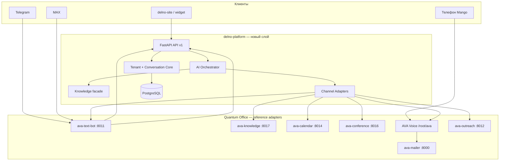

# DELNO — архитектура прототипа (2026-09-01)

Связанные документы: `00_MASTER_SPEC.md`, `14_CURRENT_STATE.md`.

## 1. Цель прототипа

**Полноценно работающий** демо-продукт для первых клиентов и инвесторов, не «макет на слайдах».

Критерий «работает»:
- посетитель сайта понимает продукт за 5–10 сек;
- может **написать / поговорить / оставить заявку**;
- DELNO отвечает по **реальной базе знаний** компании;
- может **записать** (календарь) или **передать человеку**;
- команда видит обращения в **одном месте**;
- один «демо-tenant» (Quantum Labs / DELNO), без полноценного multi-tenant billing.

Не входит в прототип: marketplace, CRM Lite, банки, Supervisor, billing meters, k8s.

---

## 2. Что уже есть (as-is)

### 2.1. Слой маркетинга

| Компонент | Статус | Где |
|-----------|--------|-----|
| Лендинг v2/v4 | ✅ prod | https://a.47z.ru/delno/ → `/opt/delno-site` |
| Голосовое демо (TTS) | ✅ | `app/api/tts` — OpenAI TTS, не realtime |
| Lead form + API | ⚠️ | `app/api/leads` — нужен TELEGRAM_CHAT_ID / webhook |
| VoiceDemo (сценарии) | ✅ | Статический контент + TTS |

### 2.2. Quantum Office / AVA (prod `5.35.86.62`)

> **Важно:** на проде код **новее**, чем в git `quantum-office`. MAX, brain-KB и channel-agnostic secretary уже работают на сервере.

| Сервис | Порт | Что делает |
|--------|------|------------|
| **AVA Voice** | 8088/8090/15000 | Asterisk + OpenAI Realtime, Mango SIP, in-call tools |
| **ava-mailer** | 8000 | Post-call, legacy calendar/knowledge endpoints |
| **ava-text-bot** | 8011 | Telegram, **MAX webhook**, VK, WhatsApp, `/api/chat` |
| **ava-outreach** | 8012 | Bitrix CRM, cold email, telephony lead ingest |
| **ava-calendar** | 8014 | CalDAV Mail.ru, слоты, create event |
| **ava-files** | 8015 | Файлы → email/Telegram |
| **ava-conference** | 8016 | Yandex Telemost + invites |
| **ava-knowledge** | 8017 | Brain KB: search, ingest, topics, graph |
| **ava-sheets-campaign** | 8018 | Исходящие звонки из Google Sheet (campaign) |
| **quantum-console** | 8013 | Control console (transcripts) |
| **delno-site** | 8019 | Next.js лендинг |

### 2.3. Каналы — реальность vs маркетинг

| Канал | Реализовано | Примечание |
|-------|-------------|------------|
| **Телефон inbound** | ✅ prod | `/root/ava` + Mango |
| **Телефон outbound** | ⚠️ | sheets-campaign, не productized |
| **Telegram** | ✅ prod | polling + business mode |
| **MAX** | ✅ prod | `POST /webhooks/max` в ava-text-bot |
| **WhatsApp / VK** | ⚠️ prod | webhook stubs, не основной фокус |
| **Email диалог** | ❌ | только transactional + outreach |
| **Web-chat widget** | ❌ | только demo на лендинге |
| **Bitrix CRM** | ✅ | single portal Quantum Labs |

### 2.4. AI / Knowledge

| Возможность | Статус |
|-------------|--------|
| OpenAI chat + tools (Telegram) | ✅ |
| OpenAI Realtime (voice) | ✅ prod |
| Keyword KB (markdown) | ✅ legacy в mailer |
| Brain KB (topics, ingest, search) | ✅ ava-knowledge :8017 |
| Vector / pgvector | ❌ |
| Per-tenant KB | ❌ один tenant |

### 2.5. Booking

| Шаг | Статус |
|-----|--------|
| check slot | ✅ ava-calendar |
| create event + Telemost | ✅ ava-conference chain |
| welcome email + PDF | ✅ ava-mailer / files |
| Единый booking из web-chat | ❌ |

---

## 3. Чего нет (gap → полноценный продукт)

| Блок Master Spec | Статус |
|------------------|--------|
| **delno-platform** repo | ❌ не создан |
| **Multi-tenant** (tenant_id, RLS) | ❌ |
| **Auth / RBAC** (кабинет клиента) | ❌ один shared token |
| **Unified Conversation/Message** | ❌ SQLite/logs по сервисам |
| **Communication Core API** | ❌ логика размазана |
| **Tenant AI Operator** | ❌ |
| **Billing / Usage** | ❌ |
| **Web widget** (embed на сайт клиента) | ❌ |
| **Self-service onboarding** | ❌ |
| **Lead → auto follow-up** | ❌ |
| **Site ↔ backend** (realtime chat) | ❌ |

---

## 4. Целевая архитектура прототипа

Принцип: **Modular Monolith `delno-platform`** + **адаптеры** к существующим ava-* сервисам. Не переписывать Asterisk/voice с нуля.



### 4.1. Модули `delno-platform` (MVP)

| Модуль | Ответственность | MVP scope |
|--------|-----------------|-----------|
| **tenant** | tenant, user, settings | 1 demo tenant + admin user |
| **auth** | JWT/session, API keys | email+password или magic link |
| **conversations** | Conversation, Message, Contact | единый inbox |
| **channels** | ChannelAccount, adapter registry | telegram, max, web, phone |
| **knowledge** | KB documents, search proxy | proxy → ava-knowledge + upload |
| **ai** | prompt, tools, agent loop | reuse secretary pattern |
| **leads** | Lead, form ingest | site form + CRM webhook |
| **booking** | Booking facade | proxy → calendar+conference |
| **integrations** | encrypted credentials | telegram token, mango ref |

### 4.2. Правила изоляции (даже для 1 tenant)

- Все таблицы с `tenant_id NOT NULL`.
- LLM tools **без** параметра `tenant_id` — только из request context.
- Адаптеры получают `tenant_id` из middleware, подставляют credentials tenant'а.

---

## 5. План: от as-is к работающему прототипу

### Этап 0 — «Сайт продаёт» (1–3 дня)

Уже частично сделано.

- [ ] v4 по умолчанию на `/delno`
- [ ] Lead form → Telegram / webhook
- [ ] Voice demo → ava-knowledge search (не статический текст)
- [ ] dlno.ru DNS (когда staging ок)

### Этап 1 — «Склеить провода» (≈1 неделя)

Без нового monolith — минимальные интеграции:

1. **Lead pipeline:** `delno-site/api/leads` → ava-text-bot owner-alert или outreach telephony/lead
2. **Единый KB для demo:** site demo + Telegram + voice → `ava-knowledge /api/brain/search`
3. **Конфиг demo-tenant:** один YAML/JSON с company profile, channels, KB path

Результат: сайт, Telegram, MAX, телефон отвечают **одной базой знаний**.

### Этап 2 — `delno-platform` shell (≈2–3 недели)

1. Repo `delno-platform`: FastAPI + PostgreSQL + Alembic
2. Таблицы: `tenants`, `users`, `conversations`, `messages`, `contacts`, `leads`, `channel_accounts`
3. `POST /v1/web/chat` — web widget backend
4. `GET /v1/conversations` — простой inbox (React или extend quantum-console)
5. Adapters: `TextBotAdapter`, `KnowledgeAdapter`, `CalendarAdapter`

Результат: **единый inbox** + web-chat API.

### Этап 3 — «Продукт для первого клиента» (≈2–4 недели)

1. Embeddable widget (`<script data-tenant=...>`)
2. KB upload / import URL → ava-knowledge ingest
3. Branded Telegram: сохранить token per tenant
4. Простой onboarding wizard (5 шагов из Master Spec §25)
5. Mango/SIP: manual provisioning per tenant (не self-service)

Результат: можно подключить **вторую компанию** без форка кода.

---

## 6. Что переиспользовать vs переписать

| Переиспользовать (adapter) | Переписать (delno-platform) |
|----------------------------|-----------------------------|
| ava-text-bot `/api/chat`, webhooks | tenant-scoped auth |
| ava-knowledge brain | Conversation model |
| ava-calendar + conference | Lead/onboarding UX |
| AVA voice stack | Billing, usage |
| outreach telephony ingest | Multi-tenant CRM |
| mailer post-call pipeline | Marketplace |

**Не трогать:** `/root/ava`, Asterisk, `/opt/polyhub`, Polyhub UI.

---

## 7. Минимальный data model (прототип)

```
Tenant
  └── User (owner, admin)
  └── ChannelAccount (telegram|max|web|phone)
  └── KnowledgeBase → documents
  └── Contact
        └── Conversation (channel, status)
              └── Message (role, text, metadata)
  └── Lead (source, name, phone, status)
  └── Booking (optional, links to calendar event id)
```

---

## 8. Риски и честные ограничения прототипа

1. **Prod ≠ git** — перед разработкой синхронизировать ava-* с репозиторием или вынести в delno-platform.
2. **MAX/Telegram** на prod привязаны к Quantum Labs tokens — для DELNO нужны отдельные боты (`Dlno_bot`).
3. **Voice realtime** на сайте ≠ TTS demo — для parity нужен WebRTC/WebSocket → OpenAI Realtime (отдельная задача).
4. **Multi-tenant telephony** — Mango/SIP вручную на первых 5–10 клиентах.
5. Master Spec завышает готовность MAX/autodial в git — опираться на **prod audit**, не на §6 spec буквально.

---

## 9. Рекомендуемый следующий шаг

**Этап 1 + решение по repo:**

1. Создать `delno-platform` (отдельный git repo).
2. Скопировать `docs/` из DELNO-site-v23.
3. Реализовать `LeadService` + `KnowledgeService` как thin proxies к prod ava-*.
4. Подключить site `/api/leads` и VoiceDemo к ava-knowledge.

Это даёт **работающий сквозной прототип** без Big Bang rewrite.
