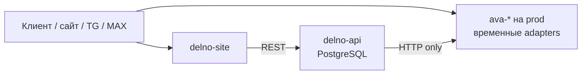

# DELNO — стратегия быстрого запуска (2026-09-01)

Принцип: **запуститься за дни, не переписывая prod**. Заложить границы, чтобы через 1–3 месяца вынести в отдельные repo без перелома архитектуры.

---

## 1. Три правила

1. **Скорость** — новый код только там, где нет готового (leads, inbox, tenant config). Остальное — HTTP-адаптеры к ava-* на prod.
2. **Автономность** — DELNO не импортирует Python-модули из quantum-office; только контракты (OpenAPI) и env URL.
3. **Масштаб** — с первого дня: PostgreSQL, `tenant_id`, stateless API, секреты per-tenant в БД (не в коде).

---

## 2. Репозитории (сейчас → потом)

| Сейчас (MVP) | Потом (autonomous) | Содержимое |
|--------------|-------------------|------------|
| `delno-site` | `delno-site` | Next.js, лендинг, widget UI |
| **`delno-api`** (создать) | `delno-api` | FastAPI, PG, auth, leads, conversations, adapters |
| — | `delno-channels` | Telegram, MAX, webhooks (вынести из ava-text-bot) |
| — | `delno-knowledge` | KB brain (вынести из ava-knowledge) |
| — | `delno-voice` | Asterisk/Realtime (infra, отдельный lifecycle) |
| `quantum-office` | reference only | Не коммитить DELNO; только читать паттерны |

**На запуске достаточно 2 repo:** `delno-site` + `delno-api`.

---

## 3. Архитектура MVP (минимум кода)



### delno-api — единственная новая точка входа продукта

```
delno-api/
├── app/
│   ├── main.py
│   ├── core/          # config, db, tenant context middleware
│   ├── models/        # SQLAlchemy + tenant_id
│   ├── api/v1/        # leads, chat, conversations, admin
│   └── adapters/      # ИНТЕРФЕЙСЫ — ключ к миграции
│       ├── knowledge.py   → http://127.0.0.1:8017
│       ├── messenger.py   → http://127.0.0.1:8011
│       ├── calendar.py    → http://127.0.0.1:8014
│       └── voice.py       → stub / webhook only
├── migrations/        # Alembic
└── docker-compose.yml # api + postgres (+ redis позже)
```

**Правило адаптера:** один класс, один base URL из env. Замена ava-knowledge на delno-knowledge = смена URL, не рефакторинг бизнес-логики.

---

## 4. Что НЕ делать на запуске

| Не делать | Почему |
|-----------|--------|
| Microservices / k8s | Медленно, не нужно до сотен tenant |
| Копировать ava-* в monorepo | Связность, сложный split |
| Multi-tenant UI + billing | Ручной onboarding 5–10 клиентов |
| Realtime voice на сайте | TTS + телефон достаточно для demo |
| CRM / marketplace | После product-market fit |
| SQLite в новом коде | Тупик для масштаба |

---

## 5. PostgreSQL schema (MVP, scale-ready)

```sql
-- Все таблицы: tenant_id UUID NOT NULL

tenants (id, name, slug, settings_json, created_at)
users (id, tenant_id, email, role, ...)
channel_accounts (id, tenant_id, channel, credentials_encrypted, status)
contacts (id, tenant_id, phone, email, name, ...)
conversations (id, tenant_id, contact_id, channel, status, ...)
messages (id, tenant_id, conversation_id, role, body, meta_json, ...)
leads (id, tenant_id, source, name, phone, email, company, website, status, ...)
audit_logs (id, tenant_id, actor, action, payload, ...)
```

Demo: один tenant `delno-demo`. Второй клиент = INSERT, не деплой.

---

## 6. План запуска (2 недели)

### Неделя 1 — «работает end-to-end»

| День | Задача |
|------|--------|
| 1 | Repo `delno-api`, Docker PG, Alembic, `/health` |
| 2 | `POST /v1/leads` + Telegram notify; site → delno-api |
| 3 | `KnowledgeAdapter` → ava-knowledge; VoiceDemo → search |
| 4 | `POST /v1/chat` (web); лог messages в PG |
| 5 | Admin: `GET /v1/conversations` (minimal JSON/HTML) |
| 6–7 | v4 default, TELEGRAM_CHAT_ID, smoke tests |

**Exit criteria:** заявка с сайта → Telegram; demo отвечает из brain-KB; сообщения в PG.

### Неделя 2 — «можно показать клиенту»

| День | Задача |
|------|--------|
| 8–9 | dlno.ru → delno-site; api.dlno.ru → delno-api |
| 10 | Tenant settings API (company name, hours, KB source) |
| 11 | MessengerAdapter: прокси chat в ava-text-bot с tenant tag |
| 12 | Onboarding checklist (manual): KB import URL |
| 13–14 | Документация deploy, `.env.example`, systemd |

**Exit criteria:** второй tenant создаётся SQL/ admin без изменения кода.

---

## 7. Deploy (простой)

```
a.47z.ru/delno          → delno-site (как сейчас)
api.dlno.ru / a.47z.ru/delno-api  → delno-api :8020
PostgreSQL              → localhost или managed (Timeweb/etc)
ava-*                   → пока на том же сервере, только localhost
```

Позже: delno-api + PG на отдельный VPS / managed DB — adapters URL меняются в env.

---

## 8. Миграция в autonomous repos (без переписывания)

| Фаза | Действие |
|------|----------|
| **Launch** | delno-api → HTTP → ava-* |
| **M1** | Выделить `delno-knowledge`, adapter URL `KNOWLEDGE_BASE_URL` |
| **M2** | Выделить `delno-channels`, webhooks на delno-api → delno-channels |
| **M3** | Voice infra → `delno-voice`, events через webhook в delno-api |
| **M4** | Отключить зависимость от quantum-office prod |

Критерий готовности к split: **нет import из quantum-office**, только OpenAPI contract tests.

---

## 9. Масштаб (заложено с day 1, включается по мере роста)

| Сразу | При росте |
|-------|-----------|
| PG + tenant_id | Read replicas |
| Stateless API | Horizontal replicas behind nginx |
| Adapter interfaces | Replace implementations |
| audit_logs | Full observability |
| — | Redis queue (async leads, webhooks) |
| — | RLS в PostgreSQL |
| — | Rate limits per tenant |

---

## 10. Следующий commit

1. Создать `delno-api` (FastAPI skeleton + PG + leads + knowledge adapter).
2. Переключить `delno-site` `/api/leads` → `delno-api`.
3. Настроить prod env.

Оценка до первого «живого» сквозного flow: **3–5 дней** разработки.
