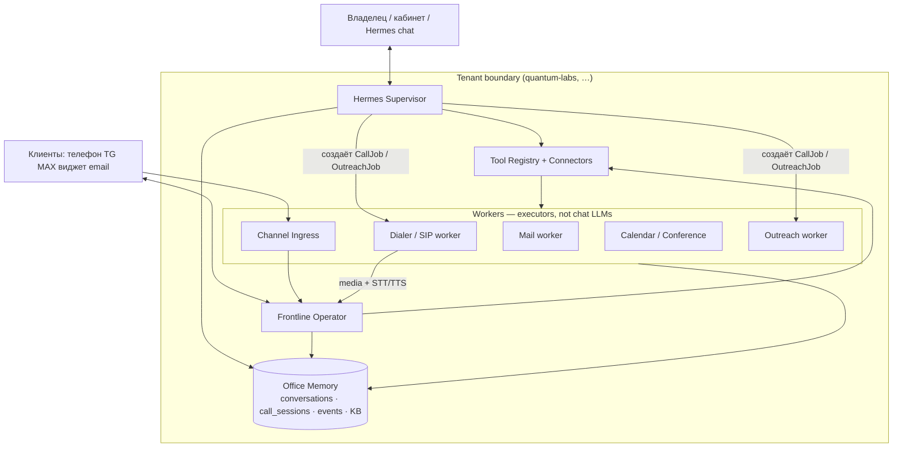
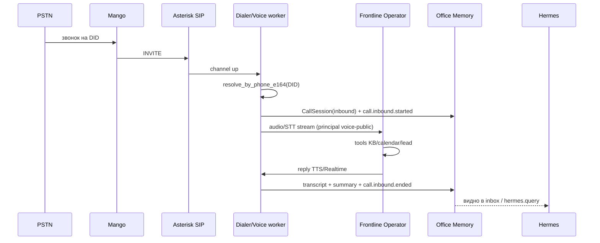

# DELNO Office OS — целевая архитектура

**Дата:** 2026-11-11 (Europe/Moscow)  
**Статус:** canonical target после потери QL Beget; dogfood = tenant `quantum-labs`  
**Связано:** [`DELNO_MASTER_PLAN.md`](https://github.com/ryabichello-stack/quantum-office/blob/cursor/delno-conference-providers-9b51/docs/DELNO_MASTER_PLAN.md) (E2–E6), [`QL_VOICE_RESTORE.md`](QL_VOICE_RESTORE.md)

---

## 1. Задача одной фразой

Каждый клиент DELNO получает **своего ИИ-сотрудника офиса**: он принимает входящие (телефон / Telegram / MAX / виджет / почта), по просьбе владельца **дирижирует исходящими**, знает **кто / когда / о чём**, умеет календарь, ВКС, письма и рассылки — и всё это **строго внутри своего `tenant_id`**.

Quantum Labs — **первый платящий dogfood-tenant**, которым мы сами атестируем весь контур.

---

## 2. Что сейчас есть vs чего нет

| Слой | Сейчас | Нужно |
|------|--------|-------|
| Multi-tenant API | ✅ `delno-api`, tenants, flags, usage, events | довести |
| Hermes | ⚠️ только MCP-профиль + tools façade (`hermes_tenant`) | сделать **живым Supervisor** |
| Frontline Operator | ✅ `/v1/operator/chat` (кабинет + widget + TG/MAX auto-reply) | расширить tool allowlist до office |
| Телефония | ❌ AVA Quantum отдельно; `phone_numbers` пусто; E4 ⬜ | **tenant-aware** inbound + outbound |
| Память «всего» | ⚠️ conversations + leads + часть events | единый **Office Memory** (звонки + сообщения + действия) |
| Календарь / ВКС / mail / outreach | 🔄 connectors stubs → brokers | живые креды per tenant |
| Исходящие задания | ❌ | `CallJob` / `OutreachJob` + воркеры |

**Важно:** поднятый сейчас `ai_engine` + Mango на Cloud4Box — это **legacy QL-секретарь**, он **не** является DELNO Office OS. Его можно временно использовать как media-движок, но мозг и память должны быть DELNO-tenant.

---

## 3. Правильная модель агентов (не «по агенту на канал»)

Не плодим отдельного LLM на Telegram, на MAX, на телефон и на почту.  
Каналы — это **трубы**. Мозгов на tenant — **два**, плюс **безмозглые воркеры**.



### 3.1. Hermes — руководитель (owner-facing)

- Собеседник **владельца** (кабинет, MCP/Cursor, позже Telegram-owner).
- Знает состояние офиса: inbox, звонки, задачи, коннекторы, флаги.
- **Дирижирует**: «перезвони Иванову», «запусти касание ломбардов», «создай ВКС на завтра 11:00», «что было на линии сегодня?».
- Не держит RTP и не отвечает клиентам на горячей линии.
- Доступ к полному toolset (HIGH_IMPACT → confirm).
- Читает **только** события/память своего `tenant_id`.

### 3.2. Frontline Operator — первая линия (customer-facing)

- Собеседник **клиентов** на любом канале.
- Один и тот же `run_operator_turn` (как сейчас: text / post-STT voice).
- Узкий публичный principal (`voice-public` / `text-guest`) → ACL KB.
- Tools: KB, слоты, создать встречу+ВКС, взять лид, (ограниченно) письмо.
- После звонка/диалога пишет summary+transcript в память → Hermes это видит.

### 3.3. Workers — исполнители

Не «подагенты с характером», а сервисы:

| Worker | Делает |
|--------|--------|
| **Channel Ingress** | webhook TG/MAX/email → нормализованное inbound → Conversation |
| **SIP / Dialer** | входящий/исходящий PSTN, media, старт/стоп сессии |
| **Voice I/O** | STT↔Frontline↔TTS (или Realtime session с tool-bridge в DELNO) |
| **Mail** | SMTP/IMAP send+ingest |
| **Calendar/Conference** | CalDAV/Graph/Google + Telemost/Meet/Zoom/Jitsi |
| **Outreach** | очереди касаний, stage_send, отчёты |

Workers **эмитят events**; Hermes их читает. LLM внутри worker — только если нужен разбор (post-call extract), не «личность».

### 3.4. Почему не «много независимых агентов»

| Плохо | Почему |
|-------|--------|
| Отдельный агент на каждый канал | Рассинхрон памяти, разные политики, дороже |
| Один гигантский агент на всё | Смешивает owner и customer, ломает ACL |
| Hermes сам в RTP | Не масштабируется, трудно отлаживать телефонию |

**Правило:** 2 conversational роли × N tenants + shared workers.

---

## 4. Единая память офиса (Hermes «знает всё»)

### 4.1. Объекты

| Объект | Назначение |
|--------|------------|
| `Conversation` + `Message` | любой диалог (phone/tg/max/widget/email/onboarding) |
| `CallSession` **(добавить)** | telephony: direction, from/to, started/ended, recording_url, transcript_id, outcome |
| `CallJob` **(добавить)** | исходящее задание: created_by hermes/owner, script, lead_id, status queued→dialing→done/fail |
| `Lead` / CRM-lite | сделки и следующий шаг |
| `PlatformEvent` | лента для Supervisor (уже есть заготовка E0.15 / E6) |
| Knowledge vault | факты о бизнесе tenant |

### 4.2. Обязательные события (минимум dogfood)

```
call.inbound.started | call.inbound.ended
call.outbound.queued | call.outbound.started | call.outbound.ended
call.transcript.ready | call.summary.ready
message.inbound.received | message.outbound.sent
calendar.slot.checked | calendar.event.created
conference.created
mail.sent | mail.inbound.received
outreach.job.created | outreach.touch.sent
connector.status.changed
```

Hermes отвечает на «кто звонил / о чём» **запросом в память + events**, а не «вспоминанием из контекста чата».

---

## 5. Телефония в multi-tenant

### 5.1. Привязка номера

```
PhoneNumber.e164 → tenant_id (+ routing_config)
```

Пример dogfood: `+79699665899` → tenant `quantum-labs`.

В Mango/PBX внешний транк → **один** Asterisk Cloud4Box.  
Различие клиентов — **по DID / To-header / trunk**, не отдельным Asterisk на tenant.

### 5.2. Входящий звонок



### 5.3. Исходящий звонок (дирижирование Hermes)

1. Owner → Hermes: «перезвони +7…, скажи что слот завтра 11:00 подтверждён».
2. Hermes создаёт `CallJob` (script, lead_id, to_e164) → event `call.outbound.queued`.
3. Dialer забирает job → originate SIP → media → Frontline с **outbound script** (не общий inbound prompt).
4. По завершении: transcript/summary в память → Hermes может отчитаться.

Исходящие **никогда** не стартуют из Frontline по желанию клиента без политики tenant (anti-abuse).

### 5.4. Media: что делать с текущим AVA

Два допустимых варианта (выбрать один в реализации E4):

**A. Bridge (быстрее для dogfood):** Asterisk + Realtime media как сейчас, но  
`in_call_tools` / post-call → **DELNO API** с `tenant_id` из DID (не QL mailer напрямую).

**B. Target:** тонкий `delno-voice` worker: RTP/AudioSocket → STT/TTS или Realtime, каждый turn = `POST /v1/operator/chat` modality=voice.

Вариант B совпадает с AGENTS.md DELNO. Вариант A — временный костыль на 1–2 недели dogfood.

---

## 6. Сообщения (Telegram / MAX / виджет / email)

Уже правильный каркас:

```
webhook → Channel Ingress → resolve tenant → Conversation
        → Frontline auto-reply (guest)
        → inbox для owner/Hermes
```

Добить:

- inbound **email** (E2.8);
- owner-bot / Hermes channel (отдельный principal `text-owner`);
- единый UI inbox уже почти есть в `delno-web`.

Hermes **не** дублирует auto-reply клиенту, если Frontline уже ответил — он эскалирует/перехватывает по правилам.

---

## 7. Офисные действия (календарь, ВКС, почта, рассылка)

Все через **Tool Registry + Connectors** (уже есть stubs):

| Действие | Tool | Worker/upstream |
|----------|------|-----------------|
| Свободные слоты | `suggest_calendar_slots` | calendar broker |
| Создать встречу + ВКС | `create_conference` (+ calendar create) | conference + calendar |
| Письмо | `send_mail_draft` | mail broker |
| Рассылка | `outreach.*` | outreach service |
| CRM-lite | `crm.*` | local leads |

**Политика confirm:**  
Frontline — SAFE_WRITE ограниченно; Hermes/owner — HIGH_IMPACT с `/confirm`.

Креды **per tenant** в `settings.connectors` / encrypted channel_accounts — не общий QL `.env` на весь мир.

---

## 8. Dogfood: Quantum Labs как первый клиент

### 8.1. Tenant

Уже есть: `slug=quantum-labs`.

### 8.2. Чеклист атестации «как раньше, но правильно»

1. **Номер** → `phone_numbers` + Mango trunk на Cloud4Box  
2. **KB** → vault/brain tenant `quantum-labs` (перенос из git vault)  
3. **TG/MAX** → channel_accounts этого tenant  
4. **Calendar/Mail/Telemost** → connectors с реальными кредами QL  
5. **Hermes MCP** → `dmcp_…` ключ tenant, профиль в Cursor  
6. **Сценарии приёмки:**
   - входящий звонок → диалог → лид → post-call в inbox  
   - Hermes: «перезвони …» → CallJob → исходящий → отчёт  
   - TG inbound → ответ → видно Hermes  
   - «найди слот / создай ВКС / отправь письмо»  
   - «статус рассылки / запусти касание»

### 8.3. Чего не делать на dogfood

- Не тащить Polyhub / trading.  
- Не делать полный Bitrix CRM.  
- Не оставлять мозг в `/root/ava` YAML без записи в DELNO memory.  
- Не шарить один OpenAI/SIP секрет «на всех будущих клиентов» без tenant vault.

---

## 9. Последовательность реализации (сжато)

| Этап | Результат |
|------|-----------|
| **D0** | Этот документ = contract |
| **D1** | `CallSession` + `CallJob` + events; DID → `quantum-labs` |
| **D2** | Inbound bridge: SIP → Frontline DELNO → transcript в inbox |
| **D3** | Hermes tools: `calls.list`, `calls.get`, `calls.dial` (создаёт CallJob) |
| **D4** | Outbound Dialer worker |
| **D5** | Cabinet allowlist = office tools; Hermes chat в кабинете |
| **D6** | Live connectors QL (mail/cal/conf/outreach) |
| **D7** | Отвязка от legacy AVA YAML; только delno-voice |

Параллельно не ломаем TG/widget — они уже на Conversation Core.

---

## 10. Ответы на спорные вопросы

**«Hermes должен сам отвечать на звонки?»** — Нет. Hermes дирижирует; Frontline говорит с клиентом.

**«Один агент или много?»** — Два conversational (Hermes + Frontline) на tenant + workers. Не N LLM на N каналов.

**«Куда идёт звонок сегодня?»** — В AVA Quantum, мимо DELNO. Это временный стенд, не продукт.

**«Как подключать следующего клиента?»** — tenant → DID/каналы → connectors → flags. Тот же Asterisk, другой `PhoneNumber` → другой `tenant_id`.

**«Как Hermes всегда всё знает?»** — Не через бесконечный chat context, а через **Office Memory + events**, которые пишут Frontline и workers после каждого действия.

---

## 11. Definition of Done для «мы пользуемся как своим офисом»

- [ ] Входящий на номер QL обрабатывает **Frontline tenant quantum-labs**
- [ ] Исходящий по просьбе Hermes создаётся как **CallJob** и дозванивается
- [ ] Transcript/summary каждого звонка в inbox + events
- [ ] TG/MAX inbound в том же inbox
- [ ] Hermes по MCP/кабинету отвечает: кто звонил, о чём, какие задачи в очереди
- [ ] Календарь / ВКС / письмо реально ходят с кредов QL
- [ ] Второй тестовый tenant **не видит** данные QL (isolation test)

---

*Документ задаёт целевую архитектуру. Реализация — по этапам D1–D7; не смешивать с legacy `/root/ava` single-tenant секретарём.*
