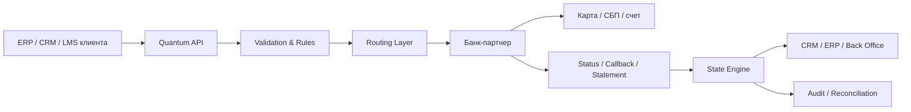

# Quantum Labs — единая база знаний для ИИ-секретаря

> Generated from vault `/workspace/knowledge/vault/quantum-brain` at 2026-11-11T14:46:27Z. Do not edit by hand — edit vault shards.

## Оглавление корпуса

- `products/part-a-quantum-payouts.md`
- `products/appendix-a-short-faq.md`
- `ops/appendix-b-ava-ops.md`
- `lombards/mass-payouts-kb-2026.md`
- `products/canonical-knowledge-2026.md`
- `platform/second-brain-overview.md`
- `platform/second-brain-architecture.md`
- `platform/second-brain-access-modes.md`
- `platform/second-brain-status.md`
- `platform/second-brain-faq.md`
- `platform/second-brain-ops-runbook.md`
- `platform/second-brain-plan-stages.md`
- `tools/office-stack-catalog.md`
- `tools/tools-faq.md`
- `tools/tool-ava-mailer.md`
- `tools/tool-ava-text-bot.md`
- `tools/tool-ava-outreach.md`
- `tools/tool-ava-calendar.md`
- `tools/tool-ava-conference.md`
- `tools/tool-ava-files.md`
- `tools/tool-ava-knowledge.md`
- `tools/tool-quantum-console.md`
- `tools/tool-ava-voice-tools.md`
- `verticals/catalog.md`
- `verticals/insurance-mass-payouts.md`
- `verticals/trade-in-mass-payouts.md`
- `verticals/agro-buyback-payouts.md`
- `verticals/mfo-mass-payouts.md`
- `verticals/gig-services-mass-payouts.md`
- `verticals/affiliate-cpa-influence-mass-payouts.md`

# Часть A. Quantum Payouts — общий продукт

# Часть A. Quantum Payouts — общий продукт

_Собрано из официальных материалов Quantum Payouts (базовая + расширенная версия)._
_Дата сборки: 2026-06-02 11:24 UTC._

**Продукт:** Quantum Payouts — сервис массовых безналичных выплат физлицам (и в ряде сценариев ИП/самозанятым).
**Бренд на линии:** Quantum Labs.
**Роль ИИ:** первичная квалификация, ответы по продукту, запись на встречу — без юридических гарантий и без обещания ставок/сроков без специалиста.

---

Quantum Payouts — расширенная база знаний для ИИ‑секретаря

Версия 2.0 · для входящих звонков, переписок и первичной квалификации лида
Внутренний документ. Не направлять клиентам без адаптации.

Ключевой принцип: ИИ‑секретарь не должен “продавать любой ценой”. Его задача — быстро понять сценарий клиента, корректно описать механику, не допустить юридически опасных обещаний и довести до следующего шага: созвона, расчета или пилота.

## 1. Быстрый профиль продукта

- Базовая модель: клиент формирует реестр получателей и реквизитов, передает его через API, личный кабинет или 1С, дальше запускается контур выплат и формируется отчетность.

- На сайте и в презентациях используется безопасное позиционирование: комиссия от 0,4%, зачисление в течение 1 минуты, работа 24/7, SLA 99,99%, выплаты на карты и через СБП.

- Подходит для компаний с регулярными массовыми выплатами от 5 млн ₽ в месяц. Для крупных сценариев возможны существенно большие объемы.

## 2. Что ИИ‑секретарь должен говорить о Quantum Payouts

## 2.1. Короткое описание

- “Мы помогаем собрать рабочий payout‑контур под модель бизнеса клиента.”

## 2.2. Безопасные сильные формулировки

- “Мы можем посмотреть ваш сценарий и предложить рабочую схему выплат.”

- “Такая механика обычно реализуема, но важно подтвердить юридическую и техническую модель.”

- “Выплаты можно инициировать через API, личный кабинет или реестр.”

- “Если у вас регулярные выплаты физлицам, мы, скорее всего, сможем быть полезны.”

## 2.3. Чего не говорить

- Не говорить: “Мы точно подключим любой кейс”.

- Не говорить: “Это полностью закрывает все риски по 115‑ФЗ”.

- Не говорить: “Это точно легально в любой конфигурации”.

- Не говорить: “Мы — банк”, “у нас свои счета банка”, “деньги у нас лежат как в банке”, если это не соответствует конкретной модели.

- Не обещать конкретную ставку без входных параметров: объем, частота выплат, тип получателей, банк, модель документооборота, интеграция.

## 3. Что нельзя обещать и как отвечать безопасно

## 3.1. Общий принцип

- Секретарь не дает юридических заключений и не подтверждает структуру сделки как окончательно согласованную.

- Любой нестандартный кейс описывается через формулу: “сценарий выглядит реализуемым, но нужно проверить модель плательщика, основание выплаты, тип получателя и документооборот”.

## 3.2. Формулы безопасного ответа

- Вместо “да, точно сделаем” говорить: “да, такой сценарий обычно можно собрать, если модель выплат и документы подходят”.

- Вместо “да, это полностью легально” говорить: “при корректно выстроенном юридическом контуре такой сценарий может быть реализован”.

- Вместо “у нас ставка X” говорить: “ориентир возможен, но точная экономика считается после короткой квалификации”.

- Вместо “через нас всё пройдет” говорить: “мы выступаем как технологический слой payout‑контура и подбираем рабочую схему под клиента”.

## 4. Кому подходит сервис

- Страховые выплаты.

- Автовыкуп и трейд‑ин.

- Ювелирный выкуп.

- Вторсырье, закупки, лом, металлы, макулатура — если модель выплаты может быть собрана безналично.

- Выплаты самозанятым и по ГПХ.

- Gig‑сервисы: такси, доставка, фриланс, платформенные исполнители.

- Агро‑закупки.

- Маркетплейсы и платформы.

- CPA/affiliate/опросные платформы / mass payouts / creators — если нужны регулярные массовые выплаты физлицам.

- HR‑сервисы, аутсорсинг, выплаты исполнителям и внештатным сотрудникам.

- Платформы, где нужен личный кабинет, уровни доступа, отчеты, статусы и API.

## 5. Кому сервис не подходит или требует отдельной проработки

- Клиентам с очень маленьким объемом и разовыми выплатами.

- Сценариям, где клиент сам не понимает, кто плательщик, на каком основании платятся деньги и кто формирует документы.

- Кейсам, где нужен не payout‑контур, а полноценный escrow / агентский / номинальный / расчетный сложный контур с распределением единого фонда по множеству получателей без понятной договорной структуры.

- Сценариям, где клиент хочет “просто переводить деньги физлицам” без объяснения основания выплаты.

- Клиентам, ожидающим, что секретарь сразу подтвердит точную юридическую модель без анализа.

## 6. Базовый сценарий звонка

- 1) Приветствие и краткое позиционирование.

- 2) Выяснение сценария: кому, за что и как часто платят.

- 3) Определение типа получателей: физлица, самозанятые, ИП, ГПХ, блогеры, водители, агенты и т.д.

- 4) Определение механики: карта / СБП / реестр / API / 1С / кабинет.

- 5) Определение объема: ежемесячный оборот, количество получателей, средний чек.

- 6) Определение юридической модели: кто плательщик, на каком основании платится вознаграждение, кто готовит закрывающие документы.

- 7) Если сценарий базовый — перевод на следующий шаг: короткий созвон, расчет, пилот.

- 8) Если сценарий нестандартный — честно сказать, что кейс нужно разобрать с менеджером / юристом / продуктом.

## 7. Обязательные квалификационные вопросы

## 7.1. Базовые

- Кому именно вы платите?

- Это физлица, самозанятые, ИП, исполнители по ГПХ, блогеры, агенты?

- На каком основании идет выплата?

- Кто является плательщиком по модели: ваша компания, клиент платформы, агент, заказчик?

- Какой объем выплат в месяц?

- Сколько получателей в месяц?

- Какой средний чек одной выплаты?

## 7.2. По процессу

- Как вы сейчас запускаете выплаты: вручную, из 1С, через реестр, через API?

- Нужен ли личный кабинет с ролями сотрудников?

- Нужны ли статусы, выгрузки, отчеты для бухгалтерии?

- Нужна ли интеграция с 1С, CRM, платформой клиента?

## 7.3. По правовой модели

- Кто формирует документы по выплате?

- Нужна ли работа с самозанятыми и чеками?

- Нужна ли проверка статуса НПД перед выплатой?

- Есть ли уже счет в банке‑партнере или нужно подобрать схему?

- Клиент ожидает выплаты на карты / по СБП или ему нужен иной контур?

## 7.4. Красные флаги

- Клиент не понимает, кто плательщик.

- Клиент не может объяснить основание выплаты.

- Клиент говорит “нам нужно одним платежом завести фонд и раскидать всем, а документы не знаем”.

- Клиент просит подтвердить схему, похожую на агентскую / номинальную / сложную платформенную без документов.

- Клиент просит ставку, не называя объем, число получателей и модель.

## 8. FAQ по продукту

## 8.1. Что делает Quantum Payouts?

- Помогает автоматизировать массовые выплаты физлицам: загрузка данных, запуск выплат, статусы, отчеты, API, кабинет, интеграции.

## 8.2. Куда можно отправлять выплаты?

- В базовом позиционировании: на банковские карты и через СБП.

## 8.3. Как инициировать выплату?

- Через API, личный кабинет, реестр, 1С.

## 8.4. Как быстро зачисляются деньги?

- Ориентир: до 1 минуты. Корректно говорить: “в типовом сценарии зачисление может происходить в течение минуты; точный SLA зависит от схемы, банка и контура”.

## 8.5. Какая комиссия?

- Ориентир на сайте — от 0,4%. Никогда не подтверждать точную ставку без параметров клиента.

## 8.6. С какими банками работаете?

- На сайте указано: Сбер, Альфа‑Банк, ГПБ, ВТБ, Уралсиб, МТС‑Банк и другие. Формулировка секретаря: “работаем через партнерскую банковскую инфраструктуру, конкретная схема подбирается под кейс”.

## 8.7. Можно ли разграничивать роли сотрудников?

- Да, можно настраивать уровни доступа сотрудников в личном кабинете.

## 8.8. Какие документы и отчеты есть?

- Реестры, статусы операций, данные для бухгалтерии. Но список документов всегда уточняется под модель клиента.

## 8.9. Подходит ли сервис для выплат блогерам / агентам / исполнителям?

- Часто — да, если понятно основание выплаты, плательщик и документооборот.

## 9. Юридический контур: безопасные формулировки

- Секретарь должен говорить не “это юридически готовое решение для всех”, а “мы помогаем собрать корректную модель выплат под конкретный кейс”.

- Не использовать формулировку “пуленепробиваемая схема”.

- Не подтверждать на звонке, что схема клиента полностью соответствует закону, если не проверены договоры, роли сторон и основание выплаты.

- Формула ответа: “сам контур может быть реализуем, но нужно понять, кто является плательщиком, кто получателем, на каком основании платится вознаграждение и как строится документооборот”.

- Если спрашивают, “через номинальные счета ли вы работаете”, ответ: “не обязательно; базовая схема зависит от модели клиента. В типовом кейсе выплаты идут от плательщика / клиента в рамках согласованного payout‑контура, а не обязательно через номинальный счет платформы”.

- Если спрашивают, “договор с кем”, ответ: “структура договоров зависит от модели. Мы как технологический партнер подбираем рабочий контур вместе с банком и клиентом”.

## 10. НПД / самозанятые / чеки ФНС

## 10.1. Что можно говорить

- “Работа с самозанятыми — типовой сценарий.”

- “Можно собрать контур, где перед выплатой проверяется статус НПД.”

- “Можно выстроить сценарий, в котором чек формируется и информация возвращается обратно в платформу.”

## 10.2. Что нельзя обещать без уточнения

- Нельзя говорить: “у нас всегда встроена автоматическая фискализация для любого кейса”.

- Нельзя говорить: “чеки в ФНС всегда автоматически пробиваются по умолчанию”.

- Правильная формулировка: “такой сценарий можно реализовать, если модель выплат, плательщик и поток данных под это подходят”.

## 10.3. Если клиент спрашивает про НПД прямо

- Ответ‑шаблон: “Да, сценарий с самозанятыми возможен. Обычно мы отдельно смотрим, кто инициирует выплату, нужна ли проверка статуса НПД перед транзакцией и требуется ли автоматическая работа с чеками ФНС.”

## 11. Личный кабинет, доступы и безопасность

- Личный кабинет может использоваться для формирования распоряжений, загрузки реестров, просмотра статусов и отчетов.

- Можно настраивать роли и уровни доступа сотрудников.

- Это важно для крупных компаний, где инициатор, согласующий и бухгалтер — разные роли.

- Секретарь не должен вдаваться в детали безопасности beyond safe phrases: “используются банковские стандарты защиты и разграничение прав сотрудников”.

- Если спрашивают про ответственность за доступ сотрудников, можно говорить: “в рабочей договорной модели отдельно фиксируется ответственность клиента за учетные данные и полномочия пользователей ЛК”.

- Если клиент задает глубокие вопросы по ЭП/ПЭП/логам — переводить на менеджера или юриста.

## 12. API, реестры, 1С, интеграции

- Базовая механика: реестр получателей и реквизитов передается через API, личный кабинет или 1С.

- Если клиент задает вопрос “можно ли интегрировать с нашей платформой / CRM / ERP”, базовый ответ: “обычно да, такие интеграции возможны; нужно уточнить архитектуру и сценарий передачи данных”.

- Не обещать сроки интеграции на первом касании.

- Не обещать конкретные endpoint’ы, если клиент не в техническом контакте.

- При техническом лид‑запросе обязательно собрать: тип системы, формат данных, количество операций, требования к статусации, webhooks/выгрузки, кто будет делать интеграцию.

## 13. Банки‑партнеры и модель расчетов

- На сайте и в коммуникации допустимо говорить, что решение работает через партнерскую банковскую инфраструктуру.

- Не говорить, что деньги “лежат у нас”, “идут через наши счета”, если это не соответствует кейсу.

- Корректная формула: “схема строится через банковский контур и подбирается под модель клиента”.

- Если клиент спрашивает, можно ли использовать существующий счет компании, ответ: “в ряде сценариев да, это отдельно смотрится по модели и банку”.

- Если клиент задает сложные вопросы про номинальные, агентские, распределительные схемы — переводить на менеджера.

## 14. Сценарии клиентов и как их разбирать

## 14.1. Базовый payout‑кейс

- Компания платит физлицам / СЗ / ГПХ регулярно.

- Есть понятный плательщик.

- Есть понятное основание выплаты.

- Есть реестр / API / 1С.

- Такой кейс почти всегда переводится на созвон и расчет.

## 14.2. Платформа с выплатами агентам / блогерам

- Нужно понять, кто платит: сама платформа или клиент платформы.

- Нужно понять, на каком основании платится агентское / маркетинговое вознаграждение.

- Нужно понять, нужны ли НПД‑чеки.

- Ответ: “сам сценарий может быть реализуем, но тут важно собрать юридическую модель и документооборот”.

## 14.3. Сложный фондовый / “одним платежом пополнить и всем раздать” кейс

- Это уже не просто базовый payout API.

- Секретарь должен распознать, что клиенту, возможно, нужен платформенный / агентский / распределительный контур.

- Нельзя подтверждать, что текущая стандартная схема это закрывает.

## 14.4. Выплаты ИП и самозанятым

- Разобрать отдельно: ИП или СЗ, документы, кто формирует акты/чеки, где находится обязанность по закрывающим документам.

## 14.5. B2B‑вопрос про массовые выплаты внештатным

- Обычно релевантно. Собрать объем, число исполнителей, тип получателей, способ инициирования, требования к отчетности.

## 15. Работа с возражениями

## 15.1. “У нас уже есть банк/провайдер”

- Ответ: “Понял. Тогда, возможно, есть смысл сравнить не только ставку, но и сам контур: скорость зачисления, статусы, API, НПД, удобство для бухгалтерии и масштабируемость”.

## 15.2. “Нам нужна самая низкая комиссия”

- Ответ: “Понял. Для нас тогда важно быстро понять объем, число получателей и тип сценария — без этого честно сравнивать экономику некорректно”.

## 15.3. “Мы пока сами не понимаем, как оформить”

- Ответ: “Это нормальная ситуация. Тогда следующий шаг — коротко разобрать вашу модель выплат и понять, какой контур вообще вам подходит”.

## 15.4. “Нам надо одним платежом завести деньги и дальше раздать всем”

- Ответ: “Понял. Это уже больше похоже на отдельную платформенную или распределительную схему. Нужно предметно разобрать модель, прежде чем подтверждать решение”.

## 16. Когда обязательно переводить на менеджера

- Клиент просит точную цену/ставку.

- Клиент задает глубокий юридический вопрос.

- Клиент спрашивает про номинальные счета, агентские модели, escrow, сложный документооборот.

- Клиент просит подтвердить “легальность” сложного кейса.

- Клиент спрашивает про договорную схему между несколькими сторонами.

- Клиент просит нестандартную механику: один фонд, распределение множеству получателей, закрывашки “под ключ”.

- Клиент — крупный бренд / банк / enterprise / тендерная закупка.

- Объем > 100 млн ₽ в месяц или особые требования по SLA/безопасности.

- Клиент просит письменное предложение после разговора.

## 17. Шаблоны ответов для чатов и почты

## 17.1. Общий первый ответ

## 17.2. Ответ про НПД

- “Да, работа с самозанятыми возможна. Обычно отдельно смотрим проверку статуса перед выплатой, формирование чека и возврат статусов в систему.”

## 17.3. Ответ про номинальные счета

- “Не обязательно. Базовая схема зависит от модели клиента и не сводится автоматически к номинальному счету платформы. Нужно понять, кто плательщик и как именно у вас устроен контур выплат.”

## 17.4. Ответ про ставку

- “Ориентир по комиссии возможен, но точная экономика считается после короткой квалификации: объем выплат, число получателей, тип контрагента, способ интеграции, требования к документам.”

## 18. Что фиксировать после разговора

- Имя, компания, должность, контакты.

- Откуда пришел лид.

- Кому платят.

- Тип получателей.

- Объем в месяц.

- Количество получателей.

- Нужны ли API / ЛК / 1С / реестры / статусы / НПД / чеки.

- Какой банк / есть ли банк‑партнер.

- Насколько кейс стандартный или нестандартный.

- Какой следующий шаг согласован: созвон, расчет, письмо, презентация, пилот.

## 19. Decision tree для ИИ‑секретаря

- Шаг 1. Понять, это вообще про регулярные массовые выплаты физлицам или нет.

- Шаг 2. Если да — понять тип получателей и объем.

- Шаг 3. Если непонятен плательщик или основание выплаты — не обещать решение, а эскалировать.

- Шаг 4. Если кейс стандартный — собирать параметры и переводить на расчет/созвон.

- Шаг 5. Если спрашивают про НПД / чеки / платформенную модель — отвечать осторожно: “можно реализовать, если модель подходит”, и передавать дальше.

- Шаг 6. Если клиент хочет письмо / презентацию — обещать отправку после разговора менеджером.

- Шаг 7. Если клиент крупный или тендерный — сразу помечать как high priority.

## 20. Краткий словарь терминов

- Плательщик — сторона, от имени которой уходит выплата.

- Получатель — физлицо / самозанятый / ИП / исполнитель, которому платят.

- Реестр — список получателей и реквизитов для запуска выплат.

- СБП — сервис быстрых платежей.

- НПД — налог на профессиональный доход, режим самозанятого.

- ЛК — личный кабинет.

- API — интерфейс интеграции систем.

- Payout‑контур — схема, по которой формируются, запускаются и учитываются выплаты.

- Юридический контур — договорная и документарная модель, объясняющая, кто, кому и за что платит.

- Банковский контур — расчетная инфраструктура с участием банка‑партнера.

- Эскалация — передача диалога менеджеру, продукту или юристу.

# Приложение А. Короткие ответы на частые вопросы

# Приложение А. Короткие ответы на 10 самых частых вопросов

### Вопрос: Можно ли у вас делать массовые выплаты физлицам?

Ответ: Да, это базовый сценарий сервиса.

### Вопрос: Можно ли платить самозанятым?

Ответ: Да, такой сценарий возможен; отдельно смотрим НПД и чеки.

### Вопрос: Можно ли работать по API?

Ответ: Да, API — один из базовых способов интеграции.

### Вопрос: Можно ли из 1С?

Ответ: Да, такой сценарий предусмотрен.

### Вопрос: Какая комиссия?

Ответ: Ориентир — от 0,4%, точный расчет после квалификации.

### Вопрос: Как быстро приходят деньги?

Ответ: В типовом контуре — до 1 минуты.

### Вопрос: Можно ли на карты и через СБП?

Ответ: Да, это базовые каналы.

### Вопрос: Вы банк?

Ответ: Нет, мы технологический партнер payout‑контура.

### Вопрос: Подойдет ли это для блогеров/агентов?

Ответ: Часто да, но нужно понять модель плательщика и основание выплаты.

### Вопрос: Можем ли мы просто пополнить один счет и раздать всем?

Ответ: Нужно отдельно разобрать модель — это может быть уже не базовый payout‑сценарий.

# Приложение Б. Стандарт закрытия / AVA ops

# Приложение Б. Стандарт закрытия разговора

- “Понял ваш сценарий. Следующий шаг — короткий предметный разбор модели выплат, чтобы подтвердить рабочую схему, экономику и состав интеграции. Могу передать ваш кейс коллеге на дальнейшую проработку.”

- “Спасибо, картина понятна. Чтобы дать точный ответ, нам нужно быстро сверить юридическую модель и механику выплат. Передаю кейс менеджеру, он вернется с предметным ответом.”

Рабочая версия для первичной коммуникации с клиентами
Назначение: помочь ИИ‑секретарю квалифицировать лидов, корректно объяснять продукт, не давать лишних обещаний и переводить разговор в созвон с менеджером.

Важно: этот документ предназначен для продаж и первичной поддержки. Он не заменяет юридическое заключение, банковский комплаенс, индивидуальный договор с клиентом и финальное согласование схемы выплат.

## 1. Краткая памятка для ИИ‑секретаря

Базовая схема: деньги на выплаты идут с расчетного счета клиента/партнера, а не с «нашего» счета; договорный контур по выплатам обычно выстраивается напрямую с банком‑партнером, а Quantum дает технологический слой.

Что можно обещать осторожно: API, личный кабинет, загрузка реестров, статусы, отчетность, выплаты на карты и через СБП, роли доступа, интеграция с 1С, помощь в построении юридического контура.

Что нельзя обещать без оговорок: подключение любого клиента, любую ставку комиссии, любую скорость запуска, возможность работать с любой бизнес‑моделью, автоматические чеки ФНС и НПД‑сценарии “всегда и для всех”.

Главная задача ИИ‑секретаря — понять модель бизнеса, тип получателей, объем выплат, источник денег, юр. основание выплат и передать лид менеджеру.

## 2. О продукте: что говорить коротко

## Короткий ответ на вопрос “что вы делаете”:

## Короткий ответ на вопрос “в чем ценность”:

снижение операционной нагрузки на выплаты;

единый процесс вместо ручных переводов;

статусы, реестры и отчетность для бухгалтерии;

гибкие интеграции;

возможность собрать юридически корректную модель под конкретный кейс.

## Короткий ответ на вопрос “кому подходит”:

Сервис в первую очередь подходит компаниям с регулярными объемами выплат от 5 млн ₽ в месяц и выше, где есть массовые выплаты физлицам, самозанятым, исполнителям по ГПХ, участникам платформ, получателям компенсаций, выкупа, закупок и т.п.

## 4. Что ИИ‑секретарь должен обязательно выяснить у лида

Кто плательщик: сама компания, платформа, агент, маркетплейс, другой контрагент?

Кому именно идут выплаты: физлица, самозанятые, ИП, сотрудники, блогеры, получатели компенсаций и т.д.?

Какой примерный объем выплат в месяц и сколько получателей?

Какие каналы нужны: карты, СБП, личный кабинет, API, 1С, реестры?

Есть ли уже банк‑партнер и расчетный счет, с которого будут идти выплаты?

Нужны ли статусы НПД, чеки ФНС, акты, реестры, разграничение ролей сотрудников?

Есть ли текущий провайдер/банк и что именно не устраивает: ставка, сроки, отказоустойчивость, ручной процесс, отсутствие API?

Нужно ли просто payout API или более сложная платформенная/агентская модель с фондированием и распределением денег?

На каком этапе клиент: изучает рынок / сравнивает ставки / собирает предложения / готов к пилоту?

## 6. Ключевые ответы на частые вопросы

## Вы работаете через номинальные счета?

Не в базовой схеме. Обычно речь идет не о номинальном счете платформы, а о выплатах с расчетного счета клиента/партнера через банковскую инфраструктуру и согласованный payout‑контур.

## Договор на выплаты заключается с вами?

Как правило, договорный контур по выплатам выстраивается напрямую с банком‑партнером, а Quantum обеспечивает технологическую часть: интеграцию, маршрутизацию, роли, отчетность и т.п.

## Можно ли платить самозанятым?

Да, такие сценарии возможны, но конкретная схема зависит от модели бизнеса, статуса получателей и требований банка/комплаенса.

## Есть ли проверка статуса НПД перед транзакцией?

Такой сценарий можно реализовать, если он нужен клиенту и укладывается в согласованную модель интеграции.

## Можно ли автоматически работать с чеками ФНС?

Такой контур можно собрать в ряде сценариев, но это нельзя обещать “по умолчанию” без анализа модели выплаты и документов.

## Можно ли выплачивать агентские / блогерские вознаграждения?

Возможно, но сначала нужно разобрать, кто плательщик, на каком основании платится вознаграждение, кто формирует закрывающие документы и какая юридическая модель используется.

## Какая комиссия?

Ориентир — от 0,4%, но точная ставка зависит от оборота, среднего чека, количества операций, типа получателей, схемы выплат и банка‑партнера.

## Есть ли API?

Да, можно строить интеграцию через API; также возможны личный кабинет, реестры и интеграции с 1С.

## Какие банки поддерживаются?

Подключение возможно при наличии счета в банках‑партнерах; список партнеров и конкретная схема обсуждаются индивидуально.

## Как быстро запускаетесь?

Срок зависит от модели, готовности клиента, банка и комплаенса. ИИ‑секретарь не должен обещать срок запуска без подтверждения менеджера.

## 7. Скрипт первичной квалификации

## Открытие

## Выявление модели

Кто у вас является плательщиком, кому идут выплаты, какой ежемесячный объем и сколько получателей?

## Каналы и интеграция

Вам нужен API, личный кабинет, реестровая загрузка, 1С или комбинация? Выплаты нужны на карты, по СБП или в смешанном формате?

## Юр. контур

Есть ли у вас самозанятые, ИП, блогеры, ГПХ? Нужна ли проверка НПД, чеки, закрывающие документы, роли сотрудников?

## Следующий шаг

Спасибо, понял. Такой кейс нам нужно предметно посмотреть вместе с менеджером: он уточнит модель, оценит экономику и предложит рабочую схему. Удобно оставить контакты для созвона?

## 8. Эскалация: когда ИИ‑секретарь обязан перевести разговор человеку

клиент просит точную юридическую квалификацию схемы выплат;

клиент просит гарантировать комплаенс/банковское согласование;

речь идет о фондировании одним платежом и дальнейшем распределении по множеству получателей;

нужны закрывающие документы, агентская модель, номинальные счета, платформенная модель, escrow/спецсчет;

клиент спрашивает про тендер, индивидуальные ставки, SLA в договоре, безопасность, PCI DSS, 115‑ФЗ, 161‑ФЗ, 152‑ФЗ, 63‑ФЗ, требования банка;

есть конфликтные или нестандартные отрасли, трансграничка, крипто‑сценарии, квазибанковские функции, выплаты не физлицам.

## 9. Юридические и регуляторные ориентиры для ответов

Ниже — не юридическое заключение, а безопасные ориентиры, на которые может опираться ИИ‑секретарь при разговоре. Все спорные вопросы — только на менеджера/юриста.

## ГК РФ: оферта и публичная оферта

На сайте маркетинговое описание сервиса обычно не нужно называть “публичной офертой на подключение выплат”; реклама и иные предложения неопределенному кругу лиц по общему правилу считаются приглашением делать оферты, если иное прямо не указано.

## 152‑ФЗ: персональные данные

Если клиент оставляет заявку на сайте, компания как оператор ПД должна иметь публичную политику обработки ПД, обеспечивать доступ к ней, принимать меры защиты и обрабатывать данные на законном основании.

## 38‑ФЗ: реклама

Для рекламных сообщений по телефону, email, SMS и мессенджерам требуется предварительное согласие адресата.

## 63‑ФЗ: электронная подпись

Порядок использования простой электронной подписи и правил подтверждения действий в ЛК должен быть прямо согласован с клиентом в договоре/оферте.

## 161‑ФЗ: национальная платежная система

Quantum в коммуникации позиционируется как технологический слой/контур обмена информацией и выплат через банк‑партнеров, а не как банк. Нельзя создавать впечатление, что Quantum сам оказывает банковские услуги.

## 115‑ФЗ: комплаенс

Финальное решение по приему клиента и параметры обслуживания зависят от банка‑партнера и комплаенса. ИИ‑секретарь не должен обещать “пройдем комплаенс точно”.

## Самозанятые / НПД

Чек самозанятого формируется в “Мой налог”; возможность автоматизации и состав обмена данными зависят от выбранной схемы. ИИ‑секретарь должен говорить: “такой сценарий может быть реализован после анализа модели”.

## 10. Политика ответов на сложные вопросы

## “Вы можете сделать так же, как у сервиса N?”

Ответ: можем посмотреть, можно ли собрать аналогичный контур. Нужны детали: кто плательщик, кто получатель, основание выплаты, документооборот, банк, объемы.

## “Нам нужно одним платежом завести 100 млн и распределить сотням блогеров”

Ответ: это уже не только про payout API; здесь нужно разбирать фондирование, платформенную/агентскую модель, закрывающие документы и юридический контур. Передаю менеджеру.

## “Сделаете без договора / без банка / просто через вас?”

Ответ: нет, такие вещи обсуждаются только в рамках согласованной банковской и юридической модели.

## “Дайте точную цену прямо сейчас”

Ответ: ориентир от 0,4%, но точная комиссия зависит от объема, количества операций, среднего чека, типа получателей и банка. Для точного расчета нужен менеджер.

## 11. Внутренние красные флаги

клиент не может объяснить, кто является плательщиком и откуда деньги;

клиент смешивает обычные B2B‑платежи с массовыми выплатами физлицам;

клиент хочет “одним платежом завести деньги и чтобы платформа сама раскидала всем” без понимания юр. модели;

клиент просит скрыть реальное основание выплаты;

клиент работает в серой/запрещенной тематике или просит обойти банк/комплаенс;

клиенту нужен скорее кошелек/номинальный счет/расчетная инфраструктура, а не payout‑контур.

## 12. Мини‑карточки ответов для ИИ‑секретаря

## Если клиент спрашивает “что мне дальше делать?”

Оставьте, пожалуйста, контакты и коротко опишите модель выплат: кто платит, кому, сколько в месяц и какие каналы нужны. Менеджер подготовит предметный разбор и расчет.

## Если клиент спрашивает “какие документы нужны?”

На старте — описание модели выплат, типы получателей, желаемые каналы выплат, примерный оборот и требования по интеграции. Дальше пакет зависит от банка и комплаенса.

## Если клиент спрашивает “подойдет ли нам решение?”

В большинстве случаев это определяется по трем вещам: модель выплат, тип получателей и объем. Давайте я зафиксирую эти параметры и передам менеджеру.

## 13. Источники и основания

## Внутренние основания для базы знаний:

сценарии, обсужденные в переписке: массовые выплаты физлицам, самозанятым, по ГПХ, платформенные кейсы, блогеры, buyback/выкуп/закупки;

рабочая логика продаж: сначала квалификация и разбор модели, потом менеджер / комплаенс / банк.

## Нормативные ориентиры (официальные/правовые источники):

ГК РФ, ст. 435 и 437 — признаки оферты и публичной оферты.

ФЗ № 152‑ФЗ “О персональных данных”, в т.ч. ст. 18, 18.1, 19.

ФЗ № 38‑ФЗ “О рекламе”, ст. 18 — реклама по сетям электросвязи только с предварительным согласием.

ФЗ № 63‑ФЗ “Об электронной подписи”, ст. 5, 6, 9 — простая подпись, признание электронных документов.

ФЗ № 161‑ФЗ “О национальной платежной системе”, в т.ч. понятие оператора услуг информационного обмена и общие требования к защите информации.

ФЗ № 115‑ФЗ — идентификация клиента, представителя, выгодоприобретателя и меры комплаенса.

Материалы ФНС по НПД и приложению “Мой налог” — формирование чека самозанятым.

---

## Голосовой ассистент AVA (операционка)

### Контакты для клиентов

- Сайт: https://quantumlabs.ru
- Email: office@quantumlabs.ru
- Телефон: 8 (800) 555-94-18
- Режим: пн–сб 09:00–20:00 (консультации по записи)

### Запись на встречу

Собирать по шагам: имя (с подтверждением) → компания → задача → дата и время → email (повторить и подтвердить).
Только после подтверждённого email — проверка календаря и создание встречи.
После успешной записи: приглашение на почту, ссылка Яндекс Телемост, презентация PDF.

### Речь на звонке

- Только русский (кроме email: «собака», «точка»).
- Коротко, как живой менеджер, без JSON/API/webhook в голосе — говорить «интеграция», «кабинет», «выплаты через СБП».
- Не озвучивать: «данные получены», «операция выполнена», технические ответы tools.
- IT-аутстафф/разработка на сайте — кратко: есть направление, детали передаёт специалист или запись на звонок.

### Инструмент get_company_knowledge

При детальных вопросах по продукту, юридике, НПД, СБП, тарифах — вызови `get_company_knowledge` с коротким topic на русском.

---

# Массовые выплаты для ломбардов (KB 2026)

**QUANTUM LABS**

**Массовые выплаты для ломбардов**

*Отраслевая база знаний, продуктовая модель, продажи, комплаенс и
аутрич*

  **Назначение документа\
  **Рабочая база знаний для продуктовой команды, продаж, комплаенса,
  интеграции, маркетинга и ИИ-ассистентов Quantum Labs. Документ
  описывает применимость системы массовых выплат в деятельности
  российских ломбардов по состоянию на 23 июля 2026 года.

**Версия 1.0 • 23.07.2026**

*Статус: рабочая аналитическая версия; перед запуском конкретной схемы
требуется юридическая и банковская валидация договорной модели.*

# 1. Резюме для руководителя

  **Главный вывод\
  **Ломбарды --- один из наиболее естественных вертикальных рынков для
  Quantum Payouts. У них есть регулярная обязанность быстро передавать
  деньги физическим лицам, высокая доля повторных клиентов, большое
  количество территориальных точек, потребность в снижении кассовой
  нагрузки и растущие расходы на цифровизацию. Однако продавать следует
  не абстрактные «массовые выплаты», а конкретный операционный контур:
  безналичная выдача займа клиенту, возврат положительной разницы после
  реализации невостребованного залога, централизованное управление
  выплатами сети и полная сверка по каждому договору.

-   В 2025 году ломбарды заключили почти 19 млн договоров займа и выдали
    412 млрд руб.; клиентская база составила 2,16 млн человек.

-   На 31.12.2025 совокупный портфель достиг 101 млрд руб.; 69% портфеля
    приходилось на топ-50 ломбардов.

-   Количество офисов выросло до 10 427, что усиливает проблему
    распределенного управления кассой, лимитами и сверкой.

-   Почти 95% выдач приходится на ювелирные изделия; средний заем под
    такой залог к IV кварталу 2025 года вырос до 27 тыс. руб.

-   Регулятор прямо требует вернуть заемщику положительную разницу после
    реализации невостребованной вещи; это отдельный, юридически значимый
    payout-сценарий.

-   Расходы сектора выросли на треть главным образом из-за дистанционных
    форматов и ИТ; рынок уже готов обсуждать API и автоматизацию, но
    внедрение остается неоднородным.

  **Приоритет**     **Сценарий**           **Ценность для     **Рекомендация**
                                           ломбарда**         
  ----------------- ---------------------- ------------------ -------------------
  P1                Безналичная выдача     Снижение кассовой  Основной оффер для
                    займа по карте/СБП     нагрузки, быстрый  крупных и средних
                                           сервис, единый     сетей
                                           контроль сети      

  P1                Возврат положительной  Исполнение         Использовать как
                    разницы после          обязанности перед  сильный
                    реализации залога      заемщиком,         комплаенс-кейс
                                           сокращение ручной  
                                           работы и           
                                           невостребованных   
                                           сумм               

  P2                Централизованный       Лимиты, роли,      Продавать
                    payout-hub для         реестры, единая    CFO/операционному
                    филиалов               сверка и           директору
                                           отчетность         

  P2                Миграция части         Снижение           Пилотировать на
                    наличных выдач в       инкассации и       выбранных точках
                    безнал                 остатков           
                                           наличности         

  P3                Выплаты                Автоматизация      Не смешивать с
                    продавцам/комитентам   скупки/комиссии,   деятельностью
                    смежного юрлица        если деятельность  ломбарда без
                                           юридически         отдельной проверки
                                           отделена           

# 2. Рынок ломбардов и коммерческая привлекательность

По данным Банка России, рынок в 2025 году рос одновременно по числу
договоров, объему выдач и портфелю. Рост не означает одинаково высокую
рентабельность всех игроков: почти половина компаний завершила год с
отрицательной или околонулевой рентабельностью. Следовательно,
технологическое предложение должно показывать измеримый эффект на
операционных расходах, скорости обслуживания и удержании клиентов, а не
только «удобство».

  **Показатель 2025**     **Значение**            **Коммерческий смысл
                                                  для Quantum**
  ----------------------- ----------------------- -----------------------
  Заключенные договоры    Почти 19 млн (+13% г/г) Большое количество
                                                  транзакционных событий
                                                  и реестров

  Объем выдач             412 млрд руб.           Рынок достаточного
                          (+примерно треть г/г)   масштаба для банковских
                                                  payout-продуктов

  Клиенты                 2,16 млн (+3% г/г)      Высокая частота
                                                  повторных обращений

  Повторные клиенты       73% постоянных; \>70%   Важна привязка
                          пользовались несколько  реквизита и быстрый
                          раз за полугодие        повторный payout

  Портфель                101 млрд руб. (+37%     Рост требований к
                          г/г)                    управлению ликвидностью
                                                  и лимитами

  Концентрация            69% портфеля у топ-50   Небольшое число крупных
                                                  целей дает основной TAM

  Офисы                   10 427 (+2% г/г)        Централизованная
                                                  система особенно ценна
                                                  для сетей

  Прибыль сектора         12,8 млрд руб.          Цена решения должна
                                                  быть соотнесена с
                                                  экономией и оборотом

## 2.1. Сегментация потенциальных клиентов

  **Сегмент**                   **Признаки**       **Боль**          **Как продавать**
  ----------------------------- ------------------ ----------------- --------------------
  Крупная                       50+ точек,         Разные банки и    API, batch, роли,
  федеральная/межрегиональная   собственное ПО,    кассы, сложная    лимиты, webhooks,
  сеть                          централизованное   сверка, SLA       банковская
                                казначейство       филиалов          отказоустойчивость

  Региональная сеть             10--50 точек, 1--3 Инкассация,       Быстрый пилот без
                                региона            ручные реестры,   замены учетной
                                                   зависимость от    системы
                                                   бухгалтерии       

  Небольшая сеть                3--10 точек        Цена и простота   Готовый кабинет,
                                                   подключения       загрузка Excel/CSV,
                                                                     понятный тариф

  Одиночный ломбард             1--2 точки         Низкая            Не основной ICP;
                                                   автоматизация,    только пакетный
                                                   небольшой объем   продукт через
                                                                     партнера/банк

  Автоломбард                   Высокий средний    Риски реквизитов  Безопасная адресная
                                чек, мало операций и подтверждения   выплата, усиленная
                                                   получателя        проверка и лимиты

  Ломбард + отдельная           Несколько          Смешение операций Раздельные мерчанты,
  скупка/комиссия               юрлиц/контуров     и отчетности      договоры, назначения
                                                                     и реестры

# 3. Правовая рамка и границы применимости

  **Важно\
  **Quantum не должен позиционироваться как сторона договора займа,
  ломбард, платежный агент клиента-физлица или налоговый агент. Базовая
  модель: банк исполняет перевод денежных средств с
  расчетного/специального счета ломбарда непосредственно физическому
  лицу, а Quantum предоставляет технологическую оркестрацию, API,
  реестры, статусы, контроль и сверку. Конкретная конструкция зависит от
  банка-партнера и договора.

## 3.1. Федеральный закон № 196-ФЗ «О ломбардах»

-   Ломбард --- специализированная коммерческая организация, основная
    деятельность которой связана с предоставлением краткосрочных займов
    гражданам под залог движимых вещей и хранением вещей.

-   Договор займа оформляется залоговым билетом; деньги передаются
    гражданину-заемщику на возвратной и возмездной основе на срок не
    более одного года.

-   После окончания срока займа действует льготный месячный срок, в
    течение которого обращение взыскания на вещь ограничено.

-   При реализации невостребованной вещи обязательства заемщика
    прекращаются даже при недостаточности выручки; если возникает
    положительная разница, она подлежит возврату заемщику при его
    обращении в установленный законом период.

-   Ломбард обязан страховать принятую вещь за свой счет на сумму
    оценки; это не payout-сценарий, но влияет на договорный и учетный
    контур.

## 3.2. Федеральный закон № 353-ФЗ «О потребительском кредите (займе)»

-   Заем ломбарда является потребительским займом, поэтому применяются
    требования к индивидуальным условиям, полной стоимости кредита,
    информированию и ограничениям переплаты.

-   С 1 апреля 2026 года Банк России указывает на снижение предельного
    размера переплаты для займов ломбардов со 130% до 100% суммы займа;
    продуктовые и маркетинговые материалы должны учитывать актуальную
    форму залогового билета.

-   Способ выдачи денег и способ погашения должны быть согласованы в
    договорном и учетном контуре. Нельзя внедрять безналичную выдачу
    только технически, не отразив ее в документах и процессах ломбарда.

## 3.3. ПОД/ФТ: Федеральный закон № 115-ФЗ и акты Банка России

-   Ломбарды относятся к организациям, осуществляющим операции с
    денежными средствами или иным имуществом, и обязаны идентифицировать
    клиентов, применять правила внутреннего контроля, фиксировать
    подозрительные операции и выполнять требования по
    отказу/приостановлению.

-   Внедрение нового программно-технического средства требует оценки
    риска его использования для ОД/ФТ и мер минимизации этого риска.

-   Перевод займа на реквизит третьего лица повышает риск мошенничества,
    обхода идентификации и несоответствия получателя заемщику. Базовое
    правило Quantum: выплата только самому идентифицированному заемщику;
    любые исключения --- только после отдельного юридического и
    банковского согласования.

-   Система должна поддерживать screening-статусы, ручную остановку,
    журнал решений, неизменяемый аудит, контроль дублей и сценарии
    возврата/отказа.

## 3.4. Персональные данные и банковские реквизиты

-   Передача ФИО, телефона, данных документа, номера карты/счета или
    идентификаторов СБП является обработкой персональных данных и должна
    иметь законное основание, определенную цель и договорное
    распределение ролей.

-   Следует минимизировать состав данных: Quantum должен получать только
    то, что необходимо банку для исполнения и сверки платежа.

-   В договоре с ломбардом необходимо закрепить поручение на обработку,
    перечень данных, операции обработки, меры защиты, сроки хранения,
    порядок инцидентов и возврата/уничтожения данных.

-   Полные карточные данные не должны храниться Quantum без
    необходимости; предпочтительны токены, маскирование и банковские
    идентификаторы. Для СБП предпочтительна проверка совпадения имени
    получателя до подтверждения выплаты, если банковский API это
    поддерживает.

## 3.5. Разграничение ломбарда, скупки и комиссионной торговли

  **Критическая граница\
  **Ломбард выдает заем под залог; скупка покупает вещь у физического
  лица; комиссионер реализует вещь по поручению комитента. Это разные
  гражданско-правовые и регуляторные процессы. Нельзя автоматически
  переносить выводы по выплатам займа на скупку или комиссию. Если группа
  ведет все направления, в Quantum должны быть раздельные юридические
  лица/мерчанты, договоры, назначения платежа и реестры.

# 4. Целевые сценарии применения Quantum Payouts

## 4.1. Сценарий A --- безналичная выдача займа

После идентификации клиента, оценки залога и оформления залогового
билета сотрудник выбирает безналичный способ получения. Учетная система
ломбарда создает выплату в Quantum, Quantum проводит валидацию и
направляет распоряжение банку. Деньги перечисляются непосредственно со
счета ломбарда заемщику.

1.  Создан договор/залоговый билет и присвоен уникальный ID.

2.  Клиент выбрал карту, банковский счет или СБП и подтвердил реквизит.

3.  Система проверила обязательные поля, сумму, лимит точки, дубли,
    соответствие получателя.

4.  Выплата получила idempotency key и была отправлена в банк.

5.  Статус банка возвращен в учетную систему: принят, исполнен,
    отклонен, возвращен.

6.  Сформированы реестр, платежный идентификатор и запись аудита.

  **Плюс**                            **Практический эффект**
  ----------------------------------- -----------------------------------
  Меньше наличных в точке             Снижение потребности в запасе кассы
                                      и экстренном подкреплении

  Быстрее обслуживание                Нет пересчета и выдачи купюр;
                                      особенно заметно при пиковом потоке

  Центральный контроль                Головной офис видит выдачи всех
                                      точек в реальном времени

  Точная сверка                       Один договор = одна выплата = один
                                      банковский статус

  Выбор клиента                       Безналичность предлагается как
                                      опция, а не навязывается

## 4.2. Сценарий B --- возврат положительной разницы после реализации залога

Если выручка от реализации невостребованной вещи превышает размер
обязательств, ломбард обязан вернуть положительную разницу заемщику при
его обращении. Банк России в 2024 году отдельно рекомендовал
информировать заемщиков о возможности получить такую сумму в течение 30
календарных дней после продажи. Quantum может закрыть весь контур:
расчет суммы в системе ломбарда, уведомление, сбор/подтверждение
реквизита, выплата и фиксация исполнения.

-   Автоматический импорт реестра проданных залогов и рассчитанных сумм.

-   Дедупликация по договору и событию реализации.

-   Уведомление клиента через SMS/e-mail/мессенджер со ссылкой на
    безопасный сценарий подтверждения реквизита.

-   Выплата только после идентификационного сопоставления с заемщиком.

-   Хранение доказательств уведомления, обращения и выплаты.

-   Отчет по невыплаченным остаткам, причинам отказа и срокам.

  **Сильный тезис для продажи\
  **«Мы не просто переводим деньги. Мы превращаем возврат разницы после
  продажи залога из ручной юридически значимой процедуры в контролируемый
  процесс с уведомлением, подтверждением получателя, банковским статусом
  и доказательной базой».

## 4.3. Сценарий C --- централизованное казначейство сети

-   Единый баланс/лимит на юридическое лицо с подлимитами по филиалам и
    сотрудникам.

-   Двухэтапное согласование крупных или нетипичных выплат.

-   Автоматическая приостановка при превышении дневного лимита, всплеске
    количества операций или несовпадении реквизита.

-   Раздельные права: оператор создает, руководитель подтверждает,
    бухгалтер сверяет, комплаенс блокирует.

-   Экспорт реестров для 1С/учетной системы и банковской выписки.

## 4.4. Сценарий D --- смежные выплаты отдельного бизнеса скупки/комиссии

Для группы компаний Quantum может обслуживать выплаты физическим лицам
за приобретенные вещи либо выплаты комитентам после продажи, но только в
отдельном договорном контуре. Это потенциально крупный сегмент, однако
он не должен использоваться в маркетинге как автоматическая часть
деятельности ломбарда.

# 5. Рекомендуемая продуктовая и техническая архитектура

  **Компонент**           **Функция**             **Обязательные
                                                  свойства**
  ----------------------- ----------------------- -----------------------
  API Gateway             Прием запросов от       OAuth/mTLS,
                          учетной системы         idempotency, rate
                                                  limits, schema
                                                  validation

  Payout Orchestrator     Маршрутизация и         State machine, retries
                          жизненный цикл выплаты  без дублей,
                                                  callback/webhook

  Recipient Validation    Проверка реквизитов и   Формат, банк, ФИО/имя,
                          получателя              телефон СБП, стоп-флаги

  Compliance Layer        Правила AML/fraud и     Лимиты, velocity,
                          ручная проверка         blacklist, case
                                                  management

  Bank Adapter            Интеграция с            Подпись, шифрование,
                          банком-партнером        статусы, reconciliation

  Ledger/Audit            Технический журнал      Неизменяемость,
                          событий                 временные метки, actor,
                                                  before/after

  Reconciliation          Сопоставление выплат с  Автоматический match,
                          выпиской                exception queue

  Merchant Cabinet        Ручные реестры и        Роли, 2FA, approvals,
                          контроль                выгрузки

  Notification Service    Информирование          Шаблоны, согласия,
                          сотрудников/клиентов    delivery status

## 5.1. Минимальный объект выплаты

  **Поле**                            **Пример/правило**
  ----------------------------------- -----------------------------------
  merchant_id                         Юридическое лицо ломбарда

  branch_id                           Точка обслуживания

  contract_id                         Номер залогового билета/договора

  event_type                          loan_disbursement / surplus_refund

  recipient_full_name                 ФИО идентифицированного заемщика

  recipient_identifier                Телефон СБП, токен карты или счет

  amount                              Сумма в копейках; \>0; в пределах
                                      лимита

  purpose                             Стандартизированное назначение
                                      платежа

  idempotency_key                     Уникален на событие и сумму

  created_by                          Сотрудник/система

  consent_reference                   Ссылка/ID подтверждения выбранного
                                      способа

  risk_context                        Результаты проверок и причины
                                      решения

## 5.2. Статусная модель

-   DRAFT --- создано, но не отправлено.

-   VALIDATION_FAILED --- ошибка данных до банка.

-   REVIEW_REQUIRED --- требуется ручная проверка.

-   APPROVED --- разрешено к отправке.

-   SUBMITTED --- принято банковским шлюзом.

-   PROCESSING --- банк обрабатывает.

-   SUCCEEDED --- исполнено и подтверждено.

-   FAILED --- окончательный отказ.

-   RETURNED --- деньги были возвращены банком получателя.

-   CANCELLED --- отменено до необратимой стадии.

# 6. Риски, контроли и запреты

  **Риск**                **Пример**              **Контроль Quantum**
  ----------------------- ----------------------- -----------------------
  Выплата не заемщику     Клиент просит перевести Запрет third-party
                          родственнику            payout; совпадение
                                                  получателя

  Дублирование            Повторная отправка      Idempotency key +
                          из-за тайм-аута         уникальное ограничение

  Подмена реквизитов      Оператор меняет карту   Подтверждение клиентом,
  сотрудником             после подписи           журнал изменений,
                                                  approval

  Ошибочный расчет        Неверная сумма после    Сумма приходит из
  разницы                 продажи                 учетной системы;
                                                  контроль формулы и
                                                  первичного документа

  Смешение юрлиц          Выплата скупки со счета Раздельные merchant_id,
                          ломбарда                счета, договоры и
                                                  назначения

  Дробление/аномалия      Много выплат одному     Velocity rules и ручная
                          получателю              проверка

  Возврат платежа         Закрытый счет/ошибка    Автоматический RETURNED
                          имени                   и задача на исправление

  Утечка ПДн              Избыточные паспортные   Минимизация,
                          данные в логах          маскирование, RBAC,
                                                  шифрование

  Несогласованный новый   Запуск СБП без          Чек-лист legal
  канал                   изменений документов    readiness до включения
                                                  функции

  Недостаток ликвидности  Филиал обещал выплату,  Pre-check доступного
                          но лимит исчерпан       лимита и резервирование

  **Запрещенные обещания в продаже\
  **Не говорить, что Quantum «снимает с ломбарда ответственность по
  115-ФЗ», «гарантирует соответствие закону», «заменяет идентификацию»,
  «может платить на любую карту по желанию клиента» или «позволяет не
  менять документы». Правильная формулировка: система автоматизирует
  контролируемое исполнение после того, как ломбард выполнил свои
  обязанности и передал корректное распоряжение.

# 7. Ценность и расчет бизнес-эффекта

Экономический эффект следует считать на данных конкретной сети.
Необходимо избегать неподтвержденных обещаний экономии. Пилот должен
замерять базовую и целевую модель.

  **Метрика**             **Как считать**         **Ожидаемый эффект**
  ----------------------- ----------------------- -----------------------
  Доля безналичных выдач  Безналичные выдачи /    Рост по выбранным
                          все выдачи              пилотным точкам

  Время выдачи            От решения до           Сокращение ручных
                          подтвержденной передачи операций
                          денег                   

  Кассовый остаток        Средний и пиковый       Снижение потребности в
                          остаток на точку        наличности

  Инкассация              Стоимость и число       Потенциальное снижение
                          операций инкассации     при достаточной
                                                  миграции

  Ошибки сверки           Количество ручных       Снижение через ID и
                          исключений на 1000      автоматический match
                          выплат                  

  Возврат разницы         Доля выплаченных сумм и Рост исполнения и
                          срок выплаты            сокращение обращений

  Нагрузка бухгалтерии    Часы на реестры/сверку  Снижение за счет
                                                  автоматизации

  NPS/повторное обращение Опрос и retention       Проверяется в пилоте
                          безналичных клиентов    

## 7.1. Пример модели для сети

  **Иллюстративный расчет, не прогноз\
  **Сеть: 50 точек, 40 000 выдач в месяц, средний заем 25 000 руб., общий
  объем 1 млрд руб./мес. При переводе 25% выдач в безнал получается 10
  000 выплат и 250 млн руб./мес. Точный тариф и экономия зависят от
  банка, структуры платежей, стоимости кассового обслуживания и
  интеграции.

-   Коммерческий расчет должен включать банковскую комиссию, плату
    Quantum, стоимость интеграции и стоимость операционных исключений.

-   Сравнение проводится с текущими затратами на кассовое обслуживание,
    инкассацию, ручную сверку, ошибки и управление остатками.

-   Для низкого среднего чека критична фиксированная комиссия за
    операцию; для высоких чеков --- процентная ставка и лимиты.

# 8. Позиционирование и сообщения для продаж

  **Позиционирование\
  **Quantum Payouts --- банковско-технологический контур для адресной
  выдачи денег клиентам ломбарда: выплаты по карте и СБП, единый API и
  реестры, контроль получателя, лимиты филиалов, банковские статусы и
  автоматическая сверка. Деньги перечисляются со счета ломбарда напрямую
  физическому лицу.

## 8.1. Что говорить разным ролям

  **Роль**                **Что важно**           **Сообщение**
  ----------------------- ----------------------- -----------------------
  Собственник/CEO         Рост, контроль сети,    Дайте клиенту выбор
                          конкурентность          способа получения и
                                                  управляйте выдачами
                                                  сети из одного контура

  CFO/казначейство        Ликвидность, комиссии,  Единые лимиты, реестры,
                          сверка                  статусы и меньше ручной
                                                  работы по филиалам

  Операционный директор   Скорость и дисциплина   Стандартизированный
                          точек                   процесс без зависимости
                                                  от кассового остатка

  ИТ-директор             Интеграция и надежность API, idempotency,
                                                  webhooks, sandbox,
                                                  готовые адаптеры и SLA

  Комплаенс/ПОДФТ         Получатель, аудит,      Выплата только
                          аномалии                идентифицированному
                                                  клиенту, журнал решений
                                                  и стоп-контроли

  Главбух                 Первичка и сверка       Каждая выплата связана
                                                  с договором,
                                                  назначением и
                                                  банковским
                                                  подтверждением

  Руководитель филиальной Простота внедрения      Можно запустить на
  сети                                            части точек без замены
                                                  основной учетной
                                                  системы

## 8.2. Аргументы, которые работают

-   «Не предлагаем отказаться от наличных. Добавляем управляемый
    безналичный канал там, где он удобен клиенту и экономически
    оправдан».

-   «Каждая выплата жестко связана с залоговым билетом и заемщиком ---
    это не обезличенный перевод по Excel».

-   «Для сети вы получаете единый контроль лимитов филиалов и
    подтвержденный банковский статус в своей системе».

-   «Отдельно автоматизируем возврат разницы после продажи
    невостребованного залога --- с уведомлением, подтверждением
    получателя и доказательством выплаты».

-   «Начинаем с пилота на 3--5 точках и измеряем время, долю безналичных
    выдач, кассовые остатки и нагрузку бухгалтерии».

## 8.3. Неподходящие формулировки

  **Не говорить**         **Почему**              **Вместо этого**
  ----------------------- ----------------------- -----------------------
  «Полностью уберем       Не учитывает            «Дадим дополнительный
  наличные»               предпочтения клиентов и управляемый канал»
                          экономику               

  «Любая карта/любое      Комплаенс и             «Выплата
  лицо»                   мошенничество           идентифицированному
                                                  заемщику»

  «Все законно из         Зависит от документов и «Есть контрольный
  коробки»                банка                   контур; схема
                                                  валидируется перед
                                                  запуском»

  «Просто загрузите       Звучит несерьезно       «API + кабинет как
  Excel» для крупной сети                         резервный канал»

  «Мы платежный агент»    Может неверно описывать «Технологическая
                          модель                  оркестрация банковского
                                                  перевода»

# 9. Возражения и ответы

  **Возражение**                      **Ответ**
  ----------------------------------- -----------------------------------
  Наши клиенты хотят наличные         Сохраняем наличный способ.
                                      Пилотируем безнал как выбор для
                                      части клиентов и измеряем спрос.

  У нас уже есть банк-клиент          Quantum не обязательно заменяет
                                      банк: мы объединяем API, реестры,
                                      филиальные лимиты и сверку, а банк
                                      остается расчетным контуром.

  Слишком маленький средний чек       Поэтому считаем unit economics:
                                      фикс, процент, доля операций и
                                      экономия. Пилот не запускается без
                                      экономической модели.

  Боюсь выплат не тому человеку       Базовый дизайн запрещает выплату
                                      третьему лицу и предусматривает
                                      подтверждение реквизита, совпадение
                                      получателя и журнал действий.

  Интеграция долгая                   Начинаем с CSV/кабинета либо
                                      минимального API, затем
                                      автоматизируем обратные статусы и
                                      сверку.

  Комплаенс банка не пропустит        До разработки проводим
                                      pre-compliance: схема денег,
                                      назначения, данные получателя,
                                      лимиты, документы и AML-контроли.

  У нас 1С/свое ПО                    Quantum работает как внешний
                                      payout-layer; учетная система
                                      остается источником договора и
                                      суммы.

  Зачем платить комиссию              Сравниваем не с нулем, а с полной
                                      стоимостью наличности, инкассации,
                                      кассовых остатков, ручных операций
                                      и ошибок.

  СБП небезопасна                     Риск управляется подтверждением
                                      номера, проверкой имени, лимитами,
                                      двухэтапным согласованием и
                                      невозможностью тихой смены
                                      реквизита.

  Мы не хотим передавать паспортные   И не должны передавать избыточные
  данные                              данные. Проектируем минимальный
                                      набор и используем
                                      токены/идентификаторы там, где
                                      возможно.

# 10. Процесс продаж и квалификации

## 10.1. ICP и скоринг лида

  **Критерий**                        **Баллы**
  ----------------------------------- -----------------------------------
  20+ точек                           +3

  Объем выдач от 100 млн руб./мес.    +3

  Есть централизованная учетная       +2
  система/API                         

  Уже принимает онлайн-погашения      +1

  Есть запрос на снижение             +3
  наличности/инкассации               

  Есть проблема возврата              +2
  разницы/уведомлений                 

  Решение принимает                   +2
  собственник/CFO/операционный        
  директор                            

  Только 1 точка и нет ИТ             -3

  Требует выплат третьим лицам        -5

  Не готов раскрыть схему денег и     -4
  документы                           

  **Приоритет\
  **12+ баллов --- активный enterprise lead; 7--11 --- discovery и
  расчет; 3--6 --- nurture; ниже 3 --- не тратить персональные ресурсы.

## 10.2. Вопросы discovery

7.  Сколько юридических лиц, точек и регионов входит в сеть?

8.  Каков месячный объем и количество выдач по видам залога?

9.  Какая доля клиентов уже просит безналичную выдачу?

10. Как сегодня пополняются кассы и сколько стоит инкассация?

11. Какая учетная система формирует залоговый билет и проводки?

12. Есть ли API, очередь событий или хотя бы регламентный экспорт
    реестра?

13. Как идентифицируется клиент и где хранится подтверждение реквизита?

14. Есть ли процедура возврата положительной разницы после реализации?

15. Какие банки обслуживают счета и есть ли B2C payout/SBP API?

16. Какие лимиты, согласования и роли нужны филиалам?

17. Как обрабатываются отказ, возврат, дубль и спор клиента?

18. Какие показатели руководство готово измерить в пилоте?

## 10.3. Красные флаги

-   Ломбард просит платить на карты родственников или сотрудников.

-   Не может однозначно связать выплату с договором/залоговым билетом.

-   Хочет смешать выплаты займа, скупки и комиссии в одном реестре.

-   Не готов пройти банковский комплаенс и предоставить документы.

-   Предлагает хранить полные карточные реквизиты без требований защиты.

-   Ожидает, что Quantum будет самостоятельно определять сумму займа или
    разницы без первичного учета ломбарда.

# 11. Цепочки e-mail аутрича

  **Правило аутрича\
  **Письма должны быть короткими, конкретными и отраслевыми. Не начинать
  с длинного рассказа о Quantum. Первое письмо продает не продукт, а
  15--20 минут на проверку применимости сценария. Персонализация: число
  точек, регионы, виды залога, наличие приложения/онлайн-погашения,
  вакансия ИТ или новость о развитии сети.

## 11.1. Цепочка №1 --- безналичная выдача займа

### Письмо 1 --- гипотеза

> Тема: Безналичная выдача займов в сети \[Компания\]\
> \
> \[Имя\], добрый день.\
> \
> Мы в Quantum Labs автоматизируем выплаты физлицам напрямую со счета
> компании --- по карте и СБП, с API, филиальными лимитами и банковскими
> статусами.\
> \
> Для ломбардов рассматриваем сценарий, когда клиент после оформления
> залогового билета может выбрать безналичную выдачу, а головной офис
> получает единую сверку по всем точкам. Наличные при этом остаются
> доступными.\
> \
> Подскажите, рассматриваете ли вы снижение кассовой нагрузки или
> дополнительный способ выдачи клиентам? Готов показать схему на 15
> минут.

### Письмо 2 --- операционная ценность

> Тема: Re: Безналичная выдача займов в сети \[Компания\]\
> \
> \[Имя\], добавлю практический смысл: каждая выплата привязывается к
> номеру договора, проходит контроль получателя и лимита точки, а статус
> банка автоматически возвращается в учетную систему.\
> \
> Это позволяет пилотировать безнал на нескольких отделениях без замены
> действующего ПО.\
> \
> Кому у вас корректнее направить схему --- операционному директору,
> казначейству или ИТ?

### Письмо 3 --- рынок/доказательство

> Тема: 10 427 офисов ломбардов и единый контроль выдач\
> \
> \[Имя\], Банк России отмечает рост рынка до 412 млрд руб. выдач за
> 2025 год и увеличение числа офисов до 10 427. Для сетей это усиливает
> задачу управления наличностью и сверкой по филиалам.\
> \
> Мы предлагаем проверить на ваших данных три показателя: долю клиентов,
> готовых получать деньги безналично; изменение кассового остатка; время
> и стоимость сверки.\
> \
> Есть смысл сделать короткий расчет?

### Письмо 4 --- закрытие

> Тема: Закрываю вопрос по выплатам для \[Компания\]\
> \
> \[Имя\], пока закрою тему, чтобы не перегружать письмами.\
> \
> Если у вас появится задача по безналичной выдаче займов, возврату
> клиентам разницы после реализации залога или централизованным выплатам
> сети, пришлю схему интеграции и чек-лист пилота.\
> \
> Можно просто ответить «схема» --- отправлю материалы без созвона.

## 11.2. Цепочка №2 --- возврат разницы после реализации залога

### Письмо 1

> Тема: Автоматизация возврата разницы заемщикам\
> \
> \[Имя\], добрый день.\
> \
> После реализации невостребованного залога ломбарду может потребоваться
> вернуть заемщику положительную разницу. На практике это уведомление
> клиента, проверка реквизита, выплата, повторные попытки и
> доказательство исполнения.\
> \
> Quantum Labs собирает этот процесс в один контур: реестр из учетной
> системы → уведомление → подтверждение получателя → банковская выплата
> → статус и сверка.\
> \
> Как этот процесс устроен у вас сейчас --- централизованно или на
> уровне точек?

### Письмо 2

> Тема: Re: Автоматизация возврата разницы заемщикам\
> \
> \[Имя\], здесь ценность не только в переводе. Система не дает
> выплатить сумму дважды, связывает ее с конкретным договором и хранит
> историю уведомления и банковского исполнения.\
> \
> Могу прислать одностраничную схему процесса и список данных для
> интеграции.

### Письмо 3

> Тема: Регуляторный процесс без ручных реестров\
> \
> \[Имя\], Банк России отдельно рекомендовал ломбардам информировать
> заемщиков о возможности получить разницу после продажи залога.\
> \
> Если у вас есть объем таких случаев, мы можем оценить пилот: импорт
> реестра, подтверждение реквизита и выплата с вашего счета.\
> \
> Кто у вас отвечает за этот процесс --- бухгалтерия, юридический блок
> или операционное направление?

## 11.3. Короткие варианты для LinkedIn/Telegram/WhatsApp

  **Ситуация**                        **Сообщение**
  ----------------------------------- -----------------------------------
  Первый контакт                      \[Имя\], добрый день. Мы
                                      автоматизируем выплаты физлицам
                                      напрямую со счета компании. Для
                                      ломбардов есть два сценария:
                                      безналичная выдача займа и возврат
                                      разницы после продажи залога. Кто у
                                      вас отвечает за операционные
                                      платежи/ИТ?

  После знакомства                    Отправлю короткую схему: учетная
                                      система создает выплату по
                                      договору, Quantum проверяет
                                      реквизит и лимит, банк переводит
                                      деньги клиенту, статус возвращается
                                      в учет. Без замены основного ПО.

  Реферал                             Подскажите, с кем лучше обсудить:
                                      CFO, операционным директором или
                                      руководителем ИТ? Вопрос именно про
                                      выплаты клиентам и филиальную
                                      сверку, не про привлечение
                                      заемщиков.

  Follow-up                           Вернусь с одним уточнением: есть ли
                                      у вас сейчас выплаты клиентам
                                      безналично хотя бы в отдельных
                                      случаях? От этого зависит, что
                                      показать --- готовую интеграцию или
                                      пилот с нуля.

# 12. Скрипт холодного звонка

  **Открытие\
  **Добрый день, \[Имя\]. Я по вопросу не кредитования, а самой выдачи
  денег клиентам ломбарда. Мы в Quantum Labs автоматизируем выплаты
  физлицам со счета компании --- карта/СБП, с привязкой к договору и
  банковским статусом. Можно задам два коротких вопроса, чтобы понять,
  вообще актуально ли это для вашей сети?

19. Вы сейчас выдаете займы только наличными или есть безналичные
    сценарии?

20. Управление кассой и сверка идут по каждой точке отдельно или
    централизованно?

21. Как возвращаете клиентам положительную разницу после реализации
    невостребованного залога?

22. Есть ли собственная учетная система/API?

23. Кто принимает решение по таким процессам: операционный директор, CFO
    или ИТ?

  **Переход к встрече\
  **Судя по вашему процессу, есть смысл не обсуждать абстрактный продукт,
  а за 20 минут разобрать одну схему на ваших цифрах: объем выдач, число
  точек, желаемая доля безнала и текущая стоимость кассы. После этого
  скажем, есть экономика или нет.

# 13. Пилот: дизайн и критерии успеха

  **Этап**                **Содержание**          **Результат**
  ----------------------- ----------------------- -----------------------
  0\. Pre-compliance      Схема денег, юрлица,    Письменное
                          договоры, данные,       подтверждение
                          назначения, лимиты      допустимой модели
                                                  банком/юристами

  1\. Baseline            2--4 недели текущих     База времени, кассы,
                          показателей             ошибок, объема

  2\. Технический контур  Sandbox, API/CSV,       Тестовые успешные и
                          webhooks, реестры       отказные сценарии

  3\. Ограниченный запуск 3--5 точек, лимит суммы Первые реальные
                          и числа выплат          операции

  4\. Оценка              Экономика, SLA,         Go/no-go и план
                          инциденты, спрос        масштабирования
                          клиентов                

  5\. Масштабирование     Новые точки, роли, HA,  Промышленный контур
                          отчетность              

## 13.1. Обязательные тест-кейсы

-   Успешная выплата по СБП и по карте/счету.

-   Неверный формат реквизита.

-   Несовпадение имени получателя.

-   Дубль того же события.

-   Повтор после тайм-аута банка.

-   Превышение лимита точки и юридического лица.

-   Отказ банка и возврат после исполнения.

-   Смена реквизита после подтверждения.

-   Отмена до отправки.

-   Сверка банковской выписки и реестра.

-   Восстановление после недоступности банка.

-   Формирование доказательного пакета по обращению клиента.

# 14. Документы и данные для подключения

  **Блок**                            **Что запросить**
  ----------------------------------- -----------------------------------
  Корпоративные документы             ЕГРЮЛ/уставные данные, полномочия
                                      подписанта, структура группы

  Регуляторный статус                 Сведения из реестра ломбардов,
                                      адреса и подразделения

  Банковский контур                   Счета, банк, доступные payout API,
                                      лимиты, подпись распоряжений

  Процессы                            Регламент выдачи, возврата разницы,
                                      ошибок и претензий

  ИТ                                  Описание учетной системы, API,
                                      форматы реестров, идентификаторы
                                      договора

  ПДн                                 Политики, согласия/основания,
                                      поручение обработки, модель угроз

  ПОД/ФТ                              ПВК, ответственные роли, правила
                                      новых технологий, стоп-листы

  Экономика                           Объем, число операций, средний чек,
                                      касса, инкассация, ручной труд

  Пилот                               Точки, лимиты, ответственные,
                                      критерии успеха, план отката

# 15. Готовые статьи для базы знаний ИИ и отдела продаж

### Что такое Quantum Payouts для ломбарда?

Это технологический слой между учетной системой ломбарда и банком. Он
принимает распоряжение, проверяет реквизиты и лимиты, отправляет перевод
в банк, получает статус и возвращает его в учет. Деньги идут со счета
ломбарда непосредственно клиенту.

### Может ли Quantum выдать заем вместо ломбарда?

Нет. Решение о займе, идентификация, оценка залога, договор и расчет
суммы остаются у ломбарда. Quantum исполняет технологическую часть
перевода после корректного распоряжения.

### Можно ли платить родственнику заемщика?

Базовая модель --- нет. Получателем должен быть идентифицированный
заемщик. Исключение возможно только после отдельной юридической и
банковской проверки, но не должно входить в стандартный продукт.

### Обязательно ли полностью отказываться от наличных?

Нет. Рекомендуется гибридная модель: клиент выбирает доступный способ, а
ломбард постепенно переводит подходящие операции в безнал.

### Зачем API, если можно сделать платежное поручение?

При большом количестве договоров API дает автоматическую привязку к
договору, защиту от дублей, мгновенный статус, филиальные лимиты и
автоматическую сверку.

### Что такое возврат положительной разницы?

После реализации невостребованной вещи может возникнуть сумма сверх
обязательств заемщика. Такая сумма подлежит возврату заемщику при
соблюдении условий закона. Quantum автоматизирует уведомление,
подтверждение реквизита, выплату и фиксацию результата.

### Хранит ли Quantum деньги?

В целевой модели деньги не проходят через собственный расчетный счет
Quantum. Их перечисляет банк со счета ломбарда физическому лицу.

### Какие данные нужны?

Минимально: идентификаторы ломбарда, точки и договора, ФИО получателя,
реквизит выплаты, сумма, назначение и технические данные контроля.
Паспортные данные передаются только если они реально требуются
согласованной схеме.

### Как предотвращаются дубли?

Каждое событие получает уникальный idempotency key. Повторный запрос с
тем же ключом не создает вторую выплату.

### Кому продавать внутри ломбарда?

Основные владельцы проблемы: CFO/казначейство, операционный директор и
ИТ. Комплаенс и главбух обязательно участвуют в согласовании.

# 16. Альтернативы и конкурентное поле

  **Альтернатива**   **Сильная         **Недостаток**    **Ответ Quantum**
                     сторона**                           
  ------------------ ----------------- ----------------- -----------------
  Наличные из кассы  Привычно и        Инкассация,       Гибрид, не
                     мгновенно         остатки, риск,    принудительная
                                       ручная сверка     замена

  Интернет-банк      Уже подключен     Не масштабируется API, реестры,
  вручную                              на миллионы       idempotency,
                                       договоров         статусы

  Прямой API одного  Меньше            Зависимость от    Оркестрация,
  банка              посредников       банка, нужно      контроль и
                                       строить весь      адаптеры
                                       продуктовый слой  

  Самописный модуль  Полный контроль   Дорогая           Готовый комплаенс
                                       разработка и      и payout-контур
                                       поддержка         

  Корпоративные      Локальная         Неподходящая      Прямая выплата по
  карты/подотчет     гибкость          модель для        договору
                                       массовой адресной 
                                       выдачи            

# 17. Рекомендуемый roadmap Quantum для вертикали

  **Период**                          **Результат**
  ----------------------------------- -----------------------------------
  0--30 дней                          Юридическая схема с банком;
                                      отраслевой лендинг; one-pager;
                                      ICP-лист; пилотный API contract

  31--60 дней                         2--3 discovery с крупными сетями;
                                      sandbox; CSV-пилот; модуль
                                      филиальных лимитов

  61--90 дней                         Первый промышленный пилот; кейс по
                                      времени/кассе/сверке; цепочка
                                      аутрича в AVA Outreach

  3--6 месяцев                        Коннектор к популярной учетной
                                      системе/1С; сценарий возврата
                                      разницы; партнерство с
                                      банком/отраслевым объединением

  6--12 месяцев                       Мультибанк, расширенная
                                      fraud-аналитика, отраслевой
                                      benchmark и масштабирование на сети

# 18. Чек-лист готовности сделки

☐ Определено юридическое лицо и подтвержден статус ломбарда.

☐ Согласован источник денег и счет списания.

☐ Банк подтвердил допустимость назначения и реквизитов.

☐ Определен только допустимый получатель --- заемщик.

☐ Документы ломбарда допускают выбранный способ выдачи.

☐ Описана обработка ПДн и роли сторон.

☐ Проведена оценка AML/fraud нового канала.

☐ Есть уникальная связь с договором и событием.

☐ Настроены лимиты, роли и approvals.

☐ Определены статусы, возвраты и ручные исключения.

☐ Согласован формат сверки и первичных документов.

☐ Есть baseline и измеримые KPI пилота.

☐ Определен план отката и поддержки.

☐ Маркетинговые формулировки проверены юристами/комплаенсом.

# 19. Источники и нормативная база

Приоритет отдавался Банку России и текстам действующих федеральных
законов. Дата проверки: 23.07.2026. Документ не заменяет официальное
юридическое заключение по конкретной интеграции.

**\[1\] Банк России. Тенденции развития рынка ломбардов в 2025 году.**
https://www.cbr.ru/analytics/microfinance/lombard/2025/ --- рынок,
выдачи, портфель, офисы, цифровизация, переплата

**\[2\] Федеральный закон от 19.07.2007 № 196-ФЗ «О ломбардах».**
https://www.consultant.ru/document/cons_doc_LAW_70009/ --- основная
правовая рамка

**\[3\] Федеральный закон от 21.12.2013 № 353-ФЗ «О потребительском
кредите (займе)».**
https://www.consultant.ru/document/cons_doc_LAW_155986/ --- условия
потребительского займа и ПСК

**\[4\] Федеральный закон от 07.08.2001 № 115-ФЗ.**
https://www.consultant.ru/document/cons_doc_LAW_32834/ ---
идентификация, ПВК, подозрительные операции

**\[5\] Банк России. Рекомендация сообщать заемщикам о возможности
получить разницу.** https://www.cbr.ru/press/event/?id=20919 --- возврат
положительной разницы

**\[6\] Банк России. Тенденции развития рынка ломбардов в 2024 году.**
https://www.cbr.ru/analytics/microfinance/lombard/2024/ --- сравнение
динамики

**\[7\] Перечень признаков необычных сделок для деятельности ломбарда.**
https://www.consultant.ru/document/cons_doc_LAW_138134/cc419e61f01b5c385236a89808de5facc3834951/
--- AML-сигналы

**\[8\] Федеральный закон от 27.07.2006 № 152-ФЗ «О персональных
данных».** https://www.consultant.ru/document/cons_doc_LAW_61801/ ---
обработка персональных данных

**\[9\] Федеральный закон от 27.06.2011 № 161-ФЗ «О национальной
платежной системе».**
https://www.consultant.ru/document/cons_doc_LAW_115625/ --- перевод
денежных средств и платежная инфраструктура

**\[10\] Банк России. Разъяснения по отчетности ломбардов.**
https://www.cbr.ru/microfinance/explan/reporting_lombard/ --- учет
операций реализации невостребованного имущества

# Приложение A. Одностраничный оффер

  **Quantum Payouts для ломбардов\
  **Безналичная выдача денег клиенту по карте или СБП непосредственно со
  счета ломбарда. Каждая выплата связана с залоговым билетом, проходит
  контроль получателя и лимитов, а банковский статус автоматически
  возвращается в учетную систему. Дополнительный модуль автоматизирует
  возврат положительной разницы после реализации залога --- от
  уведомления до сверки. Запуск возможен как пилот на нескольких точках
  без замены основного ПО.

-   API и пакетные реестры;

-   карты, счета и СБП --- по возможностям банка;

-   филиальные лимиты и роли;

-   защита от дублей и подмены реквизита;

-   статусы, возвраты и сверка;

-   деньги не проходят через счет Quantum в целевой модели.

# Приложение B. Задание для AVA Outreach

> ЦЕЛЬ: назначить discovery-встречу с руководителем операций,
> CFO/казначейством или ИТ крупного/среднего ломбарда.\
> \
> ICP: 10+ точек; предпочтительно 20+; объем выдач ориентировочно от 100
> млн руб./мес.; наличие сайта, приложения, онлайн-погашения либо
> собственной учетной системы.\
> \
> СИГНАЛЫ ПЕРСОНАЛИЗАЦИИ: количество точек и регионов; виды залога;
> наличие приложения; онлайн-продление/погашение; новости об открытии
> офисов; вакансии ИТ/казначейства.\
> \
> ОСНОВНЫЕ ГИПОТЕЗЫ: (1) безналичная выдача займа; (2) возврат
> положительной разницы; (3) централизованные лимиты и сверка сети.\
> \
> НЕ ОБЕЩАТЬ: уход от 115-ФЗ, выплаты третьим лицам, полную отмену
> наличных, гарантированную экономию, юридическую готовность без
> проверки.\
> \
> CALL TO ACTION: 15--20 минут на разбор текущего процесса и расчет
> пилота на 3--5 точках.\
> \
> СТАТУСЫ CRM: New → Contacted → Replied → Qualified → Discovery booked
> → Technical/Compliance review → Pilot proposed → Pilot → Won/Lost.\
> \
> ОБЯЗАТЕЛЬНЫЕ ПОЛЯ ЛИДА: юрлицо, ИНН, число точек, регионы, сайт,
> контакт, роль, e-mail, телефон, предполагаемый объем, учетная система,
> текущий способ выдачи, наличие безнала, банк, боль, следующий шаг.

# Quantum Labs

> Каноническая база знаний Quantum Labs. Этот документ описывает компанию, продуктовую модель, отраслевые сценарии, правовые ограничения, банковские контуры, продажи, аутрич, внедрение и эксплуатационные стандарты. История задач, невыполненные обсуждения и проектные TODO сюда не включаются.

<!-- CHUNK: executive-summary -->

## Executive summary

Quantum Labs — это не банк и не сервис хранения клиентских денег. Каноническая модель компании: **деньги не проходят через Quantum Labs; расчетный слой остается у банку-партнеру, а Quantum Labs обеспечивает оркестрацию, интеграцию, маршрутизацию, контроль сценариев, статусы, аудит и сверку**. Такая модель лучше соответствует 161‑ФЗ о национальной платежной системе и гражданско-правовой конструкции номинального счета: платежная функция остается в банке, а технологическая и процессная — в IT‑слое. 

Главный отраслевой приоритет Quantum Payouts — **ломбарды**. По данным Банка России, в 2025 году ломбарды заключили почти 19 млн договоров займа, выдали 412 млрд рублей, а портфель рынка достиг 101 млрд рублей; 69% портфеля приходилось на топ‑50 игроков, а число точек выросло до 10 427. Это означает, что наиболее ценный ICP для Quantum Labs — сетевые и крупные региональные ломбарды с распределенной филиальной структурой, централизованным бэк‑офисом и острой проблемой наличных, лимитов, контроля сотрудников и day‑to‑day сверки. 

Самая безопасная и продаваемая ломбардная модель — **выплата займа только идентифицированному заемщику, который одновременно является залогодателем**, с привязкой каждой выплаты к конкретному залоговому билету. Статья 7 закона о ломбардах прямо говорит, что заем выдается гражданину‑заемщику, который одновременно является залогодателем; договор оформляется залоговым билетом, а залоговый билет должен содержать данные заемщика и условия договора потребительского займа. Поэтому выплата третьему лицу — не просто нежелательная практика, а внутренне запрещенный стандарт Quantum Labs из-за правового և AML‑риска. 

Для ломбардов у Quantum Labs есть второй сильный и юридически значимый оффер: **автоматизация возврата положительной разницы после реализации невостребованной вещи**. Закон требует вернуть заемщику разницу между суммой оценки или реализации и суммой обязательств, если возникло превышение; заемщик вправе обратиться за ней в течение трех лет со дня продажи вещи. Банк России отдельно рекомендовал ломбардам выстраивать информирование заемщика и рассматривать уведомление в течение 30 дней как лучшую практику. Это делает payout‑контур полезным не только для ускорения выдачи займа, но и для снижения комплаенс‑риска и операционного долга. 

Банковская стратегия Quantum Labs должна быть мультибанковской. Публичные источники подтверждают, что Альфа‑Банк продвигает массовые выплаты физлицам по номеру карты и телефона через СБП и номинальные счета для юрлиц, Сбер использует API‑контур с номинальным счетом и реестром бенефициаров в сервисе безопасных сделок, ВТБ раскрывает sandbox‑документацию по callback и возвратам в СБП‑сценариях, а T‑Bank публично документирует массовые выплаты, СБП, номинальные счета и webhooks по выписке. При этом точные лимиты и часть условий подключения часто **не раскрываются публично** и должны подтверждаться у RM, через коммерческий пакет и технический due diligence. 

Маркетингово Quantum Labs нельзя продавать как «просто массовые выплаты». Компанию нужно продавать как **систему управления payout‑процессом**. Владельцу бизнеса — как способ уменьшить хаос и кассовую нагрузку. CFO — как инструмент контроля и сверки. Операционному директору — как способ стандартизировать филиалы. Комплаенсу — как встроенный запрет на сомнительные сценарии. IT — как слой API, идемпотентности, webhook и traceability.

<!-- CHUNK: company-and-products -->

## О компании и продуктовой модели

### Что такое Quantum Labs

**Внутренний канонический тезис:** Quantum Labs — поставщик прикладной финансовой инфраструктуры для выплат юридических лиц физическим лицам через банк-партнер.

Эта формулировка важна, потому что она сразу отделяет компанию от:
- банка;
- электронного кошелька;
- сервиса хранения клиентских денег;
- схемы обхода комплаенса;
- «универсальной платежки без ограничений».

### Миссия

Миссия Quantum Labs — сделать выплаты юридических лиц физическим лицам:
- управляемыми;
- проверяемыми;
- масштабируемыми;
- совместимыми с банковскими и регуляторными требованиями.

### Основные продукты

#### Quantum Payouts

Флагманский продукт компании. Назначение:
- принимать бизнес‑событие клиента;
- превращать его в управляемую выплату;
- выбирать банковский маршрут;
- обеспечивать статусы, webhooks, аудит и сверку.

#### Quantum Outreach

Система аутрича и продажной автоматизации. Назначение:
- сегментация ICP;
- цепочки касаний;
- A/B‑тесты;
- передача лида в CRM;
- системное ведение first touch и follow‑up.

#### AVA

AI‑ассистент для продаж, поддержки и внутренних процессов. Назначение:
- отвечать по базе знаний;
- помогать в квалификации лидов;
- создавать черновики follow‑up;
- работать с CRM/телефонией/календарем;
- не импровизировать в неподтвержденных юридических вопросах.

### Принципы компании

#### Деньги не проходят через Quantum Labs

Это базовый архитектурный и коммерческий принцип. Платежная функция остается в банке. Если проект использует номинальный или специальный счет, правовая конструкция определяется законом и договором банка, а не произвольным описанием в продаже. ГК РФ прямо предусматривает номинальный счет как счет для операций с денежными средствами, права на которые принадлежат бенефициару; если бенефициаров несколько, должен вестись их раздельный учет. 

#### Любая выплата должна иметь основание

Выплата — это не «перевод ради перевода», а исполнение конкретного обязательства:
- выдача займа;
- страховая выплата;
- возврат клиенту;
- выплата по ГПХ;
- выкуп имущества;
- возврат положительной разницы;
- иные допустимые сценарии.

#### Продукт не должен разрушать KYC/AML‑контур

Если клиент не может доказать:
- кто получатель;
- на каком основании платит;
- какие реквизиты использует;
- почему выбран именно этот канал,
то такой payout‑сценарий в стандартном контуре Quantum недопустим. 115‑ФЗ требует идентификации клиента, а при ее непроведении — отказа в обслуживании. 

#### Лучше запретить спорное, чем разрешить серое

Для Quantum Labs опаснее всего не «потерять сделку», а продать схему, которую потом нельзя защитить перед:
- банком;
- юристом клиента;
- службой комплаенса;
- аудитом;
- регулятором.

### Что не входит в предмет компании

Quantum Labs **не является**:
- кредитной организацией;
- оператором перевода денежных средств в собственном расчетном контуре;
- местом хранения денег клиента;
- юридическим консультантом, заменяющим внешнее заключение;
- системой для обхода AML/KYC и банковских правил. 

<!-- CHUNK: payouts -->

## Quantum Payouts

### Каноническая роль продукта

Quantum Payouts — это orchestration layer для выплат физическим лицам через банк-партнер.

Роль банка:
- принять распоряжение;
- применить лимиты и правила;
- исполнить перевод;
- вернуть статус, выписку, callback.

Роль Quantum Labs:
- принять событие;
- проверить валидность данных;
- применить policy rules;
- маршрутизировать в банк;
- привести банковские статусы к единой модели;
- сохранить аудит;
- выполнить reconcile. 161‑ФЗ требует, чтобы распоряжение клиента содержало реквизиты, позволяющие осуществить перевод денежных средств. 

### Типовые сценарии Quantum Payouts

- выдача займа;
- страховая выплата;
- возврат денег клиенту;
- вознаграждение физическому лицу;
- выкуп имущества у физлица;
- расчет по ГПХ;
- выплата самозанятому;
- возврат положительной разницы;
- пакетные выплаты по реестру.

### Каналы выплат

#### Выплата на карту

Плюсы:
- понятна получателю;
- привычный UX;
- подходит для ряда банковских контуров.

Минусы:
- зависит от правил банка и эмитента;
- требует корректной работы с реквизитами;
- часть банков накладывает отдельные ограничения.

Публичные материалы T‑Bank подтверждают наличие card‑transfer сценариев и платежных API для бизнеса. 

#### Выплата через СБП

Плюсы:
- скорость;
- доступность;
- меньше ручного ввода.

Минусы:
- зависит от поддержки B2C‑сценария банком;
- лимиты и регламенты варьируются.

СБП — круглосуточный сервис Банка России, а в НПС на уровне инфраструктуры реализованы B2C‑выплаты юридических лиц в пользу физических лиц. Публичные материалы НСПК прямо описывают B2C как перечисления от юрлиц физлицам. 

#### Выплата по банковским реквизитам

Плюсы:
- более классическая банковская модель;
- понятна бухгалтерии.

Минусы:
- обычно хуже по UX;
- часто медленнее;
- выше требования к качеству реквизитов.

### Статусная модель

| Статус | Значение | Финальность |
|---|---|---|
| `CREATED` | Выплата создана | нет |
| `VALIDATING` | Идет проверка правил | нет |
| `QUEUED` | Поставлена в очередь | нет |
| `SENT_TO_BANK` | Передана в банк | нет |
| `BANK_ACCEPTED` | Банк принял инструкцию | нет |
| `PENDING` | Исполнение в процессе | нет |
| `MANUAL_REVIEW` | Требуется ручная проверка | нет |
| `SUCCESS` | Выплата исполнена | да |
| `FAILED` | Выплата не исполнена | да |
| `CANCELLED` | Выплата отменена до исполнения | да |
| `REVERSED` | Произошел возврат/разворот | да |

**Ключевой принцип:** `BANK_ACCEPTED` не равен `SUCCESS`.

### Идемпотентность

Идемпотентность обязательна. Публичная документация T‑API отражает дедупликацию операций по ключевым идентификаторам, что подтверждает отраслевой стандарт: одна бизнес‑операция не должна случайно создавать несколько выплат. 

**Внутренний стандарт Quantum:**
- каждая выплата обязана иметь `external_id` или `idempotency_key`;
- повтор с тем же ключом и тем же payload возвращает уже созданную сущность;
- повтор с тем же ключом и иным payload должен приводить к конфликту.

### Webhooks

Webhooks — канонический способ уведомления об изменении статуса. Публичная sandbox‑документация ВТБ показывает callback‑модель статусов и возвратов, а публичная документация T‑Bank рекомендует использовать webhook операции по счету для оперативного отслеживания статуса. 

### Ошибки

Базовые классы ошибок:
- `VALIDATION_ERROR`;
- `RECIPIENT_VERIFICATION_FAILED`;
- `POLICY_VIOLATION`;
- `LIMIT_EXCEEDED`;
- `BANK_TEMPORARY_UNAVAILABLE`;
- `BANK_REJECTED`;
- `DUPLICATE_REQUEST`;
- `MANUAL_REVIEW_REQUIRED`.

### API-примеры

#### Создать выплату

```http
POST /v1/payouts
Idempotency-Key: 7f9b1e68-1f7c-4f35-9d47-2b6b77f1a101
Content-Type: application/json
Authorization: Bearer <token>
```

```json
{
  "external_id": "loan-789234",
  "scenario": "pawn_loan_disbursement",
  "client_id": "client_001",
  "bank_route": "alfa_sbp_primary",
  "amount": 27000.00,
  "currency": "RUB",
  "channel": "SBP",
  "recipient": {
    "recipient_id": "borrower_456",
    "full_name": "Иванов Иван Иванович",
    "phone": "+79991234567",
    "document_type": "passport_rf",
    "document_number": "4510123456"
  },
  "source_document": {
    "document_type": "pawn_ticket",
    "document_number": "ПБ-2026-000781",
    "document_date": "2026-07-23"
  },
  "purpose": "Выдача займа по залоговому билету ПБ-2026-000781"
}
```

```json
{
  "payout_id": "po_01J1P9M5A2YQEXAMPLE",
  "status": "CREATED",
  "next_status": "VALIDATING",
  "trace_id": "trc_11f59a3a2d60"
}
```

#### Получить статус

```http
GET /v1/payouts/po_01J1P9M5A2YQEXAMPLE
Authorization: Bearer <token>
```

```json
{
  "payout_id": "po_01J1P9M5A2YQEXAMPLE",
  "external_id": "loan-789234",
  "status": "SUCCESS",
  "bank_status": "ACCEPTED",
  "bank_reference": "br_66281519",
  "completed_at": "2026-07-23T10:11:42Z"
}
```

#### Отменить выплату

```http
POST /v1/payouts/po_01J1P9M5A2YQEXAMPLE/cancel
Content-Type: application/json
Authorization: Bearer <token>
```

```json
{
  "reason_code": "CLIENT_REQUEST",
  "reason_comment": "Клиент отказался от получения займа до момента перевода"
}
```

```json
{
  "payout_id": "po_01J1P9M5A2YQEXAMPLE",
  "status": "CANCELLED"
}
```

#### Webhook

```json
{
  "event_id": "evt_01J1P9M8J7Q9EXAMPLE",
  "event_type": "payout.status_changed",
  "occurred_at": "2026-07-23T10:11:43Z",
  "attempt": 1,
  "data": {
    "payout_id": "po_01J1P9M5A2YQEXAMPLE",
    "status": "SUCCESS",
    "bank_reference": "br_66281519"
  }
}
```

#### Загрузка реестра

```http
POST /v1/registries
Content-Type: application/json
Authorization: Bearer <token>
```

```json
{
  "registry_id": "reg_2026_07_23_001",
  "scenario": "pawn_margin_refund",
  "items": [
    {
      "external_id": "refund-9001",
      "amount": 3500.00,
      "channel": "CARD",
      "purpose": "Возврат положительной разницы после реализации невостребованной вещи"
    },
    {
      "external_id": "refund-9002",
      "amount": 1800.00,
      "channel": "SBP",
      "purpose": "Возврат положительной разницы после реализации невостребованной вещи"
    }
  ]
}
```

```json
{
  "registry_id": "reg_2026_07_23_001",
  "status": "QUEUED",
  "items_total": 2,
  "accepted_items": 2,
  "rejected_items": 0
}
```

<!-- CHUNK: industries-and-lombards -->

## Отраслевые решения и ломбарды

### Сводка по приоритетам отраслей

| Вертикаль | Главный сценарий | Почему интересна |
|---|---|---|
| Ломбарды | выдача займа и возврат положительной разницы | высокий объем, ясная модель, сильная кассовая боль |
| МФО | мгновенная выдача займа | высокая частота и чувствительность к скорости |
| Страховые | клиентские выплаты и возвраты | большой объем массовых выплат |
| Trade‑in / выкуп техники | выплата продавцу после приемки | разрыв между приемкой и платежом |
| Самозанятые / ГПХ | пакетные выплаты | повторяемые реестровые процессы |
| Вторсырье / скупка | выплаты поставщикам‑физлицам | уход от наличных, контроль и AML |

### Почему ломбарды — рынок №1

По Банку России, в 2025 году ломбарды:
- заключили почти 19 млн договоров займа;
- выдали 412 млрд руб.;
- увеличили портфель до 101 млрд руб.;
- довели число точек до 10 427;
- концентрировали 69% портфеля у топ‑50 игроков. 

Это делает рынок идеальным для Quantum, потому что сочетает:
- повторяемость выплат;
- филиальную сеть;
- понятное право;
- заметную долю ручных и cash‑heavy процессов.

### Правовая модель ломбарда

Ломбард — это хозяйственное общество, включенное в государственный реестр ломбардов. Основные виды деятельности — краткосрочные займы гражданам под залог принадлежащих им движимых вещей, предназначенных для личного потребления, и хранение вещей. Закон также запрещает ломбарду заниматься иными видами предпринимательской деятельности, кроме прямо разрешенных. 

Заем:
- выдается на срок не более одного года;
- оформляется залоговым билетом;
- выдается гражданину‑заемщику, который одновременно является залогодателем;
- должен соответствовать требованиям закона о потребительском кредите в части условий, включаемых в залоговый билет. 

Ломбард обязан:
- страховать вещь за свой счет на сумму оценки;
- соблюдать льготный месячный срок перед обращением взыскания;
- вернуть заемщику положительную разницу после реализации вещи при наличии превышения;
- хранить вещь надлежащим образом и не пользоваться ей. 

### Типовые сценарии выплат для ломбардов

#### Выдача займа

**Стандарт Quantum:** выплата только заемщику, указанному в залоговом билете.

Обязательные опоры:
- подтвержденный получатель;
- номер залогового билета;
- документ‑основание;
- подтвержденный реквизит;
- понятный маршрут в банке.

#### Возврат положительной разницы

Это не “nice to have”, а юридически значимая обязанность ломбарда в соответствующих кейсах. Именно этот сценарий хорошо продается:
- юристам;
- комплаенсу;
- операционному директору;
- CFO.

#### Возврат / отмена ошибочной выплаты

Допустимы только в рамках банковского регламента конкретного канала.

### KYC, AML, ПОД/ФТ

115‑ФЗ требует идентификации клиента, а при непроведении идентификации — отказа в обслуживании. Для ломбардов это означает, что payout‑контур не может существовать отдельно от процедуры KYC. Положение Банка России 444‑П регулирует идентификацию НФО, а 445‑П — правила внутреннего контроля. 

Статья 6 115‑ФЗ относит к операциям обязательного контроля при достижении порога сумму 1 млн рублей и более; среди видов операций прямо названы помещение драгоценных металлов, камней, ювелирных изделий и лома таких изделий в ломбард. 

### Запрещенные сценарии

**Внутренний стандарт Quantum Labs:**
1. выплата займа третьему лицу;
2. выплата без залогового билета;
3. выплата по неподтвержденным реквизитам;
4. разделение одного займа на нескольких получателей;
5. выплата при неснятом AML‑флаге;
6. использование payout‑контура ломбарда для иной деятельности без отдельного юридического контура.

### Пример реестра

```csv
external_id,scenario,branch_id,pawn_ticket_no,pawn_ticket_date,borrower_id,full_name,document_type,document_number,channel,recipient_phone,amount,currency,purpose,operator_id
loan-789234,pawn_loan_disbursement,spb-014,ПБ-2026-000781,2026-07-23,borrower_456,Иванов Иван Иванович,passport_rf,4510123456,SBP,+79991234567,27000.00,RUB,Выдача займа по залоговому билету ПБ-2026-000781,usr_1088
```

### KPI пилота

| KPI | Цель |
|---|---|
| Время от оформления билета до денег у клиента | -40% и лучше |
| Доля безналичных выдач | +20 п.п. и лучше |
| Доля операций без ручного вмешательства | >95% |
| Ошибки реквизитов на 1000 выплат | -50% и лучше |
| Сверка day‑to‑day | >99% |
| Возвраты положительной разницы по регламенту | 100% в пилоте |

### Чек‑лист пилота

| Блок | Что нужно подтвердить |
|---|---|
| Юридический | ломбард в реестре Банка России |
| Юридический | пилот охватывает именно ломбардные займы |
| AML/KYC | подтверждено правило «получатель = заемщик» |
| ПД | определены роли по обработке ПД |
| Банк | получены лимиты, тесты, callback‑контур |
| Интеграция | согласованы поля реестра и API |
| Операции | роли филиала, центра, бухгалтерии, комплаенса |
| Поддержка | runbook, инцидентный канал, on‑call |

### Тест‑кейсы

1. Успешная выплата займа через СБП.
2. Успешная выплата займа на карту.
3. Повтор с тем же `external_id` не создает дубль.
4. Повтор с конфликтующим payload дает конфликт.
5. Попытка заплатить третьему лицу блокируется.
6. Выплата без номера билета отклоняется.
7. Отмена выплаты до исполнения работает корректно.
8. Потерянный webhook доставляется повторно и обрабатывается идемпотентно.
9. Реестр возврата положительной разницы проходит сверку.
10. Права доступа филиала и центра разделены.

<!-- CHUNK: banks-and-compliance -->

## Банки и комплаенс

### Что говорит право о номинальных и специальных счетах

ГК РФ предусматривает номинальный счет для операций с денежными средствами, права на которые принадлежат бенефициарам. Инструкция Банка России относит номинальные счета и сходные конструкции к специальным банковским счетам. Это означает, что номинальный счет — не «серая схема», а законная конструкция, но ее применимость всегда определяется конкретным банковским продуктом и договором. 

### Сравнение банков по публичным источникам

| Банк | Публично подтверждено | API / sandbox | СБП | Номинальный / спецсчет | Что важно для Quantum |
|---|---|---|---|---|---|
| Альфа‑Банк | массовые выплаты физлицам, СБП, номинальный счет, отраслевые сценарии | да | да | да | сильный кандидат для payout‑кейсов ломбардов и смежных verticals |
| Сбер | API‑контур безопасных сделок, номинальный счет, реестр бенефициаров | да | да для QR/приема | да | силен для сложных договорных моделей |
| ВТБ | sandbox по callback, возвратам и СБП‑сценариям | да | да | публично недостаточно данных | важен как API‑контур, но условия нужно уточнять |
| T‑Bank | массовые выплаты, T‑API, СБП, номинальные счета, webhooks выписки | да | да | да | ориентир по лучшим публичным API‑практикам |
| НСПК / СБП | инфраструктура B2C | API для части сценариев | да | не применимо | инфраструктурный аргумент, но не заменяет договор с банком |

Публичные материалы банков подтверждают наличие этих контуров, но **точные лимиты, тарифы, сроки подключения и отдельные юридические требования часто не раскрываются полностью**. Их нужно подтверждать в bank due diligence. 

### 152‑ФЗ и ПД

Для Quantum Labs критичны:
- основание обработки ПД;
- политика обработки;
- меры безопасности;
- уведомление Роскомнадзора при необходимости;
- локализация ПД россиян в предусмотренных законом случаях. 

### 63‑ФЗ и электронная подпись

Электронные документы и электронная подпись применимы там, где это допускает закон, нормативный акт или соглашение сторон. Квалифицированная подпись приравнивается к собственноручной, а простая и неквалифицированная применимы в предусмотренных случаях. 

### Договорные формулировки

#### О роли Quantum

> Исполнитель предоставляет Заказчику программное обеспечение и услуги по технологической маршрутизации, контролю и мониторингу операций, связанных с выплатами физическим лицам через банк-партнер. Исполнитель не является стороной денежного перевода между Заказчиком и Получателем, если иное прямо не предусмотрено отдельным соглашением сторон.

#### Об основании выплаты

> Заказчик гарантирует наличие законного и документально подтвержденного основания каждой выплаты, передаваемой в Систему.

#### Об идентификации получателя

> Заказчик гарантирует, что получатель выплаты идентифицирован в соответствии с применимым законодательством, требованиями банка-партнера и внутренними правилами Заказчика.

#### О запретах

> Система не должна использоваться для выплат, право на которые не подтверждено документально, для перечисления денежных средств ненадлежащим получателям, а также для операций, направленных на обход требований применимого законодательства, банка-партнера или внутренних правил комплаенса Заказчика.

<!-- CHUNK: sales-outreach-ava-architecture -->

## Продажи, Outreach, AVA и внедрение

### ICP

**Лучший ICP для Quantum в ломбардном сегменте:**
- сети 20+ точек;
- крупные региональные игроки;
- компании с личным кабинетом или элементами цифровизации;
- бизнесы с централизованным бэк‑офисом.

**Плохой первый ICP:**
- одиночные точки без IT;
- клиенты с серыми сценариями;
- клиенты, которые хотят платить «кому угодно»;
- клиенты, не готовые вовлекать юриста и комплаенс.

### Discovery‑вопросы

#### Общие
1. Как сейчас создается выплата?
2. Где живет статус?
3. Кто сверяет?
4. Какие ошибки происходят чаще всего?
5. Какой банк и канал используется?

#### Для ломбардов
1. Какой процент выдач наличный?
2. Есть ли единая LMS?
3. Как подтверждаются реквизиты заемщика?
4. Как обрабатывается положительная разница?
5. Где филиалы чаще всего ломают процесс?

### Скрипт холодного звонка

> Добрый день. Я из Quantum Labs. Мы помогаем ломбардным сетям переводить выдачу займов и связанные выплаты из ручной/кассовой модели в управляемый безналичный контур: выплата заемщику по залоговому билету, статусы, аудит, контроль филиалов и отдельный контур по возврату положительной разницы после реализации невостребованного залога. Подскажите, у вас сейчас основная боль — это касса, филиалы или сверка?

### Две e‑mail цепочки

#### Ломбарды

**Письмо 1.**  
Тема: Как сети ломбардов переводят выдачу займов из кассы в управляемый безналичный контур

Здравствуйте, {{name}}.  
Quantum Labs помогает автоматизировать выплаты физлицам через банк‑партнер. Для ломбардов чаще всего ценны два сценария: безналичная выдача займа заемщику по залоговому билету и payout‑контур для возврата положительной разницы после реализации залога. Если вам актуальны скорость выдачи, контроль филиалов и сверка, могу отправить outline пилота.

**Письмо 2.**  
Тема: Где сеть ломбардов теряет время в payout‑процессе

Чаще всего сеть теряет время на четырех вещах: кассовая нагрузка, разрыв между оформлением билета и фактической выплатой, отсутствие единой статусной модели и ручная обработка исключений. Мы закрываем именно этот слой.

**Письмо 3.**  
Тема: Пилот на 1 сценарии и 3–5 точках

Если длинный проект сейчас не в приоритете, можно проверить эффект на коротком пилоте: один сценарий, несколько точек, понятные KPI — время выдачи, ошибки, ручные действия и сверка.

#### МФО и смежные кейсы

**Письмо 1.**  
Тема: Как ускорить клиентские выплаты без ручных платежей

Quantum Labs помогает автоматизировать выплаты через банк‑партнер: API, статусы, идемпотентность, webhooks и сверка.

**Письмо 2.**  
Тема: Что обычно ломается в payout‑процессе

Обычно ломаются не переводы как таковые, а реквизиты, статусная логика, дедупликация и reconcile.

**Письмо 3.**  
Тема: Можем показать на одном вашем сценарии

Можно взять один поток — выдачу, возвраты или выплаты исполнителям — и показать, как он будет выглядеть в модели Quantum.

### Шаблоны сообщений

#### Telegram / WhatsApp

> {{name}}, добрый день. Я из Quantum Labs. Мы помогаем автоматизировать выплаты физлицам через банк‑партнер: API, статусы, аудит и контроль сценариев. По ломбардам чаще всего заходим через безналичную выдачу займа заемщику и payout‑контур для возврата положительной разницы после реализации залога. Если тема актуальна, отправлю короткий outline без презентации.

#### LinkedIn

> Hi {{name}}. We help businesses automate payouts to individuals through partner banks with a strong orchestration layer: statuses, idempotency, webhooks, controls and reconciliation. For pawnshop networks the strongest use cases are borrower loan disbursement and post-sale surplus refunds.

### Quantum Outreach

**Канонические функции:**
- сегментация лидов;
- цепочки касаний;
- A/B‑тесты;
- handoff в CRM;
- статусная модель лидов.

**Базовые статусы Outreach:**
- `NEW`
- `ENRICHED`
- `IN_SEQUENCE`
- `REPLIED`
- `INTERESTED`
- `MEETING_BOOKED`
- `DISQUALIFIED`
- `NO_RESPONSE`
- `BLACKLISTED`

### AVA

**Канонические роли AVA:**
- SDR‑ассистент;
- sales‑assistant;
- support‑assistant;
- internal knowledge assistant;
- telephony assistant.

**Что AVA запрещено:**
- обещать обход банка;
- придумывать юридические разрешения;
- подтверждать допустимость выплаты третьему лицу в ломбардном сценарии;
- раскрывать ПД без оснований.

### Архитектурная диаграмма



### FAQ

#### Продукт
**Что такое Quantum Payouts?**  
Оркестрационный слой для выплат физлицам через банк-партнер.

**Держит ли Quantum деньги клиента?**  
Нет.

**Зачем нужен отдельный payout‑слой, если есть банк?**  
Потому что банк дает расчетную инфраструктуру, а Quantum — бизнес‑оркестрацию и контроль процесса.

#### Ломбарды
**Можно ли платить заем третьему лицу?**  
В стандартном продукте Quantum — нет.

**Нужен ли номер залогового билета?**  
Да.

**Можно ли выплачивать до оформления билета?**  
Нет.

**Что делать с положительной разницей?**  
Возвращать заемщику при наличии превышения.

#### Комплаенс
**Можно ли считать подтверждение телефона достаточной идентификацией?**  
Нет.

**Что делать при AML‑флаге?**  
Переводить операцию в `MANUAL_REVIEW`.

**Можно ли логировать полные паспортные данные и карты?**  
Нет.

#### Банки
**Нужен ли адаптер под каждый банк?**  
Да.

**Если у банка нет webhook, это стоп?**  
Нет, но ухудшается статусная модель.

**Когда нужен номинальный счет?**  
Когда этого требует банковская и юридическая модель проекта.

### Шаблоны

#### Brief нового клиента

```markdown
Название компании:
Вертикаль:
Количество точек / филиалов:
Банк / банки:
Текущий способ выплат:
Основной сценарий для пилота:
Юридическое основание выплат:
Средний чек:
Пиковый объем выплат в день:
Нужные каналы:
Требования к статусам:
Есть ли webhook / API / реестры:
Главные боли:
Главные запреты / комплаенс-ограничения:
Целевой срок запуска:
```

#### Pilot scope

```markdown
Сценарий пилота:
Банк:
Количество точек / пользователей:
Ограничение по сумме:
Набор обязательных полей:
Метод подтверждения реквизитов:
Контур ручной эскалации:
KPI:
Критерии успеха:
Критерии остановки:
Ответственные со стороны клиента:
Ответственные со стороны Quantum:
```

#### Инцидентный runbook

```markdown
Инцидент ID:
Класс инцидента:
Затронутый банк/канал:
Затронутый клиент/сценарий:
Время начала:
Симптом:
Есть ли риск дублей:
Есть ли риск недоставки:
Статус affected payouts:
Временный workaround:
Кого уведомить:
ETA следующего обновления:
RCA:
Профилактические действия:
```

### Глоссарий

- **Quantum Payouts** — продукт для маршрутизации и контроля выплат.
- **Quantum Outreach** — система аутрича и продажной автоматизации.
- **AVA** — AI‑ассистент для продаж, поддержки и внутренних операций.
- **Payout** — единичная выплата.
- **Registry** — пакет выплат.
- **Source document** — первичный документ‑основание.
- **Bank route** — банковский маршрут исполнения.
- **Idempotency key** — ключ защиты от дублей.
- **Reconciliation** — сопоставление бизнес‑события, статуса Quantum и банковского подтверждения.
- **Pawn ticket** — залоговый билет ломбарда; обязательный документ, которым оформляется договор займа. 

<!-- CHUNK: limitations -->

## Open questions и ограничения

Точные лимиты, тарифы, сроки подключения, часть условий callback и возвратов у банков **часто не раскрываются публично**. Для любого боевого проекта эти параметры должны подтверждаться отдельно через:
- RM банка;
- коммерческий пакет;
- технический due diligence;
- проектное приложение к договору. 

Если сценарий клиента требует:
- выплаты третьим лицам в ломбардной модели;
- смешения ломбардной деятельности со скупкой или комиссией;
- серых или неочевидных оснований выплаты;
- использования неподтвержденных реквизитов,
то такой сценарий должен считаться **запрещенным по умолчанию** до получения отдельного юридического заключения и письменного подтверждения банковской допустимости.

# Second Brain — что это

Second Brain (квантовый Second Brain / ava-knowledge) — единая рабочая база знаний Quantum Labs для голоса AVA, текстового секретаря и Cursor.

Цель: любой рабочий вопрос → один поиск → ответ с цитатой и правильным ACL. Корпус растёт через ingest; дублей нет; markdown/vault — канон, индексы производные.

## Что внутри корпуса

1. FAQ и продукт — шарды vault `quantum-brain` (Quantum Payouts, ломбарды, короткие ответы, ops AVA).
2. Почта — IMAP входящие/исходящие треды и контакты (только для authorized principals, не для voice-public).
3. Файлы сервера — allowlisted roots (assets, content).
4. Граф связей — люди ↔ компании ↔ треды ↔ документы (например, кто с кем работает).
5. Мета-документы про саму базу (этот раздел `platform/`).

## Источник истины

- Для агентов и office memory: Second Brain API `/api/brain/*` и поиск через BrainSearch.
- Для голоса (после cutover A3): `/api/knowledge/query` в режиме `KNOWLEDGE_READ_MODE=brain` читает Second Brain с ACL `service:voice-office`, при пустом ответе — fallback на legacy markdown.
- Vault `knowledge/vault/quantum-brain/` — канонические FAQ/playbook шарды; `content/quantum_labs.md` может быть сгенерирован из vault (`export-monolith`).

## Что Second Brain не делает

- Не трогает Polyhub / Asterisk / Mango / VPN.
- Не отдаёт почту и PII в public/voice-public канал.
- Не публикует `public` автоматически — только manual publish approval.

## Сервис на проде

- Сервис: `ava-knowledge` (порт `8017`).
- Text-bot: `ava-text-bot` (`8011`) ходит в brain tools.
- Mailer: проксирует `/api/knowledge/query` на `ava-knowledge`.
- Хранилище поиска: Postgres + pgvector (`BRAIN_STORE=postgres`); SQLite ещё участвует в dual-write при ingest.

# Second Brain — архитектура и слои

## Схема

```text
SOURCES                VAULT (канон)            INDEXES (производные)
───────                ───────────              ─────────────────────
FAQ / vault MD   ┐
Mail IMAP        ├──►  quantum-brain shards  ├──►  Postgres FTS
Server files     │     + frontmatter ACL     ├──►  pgvector HNSW
Meetings/CRM*    ┘                           ├──►  Graph entities/edges
                                             └──►  zones public|private

                              │
                              ▼
                    Search Gateway (hybrid + ACL)
                              │
              voice · text-bot · Cursor MCP · outreach
```

\* CRM/Bitrix и meeting notes — в плане ingest, ещё не основной поток.

## Поиск

- Режимы: `keyword` | `semantic` | `hybrid` (по умолчанию hybrid).
- Hybrid: FTS + embeddings + RRF; опционально graph-in-retrieve (`BRAIN_GRAPH_IN_RETRIEVE`).
- Ответы содержат citations (источник/заголовок).
- ACL фильтрует **внутри** запроса (principal → visibility/channels).

## База данных

- Postgres 16 + расширения `vector` (pgvector) и `pg_trgm`.
- БД: `quantum_brain`, приложение под ролью app-user.
- Таблицы: documents, chunks (+ embedding vector), contacts, emails, threads, files, entities, edges, audit/ingest meta.
- Dual-write: при `BRAIN_DUAL_WRITE` изменения из SQLite-пути копируются в Postgres.
- Ideal next: Postgres-only writes (убрать SQLite как write SoT).

## Граф знаний

- Сущности: person, company, project, thread_topic, product, document.
- Рёбра: works_at, participant_of, mentions, about_company, related_to и др.
- API: `POST /api/brain/graph/expand`; CLI: `brain graph expand`, `brain graph rebuild`.
- Text-bot: tool `expand_office_graph`.

## Vault

Дерево `vault/quantum-brain/`:

- `products/` — продукт и короткий FAQ
- `lombards/` — вертикаль ломбардов
- `ops/` — runbooks / AVA ops
- `platform/` — документы про саму базу знаний
- `_meta/` — манифесты (не ingest’ятся в индекс)

Каждый шард: YAML frontmatter (tenant, visibility, classification, channels, publication).

## Zones и безопасность

- Логические зоны: private (по умолчанию) / public (только после manual approve).
- B4 lite: zone guards — mail/PII никогда не в public; PG views `brain_public` / `brain_private`.
- Safety scan на ingest; credentials → quarantine.
- Default deny для неизвестных principals.

# Second Brain — доступ, режимы и API

## Service principals (ACL)

| Principal | Доступ |
|-----------|--------|
| service:voice-public | только public zone |
| service:voice-office | assistant-safe канал (`office-assistant`) |
| service:text-secretary | assistant-safe + owner memory tools |
| service:text-guest | assistant-safe FAQ |
| service:outreach | public + team:sales |
| service:cursor-admin | полный admin доступ (личный admin auth) |

Voice path (A3) использует `BRAIN_VOICE_PRINCIPAL=service:voice-office`.  
Из voice-ответов дополнительно вычищаются типы `email` / `mail` / `thread`.

## KNOWLEDGE_READ_MODE (голос / compat)

Переменная сервиса `ava-knowledge`:

| Значение | Поведение |
|----------|-----------|
| `legacy` | текст из markdown SoT (rollback) |
| `dual_compare` | legacy текст + блок `brain_compare` |
| `brain` | Second Brain primary (faq-safe); при пусто/ошибке — legacy fallback |

Прод (cutover A3): `KNOWLEDGE_READ_MODE=brain`.  
Мгновенный откат: поставить `legacy` и перезапустить `ava-knowledge`.

Mailer не имеет отдельного флага — проксирует `/api/knowledge/query` на `ava-knowledge` и наследует режим.

## Основные HTTP API

Сервис `ava-knowledge` (`:8017`):

- `GET /health` — статус, в т.ч. `knowledge_read_mode`
- `POST /api/knowledge/query` — voice/compat запрос
- `POST /api/knowledge/compare` — явный legacy vs brain (диагностика)
- `POST /api/knowledge/get` — секция legacy markdown по id
- `POST /api/knowledge/reload` — перечитать markdown
- `/api/brain/*` — search, get, contacts, threads, ingest, graph expand/rebuild

## Cursor MCP

Stdio MCP tools: `kb.search`, `kb.get`, `kb.related`, `kb.ingest_status`, `kb.find_contact`, `kb.list_threads`.  
Пример конфига: `mcp.cursor.example.json`, запуск `scripts/run_cursor_mcp.sh`.

## CLI

Из каталога knowledge: `python -m brain_platform …`

Полезные команды: `ingest`, `search`, `stats`, `eval`, `graph expand|rebuild`, `sync-pg`, `embed-backfill`, `publish-bundle`, `export-monolith`, `shard-vault`.

## Text-bot

`ava-text-bot` использует brain tools (поиск, контакты, граф) как SoT для office memory; knowledge_base указывает на `http://127.0.0.1:8017`.

# Second Brain — статус cutover (2026-07-23)

## Готово на проде

- **B1–B3 / S1:** Postgres + pgvector; `BRAIN_STORE=postgres`; hybrid FTS+vector; sync-pg выполнен.
- **B4 lite:** zone guards (mail/PII never public); PG schemas/views `brain_public` / `brain_private`.
- **G1–G3:** GraphStore + rebuild/expand; graph-in-retrieve; text-bot `expand_office_graph`.
- **S2–S3:** citations в ответах; harness `brain eval` (эталонные кейсы).
- **V1–V4 lite:** vault shards + publish bundle + `export-monolith` → generated `quantum_labs.md`.
- **A2:** Cursor MCP tools.
- **Dual-write:** `BRAIN_DUAL_WRITE` копирует затронутые SQLite rows → Postgres при ingest.
- **A3:** voice `KNOWLEDGE_READ_MODE=brain` (faq-safe primary + legacy fallback).

## Ориентир по объёму корпуса (порядок величин)

Сотни документов, тысячи chunks+embeddings; контакты и почтовые треды проиндексированы; vault FAQ shards активны. Точные цифры: CLI `brain stats` или MCP `kb.ingest_status`.

## Дальше по плану

1. Private GitHub repo `quantum-brain` как внешний канон vault.
2. Postgres-only writes (убрать SQLite как write SoT).
3. Полный physical zone split.
4. Доп. ingest: Bitrix/CRM, meeting notes, Telegram export (опционально).

## Rollback voice

1. В `/opt/ava-knowledge/.env`: `KNOWLEDGE_READ_MODE=legacy`
2. `systemctl restart ava-knowledge`
3. Проверка: `GET /health` → `knowledge_read_mode=legacy`

## Не трогать

Polyhub, Asterisk, Mango, VPN — вне контура Second Brain.

# Second Brain — частые вопросы про базу знаний

### Вопрос: Что такое Second Brain / база знаний Quantum Labs?

Ответ: Единый поисковый корпус и API для голоса AVA, текстового секретаря и Cursor. Ищет по FAQ, vault, файлам и (для authorized principals) почте/контактам с ACL и цитатами.

### Вопрос: Откуда берутся ответы голоса AVA?

Ответ: При `KNOWLEDGE_READ_MODE=brain` — из Second Brain с principal `service:voice-office` (только assistant-safe). Если мозг пуст или ошибка — fallback на legacy markdown. Откат: режим `legacy`.

### Вопрос: Видит ли голос почту клиентов?

Ответ: Нет. Voice-office не получает mail/thread документы; типы email/mail/thread дополнительно отфильтровываются на voice path.

### Вопрос: Где канонические FAQ?

Ответ: В vault `quantum-brain` (products, lombards, ops, platform). Их ingest’ят командой `brain ingest --sources vault`. Monolith `quantum_labs.md` может быть сгенерирован из шардов.

### Вопрос: Как устроен поиск?

Ответ: Hybrid по умолчанию: keyword FTS + semantic embeddings (pgvector) + RRF; опционально подмешивается граф связанных сущностей.

### Вопрос: Что такое граф знаний?

Ответ: Связи людей, компаний, тредов и документов. Пример: запрос «Парцуф» может раскрыть связь works_at с компанией/банком через `graph expand`.

### Вопрос: Как Cursor ходит в базу?

Ответ: Через MCP tools (`kb.search`, `kb.get`, `kb.related`, контакты/треды) или REST `/api/brain/*` с нужным principal.

### Вопрос: Как добавить новые знания?

Ответ: Добавить markdown шард в vault с frontmatter → `brain ingest --sources vault` (и embed при необходимости). Почта/файлы — через соответствующие ingest sources. Не класть секреты и токены в текст.

### Вопрос: Где смотреть здоровье сервиса?

Ответ: `GET http://127.0.0.1:8017/health` у `ava-knowledge`; поле `knowledge_read_mode` показывает текущий voice-режим.

### Вопрос: Что ещё не сделано?

Ответ: Private GitHub `quantum-brain`, полный отказ от SQLite write SoT, полный physical zone split, CRM/meetings ingest.

# Second Brain — операционный runbook

## Сервисы

| Сервис | Порт | Роль |
|--------|------|------|
| ava-knowledge | 8017 | Second Brain + legacy knowledge API |
| ava-text-bot | 8011 | Telegram secretary, brain tools |
| ava-mailer | 8000 | почта/oauth; proxy knowledge query → 8017 |

## Типовые операции

### Переиндексировать vault

1. Обновить файлы в `/opt/ava-knowledge/vault/quantum-brain/`
2. `cd /opt/ava-knowledge && ./venv/bin/python -m brain_platform ingest --sources vault`
3. При новых текстах: `./venv/bin/python -m brain_platform embed-backfill --limit 2000`
4. Smoke: `brain search "Second Brain" --principal service:voice-office`

### Проверить eval качества

`./venv/bin/python -m brain_platform eval` — смотреть pass rate (порог `BRAIN_EVAL_MIN_PASS_RATE`).

### Пересобрать граф

`./venv/bin/python -m brain_platform graph rebuild`

### Voice rollback

`KNOWLEDGE_READ_MODE=legacy` в `.env` → `systemctl restart ava-knowledge`.

### Снова включить brain primary

`KNOWLEDGE_READ_MODE=brain` → restart → `/health` показывает `knowledge_read_mode=brain`.

## Env (без секретов)

Ключевые флаги: `BRAIN_ENABLED`, `BRAIN_STORE=postgres`, `BRAIN_SEARCH_MODE=hybrid`, `BRAIN_GRAPH_IN_RETRIEVE`, `BRAIN_DUAL_WRITE`, `BRAIN_VAULT_PATH`, `KNOWLEDGE_READ_MODE`, `BRAIN_VOICE_PRINCIPAL`.

Секреты (токены, DATABASE_URL, OPENAI_API_KEY, IMAP пароли) хранятся только в `.env`, не в vault и не в ответах агентам.

## Диагностика

- `/api/knowledge/compare` — сравнить legacy vs brain на одном запросе.
- `journalctl -u ava-knowledge -n 50` — логи сервиса.
- `brain stats` — counts documents/chunks/contacts/emails.

# Second Brain — этапы плана до идеала

Связанные документы в git: `docs/architecture/SECOND_BRAIN_IDEAL_PLAN.md`, `ADR-0001-second-brain.md`, `SECOND_BRAIN_ROADMAP.md`, `OPERATIONAL_MEMORY.md`.

## База данных (B)

- **B1** Postgres + pgvector на проде — готово.
- **B2** Схема documents/chunks/contacts/graph/audit — готово.
- **B3** Миграция SQLite→Postgres (sync-pg, counts) — готово; dual-write период.
- **B4** Physical zones — lite (guards + views); полный split ещё впереди.

## Поиск (S)

- **S1** Hybrid на pgvector HNSW — готово.
- **S2** Citations — готово.
- **S3** Eval harness — готово.

## Граф (G)

- **G1** GraphStore таблицы — готово.
- **G2** Rebuild из contacts/threads — готово.
- **G3** Graph-in-retrieve — готово.

## Vault (V)

- **V1–V2** Шарды + frontmatter — готово (lite в office-репо).
- **V3** Publish bundle — готово.
- **V4** export-monolith → generated FAQ md — готово.
- Private GitHub `quantum-brain` — ещё нет.

## Агенты (A)

- **A2** Cursor MCP — готово.
- **A3** Voice switch `KNOWLEDGE_READ_MODE=brain` — готово на проде (с rollback на legacy).

## Критерии «идеально»

- [x] Hybrid FTS+vector(+graph) с ACL
- [x] Граф person–company–thread–doc
- [x] Ingest faq/files/mail/vault без молчаливой потери
- [x] Eval + citations
- [x] Voice+text+Cursor на brain (voice через режим brain)
- [ ] Postgres-only write store
- [ ] Vault git repo = внешний SoT
- [ ] Нет dual path `/root/ava` vs git vs индекс
- [ ] Полный physical zone split

# Каталог инструментов Quantum Labs (office stack)

Карта **наших** сервисов на prod. Не включает Polyhub trading, Xray VPN и чужие upstream-доки без Quantum-кастома.

Публичные контакты компании: сайт https://quantumlabs.ru , email office@quantumlabs.ru , телефон 8 (800) 555-94-18.

## Сервисы и порты

| Инструмент | Путь | Порт | Unit | Назначение |
|------------|------|------|------|------------|
| ava-mailer | `/opt/ava-mailer` | 8000 | ava-mailer | Календарь, Телемост, knowledge proxy, post-call, SMTP |
| ava-text-bot | `/opt/ava-text-bot` | 8011 | ava-text-bot | Telegram ИИ-секретарь + HTTP chat |
| ava-outreach | `/opt/ava-outreach` | 8012 | ava-outreach | Bitrix SMTP outreach / ломбарды |
| quantum-console | `/opt/quantum-console` | 8013 | quantum-console | Наш ops UI телефонии |
| ava-calendar | `/opt/ava-calendar` | 8014 | ava-calendar | Mail.ru CalDAV календарь |
| ava-files | `/opt/ava-files` | 8015 | ava-files | Брокер файлов → email/Telegram |
| ava-conference | `/opt/ava-conference` | 8016 | ava-conference | Яндекс Телемост + инвайты |
| ava-knowledge | `/opt/ava-knowledge` | 8017 | ava-knowledge | Second Brain + FAQ knowledge API |
| AVA Admin UI | docker | 3003 | quantum-ava-docker | Upstream admin / call scheduling |

Публичные UI (nginx):  
- Outreach: `https://a.47z.ru/_ava_outreach/ui/`  
- Console: `https://a.47z.ru/_quantum_console/`

## Голосовая AVA (in-call tools)

Во время звонка `ai_engine` вызывает HTTP-tools на mailer:

- `check_calendar` → календарь
- `create_calendar_event` → событие + Телемост + welcome email
- `get_company_knowledge` → база знаний (через mailer → `:8017`)
- `hangup_call`

## Что не кладём в эту базу

- Документация **Polyhub** trading / стратегия / кошельки
- **Xray / VPN** runbooks
- Секреты, токены, пароли, дампы БД

Телефония Mango/Asterisk описывается только на уровне office-паспорта (без секретов), без правок самих систем из Second Brain.

# Частые вопросы про инструменты Quantum Labs

### Какой сервис за что отвечает?

Смотри каталог: mailer 8000, text-bot 8011, outreach 8012, console 8013, calendar 8014, files 8015, conference 8016, knowledge/Second Brain 8017.

### Как создать Телемост?

Через text-bot сценарий conference, API `ava-conference`, или calendar create с `create_telemost=true`. Голосом — tool создания события/конференции.

### Как отправить презентацию клиенту?

`ava-files` (`POST /api/files/send`) из local/yadisk/repo в email или Telegram. Либо попросить text-bot в режиме files.

### Где холодные письма ломбардам?

`ava-outreach` UI `/_ava_outreach/ui/`. Отправка только при `OUTREACH_ENABLED=true`.

### Где база знаний продукта?

`ava-knowledge` + vault Quantum Payouts / ломбарды. Голос читает режим `KNOWLEDGE_READ_MODE=brain`.

### Что такое quantum-console?

Наш ops UI телефонии на `:8013`, не путать с AVA Admin `:3003`.

### Документы Polyhub / VPN попадают в базу?

Нет. Сознательно исключены из ingest office knowledge.

# Инструмент: ava-mailer

Центральный office HTTP-сервис для голоса AVA и части text-bot flows.

- Путь: `/opt/ava-mailer`
- Порт: `8000` (`0.0.0.0`)
- Unit: `ava-mailer.service`

## Что умеет

- Календарь Mail.ru CalDAV (check / create) — также есть отдельный `ava-calendar :8014`
- Создание события + Яндекс Телемост + welcome email/PDF
- Proxy базы знаний: `POST /api/knowledge/query` → `ava-knowledge :8017`
- Post-call webhook: разбор звонка → письмо в office / fan-out
- SMTP `office@quantumlabs.ru`
- OAuth Яндекс (Телемост)

## Типовые API (голосом)

- `POST /api/calendar/check`
- `POST /api/calendar/create`
- `POST /api/knowledge/query`
- health: `GET /health`

Секреты только в `/opt/ava-mailer/.env` (не в базе знаний).

# Инструмент: ava-text-bot (ИИ-секретарь)

Channel-agnostic секретарь Quantum Labs. Telegram + HTTP API.

- Путь: `/opt/ava-text-bot`
- Порт: `8011`
- Unit: `ava-text-bot.service`
- Бот: @Quantum_office_bot

## Роли

| Роль | Кто | Возможности |
|------|-----|-------------|
| Владелец | `SECRETARY_OWNER_IDS` | личный секретарь, память/почта/контакты brain, исходящие звонки |
| Гость | остальные | офисный тон, FAQ, календарь, конференция, файлы |

## Сценарии (`scenarios.yaml`)

`secretary`, `calendar`, `conference`, `knowledge`, `memory`, `files`, `briefing`, `client_prep`, `outbound`, `office`.

Команды: `/start` `/help` `/reset` `/режимы` `/режим outbound` `/режим сброс`.

## Исходящие звонки (owner)

Через Quantum Console `:8013`:

- `outbound_dial` — позвонить (нужно confirm)
- `get_outbound_scenario` / `update_outbound_scenario` — скрипт профиля outbound
- `list_outbound_calls` / `get_outbound_call` — отчёты/расшифровки

Входящий профиль `default` этими tools не меняется. Env: `AVA_CONSOLE_BASE`, `CONSOLE_TOKEN`.

## Связанные модули

- knowledge `:8017` (Second Brain + FAQ)
- calendar `:8014`
- conference `:8016`
- files `:8015`
- mailer `:8000`
- quantum-console `:8013`

Owner tools: `search_office_memory`, `find_office_contact`, `list_office_threads`, `expand_office_graph` → brain API.

# Инструмент: ava-outreach (Bitrix SMTP outreach)

Оркестратор B2B-касаний по базе ломбардов. Не ESP и не часть SIP/Asterisk.

- Путь: `/opt/ava-outreach`
- Порт: `8012`
- Unit: `ava-outreach.service`
- UI: `http://127.0.0.1:8012/ui/` и `https://a.47z.ru/_ava_outreach/ui/`
- Auth UI: `OUTREACH_UI_TOKEN`

## Интеграции

- CRM Bitrix24 (компании/контакты, отрасль «Ломбарды»)
- Почта Mail.ru Business `office@quantumlabs.ru` (stable From)
- DaData по ИНН (директор, реквизиты)
- Post-call fan-out из mailer: `POST /api/telephony/lead`

## Безопасность отправки

- `OUTREACH_ENABLED=false` по умолчанию (kill-switch)
- Дневной лимит, warmup, jitter 60–180с
- Domain cap / company cap / suppression / unsubscribe

## CLI

```bash
cd /opt/ava-outreach
./venv/bin/python main.py status
./venv/bin/python main.py sync
./venv/bin/python main.py dry-run 5
./venv/bin/python main.py send-batch 1
```

Изолирован от Asterisk / AVA docker / VPN — их не трогает.

# Инструмент: ava-calendar

Отдельный сервис проверки и создания событий (Mail.ru CalDAV).

- Путь: `/opt/ava-calendar`
- Порт: `8014`
- Unit: `ava-calendar.service`

## API

- `POST /api/calendar/check` — занятость слота
- `POST /api/calendar/suggest` — предложить свободные окна
- `POST /api/calendar/create` — создать событие; опционально Телемост через conference-сервис

При `create_telemost=true` вызывает `ava-conference :8016` и кладёт `join_url` в событие.

Timezone по умолчанию: `Europe/Moscow`.

# Инструмент: ava-conference (мультипровайдер ВКС)

Создание видеовстречи и email-приглашений по запросу.

Провайдеры: `yandex` (Телемост), `google_meet`, `zoom`, `teams`, `jitsi`.

- Путь: `/opt/ava-conference`
- Порт: `8016`
- Unit: `ava-conference.service`

## API

`GET /api/conferences/providers` — список провайдеров и `configured`.

`POST /api/conferences` с `X-Webhook-Token`:

- `title`, `provider`, `invitees[]`, `when_text`, `message`, `send_invites`

Ответ: `conference_id`, `join_url`, `provider`, `stub`, статус инвайтов.

Без кредов — stub URL (`stub.<provider>.delno.local`); Jitsi работает сразу (публичная комната).

Голосовой/текстовый сценарий: «создай конференцию / Meet / Zoom / Teams / Jitsi, пригласи …».

# Инструмент: ava-files (брокер файлов)

Доставка файлов из источников в email или Telegram.

- Путь: `/opt/ava-files`
- Порт: `8015`
- Unit: `ava-files.service`

## API

- `POST /api/files/send` — скачать/взять файл и отправить
- `POST /api/files/fetch` — только проверить/прочитать

## Источники (`source`)

| source | описание |
|--------|----------|
| local | allowlist локальных путей |
| repo / github | файл из GitHub-репозитория |
| yadisk | Яндекс.Диск |
| mailru | Mail.ru Облако WebDAV |

## Каналы (`via`)

- `email` → адрес почты
- `telegram` → chat_id

Типичный кейс: отправить презентацию Quantum Payouts клиенту.

# Инструмент: ava-knowledge (Second Brain)

Общая база знаний для голоса и текста.

- Путь: `/opt/ava-knowledge`
- Порт: `8017`
- Unit: `ava-knowledge.service`

## API

- Legacy/compat: `/api/knowledge/query|topics|get|reload|compare`
- Second Brain: `/api/brain/*` (search, contacts, threads, graph, ingest)
- Voice mode: `KNOWLEDGE_READ_MODE=brain|legacy|dual_compare`

Подробности про саму базу — в vault `platform/second-brain-*.md`.

Mailer проксирует knowledge query на этот сервис. Text-bot ходит напрямую.

# Инструмент: quantum-console

Операционный веб-интерфейс **нашей** телефонии (не стоковый AVA Admin UI).

- Путь: `/opt/quantum-console`
- Порт: `8013`
- Unit: `quantum-console.service`
- UI: `http://127.0.0.1:8013/` и `https://a.47z.ru/_quantum_console/`
- Auth: `CONSOLE_TOKEN`

## Возможности

- Статус mailer / ai_engine / регистрации / outbound dialplan
- Редактор сценария (greeting, prompt, model, voice)
- Просмотр базы знаний FAQ
- История звонков
- Исходящий тестовый звонок
- Чеклист секретов (без значений), бэкап, inventory пакета

Полноценные CSV-кампании — через AVA Admin `:3003` → Call Scheduling.

# Инструмент: голосовая AVA (in-call tools)

Голосовой ассистент Quantum Labs на входящей линии 8 (800) 555-94-18.

Поток (кратко): Mango SIP → Asterisk → Stasis AVA → OpenAI Realtime → HTTP tools на ava-mailer.

## Tools во время звонка

| Tool | Действие |
|------|----------|
| check_calendar | проверить занятость |
| create_calendar_event | слот + Телемост + письмо |
| get_company_knowledge | ответ из базы знаний / Second Brain |
| hangup_call | завершить звонок |

Greeting (типовой): «Добрый день! Вы позвонили в Quantum Labs. Чем могу помочь?»

После звонка: webhook → mailer → письмо в office / CRM fan-out.

## Связанные UI

- quantum-console `:8013` — наш ops UI
- AVA Admin `:3003` — upstream admin / scheduling

Паспорт стека на сервере: `/root/ava/docs/AVA_QUANTUM_LABS_SYSTEM.md` (копия также в vault `tools/imported/` после sync).  
Polyhub trading на том же хосте — **не** часть голосового секретаря и не ingest’ится сюда.

# Отраслевые базы Quantum Payouts

Помимо базового продукта и ломбардов в Second Brain есть отраслевые KB:

| Вертикаль | Документ | Зачем |
|-----------|----------|-------|
| Ломбарды | `lombards/mass-payouts-kb-2026.md` | ICP #1, выдача займа, возврат разницы |
| Страхование | `verticals/insurance-mass-payouts.md` | ОСАГО/каско/розничные выплаты физлицам |
| Trade-in / выкуп | `verticals/trade-in-mass-payouts.md` | автодилеры, электроника, обратный выкуп |
| Сельхоззакупки | `verticals/agro-buyback-payouts.md` | выкуп продукции у ЛПХ/физлиц |
| МФО | `verticals/mfo-mass-payouts.md` | выдача микрозаймов физлицам/бизнесу |
| Gig / платформенная занятость | `verticals/gig-services-mass-payouts.md` | курьеры, такси, самозанятые, НПД |
| Affiliate / CPA / influence | `verticals/affiliate-cpa-influence-mass-payouts.md` | веб-мастера, блогеры, UGC, рефералы |
| Канон компании | `products/canonical-knowledge-2026.md` | модель Quantum Labs, принципы, банки, продажи |

Общее правило позиционирования: Quantum — оркестратор выплат через банк-партнёр, не банк и не хранение денег клиентов.

# Массовые выплаты для страховых компаний

**QUANTUM LABS**

**Массовые выплаты для страховых компаний**

Отраслевая база знаний, продуктовая модель, продажи, комплаенс и аутрич

  **Назначение документа\
  **Внутренняя база знаний Quantum Labs для разработки продукта,
  квалификации лидов, подготовки коммерческих предложений, переговоров,
  пилотов и аутрича в страховом секторе. Документ не является юридическим
  заключением: конкретная схема должна быть подтверждена страховщиком,
  обслуживающим банком и профильными юристами.

Версия 1.0 • 23.07.2026

# 1. Резюме для руководителя

-   Страховой рынок России в 2025 году достиг 4,0 трлн руб. страховых
    премий (+6,9% г/г). Это крупный, технологически зрелый и
    регулируемый рынок, где качество выплаты напрямую влияет на
    клиентский опыт, жалобы, судебные расходы и репутацию.

-   Только выплаты по ОСАГО в 2025 году составили 221 млрд руб.; средняя
    выплата достигла 106 тыс. руб. Выплаты по автокаско выросли почти на
    треть, средняя выплата составила 208,8 тыс. руб. Эти сегменты
    создают крупный и регулярный поток B2C-платежей.

-   Quantum Payouts полезен страховщику не как «еще один банк-клиент», а
    как оркестратор выплат: единый API, маршрутизация по банковским
    каналам, статусы, контроль получателя, реестры, сверка, возвраты,
    лимиты и аудит.

-   Приоритетный beachhead --- денежные выплаты физическим лицам по
    массовым розничным продуктам: ОСАГО, каско, имущество, путешествия,
    несчастные случаи, возвраты страховой премии и выплаты по
    завершении/расторжении договоров жизни.

-   Ключевой риск --- неверный получатель. В страховании право на деньги
    может принадлежать страхователю, застрахованному лицу, потерпевшему,
    выгодоприобретателю, наследнику, банку-залогодержателю или
    представителю. Платежный контур обязан получать решение
    claims-системы, а не самостоятельно определять право на выплату.

-   Продажа должна строиться вокруг сокращения времени от решения до
    зачисления, снижения ручных операций и числа «платежных исключений»,
    прозрачности статусов для клиента и доказуемости исполнения, а не
    вокруг абстрактной «массовости».

-   Оптимальный пилот: один вид выплат, один юридический контур, 1-2
    банка/канала, 500-3000 транзакций, контрольная группа и измерение
    T+0/T+1, возвратов, дублей, ручных касаний, стоимости операции и
    обращений клиентов.

  **Главная формула позиционирования\
  **Quantum Payouts соединяет решение страховщика о выплате с
  подтвержденным банковским исполнением: кому, сколько, по какому
  страховому событию, на какой реквизит, с какими проверками и каким
  итоговым статусом.

# 2. Рынок и коммерческая привлекательность

По данным Банка России, в 2025 году рынок страхования вырос до 4,0 трлн
руб. премий. При этом денежные выплаты распределены неравномерно: часть
продуктов предполагает редкие крупные выплаты, часть --- очень массовые
мелкие и средние операции. Для Quantum важен не общий объем премий, а
число и структура исходящих B2C-транзакций.

  **Сегмент**                 **Потенциал для         **Особенности**
                              Quantum**               
  --------------------------- ----------------------- ---------------------------
  ОСАГО                       Очень высокий           Массовый розничный поток,
                                                      строгие сроки, потерпевший
                                                      не всегда является
                                                      страхователем; денежная
                                                      выплата конкурирует с
                                                      натуральным возмещением.

  Автокаско                   Высокий                 Средняя выплата выше ОСАГО;
                                                      возможны ремонт, денежное
                                                      возмещение, выплаты
                                                      банку-залогодержателю,
                                                      франшиза и несколько этапов
                                                      урегулирования.

  Имущество физлиц            Высокий                 Много региональных событий,
                                                      выплаты после
                                                      пожаров/заливов/стихийных
                                                      бедствий; важны быстрые
                                                      транши и работа с большим
                                                      числом пострадавших.

  Несчастные случаи и болезни Высокий                 Фиксированные выплаты,
                                                      таблицы травм, ежедневные
                                                      выплаты, инвалидность,
                                                      смерть; часто участвуют
                                                      выгодоприобретатели и
                                                      наследники.

  Путешествия                 Средний/высокий         Компенсация расходов,
                                                      небольшие суммы, высокий
                                                      клиентский запрос на
                                                      скорость; часть расходов
                                                      оплачивается ассистансу
                                                      B2B.

  Страхование жизни:          Высокий, но сложный     Крупные выплаты при
  НСЖ/ИСЖ/ДСЖ                                         дожитии, выкупные суммы,
                                                      инвестиционный доход,
                                                      наследование, усиленные
                                                      проверки и высокий
                                                      fraud/AML-риск.

  ДМС                         Ограниченный B2C        Основной поток идет
                                                      медицинским организациям;
                                                      B2C применим для возмещения
                                                      согласованных расходов,
                                                      лекарств и отдельных
                                                      компенсаций.

  Корпоративное               Точечный                Основные выплаты B2B, но
  имущество/ответственность                           возможны массовые выплаты
                                                      работникам, пассажирам,
                                                      потребителям или
                                                      пострадавшим физлицам.

  Возврат страховой премии    Очень высокий           Массовый сервисный поток:
                                                      период охлаждения,
                                                      досрочное погашение
                                                      кредита, расторжение,
                                                      ошибочное списание, дубли,
                                                      перерасчет.

## 2.1. Рыночные факты, значимые для продаж

-   В 2025 году выплаты по ОСАГО выросли на 9,4% до 221 млрд руб.;
    средняя выплата --- 106 тыс. руб., количество выплат снизилось на
    5,9%. Это означает рост стоимости каждого платежного сбоя и
    обращения.

-   Выплаты по автокаско выросли почти на треть; средняя выплата ---
    208,8 тыс. руб. Рост стоимости ремонта и запчастей повышает
    требования к лимитам, согласованию и защите от ошибочного
    перечисления.

-   65% взносов по ОСАГО в 2025 году приходилось на электронные полисы.
    Продажа уже цифровая; ожидание клиента --- столь же цифровое
    урегулирование и выплата.

-   Жалобы на страховщиков в 2025 году снизились, но клиентский спор по
    выплате остается наиболее чувствительным этапом. Прозрачный
    платежный статус не решает спор о размере, однако исключает
    отдельный класс жалоб «решение принято, но деньги не пришли».

-   Рынок высококонцентрирован: крупнейшие федеральные страховщики
    обладают собственными ИТ-контурами и потребуют
    enterprise-интеграцию; средние компании быстрее принимают решение,
    но чувствительнее к цене и объему внедрения.

## 2.2. ICP и приоритетность компаний

  **Признак**             **Высокий приоритет**       **Низкий приоритет**
  ----------------------- --------------------------- -----------------------
  Объем                   Десятки тысяч и более       Редкие единичные
                          B2C-выплат в год либо \>100 выплаты
                          млн руб. в месяц            

  Продукты                ОСАГО, каско, имущество,    Почти исключительно
                          НС, путешествия, жизнь,     корпоративное
                          возвраты премий             перестрахование

  ИТ                      Есть claims/CRM/1С и        Полностью ручной
                          API-команда, но несколько   процесс без владельца
                          банков и ручная сверка      интеграции

  Проблема                Долгий payout lead time,    Нет измеримой боли
                          возвраты, ручные реестры,   
                          нет единого статуса         

  Организация             Централизованное            Одна небольшая точка
                          урегулирование, несколько   
                          филиалов/брендов            

  Готовность              Есть бизнес-спонсор из      Только общий интерес
                          claims/operations/finance   без данных

# 3. Правовая и регуляторная рамка

  **Базовый принцип\
  **Quantum не определяет наличие страхового случая и размер выплаты. Эти
  решения остаются исключительно в контуре страховщика. Quantum получает
  уже авторизованное платежное поручение с юридически определенным
  получателем и обеспечивает его исполнение, контроль и доказательства.

## 3.1. Закон РФ № 4015-1 «Об организации страхового дела»

-   Страховая выплата --- денежная сумма, определенная федеральным
    законом и/или договором страхования, выплачиваемая страхователю,
    застрахованному лицу или выгодоприобретателю при наступлении
    страхового случая.

-   По общему правилу выплата производится в рублях. Для имущественного
    страхования договор или закон может предусматривать натуральную
    форму --- замену имущества, организацию или оплату ремонта.
    Следовательно, Quantum применим только к денежной части
    урегулирования.

-   Страховщик не вправе отказывать по основаниям, не предусмотренным
    законом или договором. Платежная система не должна создавать
    дополнительные «условия выплаты», которых нет в страховой
    документации.

-   Электронное взаимодействие со страхователем допустимо в
    установленном законом и договором порядке. Согласие на электронный
    канал, реквизит и уведомления должно храниться в системе страховщика
    либо в совместном аудите.

## 3.2. ОСАГО: Федеральный закон № 40-ФЗ и правила Банка России

-   Право на возмещение принадлежит потерпевшему; он может отличаться от
    страхователя и собственника полиса. Получатель должен формироваться
    из урегулирования конкретного требования.

-   Приоритетной формой для поврежденного легкового автомобиля
    гражданина в предусмотренных законом случаях является
    восстановительный ремонт; денежная выплата применяется в случаях,
    установленных законом. Quantum нельзя позиционировать как механизм
    «перевода любого ОСАГО в деньги».

-   Сроки рассмотрения заявления и исполнения обязанности по
    выплате/направлению на ремонт являются регуляторно чувствительными.
    Платежный SLA должен быть короче юридического SLA страховщика и
    иметь резерв на исправление реквизитов.

-   Европротокол и прямое возмещение убытков создают большой цифровой
    поток, однако требуют строгой связи выплаты с заявлением, ДТП,
    транспортным средством и потерпевшим.

## 3.3. Финансовый уполномоченный и претензионные выплаты

-   Для большинства имущественных требований потребителя к страховщику
    действует обязательный досудебный порядок через финансового
    уполномоченного после обращения к страховщику.

-   Решение финансового уполномоченного, добровольная доплата по
    претензии, судебное решение, неустойка, финансовая санкция и расходы
    должны маркироваться отдельными payment_reason и accounting_code.

-   Нельзя смешивать основное страховое возмещение и
    санкционные/судебные суммы в одной непрозрачной операции: это
    осложняет бухгалтерию, сверку и коммуникацию с клиентом.

## 3.4. ПОД/ФТ и идентификация

-   Страховые организации относятся к субъектам 115-ФЗ и обязаны
    идентифицировать клиентов, представителей, выгодоприобретателей и
    бенефициарных владельцев в предусмотренных случаях, применять
    правила внутреннего контроля и оценивать риски операций.

-   Особое внимание требуется для крупных выплат по страхованию жизни,
    досрочного расторжения вскоре после внесения премии, замены
    получателя, иностранных реквизитов, доверенностей, наследников и
    повторных изменений банковского счета.

-   Quantum должен передавать и сохранять screening outcome, причину
    ручной проверки, источник решения, версию данных и журнал изменения
    реквизитов, но не подменять AML-решение страховщика или банка.

-   Выплата третьему лицу допустима только при ясном правовом основании:
    выгодоприобретатель, представитель, наследник, залогодержатель,
    цессионарий и т.п. «Карта родственника, потому что моей нет» ---
    неприемлемый стандартный сценарий.

## 3.5. Персональные данные, тайна страхования и платежные реквизиты

-   ФИО, дата рождения, паспортные данные, телефон, сведения о здоровье,
    страховом событии, реквизиты счета и документы наследования являются
    персональными данными; медицинские сведения относятся к специальным
    категориям.

-   Quantum должен получать минимально необходимый набор. Диагнозы,
    медицинские заключения и полные материалы дела не нужны платежному
    шлюзу, если для маршрутизации достаточно claim_id, вида выплаты,
    суммы, получателя и контрольных признаков.

-   Договорная модель должна определить роли оператора/лица,
    обрабатывающего данные по поручению, цели, перечень действий,
    локализацию, меры защиты, сроки хранения, субподрядчиков, инциденты
    и уничтожение.

-   Номер карты предпочтительно заменять токеном или банковским
    идентификатором. Для СБП необходимо фиксировать банк получателя и
    подтвержденное пользователем сопоставление имени, не сохраняя лишние
    банковские данные.

## 3.6. Налоговый и бухгалтерский контур

-   Классическое страховое возмещение, возврат премии, выкупная сумма,
    инвестиционный доход, неустойка и компенсация расходов имеют разную
    экономическую и налоговую природу. Система должна передавать вид
    выплаты и не «называть все страховой выплатой».

-   Quantum не должен принимать на себя роль налогового агента
    страховщика без отдельной правовой модели. Если налог удерживается
    страховщиком, в платеж передается net amount, а в реестр --- gross
    amount, tax amount и основание удержания.

-   Для выплат наследникам, по жизни и инвестиционным продуктам
    требуется отдельная проверка налогообложения и отчетности по
    конкретному продукту и дате договора.

# 4. Карта целевых payout-сценариев

## A. Денежное страховое возмещение

ОСАГО, каско, имущество, НС, путешествия. Получатель определяется
claims-решением. Основная ценность --- мгновенная/дневная выплата,
статус и сверка.

## B. Возврат страховой премии

Период охлаждения, досрочное расторжение, досрочное погашение кредита,
перерасчет, ошибочное списание, дубли. Высокая массовость и
стандартизируемость.

## C. Выплаты по страхованию жизни

Дожитие, смерть, инвалидность, выкупная сумма, инвестиционный доход,
периодические выплаты. Высокий чек и усиленный контроль получателя.

## D. Компенсация расходов

Медицина, лекарства, эвакуация, гостиница, ремонт, экспертиза.
Необходима связь с утвержденным перечнем расходов; часть потока B2C,
часть B2B.

## E. Транши при массовом событии

Паводок, пожар, град, катастрофа. Аванс/неоспариваемая часть, затем
доплата. Нужны batch-операции, приоритеты, лимиты и кризисный режим.

## F. Претензионные и судебные доплаты

Решение финансового уполномоченного, мировое соглашение, суд, неустойка,
штраф, расходы. Нужны отдельные коды и сроки.

## G. Выплаты агентам/экспертам-физлицам

Комиссии ИП/самозанятым, оценщикам, аварийным комиссарам. Это не
страховая выплата и должно идти отдельным договорным и налоговым
контуром.

# 5. Эталонный end-to-end процесс

1.  Claims-система завершает проверку страхового события, определяет
    состав получателей, сумму, очередность, удержания и юридическое
    основание.

2.  Получатель подтверждает реквизит в защищенном канале страховщика
    либо сотрудник вводит его с последующей проверкой. Изменение
    реквизита после решения требует step-up verification.

3.  Страховщик формирует payout instruction с уникальным claim_id,
    payment_id и idempotency key.

4.  Quantum валидирует обязательные поля, лимиты, дубли, формат
    реквизита, разрешенный канал, совпадение/допуск имени и наличие
    approval.

5.  При необходимости операция уходит на дополнительное согласование:
    крупная сумма, наследник, доверенность, новый реквизит, несколько
    получателей, санкционный/AML-флаг.

6.  Quantum маршрутизирует платеж через согласованный банковский контур:
    счет, карта или B2C СБП --- в зависимости от продукта, лимита и
    доступности.

7.  Банк возвращает технические и финальные статусы; Quantum нормализует
    их и отправляет в claims/CRM.

8.  Клиент получает понятное уведомление: решение принято, платеж
    отправлен, зачислен либо требуется исправление реквизитов.

9.  Ежедневная автоматическая сверка сопоставляет claim, payment,
    банковский идентификатор и выписку. Возвраты создают отдельное
    событие, а не перезаписывают успешный статус.

10. Отчетность содержит операционный, бухгалтерский, банковский и
    клиентский разрезы.

## 5.1. Минимальный объект выплаты

  **Группа**                          **Поля**
  ----------------------------------- ---------------------------------------------------------
  Идентификаторы                      payment_id, claim_id, policy_id, event_id, batch_id,
                                      idempotency_key

  Получатель                          recipient_type, ФИО/наименование, идентификатор в claims,
                                      дата рождения/контрольный hash, роль:
                                      потерпевший/выгодоприобретатель/наследник/представитель

  Сумма                               gross_amount, tax_amount, net_amount, currency,
                                      payment_reason, accounting_code

  Реквизит                            rail: account/card/SBP, bank_id, masked_details/token,
                                      verified_at, verification_method

  Контроли                            approval_id, AML/fraud status, risk flags, limit profile,
                                      recipient match result

  Результат                           normalized_status, bank_status, bank_payment_id,
                                      timestamps, reject/return code, retry linkage

## 5.2. Статусная модель

-   DRAFT --- создано в claims, но не авторизовано.

-   READY_FOR_REQUISITES --- право и сумма определены, реквизит
    ожидается.

-   VALIDATION_FAILED --- ошибка до отправки в банк.

-   REVIEW_REQUIRED --- ручная проверка.

-   APPROVED --- авторизовано страховщиком.

-   SUBMITTED --- принято платежным контуром.

-   PROCESSING --- банк обрабатывает.

-   SUCCEEDED --- финально исполнено.

-   FAILED --- окончательный отказ до зачисления.

-   RETURNED --- зачисление отменено/средства возвращены.

-   REISSUE_REQUIRED --- требуется новый реквизит или новое поручение.

-   CANCELLED --- отменено до необратимой стадии.

# 6. Fraud, AML и операционные риски

  **Риск**                     **Пример**                  **Обязательный
                                                           контроль**
  ---------------------------- --------------------------- -----------------------
  Подмена реквизита            Мошенник меняет счет после  Step-up verification;
                               одобрения выплаты           задержка/ручная
                                                           проверка после
                                                           изменения; журнал
                                                           старого и нового
                                                           реквизита.

  Неверная роль получателя     Деньги страхователю вместо  recipient_role из
                               потерпевшего или            claims; запрет ручной
                               выгодоприобретателя         замены в платежном
                                                           интерфейсе.

  Дубли                        Повторное                   Idempotency key, claim
                               нажатие/таймаут/повторная   payment ledger, запрет
                               загрузка реестра            второй успешной
                                                           операции по одному
                                                           основанию.

  Доверенность/представитель   Поддельная или истекшая     Отдельный approval,
                               доверенность                проверка полномочий,
                                                           лимит, ручная
                                                           верификация.

  Наследники                   Несколько наследников,      Платежный план по
                               доли, спор                  каждому лицу; запрет
                                                           выплаты всей суммы
                                                           одному без правового
                                                           основания.

  Социальная инженерия         Клиент сообщает «карту      Выплата только
                               родственника»               правообладателю либо
                                                           формально
                                                           подтвержденному
                                                           представителю.

  Возврат после success        Закрыт счет/ошибка          Отдельный RETURNED
                               банка/отмена                event, reconciliation,
                                                           запрет автоматического
                                                           повторения без
                                                           подтверждения.

  Массовая катастрофа          Резкий всплеск выплат и     Crisis limits,
                               попыток fraud               приоритетные очереди,
                                                           мониторинг аномалий,
                                                           резервный банк.

  Санкционные/AML-флаги        Получатель/операция требует Остановка до решения
                               проверки                    страховщика/банка;
                                                           документирование
                                                           решения.

  Инсайдер                     Сотрудник меняет сумму или  Разделение ролей,
                               реквизит                    maker-checker,
                                                           неизменяемый аудит,
                                                           поведенческий
                                                           мониторинг.

## 6.1. Жесткие запреты для стандартного продукта

-   Не определять страховой случай, размер возмещения или право
    получателя внутри Quantum.

-   Не отправлять на произвольную карту третьего лица по устной просьбе.

-   Не менять сумму и получателя после approval без создания новой
    версии поручения.

-   Не считать технический статус «принято банком» фактом окончательного
    зачисления.

-   Не повторять неясный/тайм-аут платеж без idempotency и проверки
    банковского результата.

-   Не хранить медицинские документы и полные PAN, если они не нужны для
    исполнения.

-   Не объединять в одну нерасшифрованную сумму возмещение, неустойку,
    штраф и расходы.

-   Не обещать страховщику полное устранение fraud или юридических
    рисков: система снижает конкретные платежные риски, но не заменяет
    claims, compliance и antifraud.

# 7. Ценность для функций страховщика

  **Роль**                **Что болит**           **Сообщение Quantum**
  ----------------------- ----------------------- -----------------------
  Генеральный директор    Репутация, жалобы,      Сокращаем разрыв между
                          стоимость операций      решением и деньгами,
                                                  повышаем управляемость
                                                  и прозрачность.

  Директор по             Ручные реестры, «где    Claims получает единый
  урегулированию          платеж», повторные      нормализованный статус
                          обращения               и причины исключений.

  CFO/казначейство        Несколько банков,       Единый слой
                          лимиты, сверка, остатки маршрутизации, лимитов
                                                  и банковской
                                                  reconciliation.

  ИТ/CIO                  Разные API банков,      Один контракт API и
                          legacy, дорого          адаптеры к банковским
                          поддерживать            каналам; webhooks и
                                                  идемпотентность.

  Риск/antifraud          Подмена получателя,     Контроль изменения
                          дубли, аномалии         реквизитов,
                                                  maker-checker, risk
                                                  flags и неизменяемый
                                                  аудит.

  Комплаенс/ПОД-ФТ        Доказуемость проверок и Сохраняем контекст и
                          решений                 статус, не подменяя
                                                  решение
                                                  страховщика/банка.

  Бухгалтерия             Ручная разноска и       Реестры с кодом
                          возвраты                основания,
                                                  gross/net/tax и
                                                  банковским ID.

  CX/контакт-центр        Звонки «где деньги»     Понятный клиентский
                                                  статус и автоматическое
                                                  уведомление по факту
                                                  исполнения.

## 7.1. Метрики бизнес-эффекта

-   Median и P90 времени от APPROVED до SUCCEEDED.

-   Доля выплат T+0, T+1 и просроченных относительно внутреннего SLA.

-   Доля ручных касаний на 1000 выплат.

-   Доля возвратов/отказов из-за реквизитов.

-   Число дублей, предотвращенных до банка.

-   Стоимость одной успешной выплаты all-in.

-   Время ежедневной сверки и число несопоставленных операций.

-   Количество обращений «где выплата» на 1000 решений.

-   Доля клиентов, самостоятельно подтвердивших реквизит.

-   Доступность контура и время восстановления.

# 8. Позиционирование и коммерческое предложение

## 8.1. Короткое позиционирование

  **Вариант для сайта/письма\
  **Quantum Payouts --- единый API и операционный контур для страховых
  выплат физическим лицам: банковские реквизиты и СБП, контроль
  получателя, лимиты, статусы, возвраты, сверка и реестры. Решение
  страховщика остается в claims-системе; Quantum отвечает за надежное
  доведение авторизованной выплаты до подтвержденного банковского
  результата.

## 8.2. Аргументы, которые работают

-   «Мы не заменяем вашу claims-систему и не вмешиваемся в решение по
    убытку. Мы закрываем участок от approved claim до подтвержденного
    платежа».

-   «Один API вместо отдельных банковских интеграций и ручных реестров».

-   «Каждая операция связана с claim_id, ролью получателя и юридическим
    основанием».

-   «Клиент и контакт-центр видят один и тот же нормализованный статус».

-   «Возврат --- это отдельный управляемый процесс, а не исчезнувший
    платеж».

-   «Пилот не требует миграции всех выплат: начинаем с возвратов премий
    или одного розничного продукта».

-   «Средства идут из банковского контура страховщика; Quantum не должен
    становиться владельцем страховых денег».

-   «Сокращение времени выплаты измеряем на ваших данных и контрольной
    группе».

## 8.3. Неподходящие формулировки

-   «Выплатим любому по номеру телефона».

-   «Полностью снимем с вас 115-ФЗ/комплаенс».

-   «Гарантируем отсутствие мошенничества».

-   «Переведем ОСАГО в деньги вместо ремонта».

-   «Нам достаточно Excel с ФИО и картой».

-   «Все выплаты одинаковые».

-   «Любая выплата будет мгновенной» --- часть операций зависит от
    банка, лимитов, проверки и юридического режима.

# 9. Возражения и ответы

  **Возражение**                      **Ответ**
  ----------------------------------- -----------------------------------
  У нас уже есть прямые интеграции с  Quantum не обязательно заменяет их.
  банками                             Мы добавляем единый оркестрационный
                                      слой, нормализованные статусы,
                                      резервный маршрут, сверку и единый
                                      audit trail. Сравним стоимость
                                      поддержки текущих интеграций и
                                      исключений.

  Мы не хотим отдавать персональные   Спроектируем минимальный payload,
  данные                              токены и разделение данных.
                                      Медицинские документы не нужны
                                      платежному контуру. Роли, хранение
                                      и защита фиксируются договором и
                                      архитектурой.

  СБП не подходит для крупных выплат  СБП --- один из каналов, а не
                                      единственный. Маршрутизация может
                                      выбирать банковский счет/карту/СБП
                                      по лимиту, продукту и политике
                                      страховщика.

  Это увеличит fraud                  Новый канал действительно меняет
                                      риск. Поэтому обязательны
                                      подтверждение реквизита, step-up
                                      при изменении, роль получателя,
                                      maker-checker, idempotency и ручные
                                      исключения.

  Мы не можем менять claims           Можно начать с
                                      файлового/реестрового пилота или
                                      тонкого адаптера, не меняя
                                      бизнес-логику claims. Целевая
                                      модель --- API и webhooks.

  Нам дешевле платежные поручения     Сравнивать нужно all-in: подготовка
                                      реестра, исправления, сверка,
                                      обращения, возвраты, поддержка
                                      нескольких банков и стоимость
                                      задержки.

  Юристы не пропустят посредника      Средства не должны становиться
                                      собственностью Quantum. Проектируем
                                      агентскую/технологическую модель с
                                      банком, прозрачными ролями и
                                      поручением на обработку данных.

  Мы боимся vendor lock-in            Даем экспорт, стабильную модель
                                      данных, банковские идентификаторы и
                                      возможность параллельной работы с
                                      существующими каналами.

  Нельзя гарантировать зачисление     Верно. Мы гарантируем управляемый
                                      процесс и подтвержденный финальный
                                      статус, а не результат, зависящий
                                      от реквизита и банка получателя.

# 10. Discovery и квалификация лида

## 10.1. Вопросы первой встречи

-   Какие виды выплат физлицам есть и сколько операций/рублей по каждому
    виду за месяц?

-   Какова доля денежных выплат, ремонта/натурального возмещения и
    B2B-оплаты подрядчикам?

-   От какого события считается внутренний и законный срок выплаты?

-   Какая система принимает решение: claims, 1С, CRM, отдельный модуль
    жизни?

-   Кто является получателем в типовых и сложных случаях?

-   Как клиент передает и подтверждает реквизиты? Как обрабатывается их
    изменение?

-   Через сколько банков и какими способами выполняются выплаты?

-   Какие статусы возвращаются в claims и контакт-центр?

-   Как часто возникают дубли, возвраты, неверные реквизиты и ручные
    повторные платежи?

-   Сколько сотрудников участвует в подготовке, согласовании и сверке?

-   Есть ли отдельные потоки претензий, финансового уполномоченного и
    суда?

-   Как устроены AML/antifraud и лимиты?

-   Каков целевой SLA и какой показатель руководитель хочет улучшить?

-   Какой поток безопаснее всего взять в пилот?

## 10.2. Данные для расчета бизнес-кейса

  **Показатель**                      **Запрашиваемый разрез**
  ----------------------------------- -----------------------------------------------
  Количество и сумма                  По продукту, каналу, банку, размерным
                                      диапазонам

  Время                               От решения до отправки; от отправки до
                                      финального статуса; P50/P90

  Исключения                          Ошибка реквизита, возврат, timeout, дубль,
                                      ручная проверка

  Трудозатраты                        FTE
                                      claims/казначейство/бухгалтерия/контакт-центр

  Стоимость                           Банк, ИТ-поддержка, ручные операции, обращения

  Качество                            Жалобы, претензии, просрочки, несверенные
                                      операции

## 10.3. Красные флаги

-   Клиент хочет отправлять деньги на карты третьих лиц без формального
    основания.

-   Нет уникального claim/payment ID и невозможно исключить дубль.

-   Бизнес требует «считать принято банком успешной выплатой».

-   Нельзя определить владельца решения о получателе и сумме.

-   Планируется передавать Quantum полное медицинское досье без
    необходимости.

-   Предлагается смешать страховые выплаты, агентские комиссии и
    зарплату в одном контуре.

-   Нет готовности включить комплаенс, ИБ и юридическую функцию до
    промышленного запуска.

-   Единственный критерий --- минимальная комиссия без учета процесса и
    SLA.

# 11. Пилот

## 11.1. Рекомендуемые варианты beachhead

  **Вариант**             **Почему подходит**     **Сложность**
  ----------------------- ----------------------- --------------------------
  Возвраты страховой      Стандартизированное     Низкая/средняя
  премии                  основание, массовость,  
                          четкий получатель, мало 
                          медицинских данных      

  Небольшие выплаты по    Высокая ценность        Средняя
  путешествиям/НС         скорости, понятная      
                          сумма                   

  Денежные выплаты ОСАГО  Большой эффект и        Средняя/высокая из-за
  в одном регионе         понятные метрики        регулирования

  Выплаты по окончанию    Большой чек и           Высокая из-за
  договоров жизни         повторяемый календарный AML/налогов/наследования
                          поток                   

  Массовое событие по     Сильный эффект в        Высокая; лучше после
  имуществу               кризисе                 базовой интеграции

## 11.2. План пилота на 6-10 недель

11. Неделя 1: карта процесса, правовая модель, data mapping, метрики
    baseline.

12. Неделя 2: договорная и ИБ-архитектура, выбор банка/каналов, лимиты и
    роли.

13. Недели 3-4: интеграция sandbox, статусы, webhooks, idempotency,
    реестры.

14. Неделя 5: тест-кейсы, нагрузка, возвраты, сбои, DR и ручные
    исключения.

15. Недели 6-8: ограниченный production с контрольной группой.

16. Недели 9-10: анализ KPI, remediation и решение о масштабировании.

## 11.3. Обязательные тест-кейсы

-   Успешная выплата по каждому каналу.

-   Неверный/закрытый счет.

-   Несовпадение получателя.

-   Смена реквизита после approval.

-   Двойная отправка одинакового idempotency key.

-   Timeout без неизвестного повторного списания.

-   Возврат после success.

-   Несколько получателей по одному событию.

-   Доверенность/наследник.

-   Разделение gross/tax/net.

-   Превышение лимита.

-   Недоступность основного банка и резервный маршрут.

-   Сверка с банковской выпиской.

-   Отмена до необратимой стадии.

-   Удаление/маскирование данных по сроку хранения.

# 12. E-mail аутрич: цепочка для руководителя урегулирования

## Письмо 1. Страховая выплата: что происходит после approved claim

**Тема: Страховая выплата: что происходит после approved claim**

Добрый день, {{Имя}}.\
\
Quantum Labs помогает страховым компаниям автоматизировать участок от
утвержденного решения по убытку до подтвержденного банковского
результата. Единый API объединяет выплаты на счет, карту и через СБП,
возвращает нормализованные статусы в claims, контролирует дубли и
формирует сверку.\
\
Мы не вмешиваемся в решение о страховом случае и размере выплаты ---
только надежно исполняем уже авторизованное поручение.\
\
Подскажите, у вас статусы банков сейчас автоматически возвращаются в
систему урегулирования или значительная часть исключений обрабатывается
вручную?

## Письмо 2. Где обычно теряется время между решением и зачислением

**Тема: Где обычно теряется время между решением и зачислением**

{{Имя}}, добрый день.\
\
В страховых выплатах задержка часто возникает уже после решения: сбор
реквизитов, ручной реестр, согласование, неизвестный банковский статус,
возврат и повторная отправка. В результате claims считает дело закрытым,
а клиент продолжает звонить «где деньги».\
\
Quantum связывает claim_id с payment_id и финальным банковским статусом,
а возврат превращает в отдельный управляемый кейс. Готовы на ваших
обезличенных цифрах оценить долю таких исключений и потенциальный эффект
пилота.

## Письмо 3. Пилот без замены claims-системы

**Тема: Пилот без замены claims-системы**

Добрый день, {{Имя}}.\
\
Для проверки не требуется мигрировать весь контур. Обычно выбираем один
поток --- например возвраты премий, небольшие выплаты по НС/путешествиям
или денежные выплаты по одному продукту --- и запускаем ограниченный
пилот.\
\
Сравниваем P50/P90 времени до зачисления, ручные касания, возвраты,
дубли, стоимость операции и обращения клиентов. Интеграция возможна
через API, а на первом этапе --- через контролируемый реестр.

## Письмо 4. Закрыть тему выплат физлицам?

**Тема: Закрыть тему выплат физлицам?**

{{Имя}}, завершу цепочку.\
\
Если участок от решения до денег уже полностью автоматизирован, есть
единый финальный статус, автоматическая сверка и практически нет
возвратов/ручных повторов --- вероятно, проект не приоритетен.\
\
Если проблемы есть, достаточно 30 минут с владельцем урегулирования и
казначейством: разложим один поток и поймем, есть ли измеримый business
case.

# 13. E-mail аутрич: цепочка для CFO/казначейства

## Письмо 1. Единый контур страховых выплат вместо нескольких банковских процессов

**Тема: Единый контур страховых выплат вместо нескольких банковских
процессов**

Добрый день, {{Имя}}.\
\
У страховых компаний выплаты часто распределены между несколькими
банками и форматами: платежные поручения, карточные выплаты, СБП, ручные
реестры. Quantum Payouts дает единый API, лимиты, маршрутизацию,
финальные статусы и ежедневную сверку с банковскими идентификаторами.\
\
Средства остаются в банковском контуре страховщика. Интересно сравнить
стоимость текущих интеграций и ручных исключений с единым
оркестрационным слоем.

## Письмо 2. Возвраты и несверенные операции --- скрытая стоимость payout

**Тема: Возвраты и несверенные операции --- скрытая стоимость payout**

{{Имя}}, один из самых дорогих участков --- не тариф банка, а
исключения: закрытый счет, неверный реквизит, timeout, возврат после
success, повторная отправка и ручной поиск по выписке.\
\
Мы формируем единый ledger claim-payment-bank и не допускаем повтор без
проверки результата. Для business case достаточно статистики по 2-3
месяцам.

## Письмо 3. Резервный маршрут для страховых выплат

**Тема: Резервный маршрут для страховых выплат**

Добрый день.\
\
Помимо экономии, для страховщика важна непрерывность: массовое событие
может резко увеличить число выплат, а зависимость от одного канала
создает операционный риск. Quantum может маршрутизировать по
согласованным банковским контурам с общими лимитами и единым статусом.\
\
Предлагаю разобрать требования к резервированию и crisis mode на одном
продукте.

## Письмо 4. Имеет ли смысл расчет?

**Тема: Имеет ли смысл расчет?**

{{Имя}}, готовим расчет только на фактических данных: количество
платежей, банки, комиссии, FTE, возвраты, ручная сверка и SLA. Без этих
данных обещать экономию некорректно.\
\
Если пришлете обезличенный разрез или сведете нас с владельцем процесса,
за одну встречу определим, есть ли потенциал пилота.

# 14. Короткие сообщения и звонок

## 14.1. Telegram / WhatsApp / LinkedIn

  **Сообщение 1\
  **{{Имя}}, добрый день. Quantum Labs автоматизирует для страховщиков
  участок от approved claim до подтвержденного зачисления: единый API к
  банковским каналам, контроль получателя, статусы, возвраты и сверка. Не
  заменяем claims и не принимаем решение по убытку. Можно коротко
  сравнить с вашим текущим процессом?

  **Сообщение 2\
  **Увидел, что вы отвечаете за урегулирование/операции. Частая проблема
  --- claims уже одобрил выплату, но дальше остаются ручной реестр,
  неизвестный банковский статус и звонки клиента. Мы закрываем именно
  этот разрыв и начинаем с одного потока без большой миграции.

## 14.2. Скрипт холодного звонка

-   Открытие: «Добрый день, {{Имя}}. Quantum Labs, Денис. Мы занимаемся
    не продажей полисов, а технологией исходящих выплат страховщика
    физическим лицам. Удобно 40 секунд объясню?»

-   Контекст: «После того как убыток уже одобрен, мы через единый API
    отправляем выплату по банковскому каналу, возвращаем финальный
    статус в claims, контролируем дубли и возвраты и формируем сверку».

-   Диагностический вопрос: «У вас участок после решения полностью
    автоматизирован или реестры, исправление реквизитов и часть сверки
    еще ручные?»

-   Если есть боль: «Какой поток самый массовый --- ОСАГО, каско,
    возвраты премий, НС или жизнь?»

-   Следующий шаг: «Предлагаю 30 минут с урегулированием и
    казначейством. Без презентации на 50 слайдов: разложим один процесс,
    объемы и KPI пилота».

-   Если не тот человек: «Кто отвечает за платежный участок после
    approved claim: директор по урегулированию, операционный блок или
    казначейство?»

# 15. Материалы для базы знаний AVA / Outreach

## 15.1. Короткая карточка продукта

  **Суть\
  **Quantum Payouts --- платежная оркестрация для страховых компаний.
  Получает от claims уже одобренную выплату, проверяет структуру
  поручения и разрешенные контроли, отправляет через банковский канал,
  возвращает финальный статус, обрабатывает возвраты и формирует сверку.
  Не принимает решение по страховому случаю и не заменяет комплаенс
  страховщика.

## 15.2. Правила квалификации для ИИ

-   Сначала выяснить виды выплат, число операций и сумму в месяц.

-   Не утверждать, что Quantum заменяет claims, банк, antifraud или
    115-ФЗ.

-   Не предлагать выплаты третьим лицам без правового основания.

-   Не обещать мгновенное зачисление для каждой операции.

-   Спросить, кто отвечает за урегулирование, казначейство и ИТ.

-   Выделять отдельно возвраты премий, страховые возмещения, жизнь и
    претензионные выплаты.

-   Предлагать пилот одного потока и измеримые KPI.

-   Фиксировать pain: ручные реестры, несколько банков, нет финального
    статуса, возвраты, дубли, сверка, звонки «где деньги».

-   Красный флаг: предложение перечислять на чужие карты или скрыть
    природу платежа.

## 15.3. JSON-поля лида

  **Поле**                            **Пример/описание**
  ----------------------------------- -----------------------------------
  company                             Страховая компания

  contact_role                        claims / operations / CFO /
                                      treasury / CIO / compliance

  segments                            OSAGO, CASCO, property, accident,
                                      travel, life, premium_refund

  payments_count_month                Количество B2C выплат

  payments_volume_month               Объем руб./мес.

  current_rails                       account, cards, SBP, registries

  banks_count                         Количество банковских контуров

  systems                             claims, CRM, 1C, data warehouse

  pain_points                         manual registry, statuses, returns,
                                      duplicates, reconciliation, SLA

  pilot_candidate                     Один приоритетный поток

  next_step                           meeting / data request / technical
                                      session

  red_flags                           third_party_card, no_claim_id,
                                      no_compliance_owner

# 16. План развития продукта Quantum для страхования

  **Этап**                            **Функции**
  ----------------------------------- -----------------------------------
  MVP                                 API/реестры, account/card/SBP,
                                      idempotency, статусы, webhooks,
                                      базовые лимиты, daily
                                      reconciliation, экспорт 1С.

  Enterprise                          SSO, RBAC, maker-checker, несколько
                                      юрлиц/банков, HSM/КЭП по
                                      необходимости, real-time
                                      monitoring, DR, SLA, SIEM.

  Insurance layer                     Claim/payment ledger, recipient
                                      roles, multiple recipients,
                                      gross/net/tax, претензионные коды,
                                      реквизит self-service, клиентские
                                      уведомления.

  Advanced risk                       Device/behavior signals, velocity
                                      rules, change-of-requisites
                                      scoring, graph links, sanctions/AML
                                      integration, anomaly detection.

  Analytics                           P50/P90 SLA, return reasons, cost
                                      per success, bank routing
                                      efficiency, complaints correlation,
                                      crisis dashboards.

# 17. Что необходимо проверить до каждого промышленного запуска

-   Точный вид страхования и применимые специальные нормы.

-   Кто юридически имеет право на выплату и как это подтверждено.

-   Допустима ли денежная форма либо требуется/приоритетен ремонт или
    иная натуральная форма.

-   Условия договора и правила страхования о способе выплаты и
    электронном взаимодействии.

-   Налоговый статус конкретной выплаты.

-   Роли по 152-ФЗ и необходимость обработки специальных категорий
    данных.

-   Роли страховщика, Quantum и банка по 115-ФЗ и antifraud.

-   Банковский тариф, лимиты, cut-off, finality и возвраты.

-   Бухгалтерские проводки и формат реестров.

-   Порядок доверенностей, наследников, залогодержателей и нескольких
    выгодоприобретателей.

-   Порядок претензий, финансового уполномоченного и судебных выплат.

-   SLA, ответственность, incident management, DR и аудит.

# 18. Источники и нормативная база

**1. Банк России. Обзор ключевых показателей деятельности страховщиков
за IV квартал 2025 года.**
[[https://www.cbr.ru/Collection/Collection/File/59732/review_insure_25Q4.pdf]{.underline}](https://www.cbr.ru/Collection/Collection/File/59732/review_insure_25Q4.pdf)

**2. Банк России. Раздел статистики и аналитики страхового рынка.**
[[https://www.cbr.ru/analytics/insurance/overview_insurers/]{.underline}](https://www.cbr.ru/analytics/insurance/overview_insurers/)

**3. Банк России. ОСАГО: ключевые факты и динамические ряды.**
[[https://www.cbr.ru/statistics/insurance/osago/]{.underline}](https://www.cbr.ru/statistics/insurance/osago/)

**4. Закон РФ от 27.11.1992 № 4015-1 «Об организации страхового дела в
Российской Федерации».**
[[https://www.consultant.ru/document/cons_doc_LAW_1307/]{.underline}](https://www.consultant.ru/document/cons_doc_LAW_1307/)

**5. Статья 10 Закона № 4015-1: страховая сумма и страховая выплата.**
[[https://www.consultant.ru/document/cons_doc_LAW_1307/8240ed76341cd92c0b3a5f8c73aaaccb0c90422a/]{.underline}](https://www.consultant.ru/document/cons_doc_LAW_1307/8240ed76341cd92c0b3a5f8c73aaaccb0c90422a/)

**6. Федеральный закон от 25.04.2002 № 40-ФЗ «Об ОСАГО».**
[[https://www.consultant.ru/document/cons_doc_LAW_36528/]{.underline}](https://www.consultant.ru/document/cons_doc_LAW_36528/)

**7. Федеральный закон от 07.08.2001 № 115-ФЗ.**
[[https://www.consultant.ru/document/cons_doc_LAW_32834/]{.underline}](https://www.consultant.ru/document/cons_doc_LAW_32834/)

**8. Федеральный закон от 27.07.2006 № 152-ФЗ «О персональных данных».**
[[https://www.consultant.ru/document/cons_doc_LAW_61801/]{.underline}](https://www.consultant.ru/document/cons_doc_LAW_61801/)

**9. Федеральный закон от 27.06.2011 № 161-ФЗ «О национальной платежной
системе».**
[[https://www.consultant.ru/document/cons_doc_LAW_115625/]{.underline}](https://www.consultant.ru/document/cons_doc_LAW_115625/)

**10. Федеральный закон от 04.06.2018 № 123-ФЗ «Об уполномоченном по
правам потребителей финансовых услуг».**
[[https://www.consultant.ru/document/cons_doc_LAW_299047/]{.underline}](https://www.consultant.ru/document/cons_doc_LAW_299047/)

**11. Банк России. Система быстрых платежей.**
[[https://www.cbr.ru/PSystem/sfp/]{.underline}](https://www.cbr.ru/PSystem/sfp/)

## 18.1. Методологические оговорки

-   Статистика относится к 2025 году и опубликована Банком России в 2026
    году.

-   Законы и нормативные акты необходимо повторно проверить на дату
    заключения договора и запуска конкретного продукта.

-   В документе сознательно разделены проверенные нормы и продуктовые
    рекомендации Quantum. Рекомендации не являются утверждением о том,
    что конкретный страховщик вправе применять любой канал без изменения
    договора/правил/процесса.

-   Тарифы банков, лимиты СБП/B2C, доступность выплат на карты и
    требования банковского комплаенса зависят от выбранного банка и
    договора и должны подтверждаться отдельно.

# Массовые выплаты для trade-in

QUANTUM LABS

Массовые выплаты для trade-in

Отраслевая база знаний: продуктовая модель, право, налоги, процессы,
продажи, комплаенс и аутрич

Основной фокус: автомобильный trade-in и прямой выкуп автомобилей у
физических лиц. Дополнительные вертикали: электроника, техника,
ювелирные изделия, fashion/resale и иные программы обратного выкупа.

Версия 1.0 • 23.07.2026

1.  Резюме для руководителя

Trade-in --- это не один платежный сценарий, а связка юридических
событий: оценка имущества, покупка у физического лица, возможный зачет
цены в счет новой покупки, выплата положительной разницы, возврат при
отмене и последующая перепродажа.

Для Quantum наиболее ценный сегмент --- автодилерские группы,
федеральные и региональные сети автомобилей с пробегом,
онлайн-выкупщики, аукционные платформы и сети электроники с регулярными
выплатами физическим лицам.

Российский рынок легковых автомобилей с пробегом в 2025 году достиг
около 6,24 млн сделок. Даже ограниченная дилерская доля означает крупный
адресуемый поток выкупов, а средняя стоимость одной операции кратно выше
типичной выплаты в других B2C-вертикалях. \[1\]

Quantum не должен позиционироваться как сервис «скидки по trade-in».
Правильное позиционирование: инфраструктура безопасной выплаты физлицу
по договору выкупа --- со счета клиента, по API или реестру, с контролем
реквизитов, лимитами, статусами, аудитом и бухгалтерской сверкой.

Ключевой экономический эффект для клиента: сокращение наличной кассы и
ручных платежных поручений, ускорение закрытия сделки, единый контроль
филиалов, меньше ошибочных реквизитов, прозрачный реестр оснований и
быстрый возврат статуса в CRM/учетную систему.

Юридическая модель должна сохранять прямую связь «конкретный договор ---
конкретное имущество --- конкретный собственник --- конкретный
получатель». Выплата третьему лицу, дробление цены, неполный комплект
документов и несоответствие собственника являются красными флагами.

2.  Что считать trade-in и где возникает выплата

2.1. Базовые договорные модели

2.2. Где конкретно появляется денежная выплата

Полная выкупная цена при прямом выкупе автомобиля, смартфона, техники
или другого имущества.

Положительная разница, если оценка сдаваемого имущества выше цены
приобретаемого товара и встречные требования зачтены.

Возврат суммы продавцу при расторжении, отмене сделки, ошибочном зачете
или невозможности зарегистрировать объект.

Доплата после финальной диагностики, аукциона или подтверждения
комплектации, если первоначально перечислялся аванс.

Выплата комитенту после реализации имущества в комиссионной схеме.

Возмещение согласованных расходов: эвакуация, доставка, диагностика ---
только если это прямо предусмотрено договором и корректно отражено в
учете.

3.  Рынок и коммерческая привлекательность

3.1. Автомобильный рынок

По данным АВТОСТАТ, в 2025 году в России было приобретено 6,2357 млн
легковых автомобилей с пробегом, что на 3,3% выше 2024 года. Продажи
новых легковых автомобилей составили около 1,317 млн единиц. Вторичный
рынок более чем в четыре раза крупнее рынка новых автомобилей по
количеству сделок. \[1\]\[2\]

Trade-in и профессиональный выкуп охватывают лишь часть вторичного
рынка, однако даже несколько процентов от 6,24 млн сделок означают сотни
тысяч высокочековых выплат в год. Наиболее привлекательны группы, где
закупка централизована, а точки продаж распределены по регионам.

3.2. Смежные вертикали

4.  Правовая конструкция автомобильного trade-in

4.1. Две сделки вместо одной «скидки»

В типовой автомобильной схеме продавец-физлицо отчуждает старый
автомобиль дилеру по договору купли-продажи, а дилер продает клиенту
новый либо другой автомобиль по отдельному договору. Денежные требования
сторон могут быть прекращены зачетом. Поэтому в документах и платежном
контуре должны отдельно существовать цена выкупа, цена новой покупки,
сумма зачета и фактическая доплата каждой стороны.

Нельзя подменять договор выкупа одной маркетинговой строкой «скидка
trade-in», если право собственности на автомобиль действительно
переходит к дилеру.

Выплата Quantum должна иметь основание в договоре купли-продажи старого
автомобиля, акте приема-передачи и, при зачете, в соглашении/условии о
зачете.

Назначение платежа не должно создавать впечатление зарплаты, займа,
подарка или возврата товара, если фактически это оплата имущества.

4.2. Существенные документы сделки

4.3. Регистрация и прекращение регистрации

Госуслуги указывают, что при продаже автомобиля необходимо заключить
договор, передать автомобиль и документы, а новый собственник обязан
выполнить регистрационные действия. Если автомобиль не переоформлен,
бывший собственник может прекратить регистрацию после установленного
срока. Для дилера это создает клиентский риск и репутационную нагрузку:
платеж должен быть связан со статусом передачи, но не следует обещать
продавцу прекращение налоговых обязанностей только фактом банковского
перевода. \[3\]\[4\]

4.4. Электронный ПТС

В системе электронных паспортов смена собственника оформляется отдельным
процессом. Платежный workflow должен хранить не копию всех данных ЭПТС,
а достаточный идентификатор и статус подтверждения, полученный из
учетной системы клиента. \[5\]

5.  Налоги и кассовая дисциплина

5.1. НДФЛ продавца-физлица

Продажа автомобиля или иного имущества --- доход самого физического
лица. Организация-покупатель по общему правилу не исчисляет НДФЛ за
продавца как по зарплате или ГПХ; продавец самостоятельно оценивает
обязанность декларирования и уплаты.

При владении автомобилем более трех лет доход от продажи не облагается
НДФЛ и декларация не требуется. При меньшем сроке применяются правила о
декларировании и имущественном вычете либо документально подтвержденных
расходах. \[6\]\[7\]

С 2025 года для облагаемого дохода от продажи имущества применяется
двухступенчатая шкала 13%/15% в пределах соответствующей налоговой базы.
Quantum не должен рассчитывать налог за клиента, но может дать дилеру
корректный нейтральный текст уведомления. \[8\]

5.2. НДС при перепродаже автомобилей

Для автомобилей и мотоциклов, приобретенных у физических лиц для
перепродажи, НК РФ предусматривает специальный порядок определения
налоговой базы по НДС с межценовой разницы при выполнении установленных
условий. С 1 апреля 2024 года правила были расширены; критичны история
регистрации автомобиля и статус предыдущего продавца. \[9\]\[10\]

Quantum не рассчитывает НДС, но обязан передавать в реестр устойчивую
связь с объектом, договором приобретения и ценой выкупа.

Нельзя агрегировать выплаты так, чтобы бухгалтерия потеряла исходную
цену конкретного автомобиля.

При цепочке профессиональных перепродавцов бухгалтеру нужны сведения,
позволяющие определить применимость специальной нормы; payout-ID должен
быть доступен в карточке автомобиля.

5.3. ККТ: не делать универсальных выводов

Применение ККТ зависит от конкретной модели расчета и роли организации.
Закон № 54-ФЗ использует расширенное понятие расчета, включая прием и
выплату денежных средств за товары в установленных случаях. Поэтому до
запуска клиент должен получить письменную позицию своего налогового
консультанта/оператора фискальных данных: нужен ли чек с признаком
«расход», когда он формируется, какие реквизиты и как отражается зачет.
\[11\]

Quantum должен уметь принимать от CRM флаг «фискализация разрешила
выплату» либо подтверждение номера фискального документа, но не
подменять ККТ.

Безналичный перевод сам по себе не является кассовым чеком. Если чек
требуется, банковская квитанция его не заменяет. \[12\]

6.  Платежная модель Quantum Payouts

6.1. Принципы

Деньги идут со счета дилера/выкупщика или по банковской схеме,
согласованной для этого клиента; Quantum не становится покупателем
автомобиля и не принимает выручку на собственный расчетный счет.

Одна выплата = одно четкое основание. Для пакетной отправки сохраняется
построчная детализация по договору и автомобилю.

Получатель по умолчанию --- продавец/собственник, указанный в договоре.
Любые исключения требуют отдельного юридического правила и усиленного
контроля.

Создание выплаты отделено от ее подтверждения; крупные суммы и
исключения проходят maker-checker.

Повторный запрос с тем же idempotency key не создает вторую выплату.

Статус банка возвращается в CRM в реальном времени и доступен в
ежедневной сверке.

6.2. Основные сценарии

Сценарий A --- прямой выкуп автомобиля

Менеджер завершает оценку и оформляет договор.

Автомобиль и документы фактически приняты; CRM ставит статус «готов к
оплате».

Quantum получает сумму, реквизиты, ID договора, VIN-mask/ID автомобиля и
юридическое лицо-плательщика.

Выполняются проверки дублей, лимитов, получателя и обязательных
документов.

Банк исполняет перевод; статус и идентификатор возвращаются в CRM.

Бухгалтерия получает реестр, сопоставимый с выпиской и карточкой
автомобиля.

Сценарий B --- trade-in с зачетом

CRM рассчитывает встречные обязательства. В Quantum передается только
фактически выплачиваемая продавцу сумма, но вместе с ней --- цена
выкупа, сумма зачета и номер связанного договора продажи. Это позволяет
доказать расчет остатка и исключить ручное редактирование менеджером.

Сценарий C --- аванс и окончательный расчет

Аванс выплачивается после предварительной приемки или передачи
автомобиля на диагностику.

Окончательная сумма формируется после дефектовки; система хранит две
отдельные операции с общей сделкой.

Если итог ниже аванса, автоматическое списание с физлица недопустимо без
отдельного основания; нужен возврат самим клиентом или иной
согласованный процесс.

Сценарий D --- выплата после аукциона/комиссии

Основание --- отчет о реализации/результат торгов, а не договор покупки
дилером.

Комиссия и расходы должны быть рассчитаны учетной системой; Quantum
исполняет net payout и сохраняет расшифровку.

Нельзя смешивать деньги покупателей и продавцов без
банковской/номинальной модели, юридически согласованной для платформы.

Сценарий E --- отмена и возврат

Возврат ошибочной или избыточной выплаты --- отдельная операция, а не
отрицательная выплата.

При расторжении встречной продажи необходимо определить, какая сделка
отменена: покупка старого автомобиля, продажа нового или обе.

Все сторнирующие события должны иметь ссылку на исходную операцию и
причину.

6.3. Карта, счет или СБП

7.  Контроли риска и комплаенс

7.1. Проверки до выплаты

7.2. Красные флаги

Продавец просит перечислить деньги третьему лицу без прозрачного
правового основания.

ФИО в договоре, СТС/ЭПТС и банковском получателе различаются.

Один и тот же счет/телефон используется для большого числа несвязанных
продавцов.

Цена резко отличается от оценки или меняется после подписания
документов.

Сделка разбивается на множество платежей без технической причины.

Менеджер пытается выплатить до фактической приемки или до проверки
ограничений.

Автомобиль принят по доверенности, но полномочия на получение денег
прямо не подтверждены.

Повторные отмены и перевыплаты по одной сделке.

7.3. 115-ФЗ и банковский контроль

Обычный автодилер не становится субъектом 115-ФЗ только потому, что
покупает автомобиль у физлица. Однако банк-плательщик обязан
контролировать операции клиента, а необычные массовые или крупные
B2C-переводы без прозрачных оснований могут вызвать запрос документов.
Поэтому продукт должен заранее формировать доказуемый экономический
смысл платежей.

Единообразное назначение платежа с номером договора и без чувствительных
данных.

Реестр: дата, сумма, получатель, договор, объект, филиал, автор,
согласующий, банковский ID.

Быстрая выгрузка документов по запросу банка.

Лимиты по юрлицу, филиалу, пользователю, сумме и частоте.

8.  Персональные данные и информационная безопасность

ФИО, паспорт, телефон, банковские реквизиты, VIN в связке с
собственником и документы автомобиля являются персональными данными или
частью персонального профиля.

Quantum должен получать минимально необходимый набор; полные паспортные
сканы и полный PAN обычно не нужны для исполнения выплаты.

Договор с клиентом должен определить роли сторон, поручение на
обработку, цели, состав данных, меры защиты, сроки хранения,
субобработчиков и порядок инцидентов.

Логи не должны содержать открытые реквизиты; в интерфейсе используется
маскирование.

Доступ --- по ролям, MFA, отдельные права на просмотр документов и
создание/подтверждение выплаты.

Для электроники требуется отдельный процесс подтвержденного стирания
пользовательских данных устройства; платежная система не должна считать
факт выплаты доказательством стирания.

9.  Продуктовая архитектура и API

9.1. Минимальная модель данных выплаты

9.2. Статусы

draft → validation_failed / awaiting_approval → approved →
submitted_to_bank → bank_accepted → paid / rejected / returned /
cancelled. Статус «paid» ставится только по подтверждению банка, а не
после отправки запроса.

9.3. Интеграции

CRM/Dealer Management System: карточка сделки, оценка, документы,
статусы приемки.

1С/ERP: проводки, реестр приобретений, взаимозачет, банковская выписка.

Банк: B2C API, СБП, платежные поручения, статусы, возвраты.

ККТ/ОФД: только как согласованный trigger/идентификатор, если выбранная
модель требует фискализации.

Проверочные сервисы автомобиля: результат проверки обременений и
идентификаторов.

ЭПТС: статус процесса смены собственника через систему клиента или
профильную интеграцию.

10. Ценность для разных ролей клиента

11. ICP и скоринг лидов

11.1. Идеальный клиент

От 100 выкупов в месяц либо от 100 млн руб. B2C-выплат в месяц; для
стратегического фокуса Quantum --- предпочтительно 300 млн+ или
потенциал быстрого роста.

Несколько салонов, филиалов или юридических лиц.

Есть централизованная CRM/DMS и желание интегрировать API или хотя бы
реестры.

Сейчас используются наличные, ручные платежки, корпоративные карты либо
несколько несвязанных банковских кабинетов.

Есть подтвержденная боль по скорости расчета, кассовым остаткам,
инкассации, сверке или банковским запросам.

11.2. Скоринг

70+ баллов --- приоритет A; 50--69 --- B; ниже 50 --- nurture или
партнерский канал.

12. Discovery: вопросы первой встречи

Сколько автомобилей/единиц имущества вы выкупаете у физлиц в месяц и
каков суммарный объем выплат?

Какая доля приходится на классический trade-in, прямой выкуп и комиссию?

Как сейчас платите: наличные, платежные поручения, карты, СБП? Каков
реальный SLA?

Кто создает платеж и кто его подтверждает? Есть ли разделение ролей?

Сколько юридических лиц, банков и точек участвует?

Когда выплата считается разрешенной: после подписания договора, приемки,
диагностики, проверки ограничений?

Как проверяете принадлежность реквизитов продавцу?

Что происходит, если сумма изменилась, сделка отменена или банк вернул
платеж?

Как бухгалтерия связывает выписку с договором и автомобилем?

Нужен ли чек ККТ и где он формируется в текущем процессе?

Какие запросы чаще всего задает банк по B2C-переводам?

Какие CRM/DMS/1С используются и есть ли API/webhooks?

Какой филиал или юрлицо безопаснее взять в пилот?

13. Позиционирование и коммерческие формулировки

13.1. Одно предложение

13.2. Что продавать

Не «переводы на карты», а управляемое закрытие сделки выкупа.

Не «экономию на налогах», а прозрачное исполнение договорного
обязательства.

Не «банк вместо банка», а единый слой интеграции, контроля и сверки
между CRM, банком и учетом.

Не полную отмену наличных, а поэтапное снижение кассовой нагрузки там,
где клиент выбирает безналичный расчет.

13.3. Запрещенные обещания

«Выплачиваем кому угодно по номеру телефона».

«Никаких документов и проверок».

«НДФЛ и ККТ вас больше не касаются».

«Гарантированно проводим любой платеж без вопросов банка».

«Quantum становится покупателем автомобиля».

14. Возражения и ответы

15. Cold outreach: цепочки писем

15.1. Цепочка для автодилерских групп

Письмо 1 --- скорость расчета

Тема: Как ускорить выплату клиенту при trade-in без кассы

Добрый день, {{Имя}}!

Quantum Labs помогает автодилерским группам автоматизировать выплаты
физическим лицам при trade-in и прямом выкупе автомобилей. Менеджер
завершает сделку в CRM, выплата уходит со счета вашей компании, а
банковский статус и реестр автоматически возвращаются в учетный контур.

Это позволяет сократить ожидание клиента, ручные платежные поручения и
кассовую нагрузку, не меняя юридическую модель покупки автомобиля.

Подскажите, кто у вас отвечает за расчеты с продавцами автомобилей:
направление trade-in, казначейство или ИТ?

Письмо 2 --- операционная боль, через 3 рабочих дня

Тема: Где обычно теряется время между приемкой авто и выплатой

Добрый день, {{Имя}}!

В сетях время чаще всего теряется не на самой оценке автомобиля, а после
нее: менеджер передает реквизиты, бухгалтер создает платеж, руководитель
подтверждает, затем салон вручную уточняет статус.

Quantum объединяет этот процесс: проверяет обязательные поля и дубли,
маршрутизирует платеж по нужному юрлицу и возвращает статус в CRM. Для
бухгалтерии остается построчный реестр «договор --- автомобиль ---
получатель --- банковский ID».

Есть смысл сравнить этот процесс с тем, как устроено у вас сейчас?

Письмо 3 --- контроль сети, через 4 рабочих дня

Тема: Лимиты и контроль выплат по салонам

{{Имя}}, добрый день!

Еще один кейс для дилерских групп --- единый контроль выплат при
сохранении скорости в филиалах. Оператор салона создает заявку, а
Quantum применяет лимиты по точке, пользователю и сумме, проверяет
повтор и отправляет нетипичные операции на дополнительное согласование.

При этом деньги не проходят через расчетный счет Quantum: платеж
исполняется в согласованном банковском контуре клиента.

Готовы показать сценарий пилота на одном юрлице и 1--3 точках.

Письмо 4 --- финальное, через 5 рабочих дней

Тема: Закрываю вопрос по выплатам trade-in

{{Имя}}, добрый день!

Закрою переписку, чтобы не перегружать почту. Если у вас актуальны
безналичный выкуп автомобилей, сокращение ручных платежек или единая
сверка по нескольким салонам, направлю короткую схему процесса и вопросы
для оценки пилота.

Кому корректнее передать материал --- руководителю trade-in,
CFO/казначейству или ИТ?

15.2. Цепочка для онлайн-выкупщиков и автоаукционов

Письмо 1

Тема: API-выплата продавцу сразу после приемки автомобиля

Добрый день, {{Имя}}!

Мы в Quantum Labs развиваем API для выплат физическим лицам по договорам
выкупа. После приемки автомобиля ваша система передает заявку, банк
исполняет перевод со счета компании, а webhook возвращает финальный
статус.

Есть idempotency, лимиты, maker-checker, проверка обязательных данных и
реестры для 1С. Особенно полезно, когда продавец ожидает расчет сразу, а
операции проходят через несколько юрлиц или банков.

Кто у вас отвечает за платежный контур выкупа?

Письмо 2

Тема: Дубли, возвраты и сверка C2B-выплат

Добрый день!

При росте C2B-выкупа обычно появляются три проблемы: повторные заявки,
зависшие банковские статусы и сложная сверка выплаты с конкретным
автомобилем. Quantum хранит единый deal ID, защищает от дублей и
возвращает paid/rejected/returned в вашу систему.

Можем разобрать ваш текущий workflow на 30-минутной технической встрече.

Письмо 3

Тема: Пилот без перестройки всего платежного контура

{{Имя}}, пилот можно начать с одного юрлица и ограниченного лимита:
сначала реестр или API, контрольные кейсы на успешную выплату, отказ,
возврат и повтор запроса, затем сверка с выпиской.

По результату считаем SLA, ручные действия и стоимость операции
до/после. Если тема актуальна, пришлю чек-лист пилота.

16. Сообщения для мессенджеров

Первое сообщение

Добрый день, {{Имя}}. Quantum Labs автоматизирует выплаты физлицам при
trade-in и прямом выкупе автомобилей: запуск из CRM, деньги со счета
дилера, статусы и реестр обратно в учет. Ищу человека, который отвечает
у вас за этот процесс --- trade-in, казначейство или ИТ. Подскажете, к
кому обратиться?

После интереса

Основной эффект --- клиент не ждет ручную платежку, а сеть получает
лимиты, контроль дублей и связку выплаты с договором и автомобилем.
Пилот можно провести на одном юрлице и нескольких точках без полной
перестройки системы.

17. Скрипт холодного звонка

--- Добрый день. Меня зовут {{Имя}}, Quantum Labs. Мы автоматизируем
безналичные выплаты физическим лицам при trade-in и прямом выкупе
автомобилей. Подскажите, кто у вас отвечает за сам процесс расчета с
продавцом --- руководитель trade-in, казначейство или ИТ?

Если перевели на ЛПР:

--- Мы не предлагаем эквайринг и не меняем договорную схему. После
приемки автомобиля заявка создается из вашей CRM, деньги уходят со счета
вашей компании, а статус и реестр возвращаются автоматически. Хотел
уточнить: сейчас продавцу платит касса или бухгалтерия делает отдельную
платежку?

Диагностические развилки:

Наличные → спросить про кассовые лимиты, инкассацию, географию и долю
клиентов, которым удобен безнал.

Платежки → спросить про SLA, повторный ввод реквизитов, часы работы
бухгалтерии и сверку.

Уже есть банковский API → спросить про несколько банков, статусы,
возвраты, 1С и контроль филиалов; продавать orchestration layer.

Закрытие:

--- Предлагаю не обсуждать абстрактно. За 30 минут разложим ваш текущий
путь от подписания договора до денег у продавца и поймем, есть ли
экономический эффект. Кто должен быть на встрече вместе с вами?

18. Пилот

18.1. Рекомендуемый контур

Одно юридическое лицо, один банковский счет, 1--3 точки.

Один сценарий: прямой выкуп либо выплата положительного остатка после
зачета.

Ограниченный месячный и дневной лимит.

Сначала реальные малые суммы или согласованные тестовые сделки; затем
штатные суммы.

Назначенные owner со стороны бизнеса, ИТ, бухгалтерии и безопасности.

18.2. Обязательные тест-кейсы

18.3. KPI

Медианное и 95-й перцентиль времени от разрешения выплаты до paid.

Доля выплат без ручного участия бухгалтерии.

Ошибки реквизитов на 1 000 операций.

Количество дублей, предотвращенных системой.

Доля автоматической сверки.

Количество запросов/инцидентов по банку и комплаенсу.

Конверсия сделки после финальной оценки и NPS/жалобы на расчет.

19. Экономическая модель для клиента

ROI необходимо считать не только по комиссии за платеж. В модель
включаются: труд менеджера и бухгалтера, стоимость кассы и инкассации,
простой клиента, потерянные сделки, ошибки и возвраты, интеграционная
стоимость банков, время сверки и риск мошенничества.

20. Задание для AVA Outreach

Цель: найти ЛПР в автодилерских группах, сетях автомобилей с пробегом,
онлайн-выкупщиках и автоаукционах и квалифицировать объем B2C-выплат по
выкупу.

Обязательные поля лида: компания, сайт, регионы, число точек, бренды,
наличие направления авто с пробегом, ФИО/роль ЛПР, email, телефон,
источник.

Роли: руководитель trade-in/автомобилей с пробегом, CFO, казначейство,
операционный директор, CIO/CTO, руководитель платежей.

Сигналы A-лида: 10+ точек, федеральная/межрегиональная сеть,
онлайн-выкуп, собственная DMS/CRM, вакансии казначейства/платежей,
активное развитие автомобилей с пробегом.

Первичная квалификация: количество выкупов, объем выплат, текущий канал,
SLA, число юрлиц/банков, наличие API, готовность к пилоту.

Не утверждать, что Quantum решает налоги, ККТ, переоформление или
проверки автомобиля. Формулировка: автоматизируем исполнение и контроль
выплаты после того, как система клиента разрешила расчет.

21. Структура внутренней базы знаний для бота и продаж

22. Нейтральные ответы на чувствительные вопросы

«Кто платит НДФЛ?»

При продаже автомобиля налоговые обязанности оценивает сам
продавец-физлицо по сроку владения, цене и подтвержденным расходам.
Quantum только исполняет платеж и не является налоговым консультантом
или налоговым агентом по этой продаже.

«Нужен ли чек?»

Это зависит от конкретной модели расчета, зачета и роли компании. До
запуска клиент подтверждает схему ККТ со своим налоговым консультантом и
ОФД; Quantum может получать номер/статус фискального документа как
условие выплаты.

«Можно заплатить супруге/родственнику?»

Стандартный безопасный сценарий --- выплата продавцу, указанному в
договоре. Платеж третьему лицу возможен только при отдельном юридическом
основании и усиленном согласовании; по умолчанию система его блокирует.

«Можно дробить платеж через СБП?»

Техническое дробление для обхода лимита недопустимо. Несколько платежей
возможны только когда они соответствуют реальным этапам или
обязательствам по договору и заранее согласованы банком и клиентом.

23. Источники и проверка фактов

Дата проверки: 23.07.2026. Нормативные акты и банковские правила могут
меняться; перед внедрением следует повторно проверить актуальные
редакции и условия конкретного банка.

\[1\] АВТОСТАТ. Рынок легковых автомобилей с пробегом в России в 2025
году: 6,2357 млн ед. https://m.autostat.ru/press-releases/61667/

\[2\] Минпромторг/Интерфакс. Продажи новых легковых автомобилей в РФ в
2025 году --- 1 316 789 ед. https://www.interfax.ru/russia/1066407

\[3\] Госуслуги. Продажа автомобиля салону или частному лицу.
https://www.gosuslugi.ru/life/details/car_sale

\[4\] ФНС. Продажа автомобиля по договору и в trade-in; транспортный
налог и регистрация.
https://www.nalog.gov.ru/rn02/news/activities_fts/15064086/

\[5\] Система электронных паспортов. Смена собственника.
https://elpts.ru/smena-sobstvennika-ot-prodavcza-k-pokupatelyu/

\[6\] ФНС. НДФЛ при продаже автомобиля: срок владения более/менее трех
лет. https://www.nalog.gov.ru/rn16/news/tax_doc_news/15829155/

\[7\] ФНС. Продажа движимого имущества, вычет 250 тыс. руб. или
документированные расходы.
https://www.nalog.gov.ru/rn68/news/activities_fts/16599351/

\[8\] ФНС. Ставки НДФЛ при продаже имущества с 2025 года.
https://www.nalog.gov.ru/rn26/news/activities_fts/15849565/

\[9\] НК РФ, статья 154, порядок определения налоговой базы.
https://www.consultant.ru/document/cons_doc_LAW_28165/076a8f7742580a39ddb7c28ce3b3b48c6519df2f/

\[10\] ФНС. НДС с межценовой разницы при перепродаже бывших в
употреблении автомобилей.
https://www.nalog.gov.ru/rn77/news/activities_fts/14723558/

\[11\] Федеральный закон № 54-ФЗ, статья 1.2.
https://www.consultant.ru/document/cons_doc_LAW_42359/d2fc933bc5ec367e9a8713330510af5d9e1a3fe4/

\[12\] ФНС. Банковская квитанция не заменяет кассовый чек.
https://www.nalog.gov.ru/rn91/ifns/ifns5/info/12392273/

\[13\] Банк России. Система быстрых платежей; максимальная сумма одной
операции. https://cbr.ru/Psystem/sfp/

\[14\] Федеральный закон № 152-ФЗ «О персональных данных», актуальная
редакция. https://www.consultant.ru/document/cons_doc_LAW_61801/

24. Финальный вывод

Trade-in --- один из наиболее перспективных сегментов для Quantum
Payouts: сделки регулярны, средний чек высок, клиенту критична скорость
расчета, а крупным группам требуется централизованный контроль множества
точек и юридических лиц. Наиболее сильный go-to-market --- начинать с
прямого выкупа автомобилей и выплаты остатка после зачета, не пытаясь
сразу автоматизировать всю юридическую и регистрационную цепочку.

Продукт должен быть консервативным в праве и агрессивным в операционной
эффективности: платить только по подтвержденной сделке, только
корректному получателю, с полной связью с договором и объектом, но
делать это быстрее кассы и ручной платежки.

# Quantum Payouts для выкупа сельскохозяйственной продукции у физических лиц

**Отраслевая база знаний для продукта, продаж, комплаенса, разработки и аутрича**  
**Версия:** 1.0  
**Дата актуализации:** 23 июля 2026 года  
**География:** Российская Федерация  
**Компания:** Quantum Labs / Quantum Payouts

> Статус документа: рабочая отраслевая база знаний. Это не индивидуальное юридическое или налоговое заключение. Перед запуском конкретного клиента его договорную, налоговую, ветеринарную и платежную модель необходимо проверить с учетом региона, вида продукции, статуса продавцов и фактической схемы приемки.

---

## 1. Резюме для руководителя

### 1.1. В чем состоит рынок

В этой вертикали юридическое лицо или индивидуальный предприниматель регулярно приобретает сельскохозяйственную продукцию у большого количества физических лиц и выплачивает каждому продавцу стоимость принятой партии.

Типичные покупатели:

- молокозаводы и молокоприемные пункты;
- мясокомбинаты, убойные пункты и заготовители живого скота;
- элеваторы, зернотрейдеры и комбикормовые предприятия;
- переработчики картофеля, овощей, ягод, фруктов и грибов;
- сети закупочных пунктов;
- сельскохозяйственные потребительские кооперативы;
- торговые дома и заготовительные организации;
- предприятия пищевой промышленности;
- экспортеры и региональные дистрибьюторы;
- лесопереработчики и закупщики дикоросов — как смежная, но юридически отдельная вертикаль.

Продавцами могут быть:

1. граждане, ведущие личное подсобное хозяйство — ЛПХ;
2. граждане без подтвержденного статуса ЛПХ;
3. плательщики налога на профессиональный доход;
4. индивидуальные предприниматели;
5. главы и участники крестьянских (фермерских) хозяйств;
6. сельскохозяйственные кооперативы и иные юридические лица.

Quantum Payouts особенно полезен там, где покупатель ежедневно или еженедельно формирует сотни и тысячи выплат по результатам приемки, взвешивания, лабораторного анализа и расчета цены партии.

### 1.2. Главная ценность Quantum

Quantum не заменяет приемку продукции, ветеринарный контроль или учет партий. Он становится платежным и контрольным слоем между учетной системой покупателя и банком:

1. получает подтвержденное обязательство покупателя перед конкретным продавцом;
2. проверяет идентификаторы продавца и платежные реквизиты;
3. связывает выплату с договором, закупочным актом и партией продукции;
4. передает поручение на выплату в банк;
5. получает банковский статус;
6. предотвращает повторную выплату;
7. возвращает результат в учетную систему;
8. формирует реестр для бухгалтерии, казначейства, комплаенса и сверки.

### 1.3. Правильное позиционирование

Нельзя продавать продукт как «просто переводы фермерам» или «дешевые выплаты на карты».

Правильное позиционирование:

> Quantum Payouts — инфраструктура безналичных расчетов с поставщиками-физлицами, которая связывает приемку сельхозпродукции, подтверждающие документы, платеж, банковский статус и бухгалтерскую сверку в одну контролируемую операцию.

### 1.4. Основная бизнес-боль клиента

У крупных закупщиков проблема обычно не в возможности сделать банковский перевод. Проблема в масштабе и контроле:

- реквизиты собираются вручную;
- ФИО в договоре не совпадает с владельцем карты или счета;
- после приемки цена меняется из-за качества, влажности, жирности, сорта или засоренности;
- бухгалтерия получает неполные акты;
- платежные реестры собираются в Excel;
- один и тот же реестр может быть загружен повторно;
- возвраты и отклонения разбираются вручную;
- нет единого статуса между закупочным пунктом, бухгалтерией и банком;
- трудно доказать, какая партия была оплачена конкретным платежом;
- банк задает вопросы по массовым переводам физлицам;
- в сезон возникает резкий рост количества операций;
- наличные создают кассовую, инкассационную и fraud-нагрузку.

### 1.5. Кому продавать в первую очередь

Приоритетный ICP:

- выплаты физлицам от 30–50 млн рублей в месяц;
- не менее 500 уникальных получателей в месяц;
- несколько закупочных пунктов или регионов;
- сезонные пики;
- существующий процесс через наличные, ручные платежки или Excel-реестры;
- учет в 1С, ERP или отраслевой системе;
- потребность в оплате в день приемки или по регулярному графику;
- наличие отдельного казначейства, бухгалтерии или службы закупок;
- готовность передавать основание выплаты и идентификатор партии.

Лучшие стартовые сегменты:

1. молокозаводы с сетью молокоприемных пунктов;
2. мясопереработчики и заготовители скота;
3. крупные овощные и картофельные переработчики;
4. заготовительные кооперативы;
5. крупные региональные закупщики ягод и дикоросов;
6. зерновые компании, если они действительно работают с множеством небольших поставщиков-физлиц, а не только с ИП и юридическими лицами.

---

## 2. Границы отрасли и терминология

### 2.1. Что в этом документе понимается под «выкупом»

Под выкупом понимается приобретение покупателем права собственности на продукцию у продавца за согласованную цену. Юридически это обычно поставка или купля-продажа, а не выплата вознаграждения за услугу.

Это критично для налоговой квалификации. Покупка товара у физлица отличается от:

- договора подряда;
- оказания услуг;
- аренды;
- агентского договора;
- выплаты заработной платы;
- закупки у сотрудника в рамках трудовых отношений;
- выдачи займа или материальной помощи.

### 2.2. Что относится к сельскохозяйственной продукции

В практическом контексте закупок у населения:

- сырое молоко;
- живой скот и птица;
- мясо и продукты убоя — с учетом ветеринарных требований;
- яйца;
- мед и продукты пчеловодства;
- зерно и масличные культуры;
- картофель;
- овощи;
- фрукты и ягоды;
- грибы;
- орехи;
- шерсть, шкуры и иное сырье животного происхождения;
- продукция первичной переработки, если ее реализация допускается выбранной правовой моделью и соблюдены санитарные требования.

Дикоросы, лекарственные растения, древесное сырье и водные биоресурсы требуют отдельной проверки. Их нельзя автоматически относить к продукции ЛПХ.

### 2.3. Ключевое разграничение продавцов

| Статус продавца | Что продает | Типовая налоговая логика | Основное подтверждение |
|---|---|---|---|
| Физлицо с ЛПХ | Собственная продукция ЛПХ | Возможное освобождение по п. 13 ст. 217 НК РФ при соблюдении условий | Справка органа местного самоуправления/правления товарищества и сведения о площади/ЛПХ |
| Обычное физлицо | Имущество/продукция без подтвержденного ЛПХ | Самостоятельное декларирование дохода продавцом в предусмотренных НК РФ случаях; покупатель обычно не налоговый агент по покупке имущества | Договор и закупочный акт |
| Самозанятый | Продукция собственного производства, если режим применим | НПД, чек из «Мой налог» | Проверка статуса и чек |
| ИП/КФХ | Предпринимательская реализация | Налоговый режим продавца | Договор, УПД/накладная, счет, реквизиты |
| Кооператив/юрлицо | Продукция членов или собственная | Налоги юридического лица | Договор поставки и стандартная первичка |

### 2.4. Почему нельзя смешивать статусы

Если клиент в одном реестре обозначает всех получателей как «физлица», Quantum и банк не видят реальной правовой природы выплат. Это создает риски:

- неверное назначение платежа;
- отсутствие нужного документа;
- неправильная налоговая логика;
- выплата третьему лицу;
- подозрение на обналичивание;
- невозможность объяснить массовые переводы банку;
- риск фиктивной закупки у населения;
- двойная оплата одной партии;
- неприменимость освобождения по ЛПХ.

Поэтому статус продавца должен быть отдельным обязательным полем.

---

## 3. Размер и привлекательность рынка

### 3.1. Общий контекст

По предварительной оценке Росстата, объем продукции сельского хозяйства всех категорий хозяйств в России в 2025 году составил около **10,63 трлн рублей** в действующих ценах. Это не равно объему закупок у физических лиц, но показывает общий масштаб отрасли.[^rosstat-2025-total]

Росстат отдельно учитывает сельскохозяйственные организации, крестьянские (фермерские) хозяйства и хозяйства населения. Хозяйства населения по-прежнему имеют существенное значение, особенно в производстве картофеля, овощей, отдельных продуктов животноводства и локального сырья. Например, по итогам 2025 года основная часть российского картофеля по-прежнему была произведена хозяйствами населения.[^rosstat-potato]

### 3.2. Почему точного официального TAM нет

Официальная статистика не публикует единый показатель:

> «сумма безналичных выплат российских юридических лиц физическим лицам за закупленную сельхозпродукцию».

Причины:

- часть продукции потребляется внутри хозяйства;
- часть продается на рынках и напрямую населению;
- часть сдается кооперативам и заготовителям;
- платежи проходят наличными и безналично;
- ЛПХ, самозанятые, ИП и КФХ учитываются по-разному;
- одна партия может проходить через нескольких посредников;
- значительная доля операций региональна и сезонна.

Поэтому оценивать рынок нужно снизу вверх.

### 3.3. Рекомендуемая методика TAM/SAM/SOM

Для каждого сегмента считать:

`Количество активных закупщиков × средний объем закупок у физлиц × доля безналичной оплаты × достижимая комиссия Quantum`

Дополнительные параметры:

- число закупочных точек;
- среднее число поставщиков на точку;
- частота выплат;
- средний чек;
- сезонность;
- текущая доля наличных;
- концентрация крупнейших покупателей;
- доступность отраслевых баз и контактов.

### 3.4. Рабочая сегментная гипотеза

| Сегмент | Количество получателей | Частота | Средний чек | Потенциал Quantum |
|---|---:|---:|---:|---|
| Сырое молоко от ЛПХ | Высокое | Ежедневная приемка, выплаты 2–4 раза в месяц | Низкий/средний | Очень высокий |
| Живой скот | Среднее | По факту сделки | Средний/высокий | Высокий |
| Картофель и овощи | Высокое в сезон | По партии/еженедельно | Средний | Очень высокий в сезон |
| Ягоды и дикоросы | Очень высокое в сезон | Ежедневно/еженедельно | Низкий/средний | Высокий, но повышенный AML-risk |
| Зерно | Ниже, чем кажется: крупные продавцы часто ИП/КФХ | По партии | Высокий | Средний/высокий |
| Мед | Среднее | Периодически | Средний | Средний |
| Кооперативы | Получателей много, но платеж может идти кооперативу | По реестру | Разный | Высокий при модели выплат членам |

### 3.5. Почему рынок коммерчески интересен

- большой оборот реального товара;
- регулярная повторяемость закупок;
- множество получателей;
- сильная сезонная нагрузка;
- высокий уровень ручного труда;
- значительная доля наличных;
- распределенная сеть приемки;
- необходимость строгой связи «товар → документ → обязательство → платеж»;
- банковская чувствительность к массовым выплатам физлицам;
- экономический эффект от сокращения касс и инкассации;
- высокая ценность быстрого расчета для удержания поставщиков.

---

## 4. Правовая модель закупки у ЛПХ

### 4.1. Что такое ЛПХ

Федеральный закон № 112-ФЗ определяет личное подсобное хозяйство как форму непредпринимательской деятельности по производству и переработке сельскохозяйственной продукции. Продукция, произведенная и переработанная при ведении ЛПХ, принадлежит гражданам. Ее реализация не признается предпринимательской деятельностью.[^lph-law]

Регистрация самого ЛПХ как юридического лица или ИП не требуется. Право вести ЛПХ связано с правом на соответствующий земельный участок.[^lph-registration]

### 4.2. НДФЛ по продукции ЛПХ

Пункт 13 статьи 217 НК РФ освобождает от НДФЛ доходы от продажи выращенной в ЛПХ продукции животноводства и растениеводства, в том числе в предусмотренной законом переработанной форме, при одновременном соблюдении установленных условий.[^tax-217]

Базовые условия:

1. общая площадь участков не превышает установленный предельный размер;
2. при ведении хозяйства не используются наемные работники;
3. налогоплательщик представляет документ, подтверждающий, что реализуемая продукция произведена в его ЛПХ.

Предельная площадь в федеральной модели составляет 0,5 га, но субъект РФ вправе увеличить ее не более чем в пять раз. Конкретный регион нужно проверять отдельно.

### 4.3. Документ о ведении ЛПХ

Освобождение подтверждается документом, выданным органом местного самоуправления или правлением садоводческого/огороднического объединения, содержащим сведения о ведении ЛПХ и характеристиках участка. На практике применяются справки произвольной или региональной формы.

Для покупателя важно не только получить скан справки, но и обеспечить:

- срок актуальности документа;
- регион выдачи;
- ФИО владельца;
- адрес участка;
- площадь;
- вид продукции;
- отсутствие очевидных противоречий;
- связь продавца с участком;
- контроль, что объемы продаж реалистичны для заявленного хозяйства.

### 4.4. Является ли покупатель налоговым агентом

При покупке имущества или товара у физического лица организация в общем случае не исполняет функции налогового агента по НДФЛ в отношении цены имущества; физлицо самостоятельно исполняет обязанности в предусмотренных НК РФ случаях. Покупку сельхозпродукции необходимо документировать именно как приобретение товара, а не оплату труда или услуг.[^tax-agent-property]

Для подтвержденного ЛПХ доход дополнительно может быть освобожден по п. 13 ст. 217 НК РФ.

**Критически важная оговорка:** если фактические отношения маскируют труд, подряд, агентирование или систематическую предпринимательскую деятельность, одно название «закупочный акт» не устраняет риск переквалификации.

### 4.5. Что Quantum не должен обещать

Нельзя говорить клиенту:

- «все выплаты сельским жителям не облагаются налогом»;
- «справка ЛПХ всегда освобождает от любых налогов»;
- «покупатель вообще не отвечает за документы»;
- «можно платить на карту родственника»;
- «достаточно назначения платежа»;
- «любые объемы можно оформить как ЛПХ».

Корректная формулировка:

> Quantum обеспечивает платежный, реестровый и контрольный контур. Право продавца на налоговое освобождение определяется законом и подтверждающими документами; покупатель отвечает за корректность своей договорной и первичной документации.

---

## 5. Другие статусы продавцов

### 5.1. Обычное физическое лицо без ЛПХ

Организация может купить принадлежащее физлицу имущество, но отсутствие подтверждения ЛПХ означает, что нельзя автоматически применять льготу п. 13 ст. 217 НК РФ.

В продукте такой продавец должен иметь отдельный тип:

`INDIVIDUAL_OTHER`

Для него обязательны:

- договор/оферта закупки;
- документ, удостоверяющий личность, в объеме, оправданном законом и риском;
- закупочный акт;
- реквизиты выплаты;
- подтверждение передачи товара;
- корректное назначение платежа.

### 5.2. Самозанятый

НПД может быть применим к продаже товаров собственного производства, если деятельность не подпадает под ограничения режима. Перепродажа чужих товаров на НПД не допускается.

Покупателю желательно:

- проверить статус плательщика НПД на дату расчета;
- получить чек;
- связать чек с поставкой;
- предусмотреть сценарий аннулирования и повторного чека;
- не смешивать чек НПД со справкой ЛПХ как взаимоисключающие основания одной операции без необходимости.

Quantum может автоматизировать проверку статуса и контроль наличия чека, но это отдельный модуль, не обязательный для базового ЛПХ-сценария.

### 5.3. ИП и КФХ

Выплата ИП/КФХ по предпринимательскому договору — B2B-платеж. Технологически его можно проводить в общем оркестраторе, но банковский маршрут, реквизиты и тариф могут отличаться от B2C-выплаты физлицу.

Рекомендуется разделять:

- B2C: физлицо/ЛПХ;
- B2S: самозанятый;
- B2B: ИП/КФХ/юрлицо.

### 5.4. Кооператив

Есть две разные модели:

1. покупатель платит кооперативу одной суммой — обычный B2B;
2. кооператив или покупатель платит членам кооператива по реестру — массовые выплаты физлицам.

Вторая модель особенно перспективна для Quantum, но требует ясного основания: кто является покупателем продукции, у кого возникает денежное обязательство и действует ли кооператив как агент.

---

## 6. Договоры и первичные документы

### 6.1. Базовый комплект

Для закупки у физлица рекомендуется формировать:

1. рамочный договор купли-продажи или публичную оферту;
2. анкету продавца;
3. согласие/иное основание обработки персональных данных;
4. справку ЛПХ — когда применяется;
5. закупочный акт на каждую поставку или отчетный период;
6. документ приемки, взвешивания и качества;
7. ветеринарные/фитосанитарные документы — когда требуются;
8. расчет цены;
9. реестр начислений;
10. платежное поручение или банковский реестр;
11. банковский статус;
12. акт сверки или отчет о расчетах.

### 6.2. Закупочный акт

После отмены обязательности большинства унифицированных форм организация вправе утвердить собственную форму первичного документа. Но документ должен содержать обязательные реквизиты статьи 9 Закона № 402-ФЗ: наименование, дату, наименование составителя, содержание операции, натуральное и денежное измерение, должности и подписи ответственных лиц.[^accounting-primary]

Рекомендуемые поля закупочного акта:

- номер и дата;
- покупатель;
- закупочный пункт;
- продавец: ФИО;
- тип продавца;
- паспортные данные — только в необходимом объеме;
- адрес регистрации;
- ИНН при наличии/необходимости;
- реквизиты справки ЛПХ;
- вид продукции;
- сорт/категория;
- количество брутто;
- тара;
- количество нетто;
- показатели качества;
- базовая цена;
- надбавки/скидки;
- итоговая цена;
- сумма;
- идентификатор партии;
- номер лабораторного протокола;
- номер ВСД/СДИЗ или другого отраслевого документа;
- способ выплаты;
- согласованные реквизиты;
- подписи/электронные подтверждения сторон.

### 6.3. Электронная первичка

Первичный документ может быть электронным и подписываться электронной подписью в допустимой форме. Для массового сельского закупочного процесса возможны:

- ПЭП через SMS-код;
- подписание в мобильном приложении приемщика;
- подтверждение в личном кабинете поставщика;
- бумажный акт с последующей оцифровкой;
- гибридная схема.

Простого факта перевода денег недостаточно для полноценной первички.

### 6.4. Связь документа и платежа

Каждая выплата должна иметь стабильный `obligation_id`, связанный с:

- `supplier_id`;
- `contract_id`;
- `acceptance_id`;
- `lot_id`;
- `purchase_act_id`;
- суммой;
- валютой;
- датой наступления обязательства;
- назначением платежа.

Одна партия может порождать:

- одну выплату;
- несколько выплат — аванс/окончательный расчет;
- корректировку;
- доплату после лаборатории;
- возврат переплаты.

Нельзя использовать номер телефона как единственный идентификатор обязательства.

---

## 7. Отраслевые документы и прослеживаемость

### 7.1. Продукция животного происхождения и «Меркурий»

Для подконтрольной продукции животного происхождения ветеринарные сопроводительные документы оформляются в ФГИС «Меркурий». Система обеспечивает прослеживаемость перемещения продукции, а действительность электронного ВСД определяется наличием документа в системе.[^mercury-start][^mercury-rules]

Для физического лица — владельца животных — предусмотрена регистрация в системе и оформление перемещения через государственную ветеринарную службу. В официальной инструкции Россельхознадзора прямо описана регистрация физлица, добавление записи и оформление эВСД на животное.[^mercury-individual]

### 7.2. Сырое молоко

Закупка сырого молока может требовать:

- сведений о благополучии хозяйства;
- справок о здоровье животных;
- ветеринарных документов;
- лабораторного контроля;
- фиксации жирности, белка, кислотности, антибиотиков и иных показателей;
- температурного режима;
- корректного гашения ВСД покупателем.

Выплата часто рассчитывается не только по литрам, но и по качеству. Поэтому платеж должен формироваться после окончательного расчета, а не непосредственно по показанию весов без контроля.

### 7.3. Живой скот и продукты убоя

Для живых животных важны:

- идентификация владельца;
- идентификация животных;
- ветеринарные документы;
- маршрут перемещения;
- приемочный вес;
- категория упитанности;
- результаты осмотра;
- акт приемки;
- связь с последующей партией убоя.

Платежный реестр без `vet_document_id` и `acceptance_id` для такого сегмента является слабой моделью.

### 7.4. Зерно и ФГИС «Зерно»

Оборот зерна и продуктов его переработки сопровождается отраслевыми требованиями к прослеживаемости и документам партий. Для конкретного клиента необходимо проверить его обязанность формировать и погашать СДИЗ, статус партии, лабораторные показатели и интеграцию с ФГИС «Зерно».

Quantum не обязан становиться оператором ФГИС «Зерно», но может хранить внешний идентификатор документа и блокировать выплату до подтверждения приемки.

### 7.5. Растительная продукция

Для картофеля, овощей, фруктов и ягод обычно критичны:

- происхождение;
- фитосанитарное состояние;
- карантинные документы при перемещении из регулируемых зон;
- остаточные количества пестицидов;
- сортность;
- калибр;
- влажность;
- загрязнение;
- тара;
- условия хранения;
- региональные ограничения.

### 7.6. Принцип для Quantum

Quantum не проверяет качество продукта вместо лаборатории. Он проверяет наличие и непротиворечивость обязательных атрибутов, переданных клиентом.

Пример правила:

```text
Если product_category = RAW_MILK,
то payout запрещен без acceptance_id,
final_quality_status = ACCEPTED,
net_quantity > 0,
price_calculation_status = FINAL,
и vet_document_status в допустимом состоянии.
```

---

## 8. Платежная модель

### 8.1. Базовая схема

1. Покупатель открывает и использует свой расчетный/специальный счет в партнерском банке.
2. Quantum получает поручение на выплату.
3. Деньги не становятся собственностью Quantum.
4. Банк списывает средства со счета покупателя.
5. Получатель получает деньги на счет/карту или через B2C СБП.
6. Quantum возвращает статусы и формирует отчетность.

### 8.2. Способы выплаты

- перевод по банковским реквизитам;
- перевод на карту по реквизитам, поддерживаемым банком;
- B2C СБП по номеру телефона и выбранному банку;
- выплаты на счет самозанятого/ИП;
- смешанный маршрут.

Банк России предусматривает переводы юридических лиц и ИП физическим лицам через СБП. Конкретные лимиты, комиссии, доступность банков и API определяются правилами банка-партнера.[^sbp-tariffs]

### 8.3. Владелец реквизита

Базовая политика:

> Получатель денег должен совпадать с продавцом, указанным в договоре и закупочном акте.

Не рекомендуется разрешать:

- карту супруга;
- карту ребенка;
- карту приемщика;
- общий счет деревни;
- реквизиты посредника;
- номер телефона, принадлежащий другому лицу;
- выплаты на корпоративную карту сотрудника покупателя.

Исключения возможны только на основании отдельной юридической модели: доверенность, законное представительство, наследование, агентская схема. Они не должны входить в стандартный автоматический поток.

### 8.4. Назначение платежа

Назначение должно описывать реальную операцию, например:

> Оплата сельскохозяйственной продукции по договору № AGR-2026-00451, закупочный акт № PA-18273 от 20.07.2026, без НДС.

Для ЛПХ можно добавить указание на продукцию ЛПХ, но назначение платежа не заменяет справку и первичный документ.

Нельзя писать:

- «прочие выплаты»;
- «вознаграждение»;
- «материальная помощь»;
- «перевод собственных средств»;
- «зарплата»;
- «услуги», если покупается товар.

### 8.5. Частичная и итоговая оплата

Поддерживаемые сценарии:

- 100% после приемки;
- предварительный расчет по весу и доплата после лаборатории;
- недельный/декадный/месячный реестр;
- удержание аванса, если оно юридически предусмотрено;
- корректировка цены;
- доплата;
- возврат излишне выплаченной суммы отдельной операцией.

Любое «удержание» должно иметь договорное основание и не маскировать комиссии Quantum с физлица, если комиссию платит покупатель.

---

## 9. ПОД/ФТ, банковский комплаенс и fraud

### 9.1. Почему вертикаль чувствительна

Массовые выплаты за сельхозпродукцию имеют легитимную экономическую природу, но могут выглядеть для банка рискованно:

- множество физлиц;
- сезонные скачки;
- круглые суммы;
- повторяющиеся назначения;
- удаленные регионы;
- получатели без очевидного бизнеса;
- концентрация выплат на нескольких картах;
- быстрое снятие наличных;
- отсутствие понятной первички;
- значительные объемы, не соответствующие размеру ЛПХ;
- фиктивные закупочные акты;
- дробление одной выплаты;
- транзит через посредников.

### 9.2. Что необходимо предоставить банку до запуска

Паспорт процесса:

- описание бизнеса покупателя;
- виды продукции;
- география;
- кто продавцы;
- среднее и максимальное число получателей;
- средний и максимальный чек;
- месячный и пиковый оборот;
- сезонность;
- источники средств;
- договорная схема;
- образцы закупочных актов;
- образец справки ЛПХ;
- назначение платежа;
- порядок приемки;
- контроль качества;
- логика возвратов;
- правила проверки получателя;
- система исключения дублей.

### 9.3. Рекомендуемые risk-rules

#### На уровне продавца

- один документ используется множеством несвязанных продавцов;
- один номер телефона закреплен за несколькими ФИО;
- одна карта/счет используется несколькими продавцами;
- ФИО получателя не совпадает;
- реквизиты недавно массово изменены;
- продавец продает объем, физически нереалистичный для участка;
- резко вырос оборот;
- продажи идут одновременно в удаленных регионах;
- много отмененных и повторных выплат.

#### На уровне партии

- нет приемочного документа;
- отрицательный или нулевой вес;
- цена значительно выше рынка;
- повторный `lot_id`;
- один и тот же ветеринарный документ используется повторно;
- выплата до финального качества;
- документ создан после платежа;
- несовпадение вида продукции.

#### На уровне закупочного пункта

- аномально высокая доля ручных корректировок;
- все поставщики получают деньги на ограниченное число счетов;
- один приемщик создает и подтверждает операции без второго контроля;
- приемка идет вне рабочего времени в нетипичном объеме;
- слишком частые сторнирования;
- объем выплат существенно выше фактической пропускной способности пункта.

### 9.4. Уровни проверки

**Low risk** — действующий поставщик, стабильный объем, совпадение реквизитов, полный комплект документов.

**Medium risk** — новый поставщик, новый реквизит, повышенный чек, ручная корректировка цены.

**High risk** — несовпадение владельца счета, дубли, аномальный объем, отсутствует документ, необычная география.

High-risk операция должна уходить на ручное рассмотрение клиента или банка, а не автоматически выплачиваться.

---

## 10. Персональные данные и информационная безопасность

### 10.1. Какие данные обрабатываются

- ФИО;
- дата рождения — если обоснована;
- паспортные данные — если обоснованы;
- адрес;
- телефон;
- ИНН;
- банковские реквизиты;
- данные участка/ЛПХ;
- сведения о договорах и поставках;
- информация о выплатах;
- документы ветеринарной прослеживаемости;
- электронные подписи/подтверждения.

### 10.2. Минимизация

Нельзя собирать паспорт «на всякий случай». Для каждого поля должно быть:

- правовое основание;
- цель;
- срок хранения;
- круг доступа;
- защита;
- правило удаления/архивирования.

Quantum должен получать только те данные, которые нужны для оркестрации и контроля платежа. Полный архив паспортов может оставаться у клиента, если банку и Quantum достаточно токенизированного идентификатора и результатов проверки.

### 10.3. Роли сторон

В типовой модели:

- покупатель — оператор персональных данных;
- Quantum — обработчик по поручению оператора либо самостоятельный оператор в ограниченной части;
- банк — самостоятельный оператор в рамках банковской деятельности.

Роли должны быть закреплены в договорах и политике обработки.

### 10.4. Требования к системе

- шифрование каналов;
- разграничение доступа;
- MFA для администраторов;
- журнал действий;
- маскирование реквизитов;
- управление ключами;
- резервное копирование;
- план реагирования на инциденты;
- изоляция клиентов;
- запрет выгрузки полного набора ПДн без полномочий;
- фиксация версий согласий и договоров;
- хранение доказательства подтверждения реквизитов.

---

## 11. Целевая архитектура Quantum

### 11.1. Объекты данных

#### Supplier

```json
{
  "supplier_id": "sup_01J...",
  "type": "LPH_INDIVIDUAL",
  "full_name": "Иванов Иван Иванович",
  "inn": "123456789012",
  "phone": "+79990000000",
  "identity_status": "VERIFIED",
  "lph_document_status": "VALID",
  "risk_level": "LOW",
  "payout_instrument_id": "pi_01J..."
}
```

#### Acceptance

```json
{
  "acceptance_id": "acc_01J...",
  "supplier_id": "sup_01J...",
  "point_id": "point_017",
  "product_code": "RAW_MILK",
  "gross_quantity": "523.40",
  "net_quantity": "518.70",
  "unit": "LITER",
  "quality_status": "ACCEPTED",
  "external_lot_id": "MILK-20260720-8892",
  "traceability_document_id": "VETIS-..."
}
```

#### Obligation

```json
{
  "obligation_id": "obl_01J...",
  "acceptance_id": "acc_01J...",
  "purchase_act_number": "PA-18273",
  "amount": 21785.40,
  "currency": "RUB",
  "status": "APPROVED_FOR_PAYMENT",
  "due_date": "2026-07-21",
  "purpose_template_id": "AGRI_PURCHASE_LPH"
}
```

#### Payout

```json
{
  "payout_id": "pay_01J...",
  "obligation_id": "obl_01J...",
  "amount": 21785.40,
  "method": "SBP_B2C",
  "idempotency_key": "client123-obl_01J-v1",
  "status": "PROCESSING",
  "bank_payment_id": "..."
}
```

### 11.2. Статусы

Рекомендуемый state machine:

```text
DRAFT
→ VALIDATION_PENDING
→ VALIDATION_FAILED / READY_FOR_APPROVAL
→ APPROVED_FOR_PAYMENT
→ SUBMITTED_TO_BANK
→ PROCESSING
→ SUCCEEDED / REJECTED / RETURNED / UNKNOWN
```

`UNKNOWN` означает, что нельзя автоматически повторять платеж. Сначала требуется запрос статуса в банк.

### 11.3. Идемпотентность

Каждый платеж создается с уникальным ключом. Повторный запрос с тем же ключом и теми же параметрами возвращает существующую операцию. С тем же ключом и другой суммой — ошибка.

Это защищает от:

- двойного клика;
- повторной загрузки файла;
- сетевого таймаута;
- перезапуска интеграции;
- повторной обработки очереди.

### 11.4. Maker-checker

Рекомендуется разделить:

- создателя начисления;
- подтверждающего приемку;
- подтверждающего платежный реестр;
- администратора реквизитов.

Для небольших клиентов возможна упрощенная схема, но изменения реквизитов и крупные выплаты должны требовать дополнительного подтверждения.

### 11.5. Интеграции

- 1С:Бухгалтерия;
- 1С:ERP;
- 1С:Управление сельскохозяйственным предприятием;
- отраслевые системы молокозаводов и элеваторов;
- весовые терминалы;
- лабораторные системы;
- ВетИС/«Меркурий» — прямо или через систему клиента;
- ФГИС «Зерно» — через систему клиента;
- банки;
- сервис проверки НПД;
- CRM/MDM поставщиков.

Quantum не должен делать интеграцию с государственными системами обязательным условием первого пилота, если клиент передает подтвержденные идентификаторы и статусы.

---

## 12. Пользовательские сценарии

### 12.1. Молокоприемный пункт

1. Оператор выбирает поставщика.
2. Система проверяет статус и документы.
3. Фиксируется объем молока.
4. Лаборатория передает показатели.
5. Рассчитывается итоговая цена.
6. Создается закупочный акт.
7. Поставщик подтверждает документ.
8. Обязательство попадает в реестр.
9. Казначейство утверждает реестр.
10. Quantum проводит выплаты.
11. Статусы возвращаются в учетную систему.
12. Поставщик получает SMS/уведомление.

### 12.2. Выкуп скота

1. Предварительная заявка.
2. Идентификация владельца.
3. Проверка ветеринарных документов.
4. Приемка и взвешивание.
5. Определение категории.
6. Расчет цены.
7. Подписание акта.
8. Выплата по СБП или счету.
9. Привязка платежа к животным/партии.

### 12.3. Сезонная закупка картофеля

1. Поставщик прибывает на пункт.
2. Проверка профиля.
3. Вес брутто.
4. Отбор пробы.
5. Разгрузка.
6. Вес тары/автомобиля.
7. Расчет нетто.
8. Скидка за загрязнение/некондицию.
9. Итоговый акт.
10. Выплата в тот же день.

### 12.4. Реестр кооператива

1. Кооператив собирает продукцию членов.
2. Формирует распределение суммы.
3. Передает реестр с основаниями.
4. Quantum валидирует получателей.
5. Банк списывает общую сумму со счета кооператива.
6. Выплаты уходят членам.
7. Кооператив получает отчет и банковские статусы.

---

## 13. Продуктовая ценность по ролям

### 13.1. Собственник/генеральный директор

- меньше наличных;
- выше лояльность поставщиков;
- масштабирование сети приемки;
- прозрачность денег;
- снижение потерь и злоупотреблений;
- быстрый запуск новых регионов;
- единый стандарт закупок.

### 13.2. Финансовый директор

- прогнозируемый платежный календарь;
- контроль лимитов;
- единая сверка;
- сокращение ручной обработки;
- снижение кассовых и инкассационных расходов;
- видимость зависших/возвращенных выплат;
- отсутствие неидентифицированных платежей.

### 13.3. Главный бухгалтер

- платеж связан с первичным документом;
- единый реестр;
- меньше ручных платежек;
- корректное назначение;
- разделение статусов продавцов;
- экспорт в 1С;
- быстрый поиск основания операции.

### 13.4. Директор по закупкам

- расчет становится конкурентным преимуществом;
- поставщик получает деньги быстрее;
- меньше конфликтов на пункте;
- прозрачный расчет цены;
- история поставок;
- меньше зависимости от кассира.

### 13.5. ИТ-директор

- единый API вместо нескольких банковских кабинетов;
- webhooks;
- идемпотентность;
- тестовый стенд;
- мониторинг;
- стандартизированные справочники и статусы;
- поэтапная интеграция.

### 13.6. Комплаенс/безопасность

- контролируемая идентификация;
- антидубли;
- лимиты;
- аномалии;
- журнал изменений;
- связь с документом и партией;
- подтверждаемая экономическая цель.

### 13.7. Поставщик

- деньги быстрее;
- не нужно ехать за наличными;
- меньше риск ограбления;
- понятная сумма;
- уведомление о расчете;
- история выплат;
- возможность выбрать удобный банк.

---

## 14. Экономика клиента

### 14.1. Прямые статьи эффекта

- содержание касс;
- зарплата кассиров;
- инкассация;
- страхование наличности;
- пересчет и хранение денег;
- ошибки ручных платежей;
- труд бухгалтерии;
- разбор возвратов;
- потери от дублей;
- fraud;
- простой закупочного пункта;
- потеря поставщиков из-за задержки расчета.

### 14.2. Формула бизнес-кейса

```text
Экономический эффект =
сокращение кассовых расходов
+ сокращение ручного труда
+ предотвращенные ошибки и fraud
+ дополнительная маржа от удержанных поставщиков
- комиссия Quantum
- банковские комиссии
- стоимость интеграции
```

### 14.3. Что запросить для расчета

- месячный оборот выплат;
- число выплат;
- число получателей;
- доля наличных;
- число касс;
- расходы на инкассацию;
- FTE бухгалтерии и казначейства;
- число ошибочных платежей;
- средний срок исправления;
- стоимость потери одного поставщика;
- сезонный максимум.

---

## 15. ICP и скоринг лида

### 15.1. Положительные признаки

| Признак | Баллы |
|---|---:|
| Более 100 млн руб. выплат физлицам в месяц | +25 |
| 30–100 млн руб. | +18 |
| Более 2 000 получателей | +20 |
| 500–2 000 получателей | +12 |
| Более 5 закупочных пунктов | +15 |
| Выплаты наличными | +15 |
| Ручные Excel-реестры | +10 |
| Есть API/1С-команда | +10 |
| Нужна выплата в день приемки | +10 |
| Сильная сезонность | +5 |

### 15.2. Отрицательные признаки

| Признак | Баллы |
|---|---:|
| Менее 5 млн руб. в месяц | -20 |
| Менее 100 выплат | -15 |
| Все поставщики — юридические лица | -15 |
| Клиент хочет платить третьим лицам | -30 |
| Нет документов приемки | -30 |
| Невозможно объяснить происхождение реестра | -40 |
| Требуется «обналичивание под закупку» | -100 |

### 15.3. Категории

- **A:** 50+ баллов — немедленный контакт и discovery;
- **B:** 30–49 — квалификация;
- **C:** 10–29 — nurture;
- **D:** ниже 10 — низкий приоритет или отказ.

---

## 16. Discovery-вопросы

### 16.1. Бизнес

1. Какие виды продукции вы закупаете у физлиц?
2. Кто продавцы: ЛПХ, самозанятые, ИП, КФХ?
3. Сколько активных поставщиков в месяц и в сезон?
4. Какой месячный оборот расчетов?
5. Сколько закупочных пунктов?
6. Какие регионы?
7. Как быстро поставщик должен получить деньги?

### 16.2. Текущий платежный процесс

1. Наличные, платежные поручения, карты или СБП?
2. Кто формирует реестр?
3. Кто его утверждает?
4. Как исключаете дубли?
5. Как проверяете владельца реквизита?
6. Что происходит при отклонении?
7. Как меняются реквизиты?
8. Сколько банков используется?

### 16.3. Документы

1. Есть ли рамочный договор?
2. Как формируется закупочный акт?
3. Как подтверждается ЛПХ?
4. Как фиксируется качество?
5. Есть ли электронная подпись продавца?
6. Какие данные хранятся в 1С?
7. Используется ли «Меркурий»/ФГИС «Зерно»?

### 16.4. Комплаенс

1. Какие вопросы задавал банк?
2. Были ли блокировки или задержки?
3. Есть ли лимиты по точке/приемщику?
4. Есть ли случаи выплаты на чужую карту?
5. Как проверяете аномальные объемы?
6. Как расследуете спорную выплату?

### 16.5. Интеграция

1. Какая учетная система?
2. Есть ли API?
3. Можно ли выгружать CSV/XLSX?
4. Нужны ли webhooks?
5. Кто отвечает за доработку?
6. Какой пилотный регион проще всего?

---

## 17. Возражения и ответы

### «Мы и так платим через банк»

Банк исполняет перевод, но не управляет отраслевым процессом: приемкой, основаниями, статусами документов, идемпотентностью, сверкой и исключением дублей. Quantum соединяет учетную систему с банком и возвращает управляемый результат.

### «Поставщики хотят наличные»

Часть поставщиков действительно привыкла к наличным. Поэтому переход лучше делать постепенно: пилот на добровольной группе, выплата в день приемки, понятное уведомление и помощь при первичной привязке реквизитов.

### «У людей нет карт»

У большинства есть банковские счета, но покрытие нужно проверить в конкретном регионе. Можно оставить резервный офлайн-сценарий для исключений, не сохраняя наличные как основной поток.

### «СБП не работает без смартфона»

Получателю не обязательно пользоваться приложением Quantum. Но у него должен быть доступ к счету и корректно подключенный номер телефона. Альтернатива — перевод по банковским реквизитам.

### «Мы не хотим передавать вам паспорта»

И не обязательно передавать полный паспортный архив. Можно спроектировать минимальный набор: внутренний ID, ФИО, результат проверки, токен реквизита и ссылка на документ в системе клиента.

### «Нас заблокирует банк»

Непрозрачные массовые переводы рискованнее, чем документированный процесс. Quantum заранее формирует профиль операций, стандартизирует назначения и связывает платежи с реальными закупками. Финальное решение остается за банком.

### «У нас сезон, интегрироваться некогда»

Пилот можно начать с защищенного загрузочного реестра и статусов, а API внедрить после сезона. Но минимальные обязательные поля и антидубли должны работать с первого дня.

### «Комиссия съест маржу»

Сравнивать нужно не только с ценой платежки, а с полной стоимостью касс, инкассации, ручного труда, ошибок, задержек и потери поставщиков.

### «Нам достаточно Excel»

Excel не гарантирует идемпотентность, владельца реквизита, неизменяемый аудит и автоматическую сверку. Файл может быть входным каналом пилота, но не полноценной системой контроля.

### «Можно платить мужу или жене?»

Стандартно — нет. Получатель должен совпадать с продавцом. Исключение требует отдельного юридического основания и ручной проверки.

---

## 18. Коммерческое предложение

### 18.1. One-liner

> Массовые безналичные выплаты поставщикам сельхозпродукции с привязкой каждого платежа к приемке, закупочному акту и партии.

### 18.2. Короткое УТП

> Quantum Payouts помогает молокозаводам, переработчикам и заготовительным сетям рассчитываться с сотнями и тысячами поставщиков-физлиц без ручных платежек и кассовой нагрузки. Система получает подтвержденные начисления из 1С или реестра, проверяет реквизиты и дубли, отправляет выплаты через банк и возвращает статусы для автоматической сверки.

### 18.3. Расширенное УТП

> Мы не предлагаем еще один банковский кабинет. Мы создаем контролируемый контур расчетов: продавец, статус ЛПХ, приемка, качество, партия, закупочный акт, сумма, реквизит, банковский платеж и итоговый статус связаны одной операцией. Это сокращает наличные, ручной труд, ошибки и риски массовых переводов физлицам.

### 18.4. Обещание пилота

> За 30 дней проверить на одном закупочном пункте или группе поставщиков, можно ли сократить время подготовки выплат, количество ручных операций и срок расчета без изменения основной учетной системы.

---

## 19. Пилот

### 19.1. Рекомендуемый объем

- 1 юридическое лицо;
- 1–3 закупочных пункта;
- 100–500 поставщиков;
- 1–3 вида продукции;
- 1 банк;
- до 30 дней;
- ограниченный лимит;
- загрузочный реестр или простой API.

### 19.2. Этапы

1. Правовая и процессная карта.
2. Согласование с банком.
3. Маппинг данных.
4. Настройка ролей и лимитов.
5. Тестовые выплаты сотрудникам/контрольной группе в законной модели.
6. Пилот на реальных поставках.
7. Сверка.
8. Отчет о KPI.
9. Решение о масштабировании.

### 19.3. KPI

- доля успешных выплат;
- время от утверждения до зачисления;
- доля ручных операций;
- число дублей;
- число ошибок реквизитов;
- время разбора отклонения;
- доля автоматической сверки;
- стоимость операции;
- удовлетворенность поставщиков;
- сокращение наличного оборота.

### 19.4. Обязательные тесты

- правильная выплата;
- повтор того же запроса;
- другая сумма с тем же idempotency key;
- неверный телефон;
- не подключенный к СБП номер;
- несовпадение ФИО;
- недостаток средств;
- банковский таймаут;
- статус `UNKNOWN`;
- возврат;
- смена реквизита;
- заблокированный поставщик;
- просроченная справка ЛПХ;
- неутвержденная приемка;
- дубликат партии;
- лимит закупочного пункта.

---

## 20. Цепочка холодного email-аутрича № 1: молокозаводы

### Письмо 1 — проблема расчетов

**Тема A:** Выплаты поставщикам молока без кассы и ручных платежек  
**Тема B:** Как вы рассчитываетесь с ЛПХ после приемки молока?

Здравствуйте, {{Имя}}.

Quantum Labs автоматизирует массовые выплаты физлицам. Для молокозаводов и сетей молокоприемных пунктов мы связываем итог приемки, закупочный акт и банковскую выплату в одной операции.

После расчета объема и качества система получает начисление из 1С или реестра, проверяет получателя и дубли, отправляет выплату через банк и возвращает статус для сверки.

Это особенно полезно, если выплаты поставщикам сейчас идут наличными, отдельными платежками или через Excel.

Подскажите, какой объем расчетов с ЛПХ и другими поставщиками-физлицами у вас проходит за месяц?

С уважением,  
{{Подпись}}

### Письмо 2 — конкретика

**Тема:** Что именно автоматизируется при выплатах ЛПХ

{{Имя}}, добрый день.

Коротко уточню механику:

- поставщик и его реквизит заранее проверены;
- сумма формируется после приемки и лабораторных показателей;
- платеж связан с договором, закупочным актом и партией;
- повторная выплата блокируется;
- по каждому переводу возвращается банковский статус;
- бухгалтерия получает единый реестр для 1С и сверки.

Деньги списываются со счета вашей компании через банк — Quantum не принимает их на свой расчетный счет.

Можно начать с одного пункта и 100–300 поставщиков без перестройки всей учетной системы.

Кто у вас отвечает за процесс расчетов с населением: финансовый директор, бухгалтерия или закупки?

### Письмо 3 — экономика

**Тема:** Где обычно возникает экономия

{{Имя}}, здравствуйте.

При оценке проекта мы сравниваем комиссию не с ценой одной платежки, а с полной стоимостью текущего процесса:

- касса и инкассация;
- работа бухгалтерии и казначейства;
- ручная проверка реестров;
- ошибки реквизитов и повторы;
- разбор возвратов;
- задержка расчета с поставщиками.

Для первичной оценки достаточно четырех цифр: месячный оборот, число поставщиков, число выплат и доля наличных.

Если направите диапазоны, подготовим расчет потенциального эффекта без доступа к персональным данным.

### Письмо 4 — пилот

**Тема:** Пилот на одном молокоприемном пункте

{{Имя}}, предлагаю не обсуждать масштабное внедрение теоретически.

Пилот можно ограничить:

- одним пунктом;
- одной группой поставщиков;
- лимитом;
- загрузкой реестра вместо полноценного API;
- сроком до 30 дней.

На выходе измеряем скорость выплаты, ручные операции, ошибки и качество сверки.

Есть ли у вас пункт, на котором проще всего проверить такой сценарий?

### Письмо 5 — завершение

**Тема:** Закрываю вопрос по выплатам поставщикам

{{Имя}}, добрый день.

Не хочу перегружать письмами. Закрываю обращение.

Если расчеты с ЛПХ у вас уже полностью автоматизированы — буду благодарен за короткий ответ. Если остаются наличные, Excel-реестры или ручной разбор возвратов, покажем схему пилота применительно к вашему процессу.

С кем корректнее продолжить разговор внутри компании?

---

## 21. Цепочка email-аутрича № 2: мясокомбинаты и заготовители скота

### Письмо 1

**Тема:** Безналичный расчет с владельцами скота в день приемки

Здравствуйте, {{Имя}}.

Мы развиваем Quantum Payouts — систему массовых выплат физлицам через партнерские банки.

Для закупки скота система может связать владельца, приемочный вес, категорию, ветеринарный документ, закупочный акт и выплату. После утверждения суммы деньги отправляются продавцу по СБП или банковским реквизитам, а статус автоматически возвращается в учет.

Это снижает кассовую нагрузку и исключает повторную оплату одной партии.

Как сегодня устроен расчет с владельцами скота у вас?

### Письмо 2

**Тема:** Выплата должна совпадать с продавцом и партией

{{Имя}}, ключевой принцип нашего решения — платеж нельзя провести отдельно от основания.

Перед отправкой проверяются:

- продавец;
- реквизит получателя;
- договор;
- акт приемки;
- идентификатор партии;
- итоговая сумма;
- отсутствие дубля.

То есть это не сервис «перевода на любую карту», а контролируемый платежный контур для реальных закупок.

Готовы показать процесс на 20-минутной встрече.

### Письмо 3

**Тема:** Пилот без замены 1С

{{Имя}}, для теста не требуется менять 1С или систему весовой.

На первом этапе можно передавать утвержденный реестр. Quantum валидирует операции, отправляет их в банк и возвращает итоговый файл/статусы. После подтверждения эффекта подключается API.

Подойдет ли для проверки один регион или один закупочный пункт?

### Письмо 4

**Тема:** Кто отвечает за расчеты с физлицами?

{{Имя}}, подскажите, кому корректнее адресовать вопрос:

- финансовому директору;
- главному бухгалтеру;
- директору по закупкам;
- руководителю ИТ?

Наша зона — массовые безналичные расчеты с поставщиками-физлицами, а не изменение технологии приемки.

---

## 22. Цепочка email-аутрича № 3: овощи, картофель, ягоды

### Письмо 1

**Тема:** Выплаты сезонным поставщикам без очереди в кассу

Здравствуйте, {{Имя}}.

В сезон закупки картофеля, овощей или ягод платежный процесс часто становится узким местом: много поставщиков, меняющаяся цена после приемки, Excel-реестры и высокая нагрузка на кассу.

Quantum Payouts принимает итоговые начисления из вашей системы, проверяет дубли и реквизиты, отправляет массовые выплаты через банк и возвращает статусы для сверки.

Какой максимальный объем выплат физлицам у вас приходится на пиковый месяц?

### Письмо 2

**Тема:** Сумма после веса и качества — затем автоматическая выплата

{{Имя}}, в нашей схеме платеж создается только после финального расчета:

- нетто-вес;
- сорт/категория;
- скидка за загрязнение или некондицию;
- закупочный акт;
- подтверждение ответственного лица.

Это позволяет сохранить текущую приемку, но убрать ручную подготовку платежей.

Можно начать с файлового обмена и одного пункта.

### Письмо 3

**Тема:** Подготовка к сезонному пику

{{Имя}}, если основной объем приходится на короткий сезон, систему лучше проверить до пика на небольшой группе поставщиков.

Пилот показывает:

- сколько реестра проходит автоматически;
- где возникают неверные реквизиты;
- как банк обрабатывает профиль операций;
- сколько времени занимает сверка.

Когда у вас начинается наиболее интенсивная закупка?

---

## 23. Короткие сообщения

### Telegram/WhatsApp — первое касание

Здравствуйте, {{Имя}}. Я представляю Quantum Labs. Мы автоматизируем безналичные выплаты физлицам за принятую сельхозпродукцию: сумма из 1С/реестра связывается с закупочным актом и партией, отправляется через банк, а статус возвращается для сверки. Подскажите, у вас расчеты с ЛПХ и другими поставщиками идут наличными или уже безналично?

### После звонка

{{Имя}}, спасибо за разговор. Как договорились, Quantum не меняет вашу приемку: мы получаем уже утвержденную сумму, проверяем получателя и дубли, проводим выплату через банк и возвращаем статусы. Для оценки пилота нужны оборот, число поставщиков, частота выплат и пример обезличенного реестра.

### Запрос контакта

Добрый день. Подскажите, кто у вас отвечает за расчеты с поставщиками-физлицами/ЛПХ: финансовый директор, главный бухгалтер или руководитель закупок? Вопрос по автоматизации массовых выплат после приемки продукции.

---

## 24. Скрипт холодного звонка

### Открытие

Добрый день. Меня зовут {{Имя}}, Quantum Labs. Мы автоматизируем массовые выплаты поставщикам-физлицам после приемки сельхозпродукции. Удобно 30 секунд объясню, зачем звоню?

### Контекст

Мы работаем не как отдельная касса и не как бухгалтерская программа. Система получает утвержденную сумму из 1С или реестра, связывает ее с поставщиком и закупочным актом, отправляет выплату через банк и возвращает статус для сверки.

### Квалификация

Подскажите:

1. Вы закупаете продукцию у ЛПХ или других физлиц?
2. Как сейчас платите — наличными, платежками, картами, СБП?
3. Сколько поставщиков в пиковый месяц?
4. Кто формирует платежный реестр?
5. Есть ли ручной разбор возвратов и неверных реквизитов?

### Переход

По вашему описанию есть смысл отдельно показать процесс финансовому директору и бухгалтерии. На встрече достаточно 20–30 минут: разберем текущую схему и предложим формат пилота на одном пункте.

### Если «пришлите на почту»

Конечно. Чтобы письмо было предметным, уточню один показатель: примерно какой месячный оборот выплат физлицам — до 10, 10–50, 50–100 или более 100 млн рублей?

---

## 25. Контент для сайта и презентации

### Заголовок

**Рассчитывайтесь с поставщиками сельхозпродукции быстро — без ручных платежек и кассовой нагрузки**

### Подзаголовок

Quantum Payouts связывает приемку, закупочный акт, поставщика и банковскую выплату в одной контролируемой операции.

### Три преимущества

**Быстрый расчет**  
Поставщик получает деньги по СБП или на счет после утверждения приемки.

**Контроль основания**  
Каждая выплата связана с договором, актом и партией продукции.

**Автоматическая сверка**  
Банковские статусы возвращаются в 1С или ERP, включая отклонения и возвраты.

### CTA

**Рассчитать эффект для одного закупочного пункта**

---

## 26. Требования к AVA Outreach

### 26.1. Поля лида

```text
company_name
inn
region
website
segment
product_categories
number_of_purchase_points
estimated_individual_payout_volume
estimated_supplier_count
payment_method_current
seasonality
accounting_system
contact_name
contact_role
email
phone
source
score
status
last_touch
next_touch
```

### 26.2. Сегментные теги

- `DAIRY_LPH`
- `LIVESTOCK_PROCUREMENT`
- `POTATO_VEGETABLE`
- `BERRIES_WILD_PRODUCTS`
- `GRAIN_SMALL_SUPPLIERS`
- `AGRI_COOPERATIVE`
- `HONEY_APIARY`

### 26.3. Запрещенные утверждения в письмах

- гарантированная налоговая льгота;
- гарантированное отсутствие блокировок;
- выплата без документов;
- выплата любому третьему лицу;
- «обналичивание»;
- обещание конкретного тарифа без подтверждения;
- утверждение, что Quantum является банком;
- утверждение, что деньги проходят через счет Quantum, если модель иная.

### 26.4. Логика персонализации

Для молокозавода упоминать:

- молокоприемные пункты;
- качество молока;
- регулярные расчеты;
- «Меркурий» только осторожно, без предположения о проблеме.

Для мясокомбината:

- живой вес;
- ветеринарные документы;
- выплата владельцу;
- партия.

Для овощного переработчика:

- сезонный пик;
- вес/сортность;
- очередь в кассу;
- быстрый расчет.

Для кооператива:

- распределение по реестру;
- выплаты членам;
- отчетность;
- агентская/договорная модель.

---

## 27. Красные флаги и основания для отказа

Quantum не должен запускать клиента, если:

- клиент не может назвать реальную хозяйственную цель;
- нет документов о приемке;
- списки получателей формируются внешним посредником без контроля;
- планируются выплаты на чужие карты;
- объемы не соответствуют бизнесу;
- клиент просит скрывать назначение;
- клиент хочет разбивать операции для обхода контроля;
- источник средств не подтвержден;
- документы создаются задним числом;
- один получатель аккумулирует выплаты многих продавцов;
- закупочные точки не существуют фактически;
- отсутствует ответственное лицо за комплаенс;
- клиент отказывается предоставлять банку описание схемы;
- закупается продукция, оборот которой запрещен или требует разрешений, которых нет.

---

## 28. План выхода на рынок

### Этап 1. Выбор двух вертикалей

Рекомендуется начать с:

1. молоко;
2. картофель/овощи либо мясо.

Причина: понятный процесс приемки, регулярные выплаты и измеримый эффект.

### Этап 2. Сбор базы

Источники:

- реестры переработчиков;
- отраслевые союзы;
- каталоги молочных заводов;
- региональные министерства сельского хозяйства;
- получатели господдержки;
- сайты закупочных компаний;
- тендерные и закупочные данные;
- вакансии кассиров/закупщиков как сигнал ручного процесса;
- карты молокоприемных и заготовительных пунктов;
- участники выставок «Золотая осень», «Продэкспо», отраслевых форумов.

### Этап 3. Контент

Подготовить:

- отраслевую посадочную страницу;
- PDF/презентацию на 8–10 слайдов;
- калькулятор стоимости наличного процесса;
- чек-лист «готовность к безналичным выплатам ЛПХ»;
- кейс пилота;
- вебинар для CFO/главных бухгалтеров переработчиков.

### Этап 4. Продажи

- персонализированный email;
- звонок через 1–2 дня;
- Telegram/WhatsApp после согласия;
- discovery;
- расчет эффекта;
- согласование с банком;
- пилот.

### Этап 5. Партнерства

- банки;
- 1С-франчайзи в агросекторе;
- поставщики весовых решений;
- разработчики ПО для молокозаводов и элеваторов;
- сельхозкооперативы;
- отраслевые ассоциации;
- региональные центры компетенций.

---

## 29. Что должно войти в будущую продуктовую дорожную карту

### MVP

- импорт CSV/XLSX;
- API создания поставщика, обязательства и выплаты;
- B2C СБП и перевод по счету;
- статусы;
- идемпотентность;
- роли;
- реестры;
- экспорт в 1С;
- лимиты;
- журнал действий.

### Версия 2

- кабинет поставщика;
- подтверждение реквизитов;
- электронное подписание актов;
- проверка НПД;
- автоматическая сверка;
- шаблоны по видам продукции;
- мобильное приложение приемщика;
- уведомления.

### Версия 3

- риск-скоринг;
- интеграция с лабораториями;
- привязка внешних документов «Меркурий»/ФГИС;
- динамические лимиты;
- прогноз ликвидности;
- аналитика поставщиков;
- white label для кооперативов и банков.

---

## 30. Итоговая позиция Quantum

### Что мы продаем

Не платеж как таковой, а управляемое исполнение обязательства перед поставщиком-физлицом.

### Почему клиент покупает

- меньше наличных;
- быстрее расчет;
- меньше ручного труда;
- меньше ошибок;
- выше прозрачность;
- проще объяснить операции банку;
- лучше удержание поставщиков;
- масштабируемая сеть приемки.

### Что является доказательством ценности

- пилот;
- сокращение времени реестра;
- высокий процент успешных выплат;
- автоматическая сверка;
- отсутствие дублей;
- снижение кассовых расходов;
- положительная обратная связь поставщиков.

### Главный принцип продукта

> Нет подтвержденной приемки и понятного продавца — нет выплаты.

---

## 31. Источники и нормативная база

[^rosstat-2025-total]: Росстат, «Социально-экономическое положение России», данные за 2025 год: https://rosstat.gov.ru/storage/2025/03-06/Tw9R0K2C/Doklad_12-2025/2-1-4-1_12-2025.doc

[^rosstat-potato]: Росстат, статистический сборник «Сельское хозяйство в России 2025»: https://rosstat.gov.ru/storage/mediabank/S_x_2025.pdf

[^lph-law]: Федеральный закон от 07.07.2003 № 112-ФЗ «О личном подсобном хозяйстве», ст. 2: https://www.consultant.ru/document/cons_doc_LAW_43127/e097041d589bb2806589b17e5a300f77024fb899/

[^lph-registration]: Федеральный закон № 112-ФЗ, ст. 3: https://www.consultant.ru/document/cons_doc_LAW_43127/7ea66519094e981dcf0f83c8f4bcb6ac9c9b5a13/

[^tax-217]: НК РФ, ст. 217, п. 13: https://www.consultant.ru/document/cons_doc_LAW_28165/625f7f7ad302ab285fe87457521eb265c7dbee3c/

[^tax-agent-property]: НК РФ, ст. 226 и ст. 228; обзор практики приобретения имущества у физлица: https://www.consultant.ru/document/cons_doc_LAW_28165/ecfd690acbabfd266e9d5c4ac0275726d4d0a7c1/ и https://www.consultant.ru/law/podborki/nalogovyj_agent_ndfl_pri_pokupke_imuschestva_u_fizicheskogo_lica/

[^accounting-primary]: Федеральный закон от 06.12.2011 № 402-ФЗ «О бухгалтерском учете», ст. 9: https://www.consultant.ru/document/cons_doc_LAW_122855/b24121ba7152f33673608559f2ca844ef5b6a74c/

[^mercury-start]: Россельхознадзор, подключение и начало работы в ФГИС «Меркурий»: https://vetrf.ru/vetrf-docs/mercuryquickstart/

[^mercury-rules]: Приказ Минсельхоза России от 27.12.2016 № 589: https://www.consultant.ru/document/cons_doc_LAW_210601/

[^mercury-individual]: Россельхознадзор, оформление эВСД на живых животных, включая регистрацию физического лица: https://help.vetrf.ru/wiki/Оформление_ВСД_на_живых_животных_на_СББЖ_в_Меркурий.ГВЭ

[^sbp-tariffs]: Банк России, тарифы СБП, включая переводы юридических лиц и ИП физическим лицам: https://www.cbr.ru/about_br/dir/rsd_2022-04-14_sbp/

### Дополнительные источники для проверки конкретного проекта

- Федеральный закон от 27.07.2006 № 152-ФЗ «О персональных данных».
- Федеральный закон от 07.08.2001 № 115-ФЗ «О противодействии легализации доходов...».
- Федеральный закон от 27.06.2011 № 161-ФЗ «О национальной платежной системе».
- Гражданский кодекс РФ: купля-продажа и поставка.
- Налоговый кодекс РФ: главы 21, 23, 26.2, 26.5 и режим НПД.
- Ветеринарные правила и перечни подконтрольной продукции.
- Региональный закон о максимальном размере участков ЛПХ.
- Требования ФГИС «Зерно» и правила оформления СДИЗ.
- Технические регламенты ЕАЭС по безопасности пищевой продукции, молока, мяса и иной продукции.
- Санитарные правила и региональные ветеринарные требования.

---

## 32. Контрольный чек-лист перед запуском клиента

### Право и налоги

- [ ] Определены все типы продавцов.
- [ ] Проверена применимость ЛПХ.
- [ ] Проверен региональный лимит площади.
- [ ] Утверждена форма справки/контроль ее реквизитов.
- [ ] Определена налоговая логика для каждого статуса.
- [ ] Договор не маскирует услуги или труд.
- [ ] Утверждено назначение платежа.

### Товар и документы

- [ ] Определены виды продукции.
- [ ] Утвержден закупочный акт.
- [ ] Описана приемка.
- [ ] Описана лаборатория.
- [ ] Определены ветеринарные документы.
- [ ] Определены требования ФГИС.
- [ ] Есть уникальный ID партии.

### Платежи

- [ ] Деньги списываются со счета клиента.
- [ ] Получатель совпадает с продавцом.
- [ ] Настроена идемпотентность.
- [ ] Настроены лимиты.
- [ ] Есть maker-checker.
- [ ] Описаны возвраты.
- [ ] Описан статус UNKNOWN.
- [ ] Проверен баланс и платежный календарь.

### Комплаенс

- [ ] Банк получил паспорт процесса.
- [ ] Утверждены risk-rules.
- [ ] Запрещены выплаты третьим лицам.
- [ ] Есть контроль изменения реквизита.
- [ ] Есть журнал действий.
- [ ] Определены основания блокировки.

### ПДн и ИБ

- [ ] Определены роли операторов.
- [ ] Минимизирован состав данных.
- [ ] Подписано поручение обработки.
- [ ] Настроены доступы.
- [ ] Определены сроки хранения.
- [ ] Есть план реагирования на инциденты.

### Пилот

- [ ] Определена точка.
- [ ] Определена группа поставщиков.
- [ ] Установлен лимит.
- [ ] Согласованы KPI.
- [ ] Проведены негативные тесты.
- [ ] Назначены ответственные.

---

**Конец документа**

# Массовые выплаты для микрофинансовых организаций (МФО)

QUANTUM LABS

Массовые выплаты для микрофинансовых организаций

Отраслевая база знаний, продуктовая модель, комплаенс, продажи и аутрич

Версия 1.0 • 23.07.2026

Статус: рабочая аналитическая версия. Документ не является юридическим
заключением. Перед запуском конкретной схемы требуется валидация
банком-партнером, юридической службой МФО, ответственным за ПОД/ФТ и
подразделением информационной безопасности.

1.  Резюме для руководителя

Рынок МФО --- один из наиболее естественных вертикальных рынков для
Quantum Payouts. В 2025 году российские МФО выдали населению и бизнесу
около 2 трлн руб., а совокупный портфель микрозаймов на конец года
достиг 762 млрд руб. Объем выдач стабилизировался примерно на уровне 0,5
трлн руб. в квартал, но регуляторная нагрузка, требования к антифроду и
контролю долговой нагрузки заметно выросли.

Главное позиционирование: Quantum не просто «переводит деньги заемщику».
Система исполняет уже принятое кредитное решение в строго разрешенный
момент, проверяет получателя, выбирает платежный маршрут, возвращает
банковский статус и формирует доказуемый журнал выдачи.

2.  Рынок МФО и коммерческая привлекательность

2.1. Масштаб и динамика

По данным Банка России, в 2025 году МФО выдали населению и бизнесу около
2 трлн руб. Портфель микрозаймов достиг 762 млрд руб. Рост портфеля
замедлился: квартальный темп снизился с 10% в начале года до 0,7% в IV
квартале. Это означает переход рынка от экстенсивного роста к
оптимизации риска, маржинальности, операционных процессов и качества
клиентского опыта.

Предпринимательский сегмент также важен: только за первое полугодие 2025
года МФО выдали бизнесу 72,8 млрд руб., что на 29% больше год к году;
портфель достиг 111 млрд руб. Топ-20 МФО обеспечивали 52% задолженности
бизнес-сегмента. Для Quantum этот сегмент интересен более крупным
средним чеком и более низкой чувствительностью к фиксированной комиссии
за операцию.

2.2. Сегментация потенциальных клиентов

2.3. Признаки идеального клиента

Ежемесячные выдачи от 100 млн руб. или не менее 5--10 тыс. выплат.

Онлайн-выдача или намерение масштабировать дистанционный канал.

Используются два и более банка либо есть регулярные инциденты с
лимитами/отказами одного банка.

Есть собственная кредитная платформа и техническая команда, готовая
работать по API.

Фиксируются задержки между одобрением займа и фактической выдачей.

Есть ручная сверка банковских статусов, возвратов и зависших операций.

Компания готова раскрыть банку и Quantum платежный сценарий и пройти
комплаенс.

3.  Правовая и регуляторная рамка

3.1. Федеральный закон № 151-ФЗ

151-ФЗ определяет статус микрофинансовых организаций, условия
предоставления микрозаймов, ограничения деятельности, требования к
включению в государственный реестр и членству в СРО. МФО предоставляет
микрозаймы в рублях на основании договора микрозайма. Quantum не
принимает кредитное решение и не становится займодавцем: система должна
исполнять платежное распоряжение МФО либо банка в рамках уже
заключенного договора.

Договорная модель Quantum должна исключать впечатление, что сервис
самостоятельно предоставляет заем, распоряжается кредитным лимитом или
определяет получателя. Источник средств --- счет МФО либо согласованный
банковский контур; Quantum --- технологический оператор и оркестратор
исполнения.

3.2. Федеральный закон № 353-ФЗ

353-ФЗ регулирует потребительские кредиты и займы: общие и
индивидуальные условия, полную стоимость, порядок заключения, способы
исполнения, ограничения начислений, информирование заемщика и
специальные антифрод-механизмы. Платежный процесс должен быть
синхронизирован с фактом заключения договора и моментом, когда деньги
разрешено предоставить заемщику.

Период охлаждения с 1 сентября 2025 года

Для потребительских кредитов и займов действует обязательный период
ожидания: при сумме от 50 тыс. до 200 тыс. руб. средства становятся
доступны через 4 часа после подписания договора; при сумме свыше 200
тыс. руб. --- через 48 часов. Закон содержит исключения, поэтому
платежный движок не должен применять правило только по сумме: МФО
передает юридически рассчитанный параметр not_before либо тип
исключения, а Quantum технически блокирует преждевременную отправку.

Совпадение заемщика и получателя

С 1 сентября 2025 года МФО при дистанционной выдаче обязаны убеждаться,
что реквизиты для перечисления принадлежат заемщику. Для Quantum это
критический продуктовый модуль: recipient verification, фиксация
результата проверки, запрет выплаты третьему лицу и ручной разбор
несовпадений.

Идентификация и биометрия

С 1 марта 2026 года для микрофинансовых компаний при заключении договора
онлайн действует усиленная модель идентификации с использованием Единой
биометрической системы. Quantum не должен подменять идентификацию МФО,
однако обязан принимать и сохранять минимально необходимый признак
успешного прохождения требуемой процедуры и не отправлять выплату при
отсутствии разрешающего статуса.

3.3. Федеральный закон № 115-ФЗ и ПОД/ФТ

МФО являются субъектами 115-ФЗ и обязаны идентифицировать клиентов,
оценивать риск, применять правила внутреннего контроля, выявлять
необычные операции и выполнять решения об отказе, замораживании или
приостановлении. Новый платежный канал должен быть включен в оценку
риска программно-технических средств и внутренние документы МФО.

Выплата только после статуса KYC/AML_APPROVED со стороны МФО.

Поддержка STOP/HOLD от комплаенса до необратимой стадии.

Контроль частоты выплат на один телефон, карту, счет, устройство и
документ.

Выявление множества заемщиков, направляющих деньги на один реквизит.

Запрет автоматического изменения реквизита после подписания договора без
повторной проверки.

Полный журнал: кто создал, кто подтвердил, какие проверки пройдены, что
ответил банк.

3.4. Платежное законодательство и банковская модель

Перевод денежных средств выполняется кредитной организацией в рамках
161-ФЗ и банковских правил. Quantum не должен позиционироваться как банк
или самостоятельный оператор по переводу денежных средств. Практически
безопасная модель --- поручение МФО, технологический обмен с банком,
списание со счета МФО или специализированного согласованного счета и
непосредственное зачисление заемщику.

3.5. Персональные данные и информационная безопасность

В платежном контуре обрабатываются ФИО, телефон, данные идентификации,
банковские реквизиты, сумма и сведения о договоре. Необходимо определить
роли оператора и лица, обрабатывающего данные по поручению, закрепить
цели и перечень операций, сроки хранения, меры защиты, порядок
инцидентов и уничтожения. Полные карточные реквизиты желательно не
хранить: использовать токены, маскирование и банковские идентификаторы.

TLS/mTLS для API, подпись запросов, IP allowlist и ротация секретов.

Раздельные среды и минимизация production-доступов.

Шифрование чувствительных данных и строгая ролевая модель.

Неизменяемый аудит и корреляционный ID через МФО --- Quantum --- банк.

Запрет передачи CVV/CVC и иных избыточных карточных данных.

Процедура реагирования на утечку и регламент уведомления сторон.

3.6. Ограничения долговой нагрузки и регуляторные изменения

Макропруденциальные лимиты и правила расчета показателя долговой
нагрузки влияют на то, какие заявки МФО вправе одобрить. Quantum не
рассчитывает ПДН и не управляет лимитами выдач по риск-сегментам, но
должен получать от кредитной платформы финальный разрешающий статус.
Нельзя превращать платежный шлюз в обход кредитных ограничений:
повторная отправка после отказа допустима только при технической причине
и по правилам МФО.

4.  Целевые сценарии применения Quantum Payouts

4.1. Сценарий A --- выдача онлайн-микрозайма физическому лицу

МФО идентифицирует заемщика, принимает кредитное решение и формирует
индивидуальные условия.

Кредитная платформа рассчитывает not_before с учетом периода охлаждения
и исключений.

Заемщик подтверждает реквизит; выполняется проверка принадлежности.

МФО направляет в Quantum подписанное распоряжение с idempotency key и
разрешающими флагами.

Quantum валидирует сумму, сроки, получателя, лимиты, дубли и
риск-сигналы.

Маршрутизатор выбирает банк и канал: СБП, карта или счет.

Статусы и банковские идентификаторы возвращаются в кредитную платформу.

При окончательном отказе запускается безопасный сценарий смены реквизита
с повторной проверкой.

4.2. Сценарий B --- мультибанковская маршрутизация и резервирование

Крупная МФО обычно критически зависит от доступности платежного банка.
Quantum может поддерживать основной и резервные маршруты, но
переключение должно быть детерминированным и согласованным: по каналу,
лимиту, банку получателя, стоимости, времени, технической доступности и
комплаенс-статусу.

4.3. Сценарий C --- выплаты предпринимателям и юридическим лицам

Для микрозаймов ИП и малого бизнеса приоритетен перевод на
подтвержденный расчетный счет. Средний чек выше, операций меньше,
поэтому особенно важны многоступенчатое согласование, контроль
ИНН/наименования, назначение платежа, банковские лимиты и пакетная
сверка. Возможен отдельный тариф и SLA.

4.4. Сценарий D --- возврат переплаты заемщику

МФО может возвращать излишне списанные или ошибочно уплаченные суммы,
деньги после перерасчета, отмены дополнительной услуги либо исполнения
претензии. Это не выдача нового займа и должно иметь отдельный payment
purpose, основание, ссылку на исходный договор/платеж и собственные
лимиты.

4.5. Сценарий E --- выплаты партнерам, агентам и поставщикам

У МФО могут быть партнерские вознаграждения за лиды, услуги взыскания,
страховые или сервисные продукты. Такие выплаты допустимы как отдельный
B2B/B2C-контур, но их нельзя смешивать с выдачей займов. Для каждого
типа нужны отдельные договорные основания, реестры, налоговая
классификация и платежные назначения.

4.6. Сценарий F --- связка с эквайрингом и рекуррентными списаниями

Для МФО коммерчески привлекательна единая интеграция: выдача займа +
прием погашений картой/СБП + рекуррентные платежи при наличии
надлежащего согласия. Однако payout и acquiring должны оставаться
раздельными юридическими и техническими контурами. Нельзя использовать
рекуррент без прозрачного согласия, возможности отзыва и корректного
информирования заемщика.

Продажная идея для Quantum: «одна интеграция для движения денег в обе
стороны», но в документации --- два отдельных сервиса, разные согласия,
статусы, риски и договорные основания.

5.  Рекомендуемая продуктовая архитектура

5.1. Минимальный объект выплаты

5.2. Статусная модель

5.3. Идемпотентность и exactly-once на бизнес-уровне

Физически распределенная система не гарантирует exactly-once доставку,
поэтому требуется exactly-once business outcome. Одинаковый
idempotency_key должен возвращать исходный результат, а не создавать
новый платеж. Повтор с измененной суммой или получателем под тем же
ключом отклоняется как конфликт. При таймауте приоритет --- запрос
статуса, а не повторная отправка.

5.4. Webhooks и сверка

Подписанные webhooks с защитой от replay.

Периодический status polling как резерв.

Ежедневный реестр Quantum ↔ банк ↔ МФО.

Сверка по payment_id, bank_operation_id, сумме, дате и статусу.

Отдельная очередь неопределенных операций и SLA ручного разбора.

Отчет по возвратам, комиссиям и неисполненным выплатам.

5.5. Правила маршрутизации

Маршрутизация должна учитывать не только стоимость. Рекомендуемый
порядок критериев: юридическая допустимость → получатель и продукт →
техническая доступность → лимиты и остаток → вероятность исполнения →
SLA → стоимость. Любое правило должно быть версионируемым и объяснимым
аудитору.

6.  Антифрод, риски и обязательные контроли

6.1. Основные угрозы

6.2. Запрещенные сценарии по умолчанию

Выплата займа на карту или счет родственника, агента, сотрудника либо
иного третьего лица.

Повторная отправка при неизвестном статусе исходной операции.

Автоматическая смена реквизита без подтверждения заемщика и повторной
проверки.

Исполнение до not_before ради улучшения конверсии.

Передача в Quantum CVV/CVC, PIN или SMS-кодов.

Смешивание выдачи займа, возврата переплаты и партнерского
вознаграждения под одним payment purpose.

Обход AML/antifraud-отказа путем переключения банка.

7.  Ценность для МФО и экономика

7.1. Что реально покупает клиент

7.2. Модель бизнес-эффекта

Расчет необходимо строить на фактических данных клиента. Не обещать
абстрактное снижение затрат на 30--50%. Пилот должен сравнить текущий и
целевой процесс.

7.3. Пример unit-экономики для обсуждения

Пример не является рыночной котировкой: МФО выдает 300 млн руб. в месяц,
20 тыс. выплат, средний чек 15 тыс. руб. Сравниваются комиссии банков,
стоимость Quantum, трудозатраты на интеграции/сверку и потери от
простоев. При фиксированной комиссии критична цена на транзакцию; при
процентной --- общий оборот. Ценность резервирования часто проявляется
не в прямой экономии, а в сохраненной выдаче и конверсии во время
инцидента основного банка.

8.  Позиционирование и коммерческие сообщения

8.1. Основная формула

Quantum Payouts --- единый контролируемый контур выдачи займов:
проверяет, кому и когда можно перечислить деньги, выбирает доступный
банковский маршрут, исключает дубли и возвращает подтвержденный статус в
систему МФО.

8.2. Что говорить разным ролям

8.3. Аргументы, которые работают

«Не заменяем вашу кредитную платформу --- закрываем последний, самый
чувствительный этап: фактическую выдачу денег».

«Не ускоряем выдачу в обход закона --- гарантируем исполнение сразу
после наступления разрешенного момента».

«Один API и единые статусы вместо отдельных интеграций и исключений
каждого банка».

«При таймауте не создаем дубль: сначала выясняем судьбу исходной
операции».

«Fallback работает только там, где повтор юридически и технически
безопасен».

«Пилот измеряется по успешности, P95 времени, ручной нагрузке и
стоимости успешной выплаты».

8.4. Формулировки, которых следует избегать

«Обойдем период охлаждения».

«Выдадим на любую карту».

«Антифрод банка больше не нужен».

«Гарантируем 100% зачислений».

«Спрячем МФО за нашей платежной инфраструктурой».

«Можно не согласовывать схему с банком».

«Полностью берем на себя 115-ФЗ».

9.  Возражения и ответы

10. Процесс продаж и квалификации

10.1. Lead scoring

Приоритет A: 14+ баллов; B: 9--13; C: 5--8; ниже 5 --- не тратить
значимый presale-ресурс без стратегической причины.

10.2. Discovery-вопросы

Каков объем и количество выдач в месяц, средний и максимальный чек?

Какая доля выдач online/offline, физлица/ИП/юрлица?

Какие способы используются: карта, счет, СБП, наличные?

Сколько банков и как выбирается маршрут?

Как реализована проверка принадлежности реквизита заемщику?

Где рассчитывается not_before и исключения периода охлаждения?

Что происходит при таймауте или неизвестном статусе?

Как меняется реквизит после отказа?

Сколько операций ежемесячно требуют ручного вмешательства?

Как выполняется ежедневная сверка?

Какие требования к RTO/RPO и 24/7 SLA?

Кто отвечает за антифрод, 115-ФЗ и ИБ-согласование?

Нужны ли прием погашений, рекуррент и СБП C2B?

Какой банк готов рассматривать схему и какие документы уже запрошены?

10.3. Красные флаги

Просьба выдавать на любые реквизиты, включая третьих лиц.

Желание скрыть от банка фактическое назначение платежей.

Отсутствие государственного реестра или непрозрачная группа
сайтов/брендов.

Нет ответственного за ПОД/ФТ или ИБ.

Повторы после таймаута выполняются вручную без проверки.

Ожидание, что Quantum будет кредитором, расчетным центром или
номинальным владельцем денег без согласованной модели.

Критичный объем при отсутствии технической команды и владельца
интеграции.

11. Пилот: рекомендуемая программа

11.1. Этапы

11.2. Обязательные тест-кейсы

Повтор одного idempotency_key.

Таймаут после принятия банком.

Неизвестный статус и запрет дубля.

Выплата до not_before --- должна блокироваться.

Переход not_before и автоматический запуск.

Несовпадение получателя и заемщика.

Смена реквизита после отказа с повторной проверкой.

Технический отказ основного банка и безопасный fallback.

Превышение дневного лимита.

Возврат после успешного статуса.

Недоступность webhook и восстановление через polling.

Расхождение реестра банка и Quantum.

Отзыв разрешающего AML-статуса до отправки.

Пиковая нагрузка и деградация одного компонента.

11.3. KPI пилота

Ноль двойных выдач и потерь.

Не менее согласованной доли успешных выплат с первой попытки.

P95 time-to-money после not_before.

Снижение неопределенных статусов и ручных обращений.

Полная трехсторонняя сверка суммы и количества.

Соблюдение лимитов и блокировок в 100% тестовых случаев.

Подтвержденный runbook инцидентов и ответственные стороны.

12. Цепочки e-mail-аутрича

12.1. Цепочка для CEO / COO крупной онлайн-МФО

12.2. Цепочка для CFO / казначейства

12.3. Цепочка для CTO / директора по продукту

13. Сообщения для мессенджеров и звонков

13.1. Короткое сообщение

Добрый день, {{name}}. Quantum Labs делает для МФО единый контур выдачи
займов на карту, счет и по СБП: проверка получателя, соблюдение
разрешенного времени, защита от дублей, несколько банков и единые
статусы. Подскажите, кто у вас отвечает за платежные интеграции или
казначейство?

13.2. Скрипт холодного звонка

Открытие: «Добрый день, {{name}}. Я Денис, Quantum Labs. Мы занимаемся
не скорингом и не выдачей займов как кредитор, а последним этапом ---
фактическим перечислением денег заемщику через один или несколько
банков».

Диагностика: «У вас сейчас выдача идет через один банк или есть
резервный? Что происходит при таймауте: ждете статус, повторяете вручную
или переключаете маршрут?»

Ценность: «Мы даем единый API, проверяем разрешенный момент и
получателя, не допускаем дубль и возвращаем нормализованный статус.
Можно начать только с резервного маршрута или небольшой доли выдач».

CTA: «Предлагаю 25 минут с коллегой по платежам: вы покажете текущую
схему, мы сразу скажем, есть ли экономический и технический смысл
пилота».

13.3. Ответ секретарю

«Вопрос касается надежности банковского контура выдачи займов: резервный
банк, статусы, защита от повторной выдачи и сверка. Корректный адресат
--- руководитель платежей, казначейства, ИТ-интеграций либо операционный
директор».

14. Задание для AVA Outreach и CRM

14.1. Обязательные поля лида

14.2. Логика персонализации

Если компания online 24/7 --- акцент на доступности и резервировании.

Если крупная сеть офисов --- акцент на переходе от наличных и
централизованной сверке.

Если бизнес-займы --- акцент на расчетных счетах, крупных чеках и
maker-checker.

Если один банк --- вопрос о плане непрерывности.

Если несколько банков --- вопрос о едином API и нормализации статусов.

Если публично упоминались сбои --- аккуратно говорить о business
continuity, не обвиняя текущего поставщика.

Если контакт CTO --- технический язык; CFO --- ликвидность, комиссии и
сверка; CEO --- конверсия и устойчивость.

14.3. Правила генерации текста

Не утверждать, что Quantum уже интегрирован с конкретным банком, если
это не подтверждено.

Не обещать тариф до квалификации объема и банковской схемы.

Не использовать слова «обход», «анонимно», «без комплаенса».

Не писать, что Quantum берет на себя обязанности МФО по 115-ФЗ.

Одна гипотеза и один CTA в письме.

Первое письмо --- 60--100 слов; follow-up --- 40--80 слов.

После явного отказа прекращать цепочку и фиксировать причину.

15. Пакет материалов для сделки

Одностраничник «Единый контур выдачи займов».

Схема движения денег и данных с четким разграничением ролей.

Описание recipient verification и периода охлаждения.

API overview и статусная модель.

Security & privacy questionnaire.

Описание антифрод-контролей и idempotency.

План пилота, KPI и матрица ответственности.

Шаблон реестра выплат и сверки.

Пакет для банка: бизнес-модель МФО, продукты, объемы, средний чек,
география, сайт, реестр, AML/antifraud-процессы.

Коммерческая модель current vs target.

16. Часто задаваемые вопросы для базы знаний

Может ли Quantum принимать решение о выдаче займа?

Нет. Кредитное решение, идентификация, ПДН, договор и разрешающий статус
формируются МФО. Quantum исполняет платежное распоряжение.

Можно ли перевести заем на карту другого человека?

Базовая модель --- нет. Получатель должен совпадать с заемщиком;
исключения не закладываются без отдельного правового и банковского
основания.

Как учитывать период охлаждения?

МФО рассчитывает юридически корректный not_before и признак исключения;
Quantum технически запрещает исполнение раньше.

Что делать при таймауте банка?

Не повторять платеж. Запросить статус исходной операции; при
неопределенности поставить на сверку.

Можно ли автоматически переключить банк?

Да, только при согласованной схеме и классифицированном техническом
отказе. При комплаенс-, recipient- или неизвестном статусе переключение
запрещено.

Где хранятся деньги?

В согласованной модели --- на счете МФО или банковском счете,
предусмотренном договором. Quantum не должен становиться транзитным
владельцем средств без отдельной законной конструкции.

Нужен ли отдельный договор на возвраты переплаты?

Как минимум нужен отдельный тип операции, основание, реестр и правила
контроля; договорная упаковка зависит от банковской модели.

Можно ли объединить выдачу и рекуррентное погашение?

Технически в одной интеграционной платформе --- да, но юридически и
процессно это отдельные сервисы и согласия.

Как начать пилот?

С квалификации, согласования банка, одного продукта/канала, лимита и
ограниченной доли трафика.

17. Источники и дата актуальности

Дата проверки основных источников: 23 июля 2026 года. При использовании
документа после этой даты необходимо перепроверить действующие редакции
законов, нормативные акты Банка России, макропруденциальные лимиты,
требования к идентификации и банковские правила.

18. Итоговая стратегия выхода в сегмент

Сформировать список топ-МФО по объему/портфелю, отдельно online consumer
и business lending.

Для каждого лида определить банк(и), способы выдачи, признаки
single-bank risk и зрелость API.

Выходить не с общим сообщением о массовых выплатах, а с гипотезой:
резервирование, единый API, recipient matching, cooling-off
orchestration или reconciliation.

В первой встрече собирать техническую и регуляторную схему, не обсуждать
только тариф.

До разработки получить предварительную банковскую оценку схемы и пакет
комплаенс-документов клиента.

Запускать controlled pilot на одном продукте и ограниченном трафике.

Доказать нулевые дубли, SLA, снижение ручной нагрузки и полную сверку.

После пилота расширять банки, каналы и подключать прием погашений
отдельным контуром.

Коммерческий приоритет Quantum: крупные online-МФО и МФК с объемом от
100 млн руб. выдач в месяц, несколькими банковскими маршрутами либо
явной зависимостью от одного банка. Продажа строится вокруг
устойчивости, контроля и соответствия требованиям --- не вокруг самой
возможности перевести деньги на карту.

# Quantum Payouts для gig-сервисов и платформенной занятости

**Версия:** 1.0  
**Дата:** 23 июля 2026 года  
**Назначение:** внутренняя база знаний Quantum Labs для продаж, продукта, комплаенса, интеграций и аутрича  
**Статус:** рабочий отраслевой документ. Перед запуском конкретной схемы требуется юридическая, налоговая и банковская верификация.

---

## 1. Executive summary

Gig-сервисы — один из самых естественных рынков для Quantum Payouts. Их продуктовая модель предполагает массовые и часто регулярные выплаты курьерам, водителям, сборщикам, промоутерам, мастерам, монтажникам, временным работникам, фрилансерам, создателям контента и другим физическим лицам.

Главная ценность Quantum — не сам перевод денег, а единый расчетно-платежный слой, который:

- получает начисление из платформы;
- проверяет статус и реквизиты исполнителя;
- исключает дубли;
- маршрутизирует выплату через банк;
- поддерживает СБП, карты и счета;
- возвращает конечный статус;
- связывает задание, акт, выплату и чек НПД;
- формирует сверку и бухгалтерские реестры;
- дает резервирование нескольких банков;
- сохраняет полный audit trail.

> **Позиционирование:** Quantum Payouts — банковско-технологический слой для массовых незарплатных выплат исполнителям: от подтвержденного задания до зачисления, чека и сверки.

Quantum не должен обещать налоговую оптимизацию, отсутствие риска трудовой переквалификации, обход банковского комплаенса или возможность платить третьим лицам вместо исполнителя.

---

## 2. Что такое gig-сервис

Для целей Quantum gig-сервис — компания или цифровая платформа, которая:

1. привлекает независимых исполнителей;
2. распределяет заказы, задания или смены;
3. фиксирует результат;
4. рассчитывает вознаграждение;
5. производит большое число выплат физлицам;
6. должна сверять начисления, платежи, документы и налоги.

### Основные сегменты

**Логистика и доставка:** курьерские службы, last mile, сборщики, грузчики, водители, экспедиторы, дарксторы, фулфилмент.

**Такси и транспорт:** агрегаторы, региональные диспетчерские, грузовое такси, трансферы, эвакуаторы, перегонщики, мойщики автопарка.

**Домашние услуги:** клининг, ремонт, монтаж, сантехника, электрика, сборка мебели, уход, выгул животных, выездные мастера.

**Полевой персонал:** промоутеры, мерчандайзеры, тайные покупатели, аудиторы, интервьюеры, инвентаризаторы, временный персонал.

**Digital и контент:** дизайнеры, разработчики, переводчики, модераторы, разметчики данных, фотографы, видеографы, авторы, блогеры, UGC-креаторы.

**Образование:** репетиторы, наставники, тренеры, эксперты, проверяющие задания.

**Строительство и эксплуатация:** монтажники, отделочники, замерщики, инженеры, разнорабочие, аварийные и сезонные специалисты.

**HoReCa и мероприятия:** официанты, бармены, хостес, повара, кейтеринг, артисты, модели, технический персонал.

---

## 3. Размер рынка и приоритет Quantum

По данным сервиса ФНС, в 2026 году общее количество зарегистрированных плательщиков НПД превысило 16,8 млн человек. Аналитический портал ФНС показывал около 16,2 млн самозанятых на 1 апреля 2026 года и рост примерно на 24% год к году.

Это не означает, что все самозанятые — gig-исполнители. Однако режим НПД стал главным юридическим интерфейсом для независимых исполнителей цифровых платформ. ФНС относит к популярным направлениям перевозки, доставку, строительство, маркетинг, рекламу и услуги.

### Практическая сегментация

| Сегмент | Объем выплат в месяц | Приоритет |
|---|---:|---|
| Micro | до 10 млн руб. | низкий |
| Small | 10–50 млн руб. | выборочно |
| Mid | 50–300 млн руб. | высокий |
| Large | 300 млн–1 млрд руб. | очень высокий |
| Enterprise | свыше 1 млрд руб. | стратегический |

### Идеальный нижний порог

- 300–500 активных исполнителей;
- 5 000+ выплат в месяц;
- 30–50 млн руб. выплат в месяц;
- собственная ИТ-система;
- выплаты являются критичной частью продукта;
- есть НПД, ГПХ или ИП;
- требуется API, сверка или резервный банк.

---

## 4. Модели отношений с исполнителями

### 4.1. Самозанятый — прямой подрядчик

Заказчик заключает договор с плательщиком НПД. При корректной модели заказчик не удерживает НДФЛ и не начисляет страховые взносы, но должен получить корректный чек и подтвердить статус НПД.

#### Основные риски

- статус НПД утрачен до выплаты;
- чек не создан или аннулирован;
- неверный ИНН заказчика;
- исполнитель — бывший сотрудник менее двух лет назад;
- фактические отношения имеют признаки трудовых;
- выплаты происходят как зарплата;
- отсутствует конкретный результат и приемка.

#### Роль Quantum

- проверять статус НПД;
- блокировать неподходящую выплату;
- передавать данные для чека;
- сопоставлять чек с выплатой;
- выявлять отсутствие или аннулирование;
- формировать реестр «задание — акт — выплата — чек».

Quantum не квалифицирует отношения как трудовые или гражданско-правовые.

### 4.2. Обычное физлицо по ГПХ

Если исполнитель не применяет НПД и не является ИП, заказчик в типовой прямой модели выполняет обязанности налогового агента и учитывает применимые страховые взносы.

В платежный контур передается не «грязное начисление», а уже рассчитанная сумма к выплате:

- начислено;
- НДФЛ;
- иные удержания;
- сумма к выплате;
- договор;
- акт;
- период;
- юрлицо-плательщик.

> Рекомендуемая схема: учетная система клиента рассчитывает налоги → Quantum получает net amount → банк переводит → Quantum возвращает факт исполнения.

### 4.3. ИП-исполнитель

Платежи ИП необходимо отделять от B2C-выплат физическим лицам. Нужны отдельные реквизиты, назначения, тарифы и маршруты.

Рекомендуемые типы:

- `PAYOUT_B2C_NPD`;
- `PAYOUT_B2C_GPH`;
- `PAYMENT_B2B_IP`.

### 4.4. Платформа как агент

Платформа может организовывать сделку, учитывать оплату, удерживать комиссию и перечислять исполнителю остаток. Здесь критично установить:

- кто заказчик услуги;
- чьи деньги перечисляются;
- кто формирует чек;
- на какую сумму;
- кто удерживает комиссию;
- кто отвечает за возвраты;
- нужен ли номинальный или специальный счет;
- можно ли смешивать средства разных принципалов.

Это сильный сценарий Quantum, но он требует обязательного согласования с банком и юристами.

### 4.5. Платформа как заказчик результата

Платформа сама приобретает результат: разметку данных, модерацию, контент, фотосъемку, исследования, UGC. Тогда она непосредственно отвечает за договор, приемку, налоговый режим и выплату.

### 4.6. Бонусы, компенсации, чаевые и реферальные выплаты

Название платежа не определяет его правовую природу. Для каждого типа нужно установить:

- за что производится выплата;
- является ли она доходом;
- должен ли быть чек НПД;
- кто источник;
- как отражается возврат;
- какое назначение платежа допустимо.

---

## 5. Правовая рамка

### 5.1. 422-ФЗ и НПД

Ключевые условия:

- физлицо или ИП без работников;
- лимит дохода 2,4 млн руб. в год;
- ставка обычно 4% с физлиц и 6% с организаций и ИП;
- обязательный чек;
- ограничения для бывших работодателей;
- запрет ряда видов деятельности;
- специальные ограничения для перепродажи и агентской деятельности.

#### Контроль статуса НПД

Проверять статус рекомендуется:

1. при онбординге;
2. перед договором;
3. непосредственно перед выплатой;
4. при обработке чека;
5. при достижении внутренних лимитов;
6. при подозрении на утрату статуса.

### 5.2. Чек самозанятого

В системе сохраняются:

- id чека;
- дата;
- сумма;
- услуга;
- ИНН заказчика;
- статус;
- QR/ссылка;
- дата получения;
- дата и причина аннулирования;
- связанная выплата;
- акт или задание.

#### Контрольный цикл

1. Проверить НПД.
2. Исполнить выплату.
3. Передать данные для чека.
4. Получить и валидировать чек.
5. Сопоставить сумму и ИНН.
6. Передать статус клиенту.
7. Создать инцидент при отсутствии или аннулировании.

### 5.3. Переквалификация в трудовые отношения

ФНС оценивает фактические отношения. Риск повышают:

- систематическая работа;
- сотрудничество месяцами;
- выплаты один-два раза в месяц;
- одинаковые суммы;
- обязательный график;
- трудовая функция вместо результата;
- постоянный контроль;
- отсутствие других заказчиков;
- внутренний распорядок;
- рабочее место;
- отсутствие актов;
- бывшие сотрудники.

Quantum может предоставлять сигналы риска: периодичность, срок сотрудничества, одинаковые выплаты, долю фиксированного вознаграждения и зарплатный профиль. Это аналитика, а не юридическое заключение.

### 5.4. 289-ФЗ о платформенной экономике

Федеральный закон от 31.07.2025 № 289-ФЗ вступает в силу **1 октября 2026 года**. Он вводит рамку для посреднических цифровых платформ и партнеров-исполнителей.

Для Quantum важны:

- идентификация участников;
- фиксация условий;
- история изменений;
- прозрачность расчета вознаграждения;
- порядок расчетов;
- доказательства заказа и выполнения;
- жалобы и ограничения аккаунта;
- реестр посреднических платформ;
- новые подзаконные критерии.

#### Продуктовый вывод

Платформе понадобится доказуемая цепочка:

`условия → заказ → принятие → выполнение → начисление → удержание → выплата → статус → спор`

Quantum следует продавать не только платеж, но и **расчетную доказательность**.

### 5.5. 161-ФЗ и платежная модель

Безопасная базовая конструкция:

- средства находятся на счете клиента или согласованном специальном/номинальном счете;
- перевод выполняет банк;
- Quantum передает распоряжение и получает статус;
- Quantum не хранит деньги как собственные;
- средства клиентов не смешиваются;
- основание и назначение платежа сохраняются.

Банк России прямо указывает на наличие в СБП сервиса B2C — выплат юридических лиц физическим лицам.

### 5.6. 115-ФЗ

Gig-сервисы чувствительны для банков из-за массовости, высокой частоты, новых получателей, круглосуточности, возвратов и риска фиктивных услуг.

Банку обычно требуются:

- бизнес-модель;
- договоры;
- схема движения денег;
- объем и количество выплат;
- средний и максимальный чек;
- география;
- категории исполнителей;
- источники средств;
- идентификация;
- antifraud;
- возвраты;
- документы выполнения;
- назначения платежей;
- структура группы.

До подключения Quantum должен формировать `Merchant Compliance Profile`.

### 5.7. 152-ФЗ

Обрабатываются ФИО, телефон, ИНН, платежные реквизиты, статус НПД, договоры и история выплат.

Нужно определить:

- оператора и обработчика;
- основания;
- минимальный состав данных;
- сроки хранения;
- передачу банку и ФНС;
- локализацию;
- удаление;
- реагирование на инциденты.

Предпочтительны СБП и токенизация вместо хранения PAN карты.

---

## 6. Главные боли клиента

### Ручные реестры

Excel, ошибки, дубли, разные форматы банков, отсутствие конечного статуса и тяжелая сверка.

**Аргумент:** Quantum автоматически формирует и проверяет реестр, а затем возвращает статус каждой операции.

### Исполнители хотят деньги сразу

Скорость выплаты влияет на удержание, выход на смены, рейтинг и стоимость привлечения.

**Аргумент:** выплаты после задания, смены или по запросу без ручного участия финансовой команды.

### «Где моя выплата?»

Статус «отправлено» не равен «зачислено».

**Аргумент:** конечный статус, банковский идентификатор, причина отказа и следующее действие.

### Дубли

Причины: повтор API, таймаут, два джоба, ручная загрузка.

**Обязательная функция:** идемпотентность по ключу  
`client_id + legal_entity_id + accrual_id + payout_type + version`.

### Несовпадение начисления, выписки и чека

Решение — единый `settlement_id`:

`заказ → результат → акт → начисление → выплата → банковская операция → чек`.

### Один банк как точка отказа

Quantum — единый API над несколькими банковскими маршрутами.

### Несколько юридических лиц

Нужна multi-merchant архитектура: раздельные счета, лимиты, назначения и отчетность при едином интерфейсе.

---

## 7. Продуктовые модули

### Payout API

- одиночные и пакетные выплаты;
- валидация;
- подтверждение;
- отмена до исполнения;
- статусы;
- webhooks;
- история;
- возвраты;
- идемпотентность.

### Recipient Registry

- профиль;
- тип исполнителя;
- статус договора;
- НПД;
- реквизиты;
- выбранный банк СБП;
- лимиты;
- риск-флаги;
- история изменений.

### Accrual Ledger

- начисления;
- удержания;
- бонусы;
- корректировки;
- резерв;
- доступный баланс;
- сумма к выплате.

### NPD Control

- проверка статуса;
- получение и сверка чека;
- напоминания;
- аннулирование;
- реестр исключений.

### Reconciliation

- сверка с банком;
- сверка с начислениями;
- сверка с чеками;
- расхождения;
- закрытие дня.

### Risk Engine

- velocity;
- лимиты;
- новые реквизиты;
- общий реквизит;
- массовая смена телефонов;
- крупная первая выплата;
- ручное подтверждение;
- аномальные суммы.

### Multi-bank Routing

- приоритет банка;
- fallback;
- лимиты;
- тарифы;
- доступность;
- единые статусы.

---

## 8. Способы выплат

### СБП B2C

Плюсы:

- номер телефона;
- быстрое зачисление;
- высокая доступность;
- меньше ошибок карточных реквизитов.

Риски:

- номер принадлежит другому лицу;
- смена владельца;
- неверный банк;
- antifraud;
- несовпадение получателя.

### Карта

Плюсы: привычность и универсальность.  
Риски: PAN, перевыпуск, срок действия, комиссии, PCI-контур.

### Банковский счет

Подходит для ИП, крупных сумм и отдельных ГПХ, но требует более тяжелых реквизитов.

---

## 9. Типы выплат

- `TASK_REWARD`;
- `SHIFT_REWARD`;
- `ORDER_REWARD`;
- `BONUS`;
- `REFERRAL_REWARD`;
- `EXPENSE_REIMBURSEMENT`;
- `TIP`;
- `CORRECTION`;
- `ADVANCE`;
- `GUARANTEE_PAYMENT`;
- `COMPENSATION`;
- `GPH_NET_PAYMENT`;
- `IP_PAYMENT`.

Юридическую квалификацию каждого типа задает клиент.

---

## 10. API-модель

### Создание выплаты

```json
{
  "idempotency_key": "gig-123-2026-07-23-v1",
  "merchant_id": "merchant_001",
  "legal_entity_id": "le_001",
  "recipient_id": "worker_92344",
  "recipient_type": "SELF_EMPLOYED",
  "payout_method": "SBP",
  "amount": 4850.00,
  "currency": "RUB",
  "accrual_id": "accrual_778899",
  "contract_id": "contract_111",
  "act_id": "act_222",
  "service_name": "Курьерские услуги по заказам 881–889",
  "period_from": "2026-07-22",
  "period_to": "2026-07-23"
}
```

### Статусы

- `VALIDATION_FAILED`;
- `RECIPIENT_CHECK`;
- `NPD_CHECK`;
- `PENDING_APPROVAL`;
- `PENDING_COMPLIANCE`;
- `QUEUED`;
- `SENT_TO_BANK`;
- `PROCESSING`;
- `SUCCEEDED`;
- `REJECTED`;
- `RETURNED`;
- `CANCELLED`;
- `UNKNOWN`;
- `MANUAL_REVIEW`.

Нельзя автоматически повторять `UNKNOWN` без запроса конечного статуса.

---

## 11. Fraud-контроли

### Риски получателя

- один телефон или карта у нескольких исполнителей;
- массовая смена реквизитов;
- изменение непосредственно перед выплатой;
- крупная первая выплата;
- получатель не совпадает с исполнителем;
- захват аккаунта;
- дроп-карта.

### Контроли

- подтверждение телефона;
- cooldown после смены реквизитов;
- лимит первой выплаты;
- step-up verification;
- device fingerprint;
- запрет общего реквизита;
- ручное подтверждение крупных сумм.

### Риски задания

- фиктивное задание;
- повторное начисление;
- завышение часов;
- сговор;
- поддельный акт;
- начисление после блокировки.

### Контроли

- независимое подтверждение результата;
- связь с заказом;
- лимиты;
- контроль отклонений;
- запрет ручной выплаты без основания;
- двойное подтверждение;
- полный audit trail.

### Красные флаги клиента

- нет договоров;
- выплаты третьим лицам;
- одинаковые карты;
- непрозрачный источник денег;
- просьба «не показывать банку»;
- дробление;
- криптообмен, gambling, обналичивание;
- фактически зарплатная схема.

---

## 12. Отчетность

### Ежедневный реестр

- merchant;
- юрлицо;
- payout id;
- accrual id;
- recipient id;
- ФИО;
- ИНН;
- НПД;
- тип выплаты;
- начислено;
- удержано;
- выплачено;
- комиссия;
- способ;
- банк;
- статус;
- банковский id;
- чек;
- расхождение.

### Реестры исключений

- НПД не подтвержден;
- чек отсутствует;
- чек аннулирован;
- сумма не совпадает;
- выплата возвращена;
- статус unknown;
- ручная проверка.

Период нельзя закрыть при наличии непроясненных `UNKNOWN`, несопоставленных выплат или проблемных чеков.

---

## 13. ICP

### Обязательные признаки

- 500+ активных исполнителей;
- 5 000+ выплат в месяц;
- 50+ млн руб. в месяц;
- собственная ИТ-система;
- понятный источник средств;
- цифровые договоры и акты;
- готовность раскрывать модель банку.

### Усиливающие признаки

- несколько банков;
- несколько юрлиц;
- 24/7;
- моментальные выплаты;
- высокая нагрузка поддержки;
- ручная сверка;
- выход в регионы;
- контроль чеков;
- подготовка к 289-ФЗ.

### Красные флаги

- неясное основание;
- выплаты родственникам;
- просьба обходить лимиты;
- отсутствие идентификации;
- высокорисковая деятельность;
- желание использовать Quantum как расчетный счет;
- явная подмена труда.

---

## 14. Карта ЛПР

### CEO

Сообщение: масштабирование выплат и исполнителей без зависимости от одного банка.

### CFO

Сообщение: каждая выплата связана с начислением и банковской операцией; готовая сверка и расхождения.

### COO

Сообщение: деньги быстрее, поддержка видит точную причину отказа.

### CTO/CPO

Сообщение: один API, идемпотентность, webhooks, sandbox и multi-bank routing.

### Главный бухгалтер

Сообщение: акт, выплата и чек объединены одним идентификатором.

### Юристы/комплаенс

Сообщение: только согласованные типы выплат, полный audit trail, раздельные роли и счета.

---

## 15. Discovery-вопросы

### Бизнес

1. Какие услуги оказывают исполнители?
2. Кто заказчик?
3. Кто заключает договор?
4. Кто принимает результат?
5. Кто рассчитывает вознаграждение?
6. Как платформа зарабатывает?
7. Каков месячный объем?
8. Сколько активных исполнителей?

### Налоги

9. Доля НПД, ГПХ и ИП?
10. Как проверяется НПД?
11. Кто получает чек?
12. Как обрабатывается утрата статуса?
13. Есть ли бывшие сотрудники?
14. Кто рассчитывает НДФЛ?
15. Есть ли иностранцы?

### Операции

16. Частота выплат?
17. Есть ли instant payout?
18. Пиковое число операций?
19. Средний и максимальный чек?
20. Сколько банков и юрлиц?
21. Как проходит сверка?
22. Были ли дубли?

### ИТ

23. Есть ли API?
24. Какая учетная система?
25. Есть ли id задания?
26. Нужны ли webhooks?
27. Как хранятся реквизиты?
28. Какой SLA?

### Комплаенс

29. Источник средств?
30. Как идентифицируются исполнители?
31. Есть ли выплаты третьим лицам?
32. Как оформлены возвраты?
33. Есть ли лимиты?
34. Готовы ли показать договоры банку?

---

## 16. Коммерческое позиционирование

### Основной оффер

> Массовые выплаты исполнителям по СБП и на карты из вашей системы — со статусами, защитой от дублей, сверкой, проверкой НПД и резервированием банков.

### Для самозанятых

> Автоматизируем путь от подтвержденного задания до выплаты и чека НПД.

### Для доставки

> Выплата после смены без ручного реестра; исполнитель получает деньги быстрее, поддержка видит точный статус.

### Для временного персонала

> Разделяем НПД, ГПХ и ИП в одном интерфейсе, но проводим каждую категорию по собственной логике.

### Для enterprise

> Единый payout orchestration layer над несколькими банками и юрлицами.

---

## 17. Первая встреча

> Мы не предлагаем еще один кабинет банка. Quantum становится единым слоем между вашей системой начислений и банковскими каналами. Вы передаете подтвержденную сумму и данные исполнителя, мы проверяем допустимость, маршрутизируем платеж, возвращаем конечный статус и формируем сверку. Для самозанятых связываем выплату со статусом НПД и чеком. Деньги остаются в банковском контуре.

---

## 18. Возражения

### «У нас уже есть банк»

Мы не заменяем банк, а унифицируем статусы, сверку и резервируем платежный контур.

### «У банка есть API»

Банковский API решает перевод. Quantum добавляет идемпотентность, связь с начислением, НПД, чек, несколько юрлиц и единый audit trail.

### «Платим Excel раз в неделю»

При росте появляются дубли, задержки и ручная сверка. Quantum позволяет перейти к ежедневным или моментальным выплатам без роста финансовой команды.

### «Самозанятые сами делают чеки»

Это не гарантирует правильную сумму, ИНН и отсутствие аннулирования. Quantum автоматизирует контроль, но не забирает обязанность у исполнителя.

### «Боимся 115-ФЗ»

До запуска формируется прозрачный профиль, согласуются основания, договоры, назначения, лимиты и контроль получателей.

### «Нужна налоговая оптимизация»

Quantum не строит схемы подмены трудовых отношений. Мы автоматизируем законные НПД, ГПХ и ИП.

---

## 19. E-mail цепочка аутрича

### Письмо 1

**Тема:** Выплаты исполнителям без ручных реестров

Здравствуйте, {{Имя}}.

Quantum Labs автоматизирует массовые выплаты курьерам, водителям, мастерам и другим внештатным исполнителям.

Через единый API можно:

- выплачивать по СБП и на карты;
- получать конечный статус;
- исключать дубли;
- связывать выплату с заданием и актом;
- контролировать статус и чеки самозанятых;
- работать с несколькими банками.

Деньги остаются в банковском контуре вашей компании.

Кто у вас отвечает за выплаты исполнителям и банковские интеграции?

### Письмо 2

**Тема:** Как {{Компания}} сверяет выплаты исполнителям?

Здравствуйте, {{Имя}}.

У gig-сервисов обычно три проблемы:

1. нет конечного статуса отдельных выплат;
2. начисления, выписка и чеки сверяются отдельно;
3. второй банк требует новую интеграцию.

Quantum объединяет эти процессы одним идентификатором и возвращает готовый реестр расхождений.

Можно начать с пилота на одном юрлице.

### Письмо 3

**Тема:** Выплата сразу после смены

Здравствуйте, {{Имя}}.

Скорость выплаты стала частью продукта для исполнителя. Quantum позволяет реализовать выплату после смены или задания, выплату по запросу, лимиты доступного баланса и точные статусы для поддержки.

Финансовая команда не загружает платежи вручную.

### Письмо 4

**Тема:** Выплата и чек НПД в одном процессе

Здравствуйте, {{Имя}}.

Проверка НПД только при регистрации не защищает, если статус утрачен до выплаты, чек отсутствует или аннулирован.

В Quantum связываются:

`исполнитель → договор → задание → акт → выплата → чек`

Бухгалтерия получает список исключений по НПД и чекам.

### Письмо 5

**Тема:** Резервный банк для выплат

Здравствуйте, {{Имя}}.

Когда выплаты — часть основного сервиса, один банк становится точкой отказа.

Quantum дает единый API над несколькими банками: общие статусы, отдельные лимиты, приоритетный и резервный маршрут, консолидированная сверка.

### Письмо 6

**Тема:** Закрываю вопрос по выплатам

Здравствуйте, {{Имя}}.

Если у {{Компания}} есть массовые выплаты физлицам, самозанятые, моментальные выплаты, несколько банков или ручная сверка, предлагаю коротко сопоставить вашу схему с Quantum.

Если тема не ваша, буду признателен за контакт коллеги по выплатам или финансовой инфраструктуре.

---

## 20. Отдельная цепочка для курьерских служб

### Письмо 1

**Тема:** Выплаты курьерам после смены

Мы автоматизируем выплаты по СБП и картам: смена подтверждается, выплата создается, система проверяет исполнителя, банк возвращает статус, бухгалтерия получает сверку.

Подскажите, у вас это API или загрузка реестра?

### Письмо 2

**Тема:** Сколько обращений «где моя выплата» получает поддержка?

Quantum возвращает не «реестр принят», а конечный статус: зачислено, отклонено, требуется повтор, проверка или возврат. Статус можно показать исполнителю в приложении.

### Письмо 3

**Тема:** Пилот на одном регионе

Предлагаем одно юрлицо, один регион, 100–300 исполнителей, ограниченный лимит и сравнение скорости, отказов и нагрузки поддержки.

---

## 21. Telegram / WhatsApp

### CFO

Здравствуйте. Quantum Labs автоматизирует массовые выплаты самозанятым и исполнителям: СБП/карты, статусы, защита от дублей, сверка и контроль чеков НПД. У вас выплаты работают через API банка или реестры?

### CTO

Здравствуйте. У нас единый payout API над банковскими B2C-каналами: идемпотентность, webhooks, статусы, multi-bank routing, sandbox и сверка. Актуален резервный или новый маршрут выплат?

### CEO

Здравствуйте. Помогаем gig-сервисам сделать выплаты частью продукта: после задания, смены или по запросу, без ручной загрузки в банк.

---

## 22. Холодный звонок

### Открытие

Добрый день. Quantum Labs. Мы автоматизируем массовые выплаты курьерам, водителям, самозанятым и другим исполнителям. Кто у вас отвечает за выплаты и банковские интеграции?

### Квалификация

- число исполнителей;
- объем;
- частота;
- НПД/ГПХ/ИП;
- банки;
- instant payout;
- сверка;
- чеки;
- главная проблема.

### Закрытие

По описанию вижу две точки: {{проблема 1}} и {{проблема 2}}. Предлагаю коротко разобрать текущую схему и пилот без замены всей инфраструктуры.

---

## 23. Логика Quantum Outreach

### Поля

- company_name;
- industry;
- gig_vertical;
- region;
- estimated_workers;
- estimated_payout_volume;
- legal_entities;
- has_mobile_app;
- has_self_employed;
- payout_frequency;
- contact;
- role;
- pain_signal;
- score;
- source.

### Скоринг +20

- собственное приложение;
- 1 000+ исполнителей;
- федеральная сеть;
- ежедневные выплаты;
- вакансия payment/fintech engineer;
- самозанятые;
- 24/7.

### Скоринг +10

- массовый набор;
- новые регионы;
- несколько брендов;
- кабинет партнера;
- открытое API.

### Минус 20

- только штат;
- менее 10 млн;
- нет цифровой системы;
- высокорисковая деятельность;
- непрозрачное юрлицо.

### Триггеры

- запуск города;
- набор курьеров;
- жалобы на выплаты;
- новый банк;
- вакансия по платежам;
- переход к ежедневным выплатам;
- подготовка к 289-ФЗ.

---

## 24. Пилот

### Параметры

- 100–500 исполнителей;
- 1–10 млн руб.;
- 2–4 недели;
- одно юрлицо;
- один тип выплаты;
- один способ;
- дневные лимиты.

### Этапы

1. Описание модели.
2. Комплаенс.
3. Согласование банка.
4. Договоры.
5. Mapping.
6. Sandbox.
7. Тесты.
8. Ограниченный production.
9. Сверка.
10. Масштабирование.

### KPI

- success rate;
- p95 времени;
- дубли;
- ручные операции;
- обращения;
- время сверки;
- полнота чеков;
- unknown;
- стоимость;
- время подключения юрлица.

### Тест-кейсы

- успешная СБП;
- неверный телефон;
- дубль;
- таймаут;
- unknown;
- возврат;
- смена реквизита;
- НПД утрачен;
- чек отсутствует;
- чек не совпадает;
- аннулирование;
- лимит;
- недоступность банка;
- fallback;
- ручная блокировка.

---

## 25. Тарифная логика

- процент от оборота;
- фикс за операцию;
- минимальный платеж + операция;
- enterprise license.

Учитываются банковская комиссия, средний чек, частота, SLA, NPD-модуль, количество юрлиц, reconciliation, risk engine и резервирование.

---

## 26. Безопасность

- TLS/mTLS;
- IP allowlist;
- подпись запросов;
- idempotency;
- RBAC;
- 2FA;
- журнал действий;
- шифрование;
- rotation secrets;
- токенизация;
- подпись webhook;
- replay protection;
- API limits;
- SIEM;
- backup;
- RTO/RPO;
- pentest.

---

## 27. База знаний AVA

### Короткое описание

Quantum Payouts автоматизирует массовые незарплатные выплаты физлицам, самозанятым и ИП. Для gig-сервисов доступны СБП и карты, статусы, защита от дублей, сверка и контроль чеков НПД.

### Квалифицировать

- отрасль;
- тип исполнителей;
- НПД/ГПХ/ИП;
- количество;
- объем;
- частоту;
- банк;
- способ;
- API;
- чеки;
- проблему;
- встречу.

### Не обещать

- уход от налогов;
- отсутствие трудового риска;
- автоматическое одобрение банка;
- выплаты третьим лицам;
- обход 115-ФЗ;
- хранение денег Quantum;
- тариф без квалификации.

---

## 28. Задание для Cursor

Создать вертикаль `gig_services`.

### Сегменты

- delivery;
- taxi;
- field_staff;
- home_services;
- freelance;
- content;
- education;
- construction;
- horeca;
- staffing.

### Правила

- не придумывать объем;
- не утверждать проблему без источника;
- не писать «снизим налоги»;
- не обещать комплаенс;
- сохранять источник персонализации;
- максимум 6 писем;
- прекращать после отказа;
- повышать приоритет от 50 млн руб. в месяц.

---

## 29. Стратегические выводы

1. Gig economy — приоритетная вертикаль Quantum.
2. Сильнейшее УТП — orchestration, а не перевод.
3. НПД-контроль должен быть встроен, но не продаваться как налоговая гарантия.
4. Нужны отдельные контуры НПД, ГПХ и ИП.
5. Multi-bank routing особенно ценен крупным платформам.
6. 289-ФЗ повышает ценность доказуемой истории расчетов.
7. Продажи нужно начинать с операционной боли, а не низкой комиссии.
8. Лучший пилот — одно юрлицо, один регион, один тип исполнителя.
9. Юридическая модель должна быть понятна до интеграции.
10. Следует исключать схемы подмены труда, транзита и выплат третьим лицам.

---

## 30. Источники

1. Федеральный закон от 31.07.2025 № 289-ФЗ:  
   https://publication.pravo.gov.ru/Document/View/0001202507310020

2. Федеральный закон от 27.11.2018 № 422-ФЗ:  
   https://www.consultant.ru/document/cons_doc_LAW_311977/

3. Статистика самозанятых ФНС:  
   https://geochecki-vpd.nalog.gov.ru/self-employment

4. Аналитический портал ФНС:  
   https://analytic.nalog.gov.ru/

5. ФНС о рисках подмены трудовых отношений:  
   https://www.nalog.gov.ru/rn28/news/activities_fts/16571998/

6. Банк России, развитие национальной платежной системы 2025–2027:  
   https://www.cbr.ru/Content/Document/File/170680/onrnps_2025-27.pdf

7. Банк России, СБП:  
   https://cbr.ru/Psystem/sfp/

8. Федеральный закон № 161-ФЗ:  
   https://www.consultant.ru/document/cons_doc_LAW_115625/

9. Федеральный закон № 115-ФЗ:  
   https://www.consultant.ru/document/cons_doc_LAW_32834/

10. Федеральный закон № 152-ФЗ:  
    https://www.consultant.ru/document/cons_doc_LAW_61801/

11. Правительство РФ о вступлении закона о платформенной экономике с 1 октября 2026 года:  
    https://government.ru/news/56899/

---

## 31. Юридическая оговорка

Документ не является юридическим или налоговым заключением.

Для каждого клиента отдельно проверяются:

- роль платформы;
- заказчик;
- тип договора;
- статус исполнителя;
- чеки;
- налоговое агентирование;
- страховые взносы;
- движение средств;
- специальный/номинальный счет;
- требования банка;
- персональные данные;
- применимость 289-ФЗ;
- иностранные граждане;
- назначения платежей;
- возвраты и удержания.

# Quantum Payouts для Affiliate / CPA / блогерских сетей и маркетинговых платформ

**Версия:** 1.0  
**Дата актуализации:** 23 июля 2026 года  
**Назначение:** внутренняя база знаний Quantum Labs для продукта, продаж, маркетинга, пресейла, комплаенса, разработки и внедрения.  
**География:** Российская Федерация.  
**Статус:** исследовательский и продуктовый документ. Перед запуском нестандартной схемы требуется проверка юристом, бухгалтерией и банком-партнером.

---

## 0. Краткий вывод

Маркетинговая индустрия — один из наиболее естественных вертикальных рынков для Quantum Payouts. Здесь регулярно возникают массовые незарплатные выплаты юридических лиц физическим лицам, самозанятым и ИП:

- вознаграждения веб-мастерам и партнерам CPA-сетей;
- выплаты блогерам, авторам каналов и инфлюенсерам;
- гонорары за рекламные интеграции;
- выплаты за лиды, продажи, установки, регистрации и иные целевые действия;
- реферальные и партнерские вознаграждения;
- выплаты UGC-креаторам;
- выплаты амбассадорам;
- вознаграждения промоутерам, тайным покупателям, интервьюерам и участникам исследований;
- выплаты победителям рекламных акций и мотивационных программ;
- компенсации и возвраты;
- авторские и лицензионные вознаграждения.

Главная проблема клиента — не сам банковский перевод. Перевод является последней операцией длинного процесса. До и после него необходимо:

1. определить юридическое основание выплаты;
2. идентифицировать получателя;
3. проверить его статус;
4. разделить физлиц, самозанятых, ИП и юрлиц;
5. рассчитать gross, удержания и net;
6. собрать корректные реквизиты;
7. провести выплату без дублей;
8. получить банковский статус;
9. повторить только технически неуспешные операции;
10. провести сверку;
11. получить чек НПД и закрывающие документы;
12. сформировать реестры для бухгалтерии, рекламодателя и платформы;
13. обеспечить доказательную базу по каждой выплате.

**Рекомендуемое позиционирование:**

> Quantum Payouts — финансовая инфраструктура для автоматизированных расчетов с блогерами, веб-мастерами, авторами и другими исполнителями маркетинговых платформ.

Базовая модель Quantum Labs:

- деньги остаются на счете клиента либо на согласованном с банком специальном или номинальном счете;
- обязанным лицом перед получателем остается клиент;
- Quantum предоставляет технологический payout-слой: прием реестров, проверки, оркестрацию платежей, статусы, идемпотентность, сверку и отчетность;
- налоговая модель определяется клиентом и его договорами;
- банк исполняет платежи и применяет собственные контроли;
- Quantum не должен автоматически становиться налоговым агентом или стороной основного обязательства.

---

# 1. Границы вертикали

## 1.1. Основные сегменты

### CPA- и affiliate-сети

- рекламодатели;
- веб-мастера;
- арбитражные команды;
- владельцы сайтов и приложений;
- авторы каналов;
- cashback- и loyalty-партнеры;
- партнеры второго уровня;
- агенты и субагенты.

### Influence-маркетинг

- блогерские биржи;
- агентства;
- SaaS-платформы закупки интеграций;
- white-label кабинеты брендов;
- сервисы аналитики блогеров;
- платформы согласования и размещения контента.

### Агентства

- performance;
- digital;
- SMM;
- PR;
- event;
- BTL;
- influence;
- media buying;
- production.

### UGC- и creator-платформы

- короткие видео;
- фото;
- отзывы и обзоры;
- карточки товаров;
- сценарии;
- озвучка;
- дизайн;
- стриминг;
- пользовательские инструкции.

### Реферальные и амбассадорские программы

- вознаграждения клиентам за рекомендации;
- партнерские программы SaaS;
- выплаты экспертам;
- программы амбассадоров;
- бонусы за привлечение;
- выплаты за контент и охваты.

### Field marketing и исследования

- промоутеры;
- мерчандайзеры;
- аудит торговых точек;
- тайные покупатели;
- интервьюеры;
- участники исследований;
- фотографы торговых точек;
- полевые исполнители.

### Рекламные акции и мотивационные программы

- денежные призы;
- гарантированные выплаты;
- cashback;
- выплаты за выполнение заданий;
- мотивация дилеров и продавцов;
- пользовательские акции.

## 1.2. Что нельзя смешивать одной моделью

Одинаковая внешне выплата может иметь разную правовую природу. Нельзя объединять одним шаблоном:

- оплату услуги самозанятому;
- выплату физлицу по ГПХ;
- авторское вознаграждение;
- лицензионное вознаграждение;
- приз рекламной акции;
- cashback;
- компенсацию расходов;
- агентское вознаграждение;
- подарок;
- заработную плату.

Для каждого типа нужны отдельные:

- `payment_purpose_type`;
- договорная модель;
- налоговая логика;
- комплект документов;
- назначение платежа;
- контрольные правила.

---

# 2. Рынок и коммерческая привлекательность

## 2.1. Общий рынок маркетинговых коммуникаций

По данным АКАР, объем рекламы во всех основных сегментах распространения в России за 2025 год превысил **980 млрд рублей**, а совокупный рынок маркетинговых коммуникаций — **2,4 трлн рублей**.

Это не означает, что весь рынок является payout volume. Для Quantum важна та часть бюджета, которая распределяется множеству внешних исполнителей.

## 2.2. Рынок блогеров

АКАР оценила российский рынок блогеров примерно в **60 млрд рублей** по итогам 2024 года. Около **80%** объема приходится на 500 крупнейших рекламодателей.

Практический вывод:

- рынок достаточно крупный для отдельной вертикальной стратегии;
- платежная сложность концентрируется не только у рекламодателей, но прежде всего у агентств и платформ;
- лучший клиент Quantum — не бренд, который оплачивает десять крупных блогеров, а посредник, который ежемесячно рассчитывается с сотнями или тысячами авторов;
- особенно привлекательны платформы с регулярным payout cycle, большим числом получателей и средним или низким чеком.

## 2.3. CPA и performance

Единой официальной оценки российского CPA-рынка нет. Причины:

- пересечение с e-commerce, интернет-рекламой, cashback, loyalty и influence;
- часть выплат идет ИП и юрлицам;
- часть сетей работает международно;
- публичные цифры часто отражают рекламные бюджеты или GMV, а не payout volume.

Для квалификации лида полезнее считать снизу вверх:

`активные партнеры × средняя месячная выплата × частота`

Пример:

- 4 000 активных партнеров;
- средняя месячная выплата 45 000 рублей;
- payout volume — 180 млн рублей в месяц.

## 2.4. Почему рынок подходит Quantum

Сильный product-market fit возникает, когда одновременно присутствуют:

- 300+ активных получателей;
- регулярные массовые выплаты;
- разные налоговые статусы;
- кабинет партнера;
- API или хотя бы структурированный реестр;
- ручная сверка;
- обращения о статусе выплат;
- необходимость интеграции с бухгалтерией;
- банковские лимиты и комплаенс;
- рост количества партнеров.

---

# 3. Денежные потоки и место Quantum

## 3.1. Affiliate-схема

1. Рекламодатель размещает оффер.
2. Веб-мастер направляет трафик.
3. Пользователь совершает целевое действие.
4. Событие проходит холд и антифрод.
5. Сеть рассчитывает вознаграждение.
6. Выполняются корректировки, отклонения, возвраты и штрафы.
7. Сумма становится доступной к выплате.
8. Партнер запрашивает выплату либо получает ее по расписанию.
9. Формируется payout batch.
10. Банк исполняет платежи.
11. Статусы возвращаются в кабинет.
12. Проводится сверка.

## 3.2. Influence-схема

1. Рекламодатель заключает договор с агентством или платформой.
2. Согласуются блогер, формат, бюджет и сроки.
3. Блогер принимает оффер.
4. Может выплачиваться аванс.
5. Контент согласуется.
6. Реклама маркируется и публикуется.
7. Факт размещения подтверждается.
8. Подписывается акт или принимается оферта.
9. Рассчитывается финальная сумма.
10. Проводится выплата.
11. Получается чек НПД или иной закрывающий документ.
12. Данные увязываются с отчетностью рекламодателя и ЕРИР.

## 3.3. Где встраивается Quantum

Quantum подключается между утвержденным начислением и банком, но получает достаточный контекст для контроля.

Минимальный объект выплаты:

```json
{
  "external_payment_id": "ADV-2026-00019823",
  "campaign_id": "CMP-4821",
  "offer_id": "OFF-10092",
  "recipient_id": "USR-88310",
  "recipient_type": "self_employed",
  "recipient_name": "Иванов Иван Иванович",
  "recipient_inn": "000000000000",
  "contract_id": "OFERTA-2026-01",
  "accrual_type": "affiliate_reward",
  "gross_amount": 125000.00,
  "withheld_tax": 0.00,
  "net_amount": 125000.00,
  "payment_method": "sbp",
  "phone": "+79990000000",
  "bank_id": "100000000001",
  "period": "2026-07",
  "document_refs": ["ACT-2026-07-88310"]
}
```

Не все поля уходят в банк. Они нужны Quantum для валидации, риска, аудита, сверки и отчетности.

---

# 4. Ключевые боли клиента

## 4.1. Большое число контрагентов

При тысячах получателей ручное создание платежей, обновление реквизитов и обработка ошибок становятся самостоятельной операционной функцией.

## 4.2. Разные налоговые статусы

В одном payout cycle могут участвовать:

- физлица;
- самозанятые;
- ИП;
- юридические лица;
- нерезиденты.

Ошибка классификации меняет договор, документы, налоги, сумму к выплате и назначение платежа.

## 4.3. Изменение статуса НПД

Проверка только при регистрации недостаточна. Минимальная политика:

- при onboarding;
- перед допуском к заданию;
- на дату выплаты;
- после длительного холда;
- с сохранением результата;
- с блокировкой при расхождении.

## 4.4. Чеки НПД

Проблемы:

- чек не сформирован;
- сумма не совпадает;
- указан неверный заказчик;
- чек аннулирован;
- дата не соответствует правилам;
- бухгалтерия не может закрыть расходы.

Quantum может хранить статус чека, принимать его по API, сверять ключевые поля и блокировать следующую выплату по правилам клиента.

## 4.5. Холды и корректировки

В CPA начисление не равно обязательству к выплате. Рекомендуемые статусы:

- `estimated`;
- `pending`;
- `on_hold`;
- `approved`;
- `rejected`;
- `available`;
- `payout_requested`;
- `scheduled`;
- `paid`;
- `failed`;
- `returned`.

Quantum должен принимать только утвержденную сумму либо явно разделять accrual и payment obligation.

## 4.6. Реквизиты

Типовые ошибки:

- телефон не привязан к выбранному банку СБП;
- счет закрыт;
- карта просрочена;
- реквизиты принадлежат третьему лицу;
- неверно выбран банк;
- злоумышленник сменил реквизиты;
- партнер использует чужой аккаунт.

## 4.7. Дубли

Причины:

- повтор API-запроса;
- timeout без статуса;
- повторная загрузка файла;
- перезапуск cron;
- частичное падение batch;
- ручная повторная отправка.

Обязательна идемпотентность по внешнему ID.

## 4.8. Fraud

Affiliate- и referral-риски:

- self-referral;
- мультиаккаунты;
- фальшивые лиды;
- cookie stuffing;
- click flooding;
- мотивированный трафик вопреки правилам;
- подмена реквизитов;
- массовая смена реквизитов перед payout day;
- дробление;
- выплаты связанным лицам;
- использование чужих персональных данных.

Quantum не заменяет маркетинговый антифрод, но обязан иметь payment fraud controls.

## 4.9. Сверка

Нужна трехсторонняя сверка:

`начисление платформы ↔ поручение Quantum ↔ банковская операция`

---

# 5. Юридическая и налоговая карта

## 5.1. Основной принцип

Юридическое основание определяется до допуска исполнителя к заданию, а не после формирования выплаты.

## 5.2. Самозанятый

Подходит, когда:

- исполнитель самостоятельно оказывает услуги;
- нет признаков трудовых отношений;
- деятельность допустима для НПД;
- годовой доход не превышает 2,4 млн рублей;
- исполнитель не является текущим работником заказчика;
- с увольнения от бывшего работодателя прошло не менее двух лет;
- исполнитель формирует чек;
- договор соответствует фактическим отношениям.

При выплате от юрлица или ИП ставка НПД составляет 6%. Налог уплачивает сам исполнитель. Заказчик обычно не удерживает НДФЛ и не начисляет страховые взносы при корректной модели.

Контроли Quantum:

- ИНН;
- проверка статуса на дату выплаты;
- журнал проверки;
- связь суммы с актом или заданием;
- контроль чека;
- запрет универсального назначения без связи с кампанией.

## 5.3. Физлицо без НПД и ИП

Нужны:

- договор ГПХ, авторский или иной договор;
- расчет НДФЛ;
- учет страховых взносов, когда они возникают;
- корректные gross/net;
- отчетность;
- отсутствие подмены трудовых отношений.

Quantum должен поддерживать:

- `gross_amount`;
- `withheld_amount`;
- `net_amount`.

Сам налог рассчитывает учетная система клиента или специализированный модуль. Quantum не должен самовольно определять ставку.

## 5.4. ИП

Для ИП обычно используется B2B-платеж на расчетный счет. Это отдельный маршрут, даже если единый payout-модуль управляет всеми категориями.

## 5.5. Авторские и лицензионные выплаты

Контент может быть объектом авторского права. В договоре необходимо разделять:

- создание контента;
- право использования;
- отчуждение исключительного права;
- лицензионное вознаграждение;
- территорию;
- срок;
- способы использования;
- право переработки;
- авторство.

Для Quantum нужны отдельные типы начислений и документов.

## 5.6. Призы, cashback и referral

Денежный приз — не оплата услуги. Cashback — не всегда вознаграждение. Реферальная выплата может быть агентским доходом, подарком, скидкой либо оплатой действия.

До запуска нужно определить:

- правовую квалификацию;
- организатора;
- налогового агента;
- отчетность;
- ограничения рекламируемой категории;
- подтверждающие документы.

## 5.7. Нерезиденты

Отдельный контур:

- валютный контроль;
- налоговое резидентство;
- санкционный screening;
- трансграничные платежи;
- применимое право;
- ПДн;
- ограничения банка.

В базовый пилот лучше не включать.

---

# 6. Маркировка интернет-рекламы и ЕРИР

Quantum не является ОРД и не заменяет систему маркировки, но выплата должна быть связана с рекламной кампанией.

Полезные поля:

- рекламодатель;
- договор;
- кампания;
- креатив;
- ERID;
- площадка;
- акт;
- период;
- исполнитель.

Целевая связка:

`интеграция → ЕРИР → акт → начисление → выплата`

С 2025 года законодательство предусматривает обязательные отчисления 3% для установленных категорий участников интернет-рекламы. Quantum не должен автоматически рассчитывать их без определения роли клиента, базы и цепочки договоров.

Рекомендуемые compliance-флаги:

- `placement_allowed`;
- `erid_present`;
- `platform_checked`;
- `advertiser_verified`;
- `campaign_compliance_approved`.

---

# 7. 115-ФЗ и банковский compliance

## 7.1. Почему маркетинговые выплаты могут вызывать вопросы

- много физлиц;
- высокая частота;
- круглые суммы;
- получатели из разных регионов;
- транзитность;
- выплаты вскоре после поступления средств;
- слабые назначения;
- массовые изменения реквизитов;
- низкий остаток на счете;
- международный трафик;
- high-risk вертикали: gambling, crypto, adult, нелегальная нутра и т.п.

## 7.2. Что клиент должен объяснить банку

- бизнес-модель;
- договор с рекламодателем;
- оферту или договор с партнером;
- порядок подтверждения целевых действий;
- антифрод;
- расчет вознаграждения;
- источник средств;
- комиссию;
- назначение платежей;
- реестры;
- категории офферов;
- запрещенные тематики;
- возвраты и корректировки.

## 7.3. Что делает Quantum

- onboarding клиента;
- business model review;
- лимиты;
- velocity rules;
- контроль дублей;
- журнал смены реквизитов;
- hold после критической смены;
- audit log;
- выгрузка подтверждающих документов;
- прозрачное назначение платежа;
- запрет неподтвержденных схем.

## 7.4. Что нельзя обещать

- отсутствие запросов банка;
- обход 115-ФЗ;
- выплаты без договоров;
- сокрытие назначения;
- обезличивание получателя;
- замену зарплаты партнерской выплатой;
- возможность платить на любые чужие реквизиты.

---

# 8. Персональные данные и безопасность

## 8.1. Данные

- ФИО;
- телефон;
- email;
- ИНН;
- банковские реквизиты;
- статус НПД;
- документы;
- ссылки на аккаунты;
- история выплат;
- IP/device data;
- antifraud-сигналы.

## 8.2. Роли

Нужно определить:

- оператора ПДн;
- обработчика по поручению;
- цели;
- состав данных;
- получателей данных;
- сроки хранения;
- локализацию;
- порядок отзыва согласия;
- меры защиты.

## 8.3. Data minimization

Маркетинговый профиль остается в системе клиента. В Quantum передается только то, что требуется для платежа, контроля и аудита.

## 8.4. Security baseline

- TLS;
- шифрование чувствительных полей;
- RBAC;
- MFA;
- IP restrictions;
- audit log;
- vault для секретов;
- маскирование реквизитов;
- разделение сред;
- минимальные права;
- резервное копирование;
- регламент инцидентов;
- сроки хранения и удаление.

---

# 9. Продуктовая архитектура Quantum

## 9.1. Модули

### Recipient onboarding

- анкета;
- согласия;
- тип получателя;
- ИНН;
- статус НПД;
- реквизиты;
- договор/оферта;
- risk flags.

### Accrual import

- API;
- CSV/XLSX;
- SFTP;
- webhook;
- ручная загрузка;
- интеграция с CRM/affiliate platform.

### Validation engine

- обязательные поля;
- сумма;
- дубли;
- лимиты;
- статус получателя;
- статус договора;
- чек предыдущего периода;
- реквизиты;
- blocklist;
- compliance-флаги.

### Tax-aware routing

- самозанятый;
- физлицо;
- ИП;
- юрлицо;
- нерезидент;
- запрещенная категория.

### Approval workflow

- maker-checker;
- согласование бюджета;
- согласование бухгалтерией;
- согласование compliance;
- подписание реестра;
- пороговые правила.

### Bank orchestration

- B2C СБП;
- карта;
- банковский счет;
- B2B для ИП/юрлиц;
- банковские API;
- пакетные реестры;
- статусы.

### Retry engine

Повторяется только технически неисполненная выплата после получения финального статуса банка.

### Reconciliation

- отправлено;
- исполнено;
- отклонено;
- в обработке;
- возвращено;
- комиссия;
- расхождения.

### Documents

- акт;
- отчет;
- чек НПД;
- платежное подтверждение;
- реестр;
- журнал проверки статуса.

### Recipient cabinet

- доступный баланс;
- выплаты;
- статусы;
- реквизиты;
- чеки;
- документы;
- причины отказа;
- обращение в поддержку.

## 9.2. Минимальный API

```text
POST   /v1/recipients
GET    /v1/recipients/{id}
POST   /v1/recipients/{id}/verify-tax-status
POST   /v1/payments
POST   /v1/payment-batches
GET    /v1/payments/{id}
POST   /v1/payments/{id}/cancel
GET    /v1/payment-batches/{id}
POST   /v1/receipts
GET    /v1/reconciliation
POST   /v1/webhooks/test
```

## 9.3. Webhooks

```text
recipient.verified
recipient.tax_status_changed
payment.accepted
payment.processing
payment.succeeded
payment.failed
payment.returned
payment.manual_review
receipt.received
receipt.missing
batch.completed
reconciliation.mismatch
```

## 9.4. Идемпотентность

У платежа должны быть:

- `external_payment_id`;
- `idempotency_key`;
- payload hash;
- версия;
- история попыток;
- final bank reference.

Повтор с тем же ключом и тем же payload возвращает исходный результат. Тот же ключ с измененным payload — ошибка.

---

# 10. Сценарии применения

## 10.1. CPA-сеть

### До Quantum

- выгрузка approved balance;
- ручная сортировка;
- отдельные платежи;
- ошибки реквизитов;
- поддержка уточняет статус;
- бухгалтерия вручную сверяет;
- технические ошибки повторяются без гарантии.

### После Quantum

- approved balance передается автоматически;
- маршрут зависит от типа партнера;
- дубли блокируются;
- статус возвращается в кабинет;
- банк исполняет платеж;
- batch закрывается после сверки;
- бухгалтерия получает структурированный пакет.

### УТП

> Выплаты партнерам из вашего кабинета без ручной сборки платежек: единый API, банковские статусы, идемпотентность, сверка и раздельные маршруты для самозанятых, физлиц и ИП.

## 10.2. Агентство / блогерская платформа

- аванс и финальный расчет;
- связь с кампанией и ERID;
- чек-лист документов;
- approval;
- статусы менеджеру и бухгалтерии;
- контроль чеков;
- реестр по рекламодателям и проектам.

## 10.3. UGC-платформа

Высокий fit:

- много микроисполнителей;
- частые задания;
- повторные выплаты;
- низкий или средний чек;
- self-service;
- необходимость автоматической проверки статуса.

## 10.4. Реферальная программа

Платформа передает:

- реферера;
- привлеченного клиента;
- событие;
- дату антифрода;
- сумму;
- основание;
- статус `approved`.

Quantum не определяет валидность лида, но не платит без утверждения.

## 10.5. Тайные покупатели и исследования

Следует раздельно учитывать:

- вознаграждение;
- компенсацию документально подтвержденных расходов.

## 10.6. Амбассадоры

Возможные компоненты:

- фикс;
- CPA-бонус;
- бонус за контент;
- компенсация;
- лицензионное вознаграждение;
- продукция.

Одна агрегированная сумма «амбассадору» нежелательна.

---

# 11. ICP и сегментация

## 11.1. Tier A

- payout volume от 100 млн рублей в месяц;
- 1 000+ активных получателей;
- регулярные выплаты;
- API-first;
- собственный кабинет;
- прозрачная бизнес-модель;
- крупные рекламодатели;
- российские получатели;
- IT-команда.

## 11.2. Tier B

- 20–100 млн рублей;
- 300–1 000 получателей;
- выплаты 2–4 раза в месяц;
- ручные процессы;
- быстрый рост;
- готовность к пилоту.

## 11.3. Tier C

- менее 20 млн рублей;
- редкие выплаты;
- мало получателей;
- нет API;
- высокая доля нерезидентов;
- high-risk офферы.

## 11.4. Сильные сигналы

- партнерский кабинет;
- payout schedule;
- minimum payout;
- API docs;
- вакансии affiliate operations;
- жалобы на задержки;
- weekly payout;
- работа с сотнями блогеров;
- большой объем чеков НПД;
- рост сети;
- интеграция с 1С;
- смена банка.

## 11.5. Red flags

- нелегальный gambling;
- crypto schemes;
- adult;
- поддельные отзывы;
- накрутка;
- дропы;
- выплаты третьим лицам;
- отсутствие договоров;
- просьбы скрывать назначение;
- непрозрачный источник средств;
- международная сеть без compliance;
- дробление выплат.

---

# 12. Лица, принимающие решение

## CEO / собственник

Интересы: масштабирование, маржинальность, устойчивость, банковские риски.

Сообщение:

> Мы отделяем финансовую операцию от affiliate-ядра: ваша команда управляет офферами и трафиком, Quantum — payout-реестрами, банковскими статусами, дублями, сверкой и документами.

## CFO

Интересы: контроль денег, комиссия, cash flow, лимиты, сверка.

## Главный бухгалтер

Интересы: НДФЛ, взносы, чек НПД, акты, назначения, 1С.

## Affiliate director

Интересы: своевременность, удержание веб-мастеров, снижение support load.

## COO

Интересы: SLA, ручные операции, процессы, масштаб.

## CTO

Интересы: API, webhooks, идемпотентность, sandbox, безопасность.

## Compliance / юрист

Интересы: роль сторон, 115-ФЗ, ПДн, договоры, запрещенные сценарии.

---

# 13. Позиционирование и сообщения

## 13.1. Основная формулировка

> Quantum Payouts — инфраструктура массовых выплат для CPA-сетей, блогерских платформ и маркетинговых агентств. Сервис принимает утвержденные начисления, проверяет реестр, маршрутизирует выплаты по статусу получателя, отправляет их через банк и возвращает статусы, сверку и документы.

## 13.2. Для CPA

> Автоматизируем payout day: выплаты веб-мастерам и партнерам через API, без дублей, ручной сборки платежей и потери банковских статусов.

## 13.3. Для influence

> Один финансовый контур для сотен блогеров: авансы, финальные расчеты, привязка к кампании, чеки, статусы и бухгалтерский реестр.

## 13.4. Для UGC

> Выплаты тысячам авторов после приемки задания — из кабинета платформы, с автоматическими контролями и прозрачным статусом.

## 13.5. Что не говорить

- «мы просто дешевле банка»;
- «переводим кому угодно»;
- «берем налоги на себя»;
- «снимаем всю ответственность»;
- «договоры не нужны»;
- «заменим бухгалтерию»;
- «гарантируем отсутствие блокировок».

---

# 14. Экономика

## 14.1. Метрики клиента

- TPV;
- число выплат;
- уникальные получатели;
- средний чек;
- success rate;
- retry rate;
- return rate;
- стоимость операции;
- ручные часы;
- обращения в поддержку;
- срок закрытия периода;
- доля отсутствующих чеков;
- доля операций на ручной проверке.

## 14.2. Метрики Quantum

- подключенный TPV;
- take rate;
- gross revenue;
- банковская себестоимость;
- contribution margin;
- active merchants;
- recipients;
- API availability;
- payout success;
- fraud loss;
- manual review rate;
- time-to-onboard;
- time-to-first-payout.

## 14.3. Тариф

Возможные компоненты:

- процент от суммы;
- фикс за выплату;
- минимальная месячная комиссия;
- onboarding fee;
- premium SLA;
- модуль чеков;
- сверка;
- white label;
- кастомная интеграция.

Оптимальна гибридная модель: процент + minimum fee, а для небольших выплат — фикс или ступенчатый тариф.

## 14.4. ROI клиента

Экономия возникает за счет:

- сокращения ручных часов;
- снижения ошибок;
- устранения дублей;
- сокращения поддержки;
- ускорения payout;
- удержания партнеров;
- ускорения закрытия периода;
- сокращения затрат на банковские интеграции.

Нельзя обещать налоговую экономию, если Quantum не меняет законную налоговую модель.

---

# 15. Discovery-вопросы

## Объем

1. Сколько выплат в месяц?
2. Какой общий объем?
3. Сколько уникальных получателей?
4. Средний и максимальный чек?
5. Как часто платите?
6. Есть ли minimum payout?
7. Есть ли авансы?

## Получатели

1. Доля физлиц?
2. Доля самозанятых?
3. Доля ИП и юрлиц?
4. Есть ли нерезиденты?
5. Куда платите?
6. Допускаете реквизиты третьих лиц?
7. Как меняются реквизиты?

## Юридическая модель

1. Кто сторона договора?
2. Оферта или индивидуальный договор?
3. Кто налоговый агент?
4. Как проверяется НПД?
5. Кто собирает чеки?
6. Какие акты?
7. Есть ли авторские права?
8. Есть ли призы и cashback?

## Процесс

1. Где рассчитывается начисление?
2. Кто утверждает реестр?
3. Как исключаются дубли?
4. Как повторяются ошибки?
5. Как проходит сверка?
6. Как партнер узнает статус?
7. Как закрывается период?

## Банк

1. Из какого банка платите?
2. Есть ли API?
3. Были ли запросы по 115-ФЗ?
4. Какие лимиты?
5. Как формируется назначение?
6. Есть ли отдельный счет?

## IT

1. Есть ли API?
2. Какой стек?
3. Нужен sandbox?
4. Webhook или polling?
5. Есть ли 1С?
6. Нужен white label?
7. Требования к ПДн?
8. RPO/RTO?

---

# 16. Возражения

## «У нас банк уже делает массовые выплаты»

Банк исполняет платеж. Quantum закрывает workflow до и после банка: валидацию, тип получателя, дубли, статусы в кабинете, повтор технических ошибок и сверку.

## «У нас мало выплат»

При небольшом объеме подойдет пакетная загрузка. Полная API-интеграция оправдана при росте, регулярности и заметной ручной нагрузке.

## «Платим только самозанятым»

Это не решает проверку статуса на дату выплаты, чеки, реквизиты, банковские статусы и сверку.

## «Не хотим отдавать ПДн»

Можно минимизировать набор, использовать токены, защищенный API и договор обработки по поручению. Маркетинговый профиль передавать не требуется.

## «Боимся блокировки счета»

Гарантировать отсутствие банковских запросов нельзя. Правильная защита — согласованная модель, документы, прозрачные назначения, лимиты и доказуемая хозяйственная логика.

## «Дорого»

Сравнивать нужно с полной стоимостью: банк, разработка, сопровождение, сверка, support, ошибки, дубли и документы.

## «Пусть блогеры сами выставляют счета»

Работает при небольшом числе крупных контрагентов. При сотнях исполнителей проблема перемещается в сбор, проверку, оплату и сверку.

## «Хотим, чтобы Quantum был налоговым агентом»

Это отдельная юридическая модель. Базовый продукт Quantum — технологическое исполнение выплат клиента, а не автоматическое принятие его налоговой роли.

---

# 17. Продажная стратегия

## Приоритет 1 — CPA-сети

Причины:

- регулярный payout;
- высокий TPV;
- API;
- ясный владелец процесса;
- выплаты влияют на удержание партнеров.

Оффер:

> Бесплатно разберем ваш payout flow и покажем, где возникают ручные операции, риск дублей и расхождения между affiliate platform, банком и бухгалтерией.

## Приоритет 2 — influence-платформы

- много физлиц и самозанятых;
- сложный документооборот;
- предоплата;
- кастомные workflow;
- большой support.

## Приоритет 3 — UGC

- высокая частота;
- большое число авторов;
- низкий средний чек;
- self-service;
- сильная зависимость UX от скорости выплаты.

## Приоритет 4 — агентства

Подходят крупные и средние агентства с регулярными выплатами. Маленькие агентства могут не иметь достаточного TPV.

## Приоритет 5 — реферальные программы крупных брендов

Нужен действующий payout, а не только идея будущей программы.

---

# 18. Триггеры для аутрича

- запуск партнерской программы;
- новый кабинет;
- weekly payout;
- вакансия affiliate operations;
- жалобы на задержки;
- новый крупный рекламодатель;
- кейс с сотнями блогеров;
- внедрение 1С/ERP;
- смена банка;
- рост числа UGC-заказов;
- автоматизация НПД;
- запуск реферальной программы.

---

# 19. Email outreach для CPA-сетей

## Письмо 1

**Тема:** Выплаты веб-мастерам без ручной сборки реестров

Здравствуйте, {{Имя}}.

В CPA-сетях payout day часто остается отдельным ручным процессом: выгрузить утвержденные начисления, проверить реквизиты, разделить физлиц, самозанятых и ИП, загрузить выплаты в банк, разобрать ошибки и вернуть статусы в кабинет.

Quantum Payouts подключается к affiliate-платформе по API, принимает только approved-выплаты, блокирует дубли, отправляет реестр через банк и возвращает по каждой операции банковский статус и данные для сверки.

Деньги перечисляются из согласованного счета вашей компании; Quantum выступает технологическим payout-слоем.

Подскажите, сколько активных получателей участвует у вас в обычном платежном цикле?

С уважением,  
{{Подпись}}

## Письмо 2

**Тема:** Как вы сверяете affiliate balance с банком?

Здравствуйте, {{Имя}}.

Обычно сложность возникает при частичном исполнении реестра: часть выплат прошла, часть отклонена, часть осталась в обработке, а повторная отправка создает риск дубля.

В Quantum у платежа есть единый внешний ID, идемпотентность, история попыток и финальный банковский статус. Можно автоматически сопоставить:

`начисление в affiliate platform → платеж → банковскую операцию`.

Готов показать схему на примере одного обезличенного реестра.

## Письмо 3

**Тема:** Партнер видит статус без обращения в поддержку

Здравствуйте, {{Имя}}.

Статусы `запланирована / обрабатывается / исполнена / отклонена` возвращаются в кабинет по webhook. Аккаунт-менеджеру не приходится уточнять платеж у финансовой команды.

Особенно заметно это при weekly payout и большом числе небольших партнеров.

Есть смысл провести 30-минутный технический разбор payout flow?

## Письмо 4

**Тема:** Пилот на одном payout cycle

Здравствуйте, {{Имя}}.

Предлагаю пилот на одном ограниченном цикле:

- один тип получателей;
- согласованный лимит;
- тестовый и небольшой реальный реестр;
- проверка дублей;
- банковские статусы;
- сверка;
- отчет для бухгалтерии.

Критерии успеха: success rate, время подготовки реестра, число ручных операций и срок сверки.

Если тема сейчас не в приоритете, сообщите — я закрою обращение.

---

# 20. Email outreach для блогерских платформ и агентств

## Письмо 1

**Тема:** Один payout-контур для выплат блогерам

Здравствуйте, {{Имя}}.

При работе с большим числом блогеров финансовая команда фактически ведет отдельную платформу: авансы, финальные выплаты, самозанятые, чеки, акты, реквизиты, статусы и сверка.

Quantum Payouts связывает выплату с кампанией и исполнителем, проверяет реестр, проводит массовые платежи через банк и возвращает результат в ваш кабинет.

Это не замена вашей платформы и не бухгалтерский аутсорсинг — это инфраструктурный слой между утвержденным начислением и банком.

Сколько блогеров вы оплачиваете в среднем за месяц?

## Письмо 2

**Тема:** Авансы блогерам без ручного контроля таблиц

Здравствуйте, {{Имя}}.

В influence-проектах выплаты часто разбиты на аванс и финальный расчет, причем по каждой интеграции свои условия и дедлайн.

В Quantum можно передавать этап выплаты, campaign ID, договор и approval. Система не отправит неподтвержденную сумму, исключит повторную оплату одного этапа и вернет статус менеджеру.

Могу прислать пример структуры payout-реестра.

## Письмо 3

**Тема:** Выплата, чек НПД и бухгалтерский реестр

Здравствуйте, {{Имя}}.

Даже если перевод прошел, кампания не закрыта, пока нет корректного чека и сверки.

В payout-контуре можно хранить статус НПД, факт получения чека, ссылку на акт и банковское подтверждение. Бухгалтерия получает реестр, связанный с конкретными исполнителями и кампаниями.

Quantum не меняет налоговую модель, а обеспечивает исполнение и контроль подготовленных начислений.

## Письмо 4

**Тема:** Закрываю вопрос по автоматизации выплат блогерам

Здравствуйте, {{Имя}}.

Оставлю кратко, когда Quantum обычно полезен:

- сотни и более получателей;
- регулярные выплаты;
- самозанятые и физлица;
- ручные банковские реестры;
- много запросов о статусе;
- длительная сверка;
- необходимость API/white label.

Если один из пунктов актуален, достаточно ответить числом выплат и месячным объемом.

---

# 21. Email outreach для UGC

## Письмо 1

**Тема:** Выплаты авторам после приемки UGC-задания

Здравствуйте, {{Имя}}.

Для UGC-платформ выплата — часть пользовательского опыта. После приемки ролика автор ожидает автоматический переход из статуса «начислено» в «выплачено».

Quantum подключается по API, принимает approved-задание, проверяет получателя, выполняет выплату через банк и возвращает статус в кабинет.

Сколько заданий вы оплачиваете в месяц?

## Письмо 2

**Тема:** Самозанятые, чеки и повторные выплаты авторам

Здравствуйте, {{Имя}}.

У UGC-авторов меняются статус и реквизиты, а выплаты повторяются много раз.

Можно автоматизировать проверку статуса перед выплатой, хранить журнал, контролировать чек и блокировать следующий payout при отсутствии обязательного документа — по вашим правилам.

## Письмо 3

**Тема:** Пилот payout API для UGC

Здравствуйте, {{Имя}}.

Для пилота достаточно одного сценария:

`задание принято → начисление approved → выплата → webhook → сверка`.

Подключаем ограниченную группу авторов и заранее фиксируем лимит. После цикла видно, сколько ручных действий и обращений удалось убрать.

---

# 22. Telegram / WhatsApp / LinkedIn

## Первое сообщение

Здравствуйте, {{Имя}}. Мы в Quantum Labs автоматизируем массовые выплаты для CPA-сетей и блогерских платформ: принимаем approved-начисления по API, проверяем реестр, проводим выплаты через банк и возвращаем статусы и сверку. Подскажите, кто у вас отвечает за payout партнерам или блогерам?

## Decision maker

Здравствуйте, {{Имя}}. Увидел, что {{Компания}} работает с {{партнерами/блогерами/UGC-авторами}}. Хотел обсудить не привлечение, а финансовую часть: реестры, выплаты, статусы, дубли, самозанятые и сверку. Кто у вас владелец этого контура?

## Follow-up

Напомню о сообщении. Мы не предлагаем менять affiliate-платформу или банк: Quantum встраивается между approved balance и банком, а статусы возвращает в кабинет. Предметность можно понять по двум цифрам — число выплат и месячный объем.

---

# 23. Скрипт холодного звонка

## Открытие

Добрый день, {{Имя}}. Денис, Quantum Labs. Звоню по финансовой части работы с партнерами: автоматизируем массовые выплаты веб-мастерам, блогерам и авторам. Удобно две минуты?

## Диагностика

- сколько получателей в месяц;
- выплаты вручную или по API;
- кому платите;
- как партнер узнает статус;
- кто разбирает отклонения;
- сколько занимает сверка.

## Pitch

Мы не меняем расчет вознаграждения. Ваша система передает утвержденную сумму. Quantum проверяет реестр, исключает дубли, маршрутизирует платеж через банк и возвращает статусы и итоговую сверку. Деньги идут из согласованного счета компании.

## Следующий шаг

Предлагаю технический разбор на 30 минут с владельцем выплат и интеграции. По итогам дадим схему пилота и перечень данных.

---

# 24. Qualification score

## Объем

- >300 млн/мес — 5;
- 100–300 млн — 4;
- 30–100 млн — 3;
- 10–30 млн — 2;
- <10 млн — 1.

## Получатели

- >5 000 — 5;
- 1 000–5 000 — 4;
- 300–1 000 — 3;
- 100–300 — 2;
- <100 — 1.

## Частота

- ежедневно — 5;
- еженедельно — 4;
- дважды в месяц — 3;
- ежемесячно — 2;
- нерегулярно — 1.

## IT readiness

- API + команда — 5;
- API, ограниченный ресурс — 4;
- SFTP/файлы — 3;
- Excel — 2;
- нет владельца — 1.

## Compliance

- прозрачная модель — 5;
- отдельные вопросы — 4;
- требуется доработка — 3;
- высокий риск — 1;
- запрещенная схема — 0 / disqualify.

## Приоритет

- 21–25 — Strategic;
- 16–20 — Active sales;
- 11–15 — Nurture;
- ≤10 — Low priority.

---

# 25. Пилот

## Цель

Проверить техническую и операционную работоспособность на ограниченном объеме без переноса всей системы.

## Scope

- один договорный тип;
- российские получатели;
- один способ выплаты;
- лимит;
- sandbox;
- небольшой реальный batch;
- без high-risk офферов;
- без нерезидентов;
- без сложной tax transformation.

## Этапы

1. Business model review.
2. Compliance pre-check.
3. Data mapping.
4. Sandbox.
5. Negative tests.
6. Test batch.
7. Limited real batch.
8. Reconciliation.
9. Pilot report.
10. Production plan.

## Test cases

- успешная выплата;
- неверный телефон;
- неподдерживаемый банк;
- закрытый счет;
- duplicate ID;
- повтор webhook;
- timeout;
- частичное исполнение;
- смена реквизитов;
- превышение лимита;
- статус НПД отсутствует;
- нет approval;
- отмена;
- возврат;
- расхождение суммы.

## KPI

- согласованный success rate;
- ноль дублей;
- 100% трассируемость;
- полная сверка;
- сокращение ручных шагов;
- корректная бухгалтерская выгрузка;
- отсутствие критических security incidents.

---

# 26. Интеграция с 1С и бухгалтерией

## Выгрузки

- начисления;
- удержания;
- выплаты;
- возвраты;
- комиссии банка;
- комиссии Quantum;
- отсутствующие документы;
- связь с договором и актом;
- payment reference;
- дата исполнения.

## Аналитики

- контрагент;
- договор;
- кампания;
- рекламодатель;
- оффер;
- cost center;
- проект;
- тип выплаты;
- налоговый статус;
- период;
- ERID.

## Закрытие периода

Batch не закрыт, пока:

- нет финальных банковских статусов;
- не разобраны возвраты;
- не учтена комиссия;
- не разрешены расхождения;
- не сформирован итоговый реестр;
- не отмечены отсутствующие чеки.

---

# 27. Fraud rules

## Recipient rules

- один ИНН — много аккаунтов;
- один счет — много несвязанных получателей;
- один телефон — много ИНН;
- резкая смена банка;
- реквизиты изменены перед выплатой;
- несовпадение владельца;
- массовая регистрация с одного устройства;
- blocklist.

## Payment rules

- необычно крупная сумма;
- дробление;
- резкий рост;
- payout сразу после onboarding;
- выплаты без approved actions;
- ночные выплаты после смены реквизитов;
- повтор одинаковых сумм.

## Admin rules

- ручное изменение суммы;
- снятие hold одним сотрудником;
- массовый импорт вне расписания;
- изменение реквизитов администратором;
- отключение проверок;
- экспорт ПДн.

## Maker-checker

Две роли требуются для:

- утверждения batch;
- изменения лимита;
- разблокировки;
- смены счета;
- ручной выплаты;
- отмены после approval.

---

# 28. FAQ

## Что делает Quantum?

Исполняет массовые выплаты по утвержденному реестру клиента через интеграцию с банком, возвращает статусы, контролирует дубли и проводит сверку.

## Quantum рассчитывает вознаграждение?

Обычно нет. Вознаграждение рассчитывает affiliate-, influence- или UGC-платформа.

## Деньги проходят через Quantum Labs?

В целевой модели деньги перечисляются со счета клиента или через согласованную банком специальную структуру.

## Quantum является налоговым агентом?

Не автоматически. Базово налоговым и договорным обязанным лицом остается клиент.

## Можно платить самозанятым?

Да, при корректной модели, проверке статуса и получении чека.

## Можно платить физлицам?

Да, если клиент выполняет обязанности по НДФЛ, страховым взносам и отчетности, когда они возникают.

## Можно платить ИП?

Да, обычно отдельным B2B-маршрутом.

## Можно платить на чужую карту?

Базовая безопасная политика — нет. Исключения требуют отдельного согласования.

## Quantum маркирует рекламу?

Нет, но может хранить связь выплаты с кампанией, ERID и документами.

## Что происходит при ошибке?

Платеж получает статус и код причины. Повтор возможен только после определения финального статуса и по правилам идемпотентности.

---

# 29. Контент для сайта

## Hero

### Массовые выплаты партнерам, блогерам и авторам через API

Автоматизируйте payout day: передавайте утвержденные начисления, проводите выплаты через банк и возвращайте статусы в кабинет — без ручной сборки платежей и риска дублей.

## Benefits

- CPA, influence, UGC и referral;
- СБП, карты и счета;
- статусы в реальном времени;
- идемпотентность;
- массовые реестры;
- сверка;
- разные типы получателей;
- отчеты для бухгалтерии;
- API и webhooks.

## CTA

**Разобрать текущий payout flow**

---

# 30. Структура презентации

1. Quantum Payouts для маркетинговых платформ.
2. Офферы и кампании автоматизированы, выплаты часто ручные.
3. Approved accrual → validation → approval → bank → status → reconciliation.
4. Физлица, самозанятые, ИП и юрлица требуют разных маршрутов.
5. Идемпотентность, лимиты, реквизиты, audit trail, maker-checker.
6. Кампания, договор, акт, чек, платеж и банковский статус связаны одним ID.
7. API, webhooks, CSV/SFTP, 1С.
8. Пилот на одном batch с измеримыми KPI.

---

# 31. Задание для Quantum Outreach / AVA

## Поля лида

- company_name;
- domain;
- segment;
- estimated_payout_volume;
- estimated_recipient_count;
- payout_frequency;
- recipient_types;
- current_bank;
- has_partner_cabinet;
- has_api;
- trigger;
- decision_maker;
- email;
- phone;
- source;
- risk_category;
- outreach_status.

## Персонализация

Использовать только подтвержденные данные:

- вид платформы;
- наличие кабинета;
- payout schedule;
- число офферов;
- кейсы с блогерами;
- вакансии;
- API docs;
- публичные отзывы.

Запрещено выдумывать объемы и проблемы.

## Lead classification

```json
{
  "segment": "cpa_network",
  "fit": "high",
  "signals": ["partner_cabinet", "weekly_payout", "api_docs"],
  "risks": [],
  "recommended_sequence": "CPA_OPERATIONS_V1"
}
```

## Reply classification

- interested;
- asks_price;
- asks_materials;
- technical_question;
- compliance_question;
- wrong_person;
- not_now;
- not_interested;
- unsubscribe;
- bounce.

## Next actions

- interested → meeting;
- asks_price → qualification;
- asks_materials → one-page + два вопроса;
- technical → CTO/pre-sales;
- compliance → compliance pack;
- wrong_person → запрос владельца;
- not_now → nurture date;
- unsubscribe → suppression list.

---

# 32. Контроль обещаний

Любое обещание относится к одной категории:

1. Уже доступно.
2. Конфигурируется.
3. Зависит от банка.
4. Roadmap.
5. Невозможно гарантировать.

Запрещено выдавать roadmap за готовый функционал.

---

# 33. Compliance pack клиента

1. Описание компании.
2. Сайт.
3. Бизнес-модель.
4. Схема движения денег.
5. Типы получателей.
6. Типы договоров.
7. Оферты.
8. Пример акта.
9. Пример реестра.
10. Назначения платежей.
11. Порядок расчета.
12. Antifraud.
13. Проверка НПД.
14. Работа с чеками.
15. ПДн.
16. ИБ.
17. Запрещенные категории.
18. Лимиты.
19. Возвраты.
20. Контакты ответственных.

---

# 34. Roadmap продукта

## Phase 1

- payout API;
- CSV;
- СБП;
- idempotency;
- statuses;
- batches;
- reconciliation;
- recipient registry.

## Phase 2

- НПД-check;
- receipt registry;
- 1С export;
- maker-checker;
- configurable limits;
- white-label status widget.

## Phase 3

- campaign/ERID linkage;
- document workflow;
- advanced fraud;
- multi-bank routing;
- payout calendar;
- recipient self-service.

## Phase 4

- financing partnership;
- международные маршруты;
- embedded tax calculation через специализированного партнера;
- marketplace банковских rails.

---

# 35. Финальная стратегия

Максимальная ценность Quantum возникает:

- между approved balance и банком;
- при разных статусах получателей;
- при большом числе операций;
- при необходимости прозрачного статуса;
- при ручной сверке;
- при интеграции с 1С;
- при росте платформы;
- при смене или добавлении банка.

Основной коммерческий тезис:

> Маркетинговые платформы автоматизировали офферы, кампании и аналитику. Quantum автоматизирует последнюю критическую милю — законное, контролируемое и сверяемое перечисление вознаграждений тысячам внешних исполнителей.

Рекомендуемый MVP:

1. approved payout API;
2. recipient registry;
3. B2C СБП/карта;
4. idempotency;
5. statuses/webhooks;
6. reconciliation;
7. бухгалтерский реестр;
8. опциональная проверка НПД.

---

# 36. Источники

## Отраслевые

1. АКАР. Объем рынка маркетинговых коммуникаций в 2025 году:  
   https://akarussia.ru/volumes/obem-rynka-marketingovyh-kommunikacij-v-2025-godu/

2. АКАР. Исследование объемов российского рынка блогеров:  
   https://akarussia.ru/research/issledovanie-obemov-rossijskogo-rynka-blogerov/

3. АКАР. Рынок блогеров в России оценили в 60 млрд рублей:  
   https://akarussia.ru/news/novosti-akar/rynok-blogerov-v-rossii-ocenili-v-60-mlrd-rublej/

4. Роскомнадзор. Учет интернет-рекламы:  
   https://rkn.gov.ru/treatments/chasto-zadavaemye-voprosy/p1575/

5. Роскомнадзор. Единый реестр интернет-рекламы:  
   https://rkn.gov.ru/activity/register-ord/unified-register-of-online-advertising/

6. ФНС. Налог на профессиональный доход:  
   https://www.nalog.gov.ru/rn16/npd/

7. ФНС. Чеки самозанятых:  
   https://www.nalog.gov.ru/rn46/news/activities_fts/16536156/

8. ФНС. Риски подмены трудовых отношений:  
   https://www.nalog.gov.ru/rn28/news/activities_fts/16571998/

## Нормативная база

- Федеральный закон № 38-ФЗ «О рекламе»;
- Федеральный закон № 422-ФЗ о НПД;
- Налоговый кодекс РФ;
- Федеральный закон № 115-ФЗ;
- Федеральный закон № 152-ФЗ;
- Федеральный закон № 161-ФЗ;
- Федеральный закон № 149-ФЗ;
- Гражданский кодекс РФ;
- КоАП РФ;
- подзаконные акты по ЕРИР, ОРД и обязательным отчислениям.

---

# 37. Оговорка

Документ описывает типовые модели и продуктовые требования. Конкретная выплата может квалифицироваться иначе в зависимости от договора, роли сторон, содержания действия, статуса получателя, налогового резидентства, рекламной категории, площадки и движения денежных средств.

Перед запуском клиента требуется отдельный legal/compliance review и согласование платежной схемы с банком-партнером.

